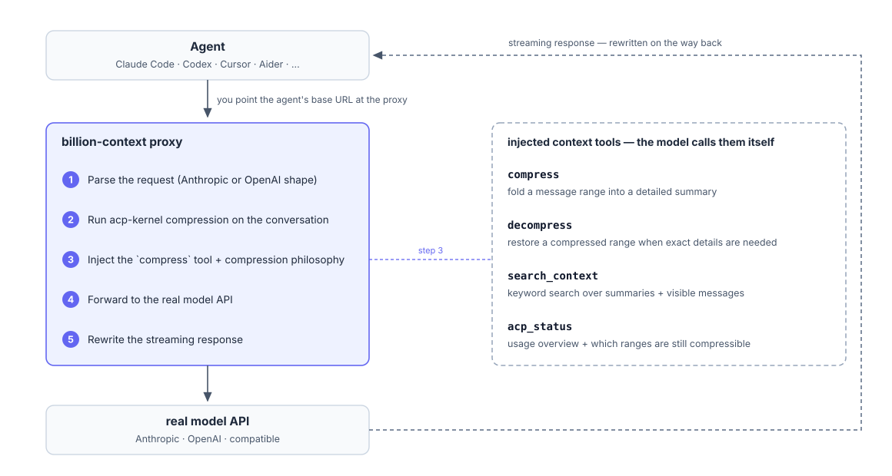
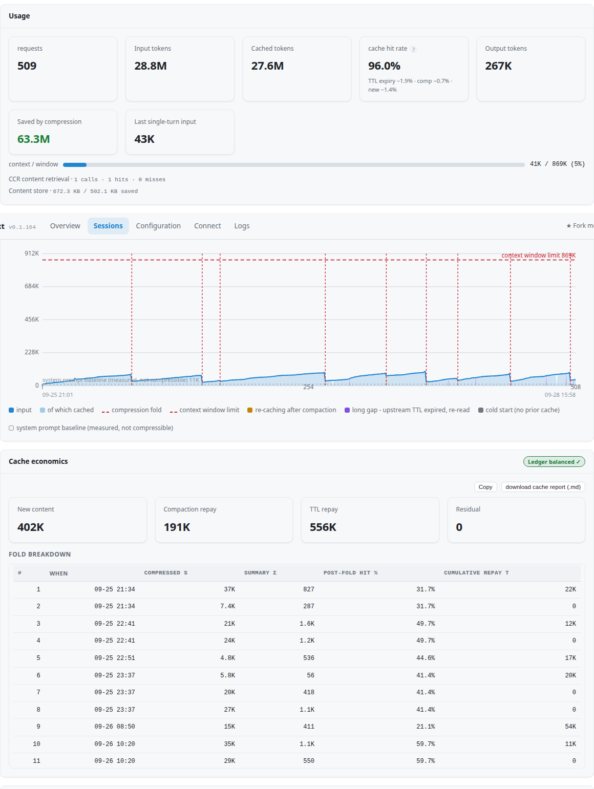

# billion-context

<p align="center"><a href="./README.md">English</a> | <a href="./README.zh-CN.md">中文</a> | <a href="./README.ja.md">日本語</a></p>

<p align="center"><strong>コンテキスト圧縮プラグイン</strong> — <em>billion-context is all you need.</em></p>

<p align="center"><sub>小さなコンテキストウィンドウ（100K で十分） · <em>トークンを 5 分の 1 に</em> · 1 か月続く単一のセッション（数十億トークン） · 高い圧縮品質</sub></p>

<p align="center">
<a href="https://www.npmjs.com/package/billion-context"></a>
<a href="https://github.com/ranxianglei/billion-context/blob/master/LICENSE"></a>
<a href="https://github.com/ranxianglei/billion-context"></a>
</p>

<p align="center">
<code>npm install -g billion-context --prefix=~/.local</code>
</p>

<p align="center">
<a href="https://claude.com/product/claude-code" title="Claude Code"></a>&nbsp;
<a href="https://github.com/openai/codex" title="Codex"><picture><source media="(prefers-color-scheme: dark)" srcset="https://api.iconify.design/simple-icons/openai.svg?color=white"></picture></a>&nbsp;
<a href="https://opencode.ai" title="OpenCode"><picture><source media="(prefers-color-scheme: dark)" srcset="https://cdn.simpleicons.org/opencode/FFFFFF"></picture></a>&nbsp;
<a href="https://pi.dev" title="pi"><picture><source media="(prefers-color-scheme: dark)" srcset="https://cdn.simpleicons.org/pi/FFFFFF"></picture></a>&nbsp;
<a href="https://github.com/google-gemini/gemini-cli" title="Gemini CLI"></a>&nbsp;
<a href="https://www.kimi.com" title="Kimi"><picture><source media="(prefers-color-scheme: dark)" srcset="https://cdn.simpleicons.org/kimi/FFFFFF"></picture></a>&nbsp;
<a href="https://github.com/QwenLM/qwen-code" title="Qwen Code"></a>&nbsp;
<a href="https://github.com/github/copilot-cli" title="GitHub Copilot CLI"><picture><source media="(prefers-color-scheme: dark)" srcset="https://cdn.simpleicons.org/githubcopilot/FFFFFF"></picture></a>&nbsp;
<a href="https://www.trae.ai" title="TRAE"></a>&nbsp;
<a href="https://www.codebuddy.cn" title="CodeBuddy"></a>&nbsp;
<a href="https://qoder.com" title="Qoder"></a>&nbsp;
<a href="https://iflow.cn" title="iFlow CLI"></a>&nbsp;
<a href="https://www.minimax.io" title="MiniMax Code (mcode)"></a>&nbsp;
<a href="https://www.deepseek.com" title="deepseek-harness (dsh)"></a>&nbsp;
<a href="https://ampcode.com" title="Amp"></a>&nbsp;
<a href="https://charm.land/crush" title="Crush"></a>&nbsp;
<a href="https://zed.dev" title="Zed"></a>&nbsp;
<a href="https://aider.chat" title="aider"></a>&nbsp;
<a href="https://github.com/aaif-goose/goose" title="goose"><picture><source media="(prefers-color-scheme: dark)" srcset="https://raw.githubusercontent.com/aaif-goose/goose/main/documentation/static/img/logo_dark.png"></picture></a>&nbsp;
<a href="https://github.com/NousResearch/hermes-agent" title="hermes"></a>&nbsp;
<a href="https://z.ai" title="zcode (Z.ai)"></a>&nbsp;
<a href="https://omp.sh" title="omp (oh-my-pi, Stencil Labs)"></a>&nbsp;
<a href="https://github.com/1jehuang/jcode" title="jcode"></a>
</p>

---

> **キャッシュの健全性をひと目で：** 健全なセッションでは、プレフィックスキャッシュのヒット率が **95〜97%** に保たれ、圧縮そのもののコストは 2% 以下です。それより低い状態が続く場合は、`/acp` か `/acp-cache` で原因を確認してください（[FAQ](#faq) を参照）。よくある原因は、多い順に、上流のキャッシュの TTL 切れ · モデルの切り替え · bili のバグ（報告してください） · その他／不明です。

## コミュニティ

QQ グループ：
1056132097（満員）
1108730198（満員）
1129868472（参加可能）

---

## 📄 論文／プレプリント

- **[Model-Driven Incremental Hierarchical Compression: Training-Free Multi-Generational Context Management for Long-Lived Coding Agents](./paper/model-driven-incremental-hierarchical-compression-training-free-multi-generational-context-management-for-long-lived-coding-agents.md)**（英語、v0.2）

> 📝 **論文そのものも、コードベースの一部（`paper/`）として MIT License のもとでオープンソース化されています。これは更新され続ける文書で、誰でも編集でき、プルリクエストによる改善を歓迎します。**

本番規模の長期的な研究です：4.5 か月、3 つのホスト、174,327 回のモデル呼び出し、累計 187.6 億の入力トークン（全ホストで約 247 億）、204,800 トークンのモデルでのウィンドウ超過ゼロ、8,584〜12,049 回の呼び出しに及ぶマラソンセッション。

### 📊 独立した第三者によるベンチマーク

- **[1,500 項目のクロスベンチマーク評価（`LongMemEval-S` · `ContextBench` · `MemoryAgentBench`）](./benchmarks/third-party-1500/README.md)**（[中文版](./benchmarks/third-party-1500/README.zh-CN.md)）— `billion-context`（`v0.1.202`）を、`full` のコンテキストと 3 種類の RAG（`bm25`、`embedding`、`embedding-rerank`）と、`DeepSeek V4.1 Flash`、`Qwen3-Embedding-8B`、`Qwen3-Reranker-4B`、`Pi Agent` を使って直接比較しました：**ContextBench で 1 位**（Utilized F1 `0.3097`、`full` に比べてコスト `-58.3%`）、**LongMemEval-S で最良の RAG を +16.6% 上回る**（`79.20%` 対 `62.60%`、独立セッションのコストは `full` に比べて `-71.1%`）、**148 万トークンの MemoryAgentBench TTL で生存率 100%**（`full` が `199/199` で失敗するところで、定常状態で `30×` の圧縮）。

---

`billion-context` は**あらゆる**エージェントとそのモデル API の間に入り、[acp-kernel](https://github.com/ranxianglei/acp-kernel) による圧縮で Anthropic/OpenAI のストリームを書き換えます。**いつ**、**何を**高い忠実度の要約に圧縮するかはモデルが決めます。固定の切り詰めの上限ではありません。

## なぜ必要か

長いコーディングセッションでは、コンテキストが膨れ上がります。どのプロバイダーもトークンごとに課金し、コンテキストウィンドウを超えるとセッションは劣化するか止まってしまいます。`billion-context` は、消費済みの会話を階層的な要約に圧縮するので、1 つのセッションを何日も動かせます。1 つのコンテキストウィンドウで数十億トークンを扱えます。

ホストに組み込まれた要約機能と違い、ここでの圧縮は**段階的で、元に戻せ、プレフィックスキャッシュに優しい**ものです：要約は小さな範囲ごとに書かれ、必要なときに展開し直せ、キャッシュのプレフィックスはそのまま保たれます。

## 仕組み



### コンテキスト管理ツール

プロキシは会話に 4 つのコンテキスト管理ツールを注入します。コンテキストが大きくなるにつれてモデル自身がそれらを呼び出し、プロキシは `compress` をサーバー側で実行するので、折りたたんだ範囲は復元されるまで履歴の中で要約されたままになります：

- **`compress`** — メッセージの範囲を詳しい要約に折りたたみます。
- **`decompress`** — 正確な詳細がもう一度必要になったときに、圧縮した範囲を復元します。
- **`search_context`** — 圧縮した要約と表示中のメッセージを対象に、キーワードで検索します。
- **`acp_status`** — コンテキストの使用状況の概要と、まだ圧縮できる範囲を示します。

## どれを使えばよいか

クライアントで選んでください：

| クライアント | 使うもの |
|---|---|
| **pi** | [`billion-context`](https://github.com/ranxianglei/billion-context) — `bili pi`（ランチャー）または `bili plugin install pi`（ネイティブ）。単体の [`billion-context-pi`](https://github.com/ranxianglei/billion-context-pi) も引き続き使えます — 詳細：[docs/clients.md](docs/clients.md#pi-pidev-coding-agent) |
| **opencode**（1.x / 2.x） | [`billion-context`](https://github.com/ranxianglei/billion-context) — `bili opencode`（ランチャー）または `bili plugin install opencode`（ネイティブ）。単体の [`opencode-acp`](https://github.com/ranxianglei/opencode-acp) も 1.x では引き続き使えます — 完全なガイド：[OpenCode](docs/clients.md#opencode) |
| **omp** | `bili omp`（組み込みのプラグイン）または `bili plugin install omp`（自分でプロキシを起動するネイティブプラグイン、ランチャー不要）経由の [`billion-context`](https://github.com/ranxianglei/billion-context) |
| **dsh** | `bili dsh`（ランチャー — `--patch` による完全なネイティブプラグイン）または `bili plugin install dsh` ≡ `dsh plugin --profile <name> add billion-context`（1 つに統一された経路） — 詳細：[docs/clients.md](docs/clients.md) |
| **kimi** | `bili plugin install kimi`（自分でプロキシを起動するネイティブ、Kimi Code ≥ 2.0.0）、`bili kimi`（証明書による MITM）、または `/bili/` プレフィックス — 詳細：[docs/clients.md](docs/clients.md) |
| **hermes** | `bili plugin install hermes`（自分でプロキシを起動するネイティブ、Python プラグイン #958）または `bili hermes`（証明書による MITM） |
| **zcode**（Z.ai / bigmodel のコーディングプラン） | `bili plugin install zcode`（自分でプロキシを起動するネイティブ、#1145）、GUI の Settings → Network による証明書の MITM、または `/bili/` プレフィックス — 詳細：[docs/clients.md](docs/clients.md) |
| **claude** | `bili claude`（ランチャー）または `bili plugin install claude`（ネイティブの構成、#964 — 管理された設定ブロック ＋ セッションが所有するプロキシ。下の注意を参照） |
| **codex** | `bili codex`（ランチャー — 設定不要の完全な構成）または `bili plugin install codex`（MCP シェルのツールの補助：**先に bili を起動してください** — シェルがプロキシを起動することはなく、codex 自身の通信を振り向けることもありません） — 詳細：[docs/clients.md](docs/clients.md#codex-openai-codex-cli) |
| **jcode** | `bili jcode`（証明書による MITM）または `/bili/` プレフィックス経由の [`billion-context`](https://github.com/ranxianglei/billion-context) — ネイティブモードはありません（コンパイル済みの Rust バイナリで、プラグインの差し込み口がありません。[#962](https://github.com/ranxianglei/billion-context/issues/962)） |
| **gemini**（Gemini CLI） | `bili gemini`（ランチャー、`GOOGLE_GEMINI_BASE_URL` の `/bili/` 書き換え）または `/bili/` プレフィックス — ランチャーのみ（ループ内でツールを差し込む口がありません、#1043） |
| **iflow**（iFlow CLI） | `bili iflow`（ランチャー、`IFLOW_BASE_URL` の `/bili/` 書き換え）または `/bili/` プレフィックス |
| **qwen**（Qwen Code） | `bili qwen`（ランチャー、証明書による MITM）または `/bili/` プレフィックス |
| **antigravity**（Antigravity CLI / agy、Google） | `bili antigravity`（ランチャー、daily-cloudcode-pa.googleapis.com の `CLOUD_CODE_URL` の `/bili/` 書き換え — Antigravity の実際のデフォルトの上流、#3129）または `/bili/` プレフィックス — プラグインの差し込み口はありません（クローズドな Go の language_server で、ユーザープラグインの面は追加のみ、#2115） — 詳細：[docs/clients.md](docs/clients.md) |
| **mcode**（MiniMax Code） | `bili mcode`（証明書による MITM）または `/bili/` プレフィックス経由の [`billion-context`](https://github.com/ranxianglei/billion-context) — ネイティブモードはありません（イベントのフックのみで、モデルへのリクエストの差し込み口がありません。[#1050](https://github.com/ranxianglei/billion-context/issues/1050)） |
| **aider** | `bili aider`（証明書による MITM）または `/bili/` プレフィックス経由の [`billion-context`](https://github.com/ranxianglei/billion-context) — ネイティブモードはありません（シェルコマンドだけのフックで、ツールを注入する口がありません。[#1048](https://github.com/ranxianglei/billion-context/issues/1048)） |
| **copilot**（GitHub Copilot CLI） | `bili copilot`（ランチャー、証明書による MITM） — クローズドな Go のバイナリで、プラグインの差し込み口はありません（#1049） |
| **amp**（Amp CLI） | `bili amp`（ランチャー、証明書による MITM） — クローズドな Go のバイナリで、プラグインの差し込み口はありません（#1049） |
| **kiro**（Kiro CLI、AWS） | `bili kiro`（ランチャー、証明書による MITM） — Rust のシェル ＋ Node のエージェントサーバーで、プラグインの差し込み口はありません。モデルの通信は `runtime.<region>.kiro.dev` 上の Responses の通信形式で、ゲートウェイ特有の癖は組み込みで処理します — 詳細：[docs/clients.md](docs/clients.md#kiro-cli-aws) |
| **crush**（Charm Crush） | `bili crush`（ランチャー、証明書による MITM） — オープンソースの Go のバイナリで、プラグインの差し込み口はありません。組み込みのプロバイダーのホストは許可リストに入り、独自の `base_url` は crush.json から自動で見つけます（#2340） |
| **zed**（Zed エディター） | `bili zed`（ランチャー、証明書による MITM） — オープンソースの Rust のエディターで、プラグインの差し込み口はありません。reqwest は HTTPS_PROXY に従い、CA は SSL_CERT_FILE で渡します（Linux の環境変数の探索）。組み込みのプロバイダーのホストは許可リストに入り、独自の `api_url` は settings.json から自動で見つけます。ループバックのプロバイダー（ollama/lmstudio）は NO_PROXY で直接接続のままです（#2340） |
| **goose**（Goose CLI） | `bili goose`（ランチャー） — rustls は CA ファイルを信頼しないので、証明書による MITM はできません：openai/anthropic の経路は `OPENAI_HOST`/`ANTHROPIC_HOST` で、独自のプロバイダーは作り直した `GOOSE_PATH_ROOT` のオーバーレイで扱います（#1049） |
| **それ以外のすべて**（コンテキストのフックなし） | [`billion-context`](https://github.com/ranxianglei/billion-context) — `bili <client>`（ランチャー、推奨）または `/bili/` プレフィックス |

**ネイティブモードと単体の拡張機能。** ホストのネイティブプラグイン（`bili plugin install …`）と、単体のプロセス内拡張機能（`billion-context-pi`、`opencode-acp`）は**同時に使えません**。両方が有効だと二重に圧縮されてしまいます。切り替えはインストーラーが行います：古い項目（名前だけのもの、`npm:` の別名、バージョン付き、パスの形式。配列でもオブジェクトでも）を置き換え、元の設定を一度だけ `.bili-bak` にスナップショットします。**プロジェクトのローカル**のインストールには手を付けないので、それは手で削除してください。手動でインストールした場合の実行時の安全網として、ネイティブの項目は読み込み時に同期的に `BILLION_CONTEXT_NATIVE=<host>` を設定するので、単体の拡張機能は動作時に身を引けます。pi 側では、この印を使うには `billion-context-pi` **0.1.72 以降**が必要です。また、pi のネイティブの項目は、プロキシが起動したあとで pi の両方の設定ファイルを走査し、インストーラーが見ていない古い項目が同居していると大きく警告します。古い `billion-context-pi` が黙って二重に圧縮している間、目に見える合図はこの警告だけです。


## インストール

Linux / macOS — ユーザー単位のプレフィックスでインストールします（`sudo` も npm の設定の変更も不要で、
`bili` の自己アップデートが権限エラーに当たることもありません）：

```bash
npm install -g billion-context --prefix=~/.local
```

`bili` コマンドは `~/.local/bin` に入ります。ほとんどのディストリビューションでは、すでに PATH に入っています。
入っていなければ、`~/.bashrc` か `~/.zshrc` に `export PATH="$HOME/.local/bin:$PATH"` を
追加してください。nvm や Homebrew の Node では、デフォルトのプレフィックスがすでにユーザーの所有なので、
普通の `npm install -g billion-context` でそのまま動きます。Windows でも、デフォルトの
プレフィックス（`%APPDATA%\npm`）はユーザーが書き込めるので、普通の `npm install -g billion-context` で動きます。

これで `bili` コマンドがインストールされます（`bili-proxy` も別名として残してあります）。root が所有する古いプレフィックスで
`EACCES` に当たった場合は、`--prefix=~/.local` を付けてインストールし直してください
（今後 npm で `bili` をインストールし直すときも、このフラグをもう一度付けてください）。これが
根本的な解決策です。`sudo` は避けてください。

コンテナーのほうがよいですか？ リポジトリのルートに `Dockerfile` があります。下記の
[Docker で動かす](#docker-で動かす)を参照してください。

## クイックスタート

使い方は 3 つあります。1 つ選んでください：

- **ネイティブプラグイン（最もネイティブ）：** `bili plugin install <client>` — bili が
  クライアントの中のプラグインになります。クライアントはいつもどおり起動します。
- **ランチャー（設定不要）：** `bili <client>` のコマンド 1 つで、プロキシとクライアントを
  いっしょに起動します。本物の設定ファイルに手を付けることはありません。
- **URL の変更（最も汎用的）：** クライアントの baseURL の前に、プロキシの
  オリジン ＋ `/bili/` を付けます。

これら 3 つの方法の裏にある仕組み（プラグインのライフサイクル、runtime-info の
プロトコル、注入の優先順位）は [docs/technical-notes.md](docs/technical-notes.md) にあります。

ポートについて手短に（#1660）：`bili start`（手動）は `8787` を使います。レーンが
自動で起動するもの（ネイティブのフック、ランチャーのレーン）はすべて、`18787` から始まる
自己管理の別の区画に置かれます。衝突すると +1 ずつずれ、各レーンは
そのずれを記憶するので、設定不要のインストールがポートを奪い合うことはありません。
意図的に起動した `bili start` のデーモンには、デフォルトでつながります。どこにつながるかは
レーンごとに決まります（#2905）：フックはまず自分のレーンのインスタンスを使い、
宣言された別のレーンのものには決してつながりません。
ただし `native.attachLanePriority` に並べたレーンは例外です。8787 のユーザー区画のデーモンは
最後の手段のフォールバックのままです。
アップグレードのための再起動で、前のビルドがまだそのレーンのポートで処理を終えようとしている場合は、
それがポートを解放するのを待ち（最大 5 秒）、ずらさずに同じポートにバインドし直します
（#1723）。本当に使われているポートだけが +1 ずれ、その移動は
はっきりとログに記録されるようになりました。

### 方法 1 — ネイティブプラグイン（`bili plugin install pi` / `omp` / `opencode` / `dsh` / `kimi` / `hermes` / `zcode`）

プロキシはクライアントの中に入ります。一度インストールすれば、あとはクライアントを
いつもどおり起動するだけです。ランチャーのコマンドも、環境変数も、固定のポートも、
URL の編集も要りません。現在、**pi**、**omp**、**opencode**（1.x と
2.x）、**dsh**、**kimi**、**hermes**、**zcode** に対応しています：

```bash
bili plugin install pi          # registers a "billion-context" entry in pi's settings (npm form when bili itself was npm-installed)
bili plugin install omp         # registers an extensions entry in omp's config.yml (~/.omp/agent/config.yml)
bili plugin install opencode    # registers the plugin in opencode's real config + disables native auto-compaction
bili plugin install dsh         # runs 'dsh plugin --profile <name> add billion-context' for every existing profile
bili plugin install kimi        # writes $KIMI_CODE_HOME/plugins/managed/billion-context/kimi.plugin.json (+ installed.json record); per-session routing block lands in config.toml on first start (Kimi Code >= 2.0.0)
bili plugin install hermes      # copies the Python plugin into ~/.hermes/plugins/billion-context/ (+ machine-owned bili.json sidecar) and enables it via `hermes plugins enable billion-context`
bili plugin install zcode       # writes hooks.enabled + a SessionStart hook + mcp.servers.bili into ~/.zcode/cli/config.json; per-session routing lands in the bigmodel provider store on first start
bili plugin remove <client>     # undo (dsh removes through the same channel; config snapshots go to .bili-bak)
```

クライアントに独自のプラグインの経路がある場合は、bili のコマンドを使わずに
ネイティブにインストールすることもできます：

- **dsh：** `dsh plugin --profile <name> add billion-context` は、`bili plugin install dsh` が
  プロファイルごとに実行するコマンドそのものです（npm の形式のみ。git の
  チェックアウトには公開済みのエントリーがなく、GitHub のアドレスを貼り付けると `dist/` のない
  ソースがインストールされ、バンドルが読み込まれません）。どちらの方法でも最終的な状態は同じです
  （プロファイルに pnpm でインストールし、同梱のパッチレイヤーを dsh 自身がマウントします）。削除も
  同じ経路で行います。下記の dsh のセクションを参照してください。
- **opencode：** 本物の設定のプラグインの一覧に、npm の名前だけを追加します —
  `"plugin": ["billion-context"]`（npm の形式のみ。git のチェックアウトには
  公開済みのエントリーがありません）。パッケージは `exports["./server"]` →
  `dist/agent/opencode-native.js` を公開しているので、opencode は自身の
  Npm.add の仕組みでそれを読み込み、プラグインは bili でインストールした形式と
  まったく同じように自分でプロキシを起動します。bili のインストーラーが代わりにやっていた
  2 つのことも行ってください：同じ設定で `"compaction": { "auto": false }` を設定すること
  （そうしないと OpenCode のネイティブの自動圧縮で二重に圧縮されます）と、先にファイルを
  手動でバックアップしておくことです。
- **claude：** このリポジトリは Claude Code のプラグインのマーケットプレイスも兼ねています —
  `/plugin marketplace add ranxianglei/billion-context` のあと、
  `/plugin install billion-context@billion-context` を実行し、さらに
  `/billion-context:bili-setup` を実行します（これが `bili plugin install claude` を
  代わりに実行し、再起動するよう伝えます）。最終的な状態は bili のインストーラーと同じです。
  このプラグイン自身はフックも MCP の項目も持たないので、何も
  二重に登録されません。

pi / omp / kimi / claude には、クライアント側の経路がありません。`bili plugin
install <client>` がそれらの設定の項目を代わりに書き込みます（kimi の宣言的な
`kimi.plugin.json` ＋ レジストリの記録、claude の管理された設定ブロックなど）。

注意：

- ネイティブモードは、単体のプロセス内拡張機能（`billion-context-pi`、`opencode-acp`）と**同時に使えません**。インストーラーが項目を入れ替え、元の設定をスナップショットします（`.bili-bak`）。
- **pi：** ネイティブのインストールでは、デフォルトで組み込みのサブエージェント（`acp_delegate` / `acp_delegate_wait` / `acp_delegate_cancel`）が組み込まれます。コンテキストの圧縮は残したままそれらを無効にする方法：[pi の組み込みサブエージェント](#pi-の組み込みサブエージェント)。
- OpenCode の古いセッション、V1/V2 の形、注意点：[OpenCode](docs/clients.md#opencode)。
- `kimi` は runtime-info を起動時にだけ報告します（静的なヘッダーでは、リクエストごとのウィンドウやモデルの値を運べません）。サブエージェントのツール呼び出しは、プロキシの外向きの tool-use の目撃記録のリング（#1685）で振り分けます。モデルから見える会話の id はありません。
- `hermes` のネイティブプラグインは Python です：ヘルスチェックのあとで環境変数によって hermes の httpx のスタックをプロキシに向け、`llm_request` のミドルウェアでリクエストごとのヘッダーを付けます。
- `codex` は、プラグインのインストールだけでは自立させられない唯一のクライアントです：codex はモデルの通信を環境変数だけで振り向けます（デフォルトの ChatGPT ログインのプロバイダーには、設定ファイルで振り向ける差し込み口がありません。管理された `model_providers` ブロックを置くと API キーでの認証が強制され、サブスクリプションのログインが使えなくなります）。また、MCP サーバーは親に環境変数を注入できません。`bili plugin install codex` は `~/.codex/config.toml` に `[mcp_servers.bili]` ブロックを 1 つだけ書き込み（command = node、args = dist/mcp.js）、4 つの ACP ツールを公開します。セッションの開始時に、シェルはプロキシを決めます — 環境変数 `BILI_MCP_PROXY` > 動いているインスタンスの記録（どのレーンのプロキシでも、`bili start` のデーモンでも） > 8787 のユーザー区画のデフォルト（#1660 でインストール時のオリジンの焼き込みを廃止、#403）。どれにも届かないと `tools/list` が -32003 で失敗します。そのため：先に bili を起動する（`bili start` か、いずれかのクライアントのレーンのプロキシ）、圧縮も使いたいなら HTTPS_PROXY を自分で export する、あるいは設定不要の完全な構成のために `bili codex` を使ってください。仕組み：[docs/clients.md](docs/clients.md#codex-openai-codex-cli)。
- `claude` にはネイティブの構成があります（#964）：管理された設定ブロック ＋ `SessionStart` のフック ＋ MCP シェルです。フックは自己管理のポートの区画（#1660）を使い、セッションごとに管理された URL を動いているオリジンに付け直すので、ポートのずれは自然に直ります。#1821 以降、MCP シェルはセッション中もプロキシを見張り（30 秒ごと × 3 回の失敗）、死んだレーンのプロキシを自分で起動し直すので、モデルへのリクエストは新しいセッションを始めなくても約 90 秒以内に回復します（zcode のレーンと同じ意味です）。`BILI_NATIVE_CLAUDE=0`（パススルー）で無効にできます。仕組み：[docs/technical-notes.md](docs/technical-notes.md)。**既知の制限（#2290）：** Claude Desktop アプリの Code タブ（`CLAUDE_CODE_ENTRYPOINT=claude-desktop`）は、組み込みの Claude Code に独自の `ANTHROPIC_BASE_URL` を設定し、管理されたものを上書きします。デスクトップのセッションはプロキシを完全に迂回する一方で、管理されたブロックの `DISABLE_AUTO_COMPACT=1` は引き続き効くので、bili の圧縮もネイティブの自動圧縮も使えなくなります。フックはセッションの開始時に大きく警告します（そして `bili doctor` 用に記録します。これは、ネイティブのレーンと並んで Claude Desktop がインストールされているマシンにも印を付けます）。ターミナルのセッションには影響しません。**2026-10-06 に実地で確認（#2290）：** 設定の `env` ブロックに `HTTPS_PROXY` を置いても、Claude Desktop 2.19675.1 / 組み込みの CC 2.1.288（Windows 11）では、MITM を有効にした動作中のプロキシへの CONNECT の通信はゼロでした。その変数はそこではどのネットワークのスタックにも届かず、当時の CLI の挙動と一致します。新しいビルド（CC 2.1.301 以降）では CLI が `HTTPS_PROXY` に従うので、`bili claude` は `/bili/` のベース URL の書き換えで振り向けています。ランチャーはこのレーンにプロキシも CA もまったく渡さず、自分でプロキシを持ち込む子プロセスには、ループバックのホストを `NO_PROXY`/`no_proxy` に追加するので、その経路はプロキシの挙動に関係なく直接接続のままです（#3446）。そのバージョンの時点で、デスクトップの Code タブには使える振り向けの差し込み口がありません。上流が挙動を変える場合に備えて、このレーンは [#2290](https://github.com/ranxianglei/billion-context/issues/2290) で引き続き追跡しています。**アカウントに結び付いた機能（#4693）：** このレーンは独自の `ANTHROPIC_BASE_URL` で振り向けるため、Claude Code はセッションをサードパーティ／API キーのものとして扱い、Anthropic のアカウント／Cloud に結び付いた機能を無効にします。**Remote Control**（`/remote-control`、モバイル／デスクトップ／Web からローカルのセッションを操作するもの）は、bili が通信を振り向けている間、コマンドの一覧から消えます。圧縮には影響しません。それらの機能が必要なセッションでは、bili なしで普通の `claude` を実行してください（または `bili plugin remove claude`）。これはベース URL で振り向ける差し込み口に本来備わったもので（CC の undici のスタックで生き残る代わりの横取りの地点はありません、#2290）、設定が消されたわけではありません。デスクトップだけを使う人は、`bili plugin remove claude` でネイティブの自動圧縮を戻せます。#5095 以降、管理されたブロックは `SubagentStart` のフック（`node <root>/dist/claude-subagent-hook.js`）もインストールし、各サブエージェントのコンテキストに、ディスパッチごとのレーンのトークンを発行します：エージェント id のヘッダーなしで親のセッション id を使うサブエージェント（VS Code の拡張機能のビルド、#4352）は、それぞれ自分の `<id>|sub:…:t:<token>` の圧縮レーンに振り分けられるので、同じ種類の並列のディスパッチが混ざらなくなります（そして最初のメッセージが折りたたまれると、以降のリクエストからトークンは消え、それらはフィンガープリントのレーンにフォールバックします）。アンインストールすると、管理されたブロックとともにフックも削除されます。
- `zcode` にはネイティブの構成があります（#1145）：管理された `~/.zcode/cli/config.json` のブロック ＋ セッションごとのプロバイダーの `baseURL` の書き換えです。仕組みの詳細：[docs/clients.md](docs/clients.md)。
- `jcode` と `aider` にはネイティブモードがありません（プラグイン／MCP／ツール注入の差し込み口がありません：#962、#1048）。`bili jcode` / `bili aider` を使ってください。
- `copilot`、`amp`、`goose` はランチャーのみです（#1049）。goose は証明書による MITM ができず（rustls は CA ファイルを信頼しません）、代わりに平文の HTTP のベース URL のリダイレクトを使います。

### 方法 2 — ランチャー（`bili pi` / `bili codex` / `bili claude` / `bili omp` / `bili opencode` / `bili hermes` / `bili dsh` / `bili codebuddy` / `bili qoder` / `bili trae` / `bili jcode` / `bili kimi` / `bili gemini` / `bili iflow` / `bili qwen` / `bili antigravity` / `bili mcode` / `bili aider` / `bili copilot` / `bili amp` / `bili goose` / `bili kiro`）

ランチャーは、クライアントを 1 つのコマンドで包みます：独立したポートでプロキシを起動し
（常に新しいインスタンスを起動し、ポートを使い回すことはありません）、クライアントをそこに向けます。
クライアントがプロキシ／CA の環境変数に従う場合は**証明書による MITM** を、
従わない場合は分離した **`/bili/` の設定の書き換え**を使います。
本物の設定ファイルを編集することはありません。
クライアント自身の設定は、どの HTTPS の上流のホストと通信するかを知るために読み込むだけで、
それらのホストを MITM の許可リストに入れるので、プロキシはちょうどそれらのホストだけで TLS を終端し、
それ以外はすべて中身を見ずにトンネルします。

```bash
bili pi                               # launch pi through the proxy — file-free (#535): env + extension registerProvider, real ~/.pi untouched
bili codex                            # launch codex through the proxy
bili claude                           # launch claude through the proxy
bili omp                              # pi-style, file-free (#535): env + extension registerProvider + compaction cancel, real ~/.omp untouched
bili opencode                         # OpenCode (1.x & 2.x): full guide in the [OpenCode](docs/clients.md#opencode) section below
bili hermes                           # file-free (#535): hermes proxy env (HTTPS_PROXY + combined CA bundle via SSL_CERT_FILE) — https via CONNECT MITM, http via absolute-form forward proxy; real ~/.hermes untouched
bili dsh                              # deepseek-harness: full native plugin injected via --patch (#941) — real dsh tools, session-bound /acp + /acp-cache (plugin mode); non-loopback upstreams ride proxy envs, loopback keeps the overlay DSH_HOME rewrite (#535); dsh auto-compaction off everywhere — host plane via the bundle patch, web-profile presets at load time (#1772/#2474/#3354)
bili codebuddy                        # Tencent CodeBuddy Code CLI: CODEBUDDY_BASE_URL /bili/ rewrite (OpenAI chat completions wire), budget aligned via CODEBUDDY_AUTO_COMPACT_WINDOW; real ~/.codebuddy untouched
bili qoder                            # qoder CLI (`qoder`/`qodercli`): model endpoint is hardcoded https (no /bili/ rewrite possible) — cert-MITM via HTTPS_PROXY + NODE_EXTRA_CA_CERTS, default model hosts whitelisted (#653). Qoder Desktop is a separate BYOK/custom channel that speaks plaintext OpenAI over a `/bili/` prefix — point it at bili as a normal custom provider (not this MITM lane); its official-subscription traffic is encrypted and out of scope (#764)
bili trae                             # Trae CLI (ByteDance, closed Go binary, no base-URL override) — cert-MITM via HTTPS_PROXY + SSL_CERT_FILE, model host from TRAE_CLI_API_HOST or the default enterprise gateway (#655)
bili jcode                            # jcode (Rust agent harness) — env-only cert-MITM launch: HTTPS_PROXY + SSL_CERT_FILE, model host api.z.ai whitelisted, local loopback providers stay direct via NO_PROXY
bili kimi                             # Kimi Code CLI (Moonshot): standard proxy envs except an unconditional loopback bypass — https via cert-MITM, http via absolute-form forward proxy; loopback endpoints inventoried with a manual /bili/ hint (#757)
bili gemini                           # Gemini CLI (Google): GOOGLE_GEMINI_BASE_URL /bili/ rewrite to generativelanguage.googleapis.com (Google native wire), real ~/.gemini untouched
bili iflow                            # iFlow CLI: IFLOW_BASE_URL /bili/ rewrite to apis.iflow.cn/v1 (OpenAI chat-completions wire), real ~/.iflow untouched
bili qwen                             # Qwen Code (multi-protocol gemini-cli fork, no base-URL hook): cert-MITM via HTTPS_PROXY + NODE_EXTRA_CA_CERTS, default DashScope/Qwen model hosts whitelisted, custom relays via --mitm-domain
bili antigravity                      # Antigravity CLI (agy, Google): CLOUD_CODE_URL /bili/ rewrite of daily-cloudcode-pa.googleapis.com — the real default upstream (bare cloudcode-pa 400s on /v1internal:*, #3129); undocumented language-server env override, v2.19.1 binary-verified; wire recognized as Google native by path (#2115)
bili mcode                            # MiniMax Code CLI: same shape as kimi (proxy envs, unconditional loopback bypass, cert-MITM/absolute-form); session bound via X-Mavis-Session-Id (#1050)
bili aider                            # Aider (Python pair programmer): cert-MITM via HTTPS_PROXY + SSL_CERT_FILE/REQUESTS_CA_BUNDLE; endpoint from OPENAI_API_BASE / ANTHROPIC_BASE_URL / --openai-api-base / .aider.conf.yml (#1048)
bili copilot                          # Copilot CLI (GitHub, closed Go binary) — cert-MITM via HTTPS_PROXY + SSL_CERT_FILE, api.githubcopilot.com + per-plan subdomains whitelisted (#1049)
bili amp                              # Amp CLI (Sourcegraph, closed Go binary) — cert-MITM via HTTPS_PROXY + SSL_CERT_FILE, ampcode.com whitelisted (#1049)
bili goose                            # Goose (Block, Rust/reqwest): rustls release builds trust no CA file — openai/anthropic legs via OPENAI_HOST/ANTHROPIC_HOST, custom providers via a regenerated GOOSE_PATH_ROOT overlay (/bili/ rewrites, real config untouched) (#1049)
bili kiro                             # Kiro CLI (AWS): cert-MITM via HTTPS_PROXY + combined CA on SSL_CERT_FILE and NODE_EXTRA_CA_CERTS; only runtime.<region>.kiro.dev is decrypted; developer/system items re-voiced as user for the gateway; session = Kiro's conversation id (survives --resume)
bili pi --mitm-domain api.foo.com     # add a domain to the MITM whitelist
```

### 方法 3 — URL の変更（`/bili/` プレフィックス）

プロキシを起動します：

```bash
bili
```

あとは、クライアントの既存の baseURL の前に `http://localhost:8787/bili/` を付けるだけです。
上流の完全な URL がパスに埋め込まれるので、プロキシは設定なしで
転送先がわかります：

```
client baseURL before:  https://api.openai.com/v1
client baseURL after:   http://localhost:8787/bili/https://api.openai.com/v1
```

クライアントごとの設定の例は、Web UI のガイド [http://localhost:8787](http://localhost:8787) を参照してください。

**確認する。** プロキシが動いていて設定を保存したら、プロキシが応答することと、
最初の実際のリクエストで圧縮の動きがログに出ることを確認します：

```bash
# Health check (proxy up + where it forwards)
curl -s http://localhost:8787/__bili/health
# → {"ok":true,"upstream":"https://api.anthropic.com"}

# Live session stats (after a real request)
curl -s http://localhost:8787/__bili/stats
```

それからクライアントからメッセージを 1 つ送り、ログを見てください
（`~/.local/state/billion-context/bili.log`。stderr にも出力されます）。
リクエストごとに `processTurn` の行が出て、会話が大きくなると、
`[acp-usage] round N input=X cached=Y (cache hit Z%)` ＋ `compress` のイベントが出るはずです。

### クライアントごとの詳細

クイックスタートの 1 行に収まらないこと — 各クライアントのレーンがどうつながるか、何がどこに書き込まれるか、既知の制限 — はすべて **[docs/clients.md](docs/clients.md)** にあります：dsh · Kimi Code · Hermes · ZCode · Gemini 系（Gemini CLI / iFlow CLI / Qwen Code / Antigravity） · 決して圧縮されない証明書 MITM のクライアント（CONNECT の中身を見ないトンネル、#897） · 直接接続になる未知のエンドポイント（#1290） · OpenCode（ランチャー／ネイティブ／純粋なプロキシ、`/acp` の状態とルール、古い opencode-acp のセッション #920）。

## ソースから（開発）

> **注意：** `master` は開発用のブランチで、いつ壊れていてもおかしくありません。未リリースの変更、失敗するビルド、未検証の修正が含まれます。コードにパッチを当てるか、未リリースの修正を試すのでない限り、上記のとおり npm でリリース版をインストールしてください。

```bash
git clone https://github.com/ranxianglei/billion-context.git
cd billion-context
npm ci
npm run build
npm link
bili --version
```

`npm link` のあとは、どのディレクトリからでも `bili` が使えます。

## FAQ

**キャッシュのヒット率はどう確認しますか？** ログを掘り返す必要はありません。`/acp-cache` を実行すると、
**クライアントの中にテキストの要約レポート**が表示され、その先頭にクリックできる
**Web UI のリンク**があります。それを開くと、セッションのページの Web 版が表示されます：キャッシュの
ヒット率の**折れ線グラフ**と、キャッシュが外れた箇所ごとの**原因の特定**です：


レポートには、ひと目で状況をつかめる 4 つの
ブロックがあります：**GRAND LEDGER**（合計 ＋ ヒット率と、はっきりした
`HEALTHY` の判定。ミスは、新しい内容／
圧縮の払い直し／上流の TTL またはクライアントの書き換え、に分解されます） · **FOLD ECONOMICS**（折りたたみごとの
損得：節約したトークンの差し引き、元が取れたかの判定） · **LINE ITEMS**（異常のみ：
ヒット率 85% 未満またはミス 5000 以上）。目安：**圧縮そのもののコストは 2% 以下**です —
健全なセッションは **95〜97%** にとどまります。それより低いときは、原因の特定が
よくある容疑者のどれかを、次の順で教えてくれます：① 上流のキャッシュの TTL
切れ（安定したプレフィックスのミスとして現れ、上位の急増の行がアイドルの
時間を示します）、② モデルの切り替え、③ bili のバグ（ページを添えて報告してください）、
④ その他／不明。`/acp-cache [full]` はすべての折りたたみと行を一覧します。同じレポートは
#1535 以降、レポートの最後には `MODEL SWITCHES` のセクションがあります：セッションの途中での
モデルの変更はプロバイダーのプレフィックスキャッシュを無効にするので、安定したプレフィックス全体が
次のリクエストで課金され直します。各切り替えの説明のつかない残り
（その `ttl` の区分から新しい内容を引いたもの）は、TTL 切れに見せかけるのではなく
切り替えの分として計上されます。イベントごとの `from → to`、ヒット率、原因に計上した
トークンが一覧され（`full` ではすべてのイベント、要約では直近の 8 件）、
Web のセッションの表にも、それに対応するモデルの切り替えの列が加わります。#2131 以降、
同じ仕組みで外向きの認証情報のフィンガープリントを取り（`authorization`/`x-api-key` 系の
ヘッダーの sha256 の先頭 12 桁の 16 進数で、生のキーが保存されることはありません）、
**キーの切り替え**（固定の URL の裏にあるリレーが別のアカウントに切り替わること）を、
専用の `KEY SWITCHES` のセクション、`CACHE INVALIDATION` の `key switch:` の
行、Web のセッションの列の 🔑 のバッジで原因として示します。
HTTP の場合：`GET /__bili/cache-report`。リクエストごとの生の `[acp-usage]` の行も、
詳しく調べるために引き続きログファイルに記録されます。

**`/acp` は何を表示しますか？** ネイティブプラグインのあるクライアント（opencode、dsh、
hermes）では、`/acp` が現在の会話の ACP の状態パネルを、プロキシから
直接表示します
（セッション、ブロック、圧縮できる範囲、使用量）。最初のモデルへの
リクエストの前は、代わりにアイドルの通知を表示します。`/acp-cache [full]` は、上記の
キャッシュのレポートを表示します。

**セッションと設定を Web で確認できますか？** はい。
[http://localhost:8787](http://localhost:8787) を開いてください：概要のダッシュボード、セッションの
一覧とセッションごとの詳細、ライブのログ、設定のエディター、上流への
接続テストがあります。Blog のビューでは、メモや長文の記事をパネルの中で
表示します。これはインストールに同梱されていて、オンラインの間は約 1 時間おきに GitHub の master から更新されます
（オフラインのときは同梱のコピーに安全に切り替わります）。
記事の全体は GitHub Pages にもあります。それ以外もすべて、スクリプトで使える普通の JSON です
（`/__bili/stats`、`/__bili/sessions`、`/__bili/config` など）。

**圧縮はいつ行われますか？** モデルが決めます：注入したコンテキストの
ツールは、コンテキストが大きくなるにつれてモデルが呼び出します。穏やかな増加のナッジ
（設計上は約 50K トークンごとで、`compress.nudgeGrowthTokens` で調整できます）が
途中でモデルを促し、入力だけでウィンドウを超えるときは、事前チェックが最後の歯止めとして
働きます（#470）。`/acp` か Web UI で、その様子をライブで見られます。

**圧縮でクライアント自身の会話ファイルは小さくなりますか？** いいえ。非常に長いセッションで最もよくある
驚きです（#5796）。圧縮で小さくなるのは**モデルに送るもの**です：
外に出るリクエストはどれも、生きているブロックと要約から作り直されるので、
会話がどれだけ長くなっても通信は小さいままです。
クライアントが保存している履歴はユーザーのデータで、bili がそれを書き換えることはありません。dsh では、
bili が有効な間はホストの自動圧縮も無効になるので（2 つの
圧縮の仕組みが 1 つの履歴を奪い合ってはいけないため、#1772/#2474/#3354）、
ホスト側のファイルはターンのたびに大きくなります：大きくなるにつれて各ターンに時間がかかるようになり
（実測：約 3 万メッセージで 1 ターンに数十秒、#5796）、
現実的な収束の方法は、重くなったら**新しいセッションを始める**ことです。
Web のセッションの一覧では、5,000 件以上のリクエストのあるセッションにバッジ（长会话/slow）が付き、
その段階に達したことを知らせます。

**最初の圧縮が約 200k まで待つのはなぜですか？** 圧縮は、ウィンドウの中の絶対的な位置ではなく、
増加の間隔で起こります：デフォルトでは、最初の穏やかな圧縮は、起動時の内容から
50k トークン増えたところで起こります（`compress.nudgeGrowthTokens`、一定でウィンドウに依存しません）。起動時の内容が
約 100k ある場合や、増加の刻みを約 100k に設定した場合は、最初の圧縮が
約 200k まで待つことがあります。
もっと早く起こすには：1) システムプロンプトを削り、不要な
ツールを無効にし、スキルを整理する。2) `compress.nudgeGrowthTokens` を約 50k に下げる。
3) リーンモードを有効にする。計算例は
[docs/configuration.md](docs/configuration.md#why-the-first-compaction-waits-until-200k) にあります。

**bili は透過的ですか？ どうすればオフにできますか？** 未知のエンドポイントは
変更せずに転送します（[docs/clients.md](docs/clients.md)）。そして、どのモードもきれいに元に戻せます：
ネイティブのインストールなら `bili plugin remove <client>`、ほかの 2 つなら、ランチャーの
コマンド／環境変数／`/bili/` プレフィックスを使うのをやめるだけです。通信はすぐに直接接続に
戻ります。

**bili をモデルのルーティングのゲートウェイ（たとえば [magpie](https://github.com/yetone/magpie)）と組み合わせられますか？**
はい。クライアントを bili に向け、bili を、ゲートウェイの絶対 URL を埋め込んだ
`/bili/` プレフィックスでゲートウェイに向けます：
`http://localhost:8787/bili/http://127.0.0.1:3425…`。例：Claude Code →
`ANTHROPIC_BASE_URL=http://localhost:8787/bili/http://127.0.0.1:3425` ＋
`ANTHROPIC_API_KEY=magpie`。OpenAI 形式のクライアント →
`OPENAI_BASE_URL=http://localhost:8787/bili/http://127.0.0.1:3425/v1`（＋
`OPENAI_API_KEY=magpie`）。圧縮はルーティングの*前*に行われるので、
ゲートウェイのルーティンググループのどのアカウントに届くリクエストも、すでに圧縮されています。
認証情報はゲートウェイにとどまります：クライアントのダミーのキーはそのまま
通り抜け、本物のキーが bili に触れることはありません。注意点：① 会話の途中での
アカウントの切り替えは、プロバイダーのプレフィックスキャッシュを無効にします。これは
複数アカウントのルーティングに本来備わったもので、bili のせいではありません（`/acp-cache` の `KEY SWITCHES` の
セクションで確認できます）。② ルーティングされたモデル名は、bili のウィンドウの照合からは中身が見えません。
providers のキー `http://127.0.0.1:3425` の下で、`models.<name>.context` によって
それらのコンテキストウィンドウを宣言してください。そうしないと
フォールバックのウィンドウで動きます（ルートが見つからない警告、#2317）。③ リレーが bili の
Anthropic のレーンの `cache_control` の付与を拒否する場合は、`compat.noCacheControl` を設定してください。④ ループバックの
ゲートウェイはそのまま動きます。ループバックでないプライベートなアドレスにあるゲートウェイでは、
さらに `network.allowPrivateHttpProviders` が必要になることがあります（#2984）。⑤ Claude Code の
ネイティブプラグインのモード（`bili plugin install claude`）では、インストールの前に
`BILI_CLAUDE_UPSTREAM=http://127.0.0.1:3425` を設定しておくと、管理されたブロックが
リレーを `ANTHROPIC_BASE_URL` に包み込みます（または直接
`ANTHROPIC_BASE_URL=http://127.0.0.1:8787/bili/http://127.0.0.1:3425` を設定します。
`localhost` と `127.0.0.1` のどちらでも受け付けます、#5369）。3 つの通信形式すべて
（OpenAI Chat / Responses / Anthropic Messages。プロトコルをまたいだ変換を含む）で、
端から端まで確認済みです（#4433）。

**ChatGPT のアカウントプールを持つ、ローカルの Codex/Claude Code のゲートウェイである [opencodex](https://github.com/lidge-jun/opencodex)（`ocx`）と使えますか？** 同じやり方です：クライアントを bili に向け、bili を `/bili/` プレフィックスで ocx に向けます。OpenAI 形式のクライアント（chat completions と Responses、たとえば Codex）→ `OPENAI_BASE_URL=http://localhost:8787/bili/http://127.0.0.1:10100/v1`。Anthropic 形式のクライアント → `ANTHROPIC_BASE_URL=http://localhost:8787/bili/http://127.0.0.1:10100`。キーを必須とするクライアントには、ダミーのキーの値で足ります。それはそのまま通り抜けます。bili は ocx の後ろではなく*前*に置いてください：ocx は最後の段でプロバイダーの認証情報とアカウントプールを持っているので、この順番でしか圧縮とプールが両立しません。ループバックなら 2 つの間でキーは不要です（ocx のデフォルトのループバックのバインドはトークンを読みません）。ループバックでないバインドでは、そのドキュメントのとおり `OPENCODEX_API_AUTH_TOKEN` と `x-opencodex-api-key` のヘッダーが必要です。ルーティングが決定的になるよう、モデルは ocx の `provider/model` の id で指定してください。どのゲートウェイとも同じく、ルーティングされた id は bili のウィンドウの照合からは中身が見えず（`models.<name>.context` で宣言してください）、セッションの途中でアカウントが付け替えられるとプレフィックスキャッシュが無効になります（`/acp-cache` の `KEY SWITCHES` で確認できます）。3 つの通信形式すべて（OpenAI Chat / Responses / Anthropic Messages）で、端から端まで確認済みです（bili 0.1.212 × ocx 2.97.0）。

**ログとセッションのデータはどこに保存されますか？** ログ：
`~/.local/state/billion-context/bili.log`（stderr にも出力されます）。セッションの
状態：`~/.local/share/billion-context/`（XDG で上書き可能。Windows のウイルス対策の除外は
#362、任意のクリーンアップは #1082） — 完全なパスは [docs/configuration.md](docs/configuration.md) にあります。

## プロキシの実行

### Docker で動かす

リポジトリのルートに `Dockerfile` があります。ビルド時に公開済みの npm の
パッケージをインストールし（テスト済みの成果物です。イメージの中では何もコンパイルしません）、
プロキシをサービスとして動かします：

```bash
docker build -t billion-context .
docker run -d --name bili -p 8787:8787 \
  -v bili-config:/root/.config/billion-context \
  -v bili-data:/root/.local/share/billion-context \
  -v bili-cache:/root/.cache/billion-context \
  -v bili-state:/root/.local/state/billion-context \
  billion-context
```

あとは、上記の方法 3 とまったく同じように、クライアントの baseURL を `http://<host>:8787/bili/…` に
向けます。

- **ベース：** `node:24-slim` — 組み込みの `node:sqlite` のストレージエンジンを直接使います（ネイティブのアドオンのダウンロードは不要です）。Node 20 のベースには切り替えないでください：自分でダウンロードする SQLite のエンジンには Node ≥ 22 が必要で、20 ではクラッシュします（#3341）。
- **アップデート：** コンテナー内の自己アップデートは**デフォルトでオフ**です（`ACP_AUTO_UPDATE=0`）。コンテナー化したコピーの正式な更新の方法は、新しいイメージをビルドし直すか pull することです。その場で自己アップデートしても、次に作り直したときに黙ってイメージのバージョンに戻ってしまいます。`-e ACP_AUTO_UPDATE=1` で有効に戻せます。ビルド時に `--build-arg BILI_VERSION=0.1.197` でリリースを固定できます（デフォルトは `latest`）。
- **データ：** マウントする 4 つのディレクトリは、それぞれ、設定、セッションの状態、アップデートの間隔制御／ロック ＋ キャッシュした SQLite のエンジン、ログを保持します。コンテナーを置き換えても残るよう、ボリュームかバインドマウントでマウントしてください。イメージはそれらを `VOLUME` としても宣言しているので、何も指定しない `docker run` でも、コンテナーのレイヤーの外に置かれます。
- **セキュリティ：** コンテナーは、外のクライアントが接続できるよう `0.0.0.0:8787` で待ち受けます。**認証はない**ので、ポートは信頼できるネットワークにだけ公開してください（下記の `--host 0.0.0.0` と同じ注意点です）。Web UI と `/__bili/*` の JSON のエンドポイントは、割り当てたポートを通してそのまま動きます。
- **ヘルスチェック：** イメージには、node の組み込みの fetch で 8787 の `/__bili/health` を確認する `HEALTHCHECK` が入っています（slim のベースに curl は不要です）。待ち受けのポートを上書きした場合も、確認は 8787 に固定されたままである点に注意してください。

### フラグ

```bash
bili --port 9000              # change listen port
bili --host 0.0.0.0           # listen on all interfaces (see host note below)
bili --debug                 # verbose logging (also: set "debug": true in config)
bili --passthrough           # forward without compression (smoke-test mode)
bili --config ~/my-bili.json # use a different config file
bili update                  # check & install a newer version now (bypasses throttle)
bili doctor --fix            # converge drifted dsh profile ledgers (manifest spec / lockfile record / bundle copy) to the on-disk version (#3496)
bili --no-auto-update        # disable self-update for this run
bili --auto-restart-on-update   # self-restart when a new version is installed (default off)
bili --bin /path/to/client   # launcher: spawn this exact client binary instead of auto-detecting (env BILI_CLIENT_BIN)
```

フラグは環境変数と設定ファイルより優先されます。`bili --help` ですべてを一覧できます。

### リモートのエージェント（`--host`）

デフォルトでは、プロキシは `127.0.0.1` にバインドし、ループバックの接続だけを受け付けます。ほかのマシンのエージェントに提供するには：`bili --host 0.0.0.0`（または LAN の IP）。リモートのエージェントは、モデルの `baseURL` を `http://<this-host>:<port>/bili/…` に向けます。

- MITM モードの `CONNECT` も、リモートのクライアントを受け付けるようになります。ただし**許可リストにあるモデルのホストだけ**です。任意のホストへの中身を見ないトンネルはループバックだけのままなので、プロキシがオープンリレーとして使われることはありません。
- `/bili/<absolute-url>` の宛先の受け入れ（#409）：プロキシ自身と、リンクローカル／メタデータのアドレスは、常に拒否します。ループバック／プライベートの宛先は、ローカルのクライアント（セルフホストの上流）には許可し、リモートのクライアントには、`BILI_TUNNEL_ALLOWED_HOSTS`（`host` または `host:port`、カンマ区切り）に並べない限り拒否します。例外が 1 つあります（#1073）：**ローカル**のクライアントが、管理用のパス（`/__bili/*`、`/__acp/*`）を**ループバックの IP リテラル**の宛先に中継する場合は、印を付けずに転送します。リモートの相手とホスト名の宛先には、内部のトンネルの印を無条件に付け続け、管理用のパスには、NAT のヘアピンを通してもトンネル経由では届かないままです。インスタンス自身のエンドポイントの管理用のパスに宛てた絶対形式のリクエストは、トンネルせずにローカルで処理します（フォワードプロキシ形式のヘルスチェックには、本当の応答が返ります）。
- **認証はありません**：信頼できる LAN の中か、ファイアウォールの後ろでだけ行ってください。`/__bili/` の管理用のエンドポイントは、ループバックだけのままです。起動時の `[security]` の警告が、上記のことを知らせます。

### デバッグ

`bili --debug`（または環境変数 `ACP_DEBUG=1`、または設定の `"debug": true` — フラグ > 環境変数 > 設定）は、すべての `processTurn`（タグの数、トークンの使用量）、ナッジの判断（growth/usage/pendingT1/shouldInject）、クライアントのヘッダー、SSE の書き換えをログに記録します。

### ログファイル

すべてのログは、デフォルトで `~/.local/state/billion-context/bili.log`（XDG の state のディレクトリ）にも書き出され、stderr にも引き続き出力されます。設定の `"logFile"` か `ACP_LOG_FILE` で上書きできます（`off` でファイルへの出力を無効にします）。10 MB で自動的にローテーションします（`bili.log.old`）。リクエストごとのキャッシュのヒットの統計は `[acp-usage] round N input=X cached=Y (cache hit Z%)` としてログに出るので、プレフィックスキャッシュの健全性をログから直接測れます。

### 接続のライフサイクルの調整（#1982）

クライアントとの接続は、最後の応答のあとで穏やかに閉じます：プロキシが閉じるとき（`Connection: close`）は、ソケットを解放する前に、クライアントからの閉じる合図を最大 `BILI_POST_RESPONSE_LINGER_MS`（デフォルト `5000`）まで待つので、接続をプールするクライアントは、競合するバイトによる RST ではなく、きれいな EOF を受け取ります。関連するつまみ：`BILI_KEEP_ALIVE_TIMEOUT_MS`（アイドルの回収の猶予、デフォルト `5000`）と `BILI_CLIENT_ERROR_BACKSTOP_MS`（エラーの吐き出しの経路の最後の歯止め、デフォルト `30000`） — 詳しい意味は [docs/configuration.md](docs/configuration.md#environment-variables) にあります。

### 自己アップデート

プロキシは、起動時と 3 分ごとに npm を確認します。新しいバージョンはその場でインストールされ、通知がログに出ます。**それを使うには `bili` を再起動してください**。ただし、任意の自己再起動（`--auto-restart-on-update` のフラグ、環境変数 `ACP_AUTO_RESTART_ON_UPDATE=1`、または設定の `"autoRestartOnUpdate": true` — デフォルトはオフ）を有効にした場合は別です：処理中のリクエストがゼロのときに、新しいインストールを確認し、接続の受け付けを止め、処理を終わらせ、同じポートで代わりのプロセスを起動し、それが接続を受け付けたら終了します（クライアントは自動で再接続し、セッションの状態はディスク上に残ります）。安全のための関門：処理を終わらせる間の処理中のリクエストがゼロであること、再実行の前のインストールの健全性の確認、そして揺れ動くバージョンがループして再起動し続けないための 10 分間のクールダウンの印です。何かが失敗すると、元のリスナーを再開し、普通の通知に戻ります。

**段階的な展開（#3619）：** 見つかったバージョンが、自動アップデートですぐに適用されることはありません。各インスタンスは、遅延の範囲（組み込みのデフォルトは **15 分〜48 時間**）の中でランダムな時点を 1 つ引き、その時点が来たらアップグレードします。引いた時点は保存されるので、再起動しても引き直すことはありません。そのため、全体のアップグレードはリリースから数分で終わるのではなく、その範囲に分散し、悪いリリースを展開の途中で見つける時間が残ります（#3401/#3600/#3394）。範囲と緊急時の操作は、公開のポリシーファイル（このリポジトリの `auto-update-policy.json`。ETag のキャッシュを使って匿名で取得します）にあります：`hold` は全体の自動アップグレードを凍結し、`blocked` は一覧したバージョンを飛ばし、`pinned` はアップグレードの上限を決めます。設計上、失敗しても開いたままです — 届かないファイルや壊れたファイルはローカルのデフォルトにフォールバックするだけで、このファイルが操作できるのはタイミング／飛ばすもの／固定だけで、何がインストールされるかは決して操作できません。マシンごとの抜け道：手動の `bili update` は `hold`/段階的な展開を迂回します（`blocked`/`pinned` には引き続き従います）。`"staggerMinDelayMs": 0` ＋ `"staggerMaxDelayMs": 0`（または `BILI_UPDATE_STAGGER_MIN_MS`/`BILI_UPDATE_STAGGER_MAX_MS`）で、以前のすぐにアップグレードする動作に戻し、`ACP_AUTO_UPDATE=0` で自動アップデートを完全に無効にします。形式と意味の詳細：[docs/configuration.md → `update`](docs/configuration.md#update)。

動いているプロセスがディスク上のインストールより古い（「stale」）間は、Web UI にバナー（動いているバージョンとインストール済みのバージョン、自動再起動の状態）が表示され、スクリプト用に `GET /__bili/status` が `{version, diskVersion, stale, autoRestartOnUpdate, advisory, updatePolicy, inFlight}` を返します（`advisory` は有効な重大な欠陥の項目か `null` です。下記を参照。`updatePolicy` は #3619 の展開の状態 — ポリシーの出どころ、`hold`/`pinned`/`blocked`、そして期限付きの保留中の段階的なアップグレード — を報告します）。設定の `"autoUpdate": false` か `ACP_AUTO_UPDATE=0` で永続的に無効にできます。

**プラグインモード**（`bili opencode` / `bili pi` / `bili dsh` — プロキシは長く動き続けるホストに組み込まれて動きます）では、「bili を再起動する」とは**ホスト**を再起動することです：組み込まれたプロセスは自分では終了できないので、開いたままのホストは起動したときのコードで動き続け、自動アップデートがインストール済みと報告したどの修正も黙って取りこぼします（#1603）。`--auto-restart-on-update` を有効にすると安全な時点で自己再起動させられます。または `/acp` を実行してください（現在は OpenCode のホスト。pi/dsh への対応は #2084 で追跡しています） — ディスク上のインストールが動いているプロセスより新しいときは、状態パネルに古さについての 1 行の警告（動いているバージョンとインストール済みのバージョン）が加わります。自動アップデートが置き換えるのは、ディスク上のファイルと（任意で）プロキシのプロセスだけです。**ホストのプロセスの中に注入したコードは、ホスト自身が再起動して初めて有効になります** — そのため、セッションの途中で実行時に注入が壊れると（破棄されたエージェントのスコープ、無効にされたプラグイン）、それまでの間、モデルの通信は圧縮されずに直接送られます。#3581 以降、この状態は黙っているのではなく見えるようになりました：生きているセッションがないのにプラグインが帰属のゲートの劣化を報告すると、Web UI に「takeover broken」のバナー（エージェント ＋ 拒否の回数）が表示され、`GET /__bili/status` / `/__bili/overview` がエージェントごとの `attribution` の状態（`ok`/`none`/`threw`、拒否の回数、最初の拒否のタイムスタンプ）を公開します。**設計上**エージェントを持たないバックグラウンドのレーン（たとえば dsh のタイトル生成のサイドカー）は、開始者を持たないので、その小さな 1 回限りの呼び出しは定義上、直接送られます。#3651 の取り決めのもとでは、こうした通常の横取りは決して報告されないので、バナーを出すことはありません。バナーが出るのは、帰属の照合そのものが例外を投げたとき（ホストの内部のエラー、たとえば破棄されたエージェントのスコープ）だけで、そのときは何が失敗したかを示します：投げられたエラーの文章、伏せたエンドポイント、その状態がいつ始まったか、圧縮されずに送られたリクエストの数、対処法（ホストのプロセスを再起動する）、そして GitHub の issue をあらかじめ埋めるコピー／診断情報の送信のボタンです。

**v0.1.183 以降、アップデートの表示はデフォルトで控えめです（#1977）：** 通常／推奨のリリースは、`/acp` のパネルのフッターや `acp_status` にアップデートの行を表示しなくなりました。そこに現れるのは `critical` の段階のリリースだけです（`CRITICAL UPDATE READY/AVAILABLE`）。インストール済みで再起動していないリリースを確認する常設の方法は、上記の古さの合図です：Web UI のバナー、`/acp` の 1 行の警告、`GET /__bili/status`。常に出し続ける催促は意図的に置いていません。勧告の経路（#1481）が、自動で目に見える唯一の重大な経路のままです。

インストールが失敗し続けるとき（書き込めないディレクトリやホストが管理するディレクトリ、ネットワークのエラーなど）、自動アップデートは 3 分の周期のたびに永遠にダウンロードし直して再試行することはなくなりました。3 回続けて失敗すると、指数関数的に間隔を空け（5 分 → 10 → 20 …、上限は 6 時間）、行動につながるヒントを一度だけログに出し（権限／npm のプレフィックスを直す、ユーザー単位でインストールし直す、または `"autoUpdate": false` / `ACP_AUTO_UPDATE=0` で無効にする）、クールダウンの間はその失敗について何もログに出しません（ダウンロードも、再試行の行もありません）。失敗が解消するか、別のバージョンが対象になると、すぐに再開します（#1603）。

同じ上限付きの再試行は、全体の自己アップデートが自分でコピーを書き込む代わりに動かす**所有者が管理するレーン**にも適用されるようになりました — dsh のデスクトップのその場のコピー、dsh のプロファイルのバンドル、pi の npm のコピーです（#2192）。各レーンは、レーン ＋ 対象のバージョンをキーにして自分の失敗の連続を記録するので、ずっと壊れたままのデスクトップの構成が、周期ごとに tarball 全体をダウンロードし直すことはなくなりました（修正前は、影響を受けたマシン 1 台あたり 1 日に最大約 480 回のダウンロードがありました）。3 回で同じ指数関数的なクールダウンに入り、一度だけのヒントが失敗しているレーンと、その手動での直し方（`dsh plugin --profile <name> add …`、`pi update --extension …`、またはデスクトップのプロファイルを作り直す）を示します。ホストが管理するインスタンスは、全体の 3 分の予算を使う代わりに、別の間隔制御の印のもとで、自分のより遅い周期 — 30 分 ＋ 最大 15 分のゆらぎ — でも確認します。失敗の連続は、キャッシュのディレクトリにある小さな状態ファイル（`.install-backoff.json`）を通して、マシン上のすべての bili のプロセスで共有されるので、複数の動いているインスタンスがそれぞれ自分の再試行の予算を使い切ることはありません。きれいに終わった `bili plugin update` は、dsh のプロファイルのレーンをすぐに解除します。ファイルはアトミックに書き込まれ（tmp ＋ rename）、どの書き手もディスク上にすでにあるものとマージするので、同時に動くインスタンスは互いの連続を上書きせずに協調します。長く動くプロセスは、ファイルが変わると読み直すので、1 つのコピーによる手動の解除は、ほかのコピーの次の確認で見えるようになります。再試行の方向には安全側に倒れます — 壊れたファイルや飛んだ時計は捨てられ、レーンを長く黙らせることは決して許しません。`bili plugin update` は dsh のプロファイルのレーンのキーを消し、修復されたデスクトップのレーンは、次にその場の更新に成功したときに自分のキーを消します。

### ネットワーク／VPN の変更後に古くなるローカル DNS（#5224）

**長く動き続ける**単体のプロキシは、WSL/VPN/TUN の構成が変わったあとも、古い OS のリゾルバーの状態を持ち続けることがあります。プロセスはシステムのリゾルバーをキャッシュし、libuv の `getaddrinfo` は `/etc/resolv.conf` を自分では読み直さないためです。症状：`/bili/` のトンネルを通るモデルへのリクエストがすべて、詳細 `unresolvable` 付きの HTTP 502 `tunnel_destination_denied` を返します。同じ時点で新しく起動した `bili` は同じホストを問題なく解決でき、新しいシェルからの `curl` も動くのにです。次のどちらかの対処で直ります：
- **プロキシのプロセスを再起動する** — 新しいプロセスはシステムのリゾルバーを読み直します。ランチャーのレーンと dsh の Web プロファイルのレーンでは、プロキシは*別に登録された*プロセス（インスタンスのレジストリ）なので、クライアント／ホストだけを再起動しても同じ固まったプロキシをまた使うだけで、効果は**ありません** — プロキシそのものを止めて起動し直す必要があります。（組み込みのプラグインモードでは、プロキシはホストの中で動くので、ホストを再起動すれば*直ります*。）
- **外向きの通信を上流のプロキシに通す** — `-F http://<host:port>` または `BILI_UPSTREAM_PROXY=… BILI_UPSTREAM_PROXY_MODE=auto`：宛先はそのプロキシが遠隔で解決するので、bili が受け入れのために自分の（古い）リゾルバーを参照することはありません。

### 重大な欠陥の勧告（強制アップデート）

自動アップデートとは独立して（#1481）、`autoUpdate` がオフでも、プロキシは小さな付属の npm のパッケージ（`billion-context-advisories`。このリポジトリの [`advisories/`](advisories/) のディレクトリから CI が公開します）を同じ 3 分の周期で確認します。各勧告は、壊れたバージョンの semver の範囲（`affected`）、インストールすべき正確なバージョン（`target` — 現在のものより*古い*、つまりロールバックのこともあります）、ユーザー向けの `reason` を示します。ローカルのバージョンが `affected` に入ると、bili は自己アップデーターの完全な安全の連鎖（プロセスをまたいだロック、バックアップ ＋ 確認 ＋ ロールバック。ソースのチェックアウトとホストが管理するインストールは、代わりに手動の手順を示して拒否します）を通して `target` を強制的にインストールし、目立つように警告します：プロセスごと・勧告の id ごとに一度だけの `[advisory] ⚠️ …` のログの行、理由と正確な手動のアップグレードのコマンドを示す Web UI のバナー、そして `/__bili/status` の `advisory` の下の有効な項目です。この確認は設計上、失敗しても開いたままです：届かない、または壊れた勧告の出どころは警告を出すだけで、それによってモデルの通信が止められることは決してありません。設定（`"advisoryCheck": false`）か環境変数（`BILI_ADVISORY_CHECK=0`）で無効にできます。`"advisoryUrl"` / `BILI_ADVISORY_URL` で独自の文書を指定できます。

**お知らせ**（#5548） — 上記の欠陥の勧告とは別に、3 つの出どころが Web UI のバナーを供給し、同じ id は **ローカルのファイル > リモートのフィード > 組み込み** の順で上書きします：(1) *組み込み* — UI の i18n の文字列から描画する 1 回限りの通知。(2) *ローカル* — `<config dir>/announcements/*.json`（デフォルトは `~/.config/billion-context/announcements/`）に JSON ファイルを置くと、自動で描画されます：種類から色が決まる 2 か国語の記録、npm 形式の `versions` の対象指定（`>=a.b.c`、`^`、`~`、`[lo hi]`、`||` の一覧）、`percent` による段階的な展開、時間の範囲、種類ごとの優先度 — 1 つの悪いファイルは、自分だけを無効にします。(3) *リモート* — このリポジトリの master ブランチの [`announcements/remote.json`](announcements/remote.json)（すべての PR で CI が lint します）。約 3 分の監視の周期で取得し、最後に正常だったスナップショットは再起動や障害を越えて残り、壊れた push は拒否されます。届かないインストール（ファイアウォール）では、`"remoteAnnouncementsUrl"` / `BILI_ANNOUNCEMENTS_URL` を同じ文書のリレーのミラーに向けます。閉じる操作は、各記録が宣言したモードに従います：`persistent`（デフォルト。内容に基づくアドレスで、通知を編集するとまた表示されます）、`instance`（このプロセスの実行の間だけ）、`always`（閉じるボタンなしで表示されます）。組み込みの紹介の通知を閉じたことは、インストールごとに bili の統一ストレージ（デフォルトは SQLite。MySQL のバックエンドも使えます）に記録されるので、再起動しても残ります — 古い `upgrade-notices.json` の状態ファイルは、統一のサイドカーのない古い形式だけのインストールでのフォールバックとして残っているだけです。公式のフィードは、現在は空の一覧を配信しています。

## 設定

設定の完全なリファレンス — 設定ファイルの場所、最上位のキー、
プロバイダー、圧縮の調整、環境変数 — は
**[docs/configuration.md](docs/configuration.md)** にあります。

### 設定ファイル

`~/.config/billion-context/billion-context.json` にある 1 つの JSON 文書です
（`$XDG_CONFIG_HOME/billion-context/`。パスは `BILI_CONFIG_FILE` で上書きできます）。
複数の出どころが同じつまみを設定したときの優先順位：**CLI のフラグ（あるもの） > 環境変数 > 設定ファイル > 組み込みのデフォルト** — どの環境変数も、上書きの段として引き続き使えます。

中身（詳細は docs/configuration.md）：

- `providers` — プロバイダーごとのルーティングの表：上流の上書き、モデルのコンテキストウィンドウ、プロバイダー／モデルごとの圧縮の調整、通信プロトコルの宣言、圧縮の有効化。
- `compress` — 3 段階の圧縮の調整（全体 → プロバイダー → モデル）：しきい値、ナッジの周期、保持のルール、プロンプト、段階。
- サーバー単位のブロック — プロセス全体の挙動。#2030 で追加されたものを含みます：`network`（タイムアウト／再試行／keep-alive／事前チェックの周期）、`persist`（セッションの永続化の形式 ＋ 末尾）、`sessions`（上限 ＋ GC のポリシー）、`update`（レジストリのミラー ＋ 確認の間隔）、`diagnostics`（ダンプ、描画のタグのモード、注入のスイッチ）、`fakeCompletion`、そしてスカラーの `codexCompact` / `ccrRetrievalTtlMs` / `decompressTmpCap` と、拡張の `mitm.handshakeTimeoutMs`、`compat.noCacheControl`、`compat.keepResponseId`。

最小限の例：

```json
{
  "network": { "upstreamTimeoutMs": 900000 },
  "persist": { "zstd": true },
  "sessions": { "gc": { "enabled": true, "maxAgeDays": 14 } }
}
```

多くの人がまず探すつまみ：

- **上流のプロキシ（ファイアウォール／GFW）** — プロキシ自身の外向きの通信を v2rayA/clash に通す方法：解決の完全な順序、空文字列 = 明示的な直接接続、SOCKS5 の拒否、両方の外向きの経路、`mitm://` と `https://` のキーの方式は、[docs/configuration.md](docs/configuration.md) にあります（Server Settings → `proxy`、Providers → キーの方式）。
- **通信の互換のためのロールの書き換え（`compat.roles`）** — 上流が `developer` のロールを拒否しますか？ [docs/configuration.md](docs/configuration.md) で扱っています（Server Settings → `compat`） — 設定をまったく必要としない、失敗から学ぶ自動の修正も含みます。
- **署名付きの上流（本文を覆う署名）** — リクエストに本文を覆う署名が付くゲートウェイ（CodeArts APIG の `SDK-HMAC-SHA256`、または `x-ofm-signature` のようなゲートウェイ独自のヘッダー）：組み込みの方式は dsh で透過的に署名し直します。それ以外に検出された方式は、常にローカルで拒否します — 署名付きのリクエストは、署名し直して圧縮するか、拒否するかのどちらかで、署名なしで通すことは決してありません — そして bili は、その方式の署名し直しの仕組みを出荷するまで、起動時と Web UI で知らせ続けます（#1884/#2090）。検出のルール、方式ごとの上書き、`BILI_RESIGN` / `BILI_RESIGN_PASSTHROUGH` / `BILI_CODEARTS_REF` は [docs/configuration.md](docs/configuration.md) にあります（Server Settings → `resign`）。

### pi の組み込みサブエージェント

`bili pi` やネイティブの pi プラグイン（`bili plugin install pi`）を使うと、組み込みのサブエージェントの機能がデフォルトで有効になります：`acp_delegate`、`acp_delegate_wait`、`acp_delegate_cancel` です。この追加のツールは pi に固有のものです。

**サブエージェントの実装は 1 つだけを有効にしてください。** 組み込みの機能を使う場合は、ツール、プロンプト、挙動が重ならないよう、ユーザーとプロジェクトの両方の設定で、ほかの pi のサブエージェントのプラグイン（たとえば `pi-subagents` や、別にインストールした `billion-context-pi-subagents`）を削除するか無効にしてください。別のサブエージェントのプラグインを使いたい場合は、代わりに組み込みの機能を無効にしてください。どちらの範囲（プロジェクトかユーザー）でも `pi-subagents` がインストールされていると、デフォルトで組み込みの delegate が自動で身を引きます — ユーザーの範囲のインストールはすべてのプロジェクトで読み込まれるので、そこでもこの保護が効きます（#5637）。それと並べて `acp_delegate` を残すには、`delegate.forceEnable` を設定してください。

コンテキストの圧縮は残したまま組み込みのサブエージェントを無効にするには、ほかの設定を残したまま、次の内容を `~/.config/billion-context/billion-context.json`（または `BILI_CONFIG_FILE` で選んだファイル）にマージしてください：

```json
{
  "pi": {
    "subagents": false
  }
}
```

変更を反映するには、pi を再起動して新しいセッションを始めてください。これで 3 つの delegate のツール、そのシステムプロンプトのセクション、fleet のキーボードショートカットが無効になります。コンテキストの圧縮は有効なままです。別にインストールしたサブエージェントのプラグインは無効になりません。その他のオプション：[サブエージェントの設定](docs/configuration.md#pi)。

## セッションの仕組み

プロキシは、圧縮の状態を、**クライアント自身が渡す会話の値をそのまま**キーにして管理します（`src/session-id.ts`） — ハッシュも、プロトコル／上流／API キーの次元も使いません（それらは会話の途中で変わり、ユーザーが話し続けたまさにそのときに状態を孤立させてしまったためです、#280/#286）。この id はプロキシの中にとどまり（状態のストア、永続化、UI のラベル）、上流に送られることはありません。

値の出どころは、最初に見つかったものが勝ちます：プラグインの
`x-bili-plugin-conversation`（`x-bili-plugin` の
印のヘッダーと一緒の場合だけ使います）、次にクライアントごとのヘッダー（`x-claude-code-session-id`、
`x-grok-session-id`/`x-grok-conv-id`、`x-mavis-session-id`、
`x-opencode-session-id`）、次に汎用の
ヘッダー（`x-session-affinity`、`x-acp-session`、`x-session-id`、
`x-opencode-session`、`session-id`/`session_id`）、そして本文のフィールド：
Responses の通信形式の `session_id` / `metadata.session_id`、そして
Responses/OpenAI/Anthropic の通信形式で、内容のフィンガープリントによるフォールバックより優先される
`prompt_cache_key` です。

| クライアント | 会話の id を送るか | 出どころ |
|---|---|---|
| **Codex** | ✅ はい | `body.session_id` / ターンのメタデータのスレッド id |
| **OpenCode** | ✅ はい | `x-opencode-session-id` ヘッダー（`ses_…`、リクエスト自身のセッション id。2.x は、それと並べて `x-session-affinity`/`X-Session-Id`/`x-opencode-session` で*親*のキャッシュのルーティングのアフィニティを送ります、#2779 — 1.x はそれらで自分の id を送っていました） |
| **Claude Code** | ✅ はい | `x-claude-code-session-id` ヘッダー |
| **omp**（プラグイン経由） | ✅ はい | どのフィンガープリントよりも優先される `prompt_cache_key`（#268） |
| **pi**（素の状態） | ❌ いいえ | 何もなし → 下記の匿名のプレフィックスアフィニティ |

**omp の注意点（#2583/#3556）：** 最近の OMP のビルドでは、デフォルトの Anthropic（`anthropic-messages`）のリクエストは、OMP の Cowork の通信路を通して node:https で直接ホストを出ていきます — bili の fetch の層に届かないので、そこでは `prompt_cache_key` の付与を*控えます*（付与すると、そのフィールドが Anthropic の厳格なスキーマに漏れて HTTP 400 になります）。#3556 以降、`bili omp` のランチャーのレーンは、デフォルトでその穴を開けたままにしなくなりました：自分で `PI_PROXY` / `PI_PROXY_ANTHROPIC` を設定しない限り、ランチャーが `PI_PROXY_ANTHROPIC=<proxy>` を export し、Cowork を Bun の fetch に乗せて、ほかのすべてのレーンと同じようにプロキシを通します（圧縮され、セッションからも見えます。付与したキーはプロキシが使ってから取り除きます）。直接かつ匿名のままなのは、ネイティブの omp のモードと、自分でプロキシの構成を固定したランチャーのレーンだけです。それ以外の omp の通信は、付与した識別子を保ちます。詳細：[docs/technical-notes.md](docs/technical-notes.md)。

**omp の advisor の分離（#5567）：** omp の永続的なバックグラウンドのストリーム（たとえば、2 つ目のモデルで動くターンのレビュー役の *advisor*）は別々のモデルの会話ですが、その Chat Completions のリクエストは自分自身の会話の合図を持ちません — プラグインはメインのセッションの id を `prompt_cache_key` に付与するので、両方のストリームが 1 つの bili のセッションに入ってしまいます。2 つのモデル／プロトコルが 1 つの台帳に混ざると、台帳が壊れます：参照が DEAD になり（`cannot be anchored` / `content-changed`）、折りたたみの範囲がずれ、使用量／ウィンドウ／ナッジの計量がストリーム間で混線します（ログの行 `foreign payload under a shared session id (#4805)` が、プロキシがそれに気づいた場所を示します）。ホスト側の識別子の修正が入るまで（[#5567](https://github.com/ranxianglei/billion-context/issues/5567) で追跡しています）、advisor が通信上で自分の識別子を持てるようにして分離してください：omp のモデルのレジストリの設定（`models.yml` の `providers:` のセクション）で、advisor のプロバイダーの項目に `compat.supportsPromptCacheKey: true` を設定します — そうすると pi-ai は advisor 自身のセッションの UUID を `prompt_cache_key` としてシリアライズし、bili はそれを自分のセッションに結び付けます。限界：omp が advisor に共有のキャッシュのキーを明示的に渡す場合は効きません。分離されると、advisor は自分の圧縮の状態を持つ独立したセッションとして動きます。Web のパネルで、advisor の通信が別のセッション id の下に現れることを確認してください。

**ヘッダーのないクライアント（pi のようなもの）：匿名のプレフィックスアフィニティ。** 会話の合図がまったくない場合、プロキシは再送された履歴そのものからセッションを決めます（`src/prefix-affinity.ts`、#309）：リクエストが保存済みのセッションにつながり直すのは、その履歴が、そのセッションのメッセージの連なりを位置 0 からバイト単位で正確に再現する場合だけです。そうでなければ、決定的な自分専用の `pfa-…` のセッションを持ちます。結果として（#1262）：**再開した**会話は自分のセッションにつながり直します（プロキシを再起動したあとでも、#499）。**最初の発言が同じ新しいタスクは、ほかの会話のブロックを引き継ぎません** — 新しい、完全に別のセッションを作ります。使える合図がまったくないリクエストには、黙って衝突させるのではなく、明示的な 400 を返します。

設計の記録と脅威モデル：[docs/session-identity.md](docs/session-identity.md)。
メッセージの粒度での兄弟分（識別子が割り当てられた id ではなく、内容から導かれる理由）は
[docs/message-identity.md](docs/message-identity.md) です。

上流でのスティッキーなルーティングのために、プロキシが転送するのは、クライアントが
すでに渡した識別子の値だけです（たとえば本文の `session_id` は、上流に
`x-session-id` として転送されます）。自分で作り出すことは決してありません。

**おすすめ：** 明示的な id を持つクライアントは、同時に動かしても安全です。ヘッダーのないクライアントを複数のエージェントで使う場合は、クライアントのプラグイン（会話ごとに安定した id を付与します）を使うか、明示的な `x-acp-session` のヘッダーを渡してください — そうしなくても、プレフィックスアフィニティが別々のタスクを分けたままにします（分岐したフォークには、生の再送 1 回と、圧縮の段階のやり直しのコストがかかります）。

### 派生（子）セッションは親の圧縮済みコンテキストを引き継ぐ（#1333、#1362）

子のセッション（空の履歴から始まるサブエージェント／フォーク）は、生まれたときに自分の系譜を報告します — その識別子の登録が `parentConversationId` を運び、プロキシが読み取り専用の `derivedFrom` のリンクを記録します — そのため、`decompress` / `search_context` は、子が自分では見ていない内容について、親の連なりをたどってフォールバックします（循環を防ぎ、深さの上限は 8）。子に何かがコピーされることはなく、親が変更されることもありません。親がわからない場合、子は単に新しく始めます。レーンごとの親の合図（pi/omp の `parentSession` ヘッダー、OpenCode V1/V2 の `parentID`）：[docs/session-identity.md](docs/session-identity.md#derived-child-sessions-lineage-at-birth-1333-1362)。claude/codex/dsh は、ここでは何も必要ありません：サブエージェントの間で 1 つのセッション id を共有するか、子のセッションという概念をまったく持たないためです。

### 複数のインスタンスを動かす（#3633）

**1 つの会話は、その一生を通じて 1 つのインスタンスに属します。** 折りたたみの状態、
プレフィックスアフィニティ、要約の予算は、セッション id をキーにしていて、その本来の居場所は
クライアント自身の履歴です — そしてセッションの行は、そのインスタンスの
`index.db` にあります。インスタンスの間に共有のストアはありません：何も複製されず、
何もフェイルオーバーせず、何もセッションを別のインスタンスに復元しません。

複数のインスタンスを 1 つの Service の後ろに置きたくなる人への影響：

- **スティッキーなルーティングが必須で、`ClientIP` のアフィニティは間違った種類です。**
  会話の識別子はヘッダーかリクエストの本文にあり、送信元の IP にはありません —
  Service がハッシュできるのは IP だけなので、レプリカ N に固定されたクライアントは、
  レプリカ N が死ぬと、*すべての*セッションを黙って失います（スループットを買う代わりに
  可用性を売り払うことになり、まさに負荷のためにスケールアウトしたときに起こります）。
  正しいルーティングは、会話のヘッダー
  （`x-bili-plugin-conversation`、`x-opencode-session-id`、`x-acp-session` など）を
  バックエンドにハッシュする L7 のプロキシで、さらにクライアントが実際にそれを送っていることです（ヘッダーのないクライアントは
  代わりにプレフィックスアフィニティを使い、L7 のプロキシではそれをハッシュできません）。
- **インスタンスの数はボリュームの数です。** 状態のディレクトリは、WAL モードの SQLite
  （`busy_timeout=5000`）を持つ 1 つのローカルのディレクトリです。一貫して共有される
  `-shm` と、書き手の間で動くバイト範囲のロックには、決して共有しない RWO のボリュームが
  必要です。2 つのインスタンスを同じ RWX/NFS のパスに向けても、
  共有のストアにはなりません — タイムアウトの陰で黙って壊れるだけです。
  インスタンスごとに 1 つの RWO のボリュームで、
  `storage.unified` も含みます：「unified」とは、*そのインスタンスにとっての* 1 つのストア
  （セッション ＋ CCR ＋ CAS を 1 つの `index.db` に）という意味で、全体で 1 つのストアという意味ではありません。
- **実際にスケールする作業**は、*多くの独立した短命の
  会話*です — クライアントごと、またはレーンごとに 1 つのプロキシ — *プロキシの間で負荷分散した 1 つの長い
  会話*ではありません。長い会話は、
  設計上、単一のインスタンスです。

**1 台のマシンに複数のインストール（#5046）。** 上記の構成はデプロイの
レプリカについてのものです。1 台のデスクトップにも似た状況があります：1 台の
マシンに 2 つのインストール（たとえば 2 つの DSH のプロファイル — デスクトップ ＋ ボット、またはグローバルな npm のコピーと
ホストのツリーのコピー）があると、それぞれが自分のプロキシを起動し、分離しない限り、どちらも
同じデフォルトの XDG のセッションのディレクトリと同じ設定ファイルを使います。複数の
プロセスが 1 つのローカルディスクの `index.db` に書き込むのは、サポートされた構成です
（#5082/#5091） — SQLite の WAL はローカルのファイルシステムでは複数のプロセスに対して安全です — そのため、
生きているほかの書き手がいても、起動が止まることは決してありません：相手は情報レベルの
`[storage] process pid … is also using …` の行と、状態の通信に現れるだけで、
それ以上のことはありません（2026-10-31 に決まったポリシーで、まさにこの形について #5046/B の時期の
起動の拒否を取り下げたものです）。本当に危険なまま残っているのは、
2 つのインストールが同じ*セッション*を同時にたどることで — その場合は
別に警告します（スプリットブレインの奪い合い、#3923）。それでもインストールごとに履歴とストアを厳密に
分けたい場合は、そのインストールの
ランチャー／プロファイルの環境を通して、それぞれに専用の `BILI_SESSIONS_DIR`（設定も変えたい場合は
`BILI_CONFIG_FILE` も）を与えてください — 全体の環境変数を変える必要はありません。分離されると、
`[instances]` の通知は完全に消えます。上記のデプロイの場合との違いに注意してください：
WAL の SQLite を持つローカルディスクは多くの書き手を許容しますが、
共有の RWX/NFS のストレージは許容せず、引き続きボリュームごとに 1 つの書き手が必要です。

名前についての注意：`POST /__bili/replicas` が作るのは、セッションの**チェックポイントのフォーク**
（保存済みのチェックポイントから）で、Pod のレプリカではありません — `/__bili/checkpoints` と読み替えてください。


プロキシは、長いセッションのターンごとに、各セッションの状態ファイルを書き直します。Windows では、リアルタイムのウイルス対策（Defender）、検索のインデクサー、同期ツール（OneDrive）が、書き込みの途中でセッションのディレクトリをロックすることがあり、ロックが解けるまで永続化が `EPERM` で失敗します。根本的な対処：`%USERPROFILE%\.local\share\billion-context\` をウイルス対策の除外に追加し（Defender の手順も載っています）、同期ツールをそのパスから外してください — [docs/configuration.md](docs/configuration.md#windows-exclude-the-sessions-dir-from-antivirus-362)。同じ除外で、統一ストレージの `index.db` が開けない問題（`unable to open database file`、#3823）も解決します — ストレージの劣化の警告は、それを最初の容疑者として挙げます。

### セッションファイルのクリーンアップ（#1082）

短命のセッションは、二度と再開されない小さな状態ファイルを残します。クリーンアップは**任意**です（`BILI_SESSION_GC=1`。デフォルトはオフ — セッションのファイルはユーザーのデータで、黙って削除するポリシーはありません）：有効にすると、bili は起動時と 1 時間ごとにセッションのディレクトリを走査し、次の両方を満たすファイルだけを削除します — `BILI_SESSION_GC_MAX_AGE_DAYS`（デフォルト 7 日）より古く、かつ一度も圧縮されておらず、最新のリクエストの本文が `BILI_SESSION_GC_MAX_TOKENS` トークン（デフォルト 100 万）以下であること — そのため、削除で失われるのはバイトだけです。CCR の内容のストアは、そのセッションのファイルのライフサイクルに従います。圧縮されたセッションが削除されることはなく、すべての削除は監査ログに記録されます。ポリシーの全体：[docs/configuration.md](docs/configuration.md#environment-variables)。

### ストレージのメンテナンス CLI（#3928）

パネルが HTTP で公開しているのと同じストアのメンテナンス（`POST /__bili/storage/gc`、`POST /__bili/storage/restore`）には、薄い CLI の層があります — プロキシは不要で、セッションのディレクトリを持つどのマシンでも実行できます：

```bash
bili sessions ls                 # id, label, decoded size, last-updated, storage status (active/archived)
bili sessions rm <id>            # full delete (content refcount release incl. media); shrinks index.db afterwards (--no-vacuum skips)
bili sessions archive <id>       # export to archive/archive.jsonl + sweep rows; tombstone keeps label & identity
bili sessions restore <id>       # bring an archived session back from the log line
bili sessions foreign-blocks     # (#5312) list fold blocks whose covered messages never belonged to this transcript — dry-run; --apply reversibly archives them, --restore <sid>:<bid> brings one back
bili storage gc [--days N] [--vacuum full|incremental] [--dry-run]
                                 # print the sweep plan (sessions past retention, zero-ref content rows, ~pages reclaimable), then run the same gc() the HTTP endpoint calls; --dry-run stops after the plan
```

`archive`/`restore`/`gc` には統一ストア（`BILI_STORAGE_UNIFIED=shadow|full` または設定ファイルの `storage.unified`）が必要です — 古い形式だけのインストールは、ヒントを示して拒否します。`--days` のデフォルトは `storage.archiveAfterDays`（365）です。スケジューラーはありません：これらは必要なときに実行します。すべてのコマンドが `--json` を受け付けます。

**大きなデータベースでは、完全なバキュームはオフラインの操作です（#4612）。** `--vacuum full`（デフォルト）は、排他的な書き込みのロックのもとで index.db 全体を書き直します — データベースのサイズに比例し、数 GB のデータベースでは数分から数十分かかり、途中の進捗はありません（SQLite の VACUUM はアトミックで、分割できません）。同じセッションのディレクトリからプロキシが動いている間にこれを実行すると、そのプロキシの書き込みが、ストレージの層が劣化するまで止められてしまうので、`storage gc --vacuum full` は**ほかの生きているプロセスがデータベースを持っているときは開始を拒否します**（`index.db.lock` の pid の規律、#4175）：CLI は行動につながるメッセージとともに終了コード 1 で終了し、パネルのエンドポイントは HTTP 409 を返します。先にほかのインスタンスを止めて（または終了を待って）から、やり直してください。オンラインで安全に縮めるには `--vacuum incremental` を使ってください。これは排他的なロックを取らずに、短いトランザクションで空いたページを回収します。参照のない行の削除の走査そのものは、どちらの場合もバッチごとに進捗を表示しながら行われます。

## 状況

初期段階です。プロトコルの処理と圧縮は、モックのテスト（500 以上が合格）に対して動いています。実際のモデルとの統合テストが次のマイルストーンです。粗い部分があることを想定してください。

pi / omp / opencode 向けのクライアント側のプラグインは、協調するプロキシの経路のために `billion-context` の中（`dist/agent/*.js`）に同梱されています。`billion-context`、単体の `billion-context-pi`、`opencode-acp` の関係については、上記の **「どれを使えばよいか」** のセクションを参照してください。

## 帰属表示の要件（MIT に加えた 1 つの条項）

このプロジェクトは MIT ライセンス**に 1 つの追加の条項を加えたもの**です：ユーザーが目にしたり操作したりできる製品やサービス（商用でもオープンソースでも）で、このソフトウェアを使うものは、ホームページ、ドキュメント、または About/Credits のページで、billion-context を使っていることを、このリポジトリへのリンクとともに表示しなければなりません。純粋にサーバー側で使う場合や組み込んで使う場合は、同梱するドキュメントで満たせます。[LICENSE](LICENSE) の最後にある **Additional Term** を参照してください。

このプロジェクトを使って何かを作ったら、ぜひ教えてください：issue を開いてもらえれば（義務ではありません）、どこで使われているかを追跡できます。

## ライセンス

MIT
