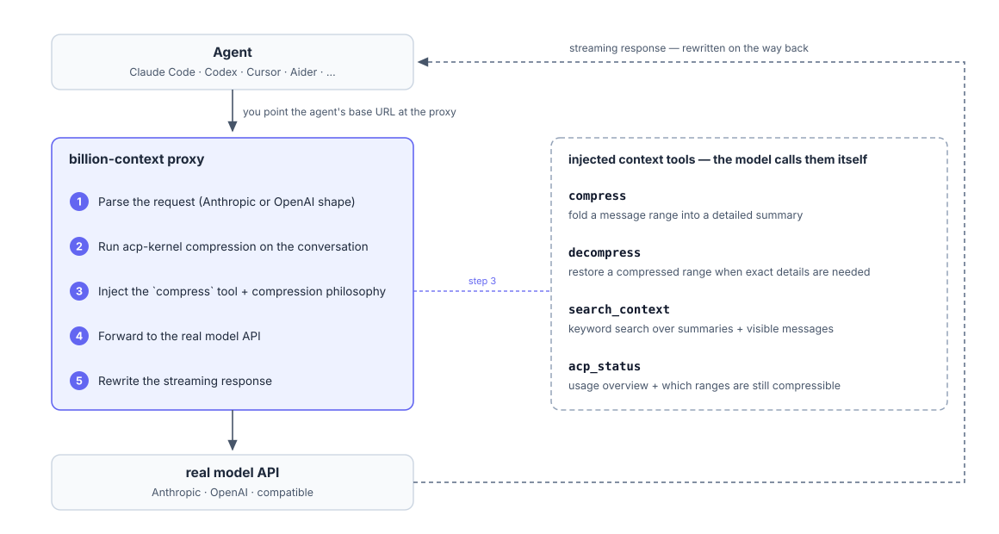
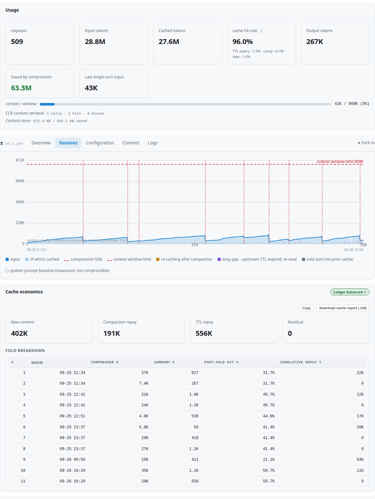

# billion-context

<p align="center"><a href="./README.md">English</a> | <a href="./README.zh-CN.md">中文</a> | <a href="./README.ja.md">日本語</a> | <a href="./README.ko.md">한국어</a></p>

<p align="center"><strong>컨텍스트 압축 플러그인</strong> — <em>billion-context is all you need.</em></p>

<p align="center"><sub>작은 컨텍스트 윈도(100K면 충분) · <em>토큰 5분의 1</em> · 한 달 동안 이어지는 단일 세션(수십억 토큰) · 높은 압축 품질</sub></p>

<p align="center">
<a href="https://www.npmjs.com/package/billion-context"></a>
<a href="https://github.com/ranxianglei/billion-context/blob/master/LICENSE"></a>
<a href="https://github.com/ranxianglei/billion-context"></a>
<a href="https://discord.gg/wSejsBdRf"></a>
</p>

<p align="center">
<code>npm install -g billion-context --prefix=~/.local</code>
</p>

<p align="center">
<a href="https://claude.com/product/claude-code" title="Claude Code"></a>&nbsp;
<a href="https://github.com/openai/codex" title="Codex"><picture><source media="(prefers-color-scheme: dark)" srcset="https://api.iconify.design/simple-icons/openai.svg?color=white"></picture></a>&nbsp;
<a href="https://opencode.ai" title="OpenCode"><picture><source media="(prefers-color-scheme: dark)" srcset="https://cdn.simpleicons.org/opencode/FFFFFF"></picture></a>&nbsp;
<a href="https://pi.dev" title="pi"><picture><source media="(prefers-color-scheme: dark)" srcset="https://cdn.simpleicons.org/pi/FFFFFF"></picture></a>&nbsp;
<a href="https://github.com/google-gemini/gemini-cli" title="Gemini CLI"></a>&nbsp;
<a href="https://www.kimi.com" title="Kimi"><picture><source media="(prefers-color-scheme: dark)" srcset="https://cdn.simpleicons.org/kimi/FFFFFF"></picture></a>&nbsp;
<a href="https://github.com/QwenLM/qwen-code" title="Qwen Code"></a>&nbsp;
<a href="https://github.com/github/copilot-cli" title="GitHub Copilot CLI"><picture><source media="(prefers-color-scheme: dark)" srcset="https://cdn.simpleicons.org/githubcopilot/FFFFFF"></picture></a>&nbsp;
<a href="https://www.trae.ai" title="TRAE"></a>&nbsp;
<a href="https://www.codebuddy.cn" title="CodeBuddy"></a>&nbsp;
<a href="https://qoder.com" title="Qoder"></a>&nbsp;
<a href="https://iflow.cn" title="iFlow CLI"></a>&nbsp;
<a href="https://www.minimax.io" title="MiniMax Code (mcode)"></a>&nbsp;
<a href="https://www.deepseek.com" title="deepseek-harness (dsh)"></a>&nbsp;
<a href="https://ampcode.com" title="Amp"></a>&nbsp;
<a href="https://charm.land/crush" title="Crush"></a>&nbsp;
<a href="https://zed.dev" title="Zed"></a>&nbsp;
<a href="https://aider.chat" title="aider"></a>&nbsp;
<a href="https://github.com/aaif-goose/goose" title="goose"><picture><source media="(prefers-color-scheme: dark)" srcset="https://raw.githubusercontent.com/aaif-goose/goose/main/documentation/static/img/logo_dark.png"></picture></a>&nbsp;
<a href="https://github.com/NousResearch/hermes-agent" title="hermes"></a>&nbsp;
<a href="https://z.ai" title="zcode (Z.ai)"></a>&nbsp;
<a href="https://omp.sh" title="omp (oh-my-pi, Stencil Labs)"></a>&nbsp;
<a href="https://github.com/1jehuang/jcode" title="jcode"></a>
</p>

---

> **캐시 상태 한눈에 보기:** 건강한 세션은 **96–99%**의 프리픽스 캐시 적중률을 유지합니다 — 압축 자체의 비용은 ≤2%입니다. 계속 그보다 낮다면 `/acp` 또는 `/acp-cache`로 원인을 확인하세요([FAQ](#faq) 참고). 흔한 원인은 순서대로: 업스트림 캐시 TTL 만료 · 모델 전환 · bili 버그(제보 부탁드립니다) · 기타/불명.

## 커뮤니티

QQ 그룹:
1056132097 (정원 마감)
1108730198 (정원 마감)
1129868472 (가입 가능)

---

## 📄 논문 / 프리프린트

- **[Model-Driven Incremental Hierarchical Compression: Training-Free Multi-Generational Context Management for Long-Lived Coding Agents](./paper/model-driven-incremental-hierarchical-compression-training-free-multi-generational-context-management-for-long-lived-coding-agents.md)** (영어, v0.2)

> 📝 **논문 자체도 코드베이스의 일부(`paper/`)로 MIT 라이선스로 공개되어 있습니다. 살아 있는 문서이므로 누구나 수정할 수 있으며, 풀 리퀘스트를 통한 개선을 환영합니다.**

실사용 규모의 장기 연구: 4.5개월, 호스트 3대, 모델 호출 174,327회, 누적 입력 토큰 18.76B(전체 호스트 합계 약 24.7B), 204,800토큰 모델에서 윈도 초과 0회, 8,584–12,049회 호출에 이르는 마라톤 세션.

### 📊 독립 제3자 벤치마크

- **[1,500문항 교차 벤치마크 평가 (`LongMemEval-S` · `ContextBench` · `MemoryAgentBench`)](./benchmarks/third-party-1500/README.md)** ([中文版](./benchmarks/third-party-1500/README.zh-CN.md)) — `billion-context`(`v0.1.202`)를 `full` 컨텍스트 및 RAG 3종(`bm25`, `embedding`, `embedding-rerank`)과 `DeepSeek V4.1 Flash`, `Qwen3-Embedding-8B`, `Qwen3-Reranker-4B`, `Pi Agent`로 정면 비교: **ContextBench 1위**(Utilized F1 `0.3097`, `full` 대비 비용 `-58.3%`), **LongMemEval-S에서 최고 RAG 대비 +16.6%**(`79.20%` vs `62.60%`, `full` 대비 독립 세션 비용 `-71.1%`), **1.48M 토큰 MemoryAgentBench TTL에서 생존율 100%**(`full`이 `199/199` 실패하는 구간에서 정상 상태 `30×` 압축).

---

`billion-context`는 **어떤** 에이전트와 그 모델 API 사이에도 들어가서, [acp-kernel](https://github.com/ranxianglei/acp-kernel) 압축으로 Anthropic/OpenAI 스트림을 재작성합니다. **언제**, **무엇을** 고충실도 요약으로 압축할지는 하드 잘라내기 한도가 아니라 모델이 결정합니다.

## 왜 필요한가

긴 코딩 세션은 컨텍스트를 폭발시킵니다. 프로바이더는 토큰 단위로 과금하고, 컨텍스트 윈도를 넘기면 세션은 품질이 떨어지거나 죽어 버립니다. `billion-context`는 이미 소비된 대화를 계층형 요약으로 압축하므로, 하나의 세션을 며칠씩 — 하나의 컨텍스트 윈도로 수십억 토큰을 — 돌릴 수 있습니다.

호스트 내장 요약기와 달리 여기서의 압축은 **증분적이고, 되돌릴 수 있으며, 프리픽스 캐시 친화적**입니다. 요약은 작은 범위 단위로 작성되고, 필요할 때 압축을 풀 수 있으며, 캐시 프리픽스도 그대로 유지됩니다.

## 동작 방식



### 컨텍스트 관리 도구

프록시는 대화에 네 가지 컨텍스트 관리 도구를 주입합니다. 컨텍스트가 커지면 모델이 직접 이 도구를 호출하고, 프록시가 `compress`를 서버 측에서 실행하므로 접힌 범위는 복원될 때까지 히스토리에서 요약 상태로 유지됩니다.

- **`compress`** — 메시지 범위를 상세한 요약으로 접습니다.
- **`decompress`** — 정확한 세부 내용이 다시 필요할 때 압축된 범위를 복원합니다.
- **`search_context`** — 압축된 요약과 보이는 메시지를 키워드로 검색합니다.
- **`acp_status`** — 컨텍스트 사용량 개요와 아직 압축 가능한 범위를 보여 줍니다.

## 무엇이 필요한가?

사용하는 클라이언트에 따라 고르세요:

| 클라이언트 | 사용 방법 |
|---|---|
| **pi** | [`billion-context`](https://github.com/ranxianglei/billion-context) — `bili pi`(런처) 또는 `bili plugin install pi`(네이티브). 단독 [`billion-context-pi`](https://github.com/ranxianglei/billion-context-pi)도 계속 사용 가능 — 자세히: [docs/clients.md](docs/clients.md#pi-pidev-coding-agent) |
| **opencode** (1.x / 2.x) | [`billion-context`](https://github.com/ranxianglei/billion-context) — `bili opencode`(런처) 또는 `bili plugin install opencode`(네이티브). 단독 [`opencode-acp`](https://github.com/ranxianglei/opencode-acp)도 1.x에서 계속 사용 가능 — 전체 가이드: [OpenCode](docs/clients.md#opencode) |
| **omp** | [`billion-context`](https://github.com/ranxianglei/billion-context) — `bili omp`(내장 플러그인) 또는 `bili plugin install omp`(자체 기동 네이티브 플러그인, 런처 불필요) |
| **dsh** | `bili dsh`(런처 — `--patch`로 완전한 네이티브 플러그인) 또는 `bili plugin install dsh` ≡ `dsh plugin --profile <name> add billion-context`(하나로 통합된 레인) — 자세히: [docs/clients.md](docs/clients.md) |
| **kimi** | `bili plugin install kimi`(자체 기동 네이티브, Kimi Code ≥ 2.0.0) 또는 `bili kimi`(cert-MITM) 또는 `/bili/` 프리픽스 — 자세히: [docs/clients.md](docs/clients.md) |
| **hermes** | `bili plugin install hermes`(자체 기동 네이티브, Python 플러그인 #958) 또는 `bili hermes`(cert-MITM) |
| **zcode** (Z.ai / bigmodel coding plan) | `bili plugin install zcode`(자체 기동 네이티브, #1145) 또는 GUI의 Settings → Network를 통한 cert-MITM 또는 `/bili/` 프리픽스 — 자세히: [docs/clients.md](docs/clients.md) |
| **claude** | `bili claude`(런처) 또는 `bili plugin install claude`(네이티브 구성, #964 — 관리형 settings 블록 + 세션 소유 프록시. 아래 참고 사항 참조) |
| **codex** | `bili codex`(런처 — 설정 없는 완전한 구성) 또는 `bili plugin install codex`(MCP 셸 도구 컴패니언: **먼저 bili를 시작하세요** — 셸은 프록시를 띄우지 않으며 codex 자체 트래픽도 라우팅하지 않습니다) — 자세히: [docs/clients.md](docs/clients.md#codex-openai-codex-cli) |
| **jcode** | [`billion-context`](https://github.com/ranxianglei/billion-context) — `bili jcode`(cert-MITM) 또는 `/bili/` 프리픽스. 네이티브 모드 없음(컴파일된 Rust 바이너리, 플러그인 접점 없음, [#962](https://github.com/ranxianglei/billion-context/issues/962)) |
| **gemini** (Gemini CLI) | `bili gemini`(런처, `GOOGLE_GEMINI_BASE_URL` `/bili/` 재작성) 또는 `/bili/` 프리픽스 — 런처 전용(루프 내 도구 접점 없음, #1043) |
| **iflow** (iFlow CLI) | `bili iflow`(런처, `IFLOW_BASE_URL` `/bili/` 재작성) 또는 `/bili/` 프리픽스 |
| **qwen** (Qwen Code) | `bili qwen`(런처, cert-MITM) 또는 `/bili/` 프리픽스 |
| **antigravity** (Antigravity CLI / agy, Google) | `bili antigravity`(런처, daily-cloudcode-pa.googleapis.com의 `CLOUD_CODE_URL` `/bili/` 재작성 — Antigravity의 실제 기본 업스트림, #3129) 또는 `/bili/` 프리픽스. 플러그인 접점 없음(비공개 Go language_server. 사용자 플러그인 표면은 추가 전용, #2115) — 자세히: [docs/clients.md](docs/clients.md) |
| **mcode** (MiniMax Code) | [`billion-context`](https://github.com/ranxianglei/billion-context) — `bili mcode`(cert-MITM) 또는 `/bili/` 프리픽스. 네이티브 모드 없음(이벤트 훅만 있고 모델 요청 접점 없음, [#1050](https://github.com/ranxianglei/billion-context/issues/1050)) |
| **aider** | [`billion-context`](https://github.com/ranxianglei/billion-context) — `bili aider`(cert-MITM) 또는 `/bili/` 프리픽스. 네이티브 모드 없음(셸 명령 전용 훅, 도구 주입 접점 없음, [#1048](https://github.com/ranxianglei/billion-context/issues/1048)) |
| **copilot** (GitHub Copilot CLI) | `bili copilot`(런처, cert-MITM) — 비공개 Go 바이너리, 플러그인 접점 없음(#1049) |
| **amp** (Amp CLI) | `bili amp`(런처, cert-MITM) — 비공개 Go 바이너리, 플러그인 접점 없음(#1049) |
| **kiro** (Kiro CLI, AWS) | `bili kiro`(런처, cert-MITM) — Rust 셸 + Node 에이전트 서버, 플러그인 접점 없음. 모델 트래픽은 `runtime.<region>.kiro.dev`의 Responses 와이어이며 게이트웨이 특이사항은 내장 처리 — 자세히: [docs/clients.md](docs/clients.md#kiro-cli-aws) |
| **crush** (Charm Crush) | `bili crush`(런처, cert-MITM) — 오픈소스 Go 바이너리, 플러그인 접점 없음. 내장 프로바이더 호스트는 화이트리스트에 등록되고, 커스텀 `base_url`은 crush.json에서 자동 탐지(#2340) |
| **zed** (Zed 에디터) | `bili zed`(런처, cert-MITM) — 오픈소스 Rust 에디터, 플러그인 접점 없음. reqwest가 HTTPS_PROXY를 따르고, CA는 SSL_CERT_FILE로(Linux 환경 탐지). 내장 프로바이더 호스트는 화이트리스트 등록, 커스텀 `api_url`은 settings.json에서 자동 탐지. 루프백 프로바이더(ollama/lmstudio)는 NO_PROXY로 직결 유지(#2340) |
| **goose** (Goose CLI) | `bili goose`(런처) — rustls가 CA 파일을 신뢰하지 않으므로 cert-MITM 불가: openai/anthropic 레인은 `OPENAI_HOST`/`ANTHROPIC_HOST`로, 커스텀 프로바이더는 재생성된 `GOOSE_PATH_ROOT` 오버레이로(#1049) |
| **그 밖의 모든 것** (컨텍스트 훅 없음) | [`billion-context`](https://github.com/ranxianglei/billion-context) — `bili <client>`(런처, 권장) 또는 `/bili/` 프리픽스 |

**네이티브 모드 vs 단독 확장.** 호스트 네이티브 플러그인(`bili plugin install …`)과 단독 인프로세스 확장(`billion-context-pi`, `opencode-acp`)은 **상호 배타적**입니다 — 둘 다 활성화되면 이중 압축이 됩니다. 전환은 설치 프로그램이 처리합니다. 레거시 항목(순수 이름, `npm:` 별칭, 버전 지정, 경로 형식, 배열 또는 객체 형태)을 교체하고 원본 설정을 한 번 `.bili-bak`로 스냅샷합니다. **프로젝트 로컬** 설치는 건드리지 않으니 직접 제거하세요. 수동 설치를 위한 런타임 안전망으로, 네이티브 항목은 로드 시 동기적으로 `BILLION_CONTEXT_NATIVE=<host>`를 설정하여 단독 확장이 실행 시점에 물러설 수 있게 합니다. pi 쪽에서는 이 마커가 `billion-context-pi` **0.1.72+**를 필요로 하며, pi 네이티브 항목은 프록시가 올라오면 pi 설정 파일 두 개를 한 번 스캔해서 설치 프로그램이 보지 못한 레거시 항목이 함께 있으면 크게 경고합니다 — 오래된 `billion-context-pi`가 조용히 이중 압축하는 동안 보이는 신호는 이 경고뿐입니다.

## 설치

Linux / macOS — 사용자 수준 프리픽스로 설치합니다(`sudo` 불필요, npm 설정
변경 없음, `bili` 자체 업데이트에서 권한 오류가 나지 않음):

```bash
npm install -g billion-context --prefix=~/.local
```

`bili` 명령은 `~/.local/bin`에 설치됩니다 — 대부분의 배포판에서 이미 PATH에
포함되어 있습니다. 그렇지 않다면 `~/.bashrc` 또는 `~/.zshrc`에
`export PATH="$HOME/.local/bin:$PATH"`를 추가하세요. nvm이나 Homebrew Node에서는
기본 프리픽스가 이미 사용자 소유이므로 그냥 `npm install -g billion-context`로
충분합니다. Windows에서도 기본 프리픽스(`%APPDATA%\npm`)는 사용자가 쓸 수 있으므로
그냥 `npm install -g billion-context`를 사용하세요.

이렇게 하면 `bili` 명령이 설치됩니다(`bili-proxy`는 별칭으로 유지). 예전의 root 소유
프리픽스 때문에 `EACCES`가 난다면 `--prefix=~/.local`로 다시 설치하세요(앞으로
`bili`를 npm으로 재설치할 때도 매번 이 플래그를 붙이세요) — 이것이 근본적인
해결책이며, `sudo`는 피하세요.

컨테이너가 좋다면? 저장소 루트에 `Dockerfile`이 들어 있습니다 — 아래
[Docker에서 실행하기](#docker에서-실행하기)를 참고하세요.

## 빠른 시작

세 가지 사용 방법 중 하나를 고르세요:

- **네이티브 플러그인(가장 네이티브):** `bili plugin install <client>` — bili가
  클라이언트 안의 플러그인이 되며, 클라이언트는 평소대로 시작하면 됩니다.
- **런처(설정 불필요):** `bili <client>` 명령 하나로 프록시와 클라이언트를 함께
  띄웁니다 — 실제 설정 파일은 전혀 건드리지 않습니다.
- **URL 변경(가장 범용적):** 클라이언트의 baseURL 앞에 프록시 오리진 + `/bili/`를
  붙입니다.

이 세 가지 방식의 내부 동작(플러그인 수명 주기, runtime-info 프로토콜, 주입
우선순위)은 [docs/technical-notes.md](docs/technical-notes.md)에 정리되어 있습니다.

포트 요약(#1660): `bili start`(수동)는 `8787`을 사용합니다. 레인이 대신 띄우는
모든 것(네이티브 훅, 런처 레인)은 `18787`부터 시작하는 별도의 자체 관리 영역에
있습니다 — 충돌하면 +1씩 이동하고 각 레인은 자신이 이동한 위치를 기억하므로,
설정 없는 설치가 포트를 두고 사용자와 다투는 일이 없으며, 의도적으로 띄운
`bili start` 데몬에는 기본적으로 연결됩니다. 연결은 레인을 인식합니다(#2905):
훅은 먼저 자신의 레인 인스턴스를 사용하고, 다른 선언된 레인의 인스턴스는 절대
사용하지 않습니다 — `native.attachLanePriority`에 나열한 레인은 예외입니다 — 그리고
8787 사용자 영역 데몬은 최후의 대체 수단으로 남습니다. 업그레이드 재시작 시 이전
빌드가 레인의 포트에서 아직 정리 중이면, 포트를 옮기지 않고 해제될 때까지(최대
5초) 기다렸다가 같은 포트에 다시 바인딩합니다(#1723). 실제로 점유된 포트만 +1
이동하며, 그 이동은 이제 눈에 띄게 로그로 남습니다.

### 방법 1 — 네이티브 플러그인 (`bili plugin install pi` / `omp` / `opencode` / `dsh` / `kimi` / `hermes` / `zcode`)

프록시가 클라이언트 안에 상주합니다. 한 번 설치하면 이후에는 클라이언트를 평소와
똑같이 시작하면 됩니다 — 런처 명령도, 환경 변수도, 고정 포트도, URL 수정도
필요 없습니다. 현재 **pi**, **omp**, **opencode**(1.x 및 2.x), **dsh**, **kimi**,
**hermes**, **zcode**를 지원합니다:

```bash
bili plugin install pi          # registers a "billion-context" entry in pi's settings (npm form when bili itself was npm-installed)
bili plugin install omp         # registers an extensions entry in omp's config.yml (~/.omp/agent/config.yml)
bili plugin install opencode    # registers the plugin in opencode's real config + disables native auto-compaction
bili plugin install dsh         # runs 'dsh plugin --profile <name> add billion-context' for every existing profile
bili plugin install kimi        # writes $KIMI_CODE_HOME/plugins/managed/billion-context/kimi.plugin.json (+ installed.json record); per-session routing block lands in config.toml on first start (Kimi Code >= 2.0.0)
bili plugin install hermes      # copies the Python plugin into ~/.hermes/plugins/billion-context/ (+ machine-owned bili.json sidecar) and enables it via `hermes plugins enable billion-context`
bili plugin install zcode       # writes hooks.enabled + a SessionStart hook + mcp.servers.bili into ~/.zcode/cli/config.json; per-session routing lands in the bigmodel provider store on first start
bili plugin remove <client>     # undo (dsh removes through the same channel; config snapshots go to .bili-bak)
```

클라이언트에 자체 플러그인 채널이 있다면 bili 명령을 아예 거치지 않고 네이티브로
설치할 수도 있습니다:

- **dsh:** `dsh plugin --profile <name> add billion-context`는 `bili plugin install dsh`가
  프로필마다 실행하는 바로 그 명령입니다(npm 형식만 가능. git 체크아웃에는 게시된
  엔트리가 없습니다 — GitHub 주소를 붙여 넣으면 `dist/` 없는 소스가 설치되어 번들이
  로드되지 않습니다). 어느 쪽이든 최종 상태는 같습니다(프로필에 pnpm 설치, 번들된
  패치 레이어는 dsh가 직접 마운트). 제거도 같은 채널로 합니다. 아래 dsh 섹션을
  참고하세요.
- **opencode:** 가장 쉬운 방법은 `bili plugin install opencode`입니다(호스트 버전에
  맞는 엔트리 형식을 골라 줍니다). bili 없이 직접 설치하려면(npm 형식만 가능. git
  체크아웃에는 게시된 엔트리가 없습니다):
  - **OpenCode 1.x** — 실제 설정의 plugin 목록에 npm 이름만 추가합니다:
    `"plugin": ["billion-context"]`. 패키지가 `exports["./server"]` →
    `dist/agent/opencode-native.js`를 게시하므로, opencode는 자체 Npm.add 기구로 이를
    로드하고 플러그인은 bili가 설치한 형태와 똑같이 자체 기동합니다.
  - **OpenCode 2.x** — 이름만으로는 동작하지 않습니다. 2.x는 패키지의 `main` 필드
    (`dist/index.js`, 즉 CLI — 플러그인 정의 없음)로 이를 해석하므로 모듈 로드가
    실패합니다(#3976). 대신 한 줄짜리 re-export를 디렉터리에 두고 설정의 `plugins`
    목록이 그 디렉터리를 가리키게 하세요:

    ```js
    // <shim dir>/index.js
    export { default } from "<abs path to the global install>/dist/agent/opencode-native.js";
    ```

    ```json
    { "plugins": ["<shim dir>"] }
    ```

  어느 세대든, bili 설치 프로그램이 해 주었을 두 가지를 직접 하세요 — 같은 설정에
  `"compaction": { "auto": false }`를 설정하고(그렇지 않으면 OpenCode의 네이티브
  자동 압축이 이중 압축을 일으킵니다), 먼저 파일을 수동으로 백업해 두세요.
- **claude:** 이 저장소는 Claude Code 플러그인 마켓플레이스도 겸합니다 —
  `/plugin marketplace add ranxianglei/billion-context`, 그다음
  `/plugin install billion-context@billion-context`, 그다음
  `/billion-context:bili-setup`을 실행하세요(`bili plugin install claude`를 대신
  실행하고 재시작하라고 안내합니다). 최종 상태는 bili 설치 프로그램과 같습니다.
  이 플러그인은 자체 훅이나 MCP 항목을 포함하지 않으므로 이중 등록되는 것은 없습니다.

pi / omp / kimi / claude에는 클라이언트 측 채널이 없습니다 — `bili plugin
install <client>`가 설정 항목을 대신 작성합니다(kimi의 선언형 `kimi.plugin.json` +
레지스트리 레코드, claude의 관리형 settings 블록 등).

참고 사항:

- 네이티브 모드는 단독 인프로세스 확장(`billion-context-pi`, `opencode-acp`)과 **상호 배타적**입니다 — 설치 프로그램이 항목을 교체하고 원본 설정을 스냅샷합니다(`.bili-bak`).
- **pi:** 네이티브 설치는 기본적으로 내장 서브에이전트(`acp_delegate` / `acp_delegate_wait` / `acp_delegate_cancel`)를 연결합니다 — 컨텍스트 압축은 유지하면서 이를 끄는 방법: [Pi 내장 서브에이전트](#pi-내장-서브에이전트).
- OpenCode 레거시 세션, V1/V2 형태와 주의 사항: [OpenCode](docs/clients.md#opencode).
- `kimi`는 부트스트랩 시점에만 runtime-info를 보고합니다(정적 헤더로는 요청별 윈도/모델 값을 실을 수 없음). 서브에이전트 도구 호출은 프록시의 아웃바운드 tool-use 증인 링(#1685)으로 라우팅됩니다 — 모델에게 보이는 대화 id는 없습니다.
- `hermes`의 네이티브 플러그인은 Python입니다. 헬스 체크 후 환경 변수로 hermes의 httpx 스택을 프록시로 향하게 하고, `llm_request` 미들웨어로 요청별 헤더를 찍어 넣습니다.
- `codex`는 플러그인 설치만으로 자립시킬 수 없는 유일한 클라이언트입니다. codex는 모델 트래픽을 환경 변수로만 라우팅하고(기본 ChatGPT 로그인 프로바이더에는 설정 파일 라우팅 접점이 없습니다 — 관리형 `model_providers` 블록을 쓰면 API 키 인증이 강제되어 구독 로그인이 사라집니다), MCP 서버는 부모 프로세스에 환경 변수를 주입할 수 없습니다. `bili plugin install codex`는 `~/.codex/config.toml`에 `[mcp_servers.bili]` 블록 하나(command = node, args = dist/mcp.js)를 작성하여 네 가지 ACP 도구를 노출합니다. 세션 시작 시 셸은 프록시를 찾습니다 — 환경 변수 `BILI_MCP_PROXY` > 라이브 인스턴스 레코드(어떤 레인의 프록시든 `bili start` 데몬이든) > 8787 사용자 영역 기본값(#1660에서 설치 시점 오리진 고정을 제거, #403) — 연결 가능한 것이 없으면 `tools/list`가 -32003으로 실패합니다. 따라서: 먼저 bili를 시작하고(`bili start` 또는 아무 클라이언트의 레인 프록시), 압축도 원한다면 HTTPS_PROXY를 직접 export하거나, 설정 없는 완전한 구성을 원하면 `bili codex`를 쓰세요. 동작 원리: [docs/clients.md](docs/clients.md#codex-openai-codex-cli).
- `claude`에는 네이티브 구성이 있습니다(#964): 관리형 settings 블록 + `SessionStart` 훅 + MCP 셸. 훅은 자체 관리 포트 영역(#1660)을 사용하며 세션마다 관리형 URL을 라이브 오리진으로 다시 고정하므로, 포트 이동은 저절로 복구됩니다. #1821부터 MCP 셸은 세션 도중에도 프록시를 감시하며(30초 주기 × 3회 실패) 죽은 레인 프록시를 직접 다시 띄우므로, 모델 요청이 새 세션 없이 약 90초 안에 복구됩니다(zcode 레인과 같은 방식). `BILI_NATIVE_CLAUDE=0`으로 비활성화할 수 있습니다(패스스루). 동작 원리: [docs/technical-notes.md](docs/technical-notes.md). **알려진 제한(#2290):** Claude Desktop 앱의 Code 탭(`CLAUDE_CODE_ENTRYPOINT=claude-desktop`)은 내장 Claude Code에 자체 `ANTHROPIC_BASE_URL`을 설정해 관리형 값을 덮어씁니다 — 데스크톱 세션은 프록시를 완전히 우회하지만 관리형 블록의 `DISABLE_AUTO_COMPACT=1`은 여전히 적용되므로, bili 압축도 네이티브 자동 압축도 받지 못합니다. 훅은 세션 시작 시 크게 경고하며(`bili doctor`용으로도 기록하고, `bili doctor`는 Claude Desktop이 네이티브 레인과 함께 설치된 머신도 표시합니다), 터미널 세션은 영향받지 않습니다. **2026-10-06 현장 테스트(#2290):** settings `env` 블록에 `HTTPS_PROXY`를 넣었을 때, Claude Desktop 2.19675.1 / 내장 CC 2.1.288(Windows 11)에서 MITM이 활성화된 라이브 프록시로 향하는 CONNECT 트래픽이 전혀 없었습니다 — 이 변수는 거기서 어떤 네트워크 스택에도 닿지 않으며, 당시의 CLI 동작과 일치합니다. 참고로 최신 빌드(CC 2.1.301+)의 CLI는 `HTTPS_PROXY`를 따르는데, 바로 그래서 `bili claude`는 `/bili/` base-URL 재작성으로 라우팅합니다 — 런처는 이 레인에 프록시도 CA도 전혀 주지 않으며, 자체 프록시를 가져온 자식 프로세스에는 루프백 호스트를 `NO_PROXY`/`no_proxy`에 병합하여 그 프록시 동작과 무관하게 해당 구간이 직결로 유지되게 합니다(#3446). 해당 버전 기준으로 데스크톱 Code 탭에는 쓸 수 있는 라우팅 접점이 없으며, 업스트림 동작이 바뀔 경우를 대비해 이 레인은 [#2290](https://github.com/ranxianglei/billion-context/issues/2290)에서 계속 추적합니다. **계정 연동 기능(#4693):** 이 레인은 커스텀 `ANTHROPIC_BASE_URL`로 라우팅하므로, Claude Code는 세션을 서드파티/API 키 세션으로 취급하여 Anthropic 계정/Cloud에 연동된 기능을 비활성화합니다 — bili가 트래픽을 라우팅하는 동안 **Remote Control**(`/remote-control`, 모바일/데스크톱/웹에서 로컬 세션 조작)이 명령 목록에서 사라집니다. 압축에는 영향이 없습니다. 그런 기능이 필요한 세션은 bili 없이 그냥 `claude`를 실행하세요(또는 `bili plugin remove claude`). 이는 base-URL 라우팅 접점에 내재한 것이며 — CC의 undici 스택을 견디는 다른 가로채기 지점은 없습니다(#2290) — 설정 삭제 문제가 아닙니다. 데스크톱만 쓰는 사용자는 `bili plugin remove claude`로 네이티브 자동 압축을 되살릴 수 있습니다. #5095부터 관리형 블록은 `SubagentStart` 훅(`node <root>/dist/claude-subagent-hook.js`)도 설치하는데, 이 훅은 디스패치마다 레인 토큰을 발급해 각 서브에이전트의 컨텍스트에 넣습니다. 에이전트 id 헤더 없이 부모의 세션 id를 그대로 쓰는 서브에이전트(VS Code 확장 빌드, #4352)는 각자의 `<id>|sub:…:t:<token>` 압축 레인에 매핑되어, 같은 유형의 병렬 디스패치가 더 이상 합쳐지지 않습니다(첫 메시지가 접히면 이후 요청에서는 토큰이 사라지며, 그런 요청은 지문 레인으로 대체됩니다). 제거 시 훅은 관리형 블록과 함께 삭제됩니다.
- `zcode`에는 네이티브 구성이 있습니다(#1145): 관리형 `~/.zcode/cli/config.json` 블록 + 세션별 프로바이더 `baseURL` 재작성. 전체 동작 원리: [docs/clients.md](docs/clients.md).
- `jcode`와 `aider`에는 네이티브 모드가 없습니다(플러그인/MCP/도구 주입 접점 없음: #962, #1048) — `bili jcode` / `bili aider`를 사용하세요.
- `copilot`, `amp`, `goose`는 런처 전용입니다(#1049). goose는 cert-MITM이 불가능하므로(rustls가 CA 파일을 신뢰하지 않음) 평문 HTTP base-URL 리다이렉트를 사용합니다.

### 방법 2 — 런처 (`bili pi` / `bili codex` / `bili claude` / `bili omp` / `bili opencode` / `bili hermes` / `bili dsh` / `bili codebuddy` / `bili qoder` / `bili trae` / `bili jcode` / `bili kimi` / `bili gemini` / `bili iflow` / `bili qwen` / `bili antigravity` / `bili mcode` / `bili aider` / `bili copilot` / `bili amp` / `bili goose` / `bili kiro`)

런처는 클라이언트를 명령 하나로 감쌉니다. 독립된 포트에서 프록시를 시작하고(항상
새 인스턴스를 띄우며 포트는 절대 재사용하지 않습니다), 클라이언트가 그 프록시를
향하게 합니다 — 클라이언트가 프록시/CA 환경 변수를 따르면 **인증서 기반 MITM**을,
따르지 않으면 격리된 **`/bili/` 설정 재작성**을 사용합니다. 실제 설정 파일은 절대
수정하지 않습니다. 클라이언트 자체 설정은 어떤 HTTPS 업스트림 호스트와 통신하는지
알아내기 위해 읽기만 하며, 그 호스트들은 MITM 화이트리스트에 올라가서 프록시가
정확히 그 호스트만 TLS 종료하고 나머지는 모두 블라인드 터널로 넘기게 됩니다.

```bash
bili pi                               # launch pi through the proxy — file-free (#535): env + extension registerProvider, real ~/.pi untouched
bili codex                            # launch codex through the proxy
bili claude                           # launch claude through the proxy
bili omp                              # pi-style, file-free (#535): env + extension registerProvider + compaction cancel, real ~/.omp untouched
bili opencode                         # OpenCode (1.x & 2.x): full guide in the [OpenCode](docs/clients.md#opencode) section below
bili hermes                           # file-free (#535): hermes proxy env (HTTPS_PROXY + combined CA bundle via SSL_CERT_FILE) — https via CONNECT MITM, http via absolute-form forward proxy; real ~/.hermes untouched
bili dsh                              # deepseek-harness: full native plugin injected via --patch (#941) — real dsh tools, session-bound /acp + /acp-cache (plugin mode); non-loopback upstreams ride proxy envs, loopback keeps the overlay DSH_HOME rewrite (#535); dsh auto-compaction off everywhere — host plane via the bundle patch, web-profile presets at load time (#1772/#2474/#3354)
bili codebuddy                        # Tencent CodeBuddy Code CLI: CODEBUDDY_BASE_URL /bili/ rewrite (OpenAI chat completions wire), budget aligned via CODEBUDDY_AUTO_COMPACT_WINDOW; real ~/.codebuddy untouched
bili qoder                            # qoder CLI (`qoder`/`qodercli`): model endpoint is hardcoded https (no /bili/ rewrite possible) — cert-MITM via HTTPS_PROXY + NODE_EXTRA_CA_CERTS, default model hosts whitelisted (#653). Qoder Desktop is a separate BYOK/custom channel that speaks plaintext OpenAI over a `/bili/` prefix — point it at bili as a normal custom provider (not this MITM lane); its official-subscription traffic is encrypted and out of scope (#764)
bili trae                             # Trae CLI (ByteDance, closed Go binary, no base-URL override) — cert-MITM via HTTPS_PROXY + SSL_CERT_FILE, model host from TRAE_CLI_API_HOST or the default enterprise gateway (#655)
bili jcode                            # jcode (Rust agent harness) — env-only cert-MITM launch: HTTPS_PROXY + SSL_CERT_FILE, model host api.z.ai whitelisted, local loopback providers stay direct via NO_PROXY
bili kimi                             # Kimi Code CLI (Moonshot): standard proxy envs except an unconditional loopback bypass — https via cert-MITM, http via absolute-form forward proxy; loopback endpoints inventoried with a manual /bili/ hint (#757)
bili gemini                           # Gemini CLI (Google): GOOGLE_GEMINI_BASE_URL /bili/ rewrite to generativelanguage.googleapis.com (Google native wire), real ~/.gemini untouched
bili iflow                            # iFlow CLI: IFLOW_BASE_URL /bili/ rewrite to apis.iflow.cn/v1 (OpenAI chat-completions wire), real ~/.iflow untouched
bili qwen                             # Qwen Code (multi-protocol gemini-cli fork, no base-URL hook): cert-MITM via HTTPS_PROXY + NODE_EXTRA_CA_CERTS, default DashScope/Qwen model hosts whitelisted, custom relays via --mitm-domain
bili antigravity                      # Antigravity CLI (agy, Google): CLOUD_CODE_URL /bili/ rewrite of daily-cloudcode-pa.googleapis.com — the real default upstream (bare cloudcode-pa 400s on /v1internal:*, #3129); undocumented language-server env override, v2.19.1 binary-verified; wire recognized as Google native by path (#2115)
bili mcode                            # MiniMax Code CLI: same shape as kimi (proxy envs, unconditional loopback bypass, cert-MITM/absolute-form); session bound via X-Mavis-Session-Id (#1050)
bili aider                            # Aider (Python pair programmer): cert-MITM via HTTPS_PROXY + SSL_CERT_FILE/REQUESTS_CA_BUNDLE; endpoint from OPENAI_API_BASE / ANTHROPIC_BASE_URL / --openai-api-base / .aider.conf.yml (#1048)
bili copilot                          # Copilot CLI (GitHub, closed Go binary) — cert-MITM via HTTPS_PROXY + SSL_CERT_FILE, api.githubcopilot.com + per-plan subdomains whitelisted (#1049)
bili amp                              # Amp CLI (Sourcegraph, closed Go binary) — cert-MITM via HTTPS_PROXY + SSL_CERT_FILE, ampcode.com whitelisted (#1049)
bili goose                            # Goose (Block, Rust/reqwest): rustls release builds trust no CA file — openai/anthropic legs via OPENAI_HOST/ANTHROPIC_HOST, custom providers via a regenerated GOOSE_PATH_ROOT overlay (/bili/ rewrites, real config untouched) (#1049)
bili kiro                             # Kiro CLI (AWS): cert-MITM via HTTPS_PROXY + combined CA on SSL_CERT_FILE and NODE_EXTRA_CA_CERTS; only runtime.<region>.kiro.dev is decrypted; developer/system items re-voiced as user for the gateway; session = Kiro's conversation id (survives --resume)
bili pi --mitm-domain api.foo.com     # add a domain to the MITM whitelist
```

### 방법 3 — URL 변경 (`/bili/` 프리픽스)

프록시를 시작합니다:

```bash
bili
```

그다음 클라이언트의 기존 baseURL 앞에 `http://localhost:8787/bili/`만 붙이면 됩니다.
업스트림 전체 URL이 경로에 들어 있으므로, 프록시는 별도 설정 없이 어디로 전달할지
알 수 있습니다:

```
client baseURL before:  https://api.openai.com/v1
client baseURL after:   http://localhost:8787/bili/https://api.openai.com/v1
```

클라이언트별 설정 예시는 웹 UI 가이드 [http://localhost:8787](http://localhost:8787)에서 더 볼 수 있습니다.

**확인.** 프록시를 실행하고 설정을 저장한 상태에서, 프록시가 응답하는지와 첫 실제
요청에서 로그에 압축 활동이 나타나는지 확인하세요:

```bash
# Health check (proxy up + where it forwards)
curl -s http://localhost:8787/__bili/health
# → {"ok":true,"upstream":"https://api.anthropic.com"}

# Live session stats (after a real request)
curl -s http://localhost:8787/__bili/stats
```

그런 다음 클라이언트에서 메시지를 하나 보내고 로그
(`~/.local/state/billion-context/bili.log`, stderr에도 출력됨)를 지켜보세요. 요청마다
`processTurn` 줄이 하나씩 보이고, 대화가 길어지면
`[acp-usage] round N input=X cached=Y (cache hit Z%)`와 `compress` 이벤트가 나타나야 합니다.

### 클라이언트별 상세 설명

빠른 시작 한 줄에 담기지 않는 모든 것 — 각 클라이언트의 레인이 어떻게 연결되는지, 무엇이 어디에 기록되는지, 알려진 제한 — 은 **[docs/clients.md](docs/clients.md)**에 있습니다: dsh · Kimi Code · Hermes · ZCode · Gemini 계열(Gemini CLI / iFlow CLI / Qwen Code / Antigravity) · 압축되지 않는 cert-MITM 클라이언트(CONNECT 블라인드 터널, #897) · 직결되는 미인식 엔드포인트(#1290) · OpenCode(런처 / 네이티브 / 순수 프록시, `/acp` 상태와 규칙, 레거시 opencode-acp 세션 #920).

## 소스에서 설치 (개발용)

> **주의:** `master`는 개발 브랜치이며 언제든 깨질 수 있습니다 — 미출시 변경, 실패하는 빌드, 검증되지 않은 수정이 섞여 있습니다. 코드를 직접 패치하거나 미출시 수정을 테스트하는 경우가 아니라면 위와 같이 npm으로 릴리스를 설치하세요.

```bash
git clone https://github.com/ranxianglei/billion-context.git
cd billion-context
npm ci
npm run build
npm link
bili --version
```

`npm link` 후에는 어느 디렉터리에서든 `bili`를 쓸 수 있습니다.

## FAQ

**캐시 적중률은 어떻게 확인하나요?** 로그를 뒤질 필요 없습니다 — `/acp-cache`가
**클라이언트 안에서 바로 텍스트 요약 보고서**를 출력하며, 맨 위에 클릭할 수 있는
**Web UI 링크**가 있습니다. 링크를 열면 세션 페이지의 웹 버전 — 캐시 적중률
**꺾은선 그래프**와 끊김별 **원인 분석** — 을 볼 수 있습니다:


보고서는 한눈에 상황을 파악할 수 있는 블록으로 구성됩니다: **GRAND LEDGER**(합계 +
적중률과 명시적인 `HEALTHY` 판정. 미스는 새 콘텐츠 / 압축 재지불 /
upstream-ttl-or-client-rewrite로 분해) · **FOLD ECONOMICS**(접기별 경제성: 절감된
순 토큰, 회수 여부 판정) · **LINE ITEMS**(이상치만: 적중률<85% 또는 미스≥5000).
경험칙: **압축 자체의 비용은 ≤2%** — 건강한 세션은 **96–99%**에 머뭅니다. 그보다
낮다면 원인 분석이 흔한 용의자 중 무엇인지 알려 줍니다. 순서대로: ① 업스트림 캐시
TTL 만료(안정 프리픽스 미스로 나타나며, top-spikes 줄이 유휴 시간을 짚어 줍니다),
② 모델 전환, ③ bili 버그(페이지를 첨부해 제보해 주세요), ④ 기타/불명.
`/acp-cache [full]`은 모든 접기와 줄을 나열합니다.
#1535부터 보고서 끝에 `MODEL SWITCHES` 섹션이 붙습니다. 세션 도중 모델을 바꾸면
프로바이더의 프리픽스 캐시가 무효화되어 다음 요청에서 안정 프리픽스 전체가 다시
과금됩니다 — 각 전환의 설명되지 않은 잔여분(`ttl` 버킷에서 새 콘텐츠를 뺀 값)은
TTL 만료로 위장되지 않고 그 전환에 귀속됩니다. 이벤트별 `from → to`, 적중률, 귀속
토큰이 나열되며(`full`은 모든 이벤트, 요약은 최근 8개), 웹 세션 테이블에도 대응하는
모델 전환 열이 추가됩니다. #2131부터는 같은 기구가 아웃바운드 자격 증명의 지문
(`authorization`/`x-api-key` 계열 헤더의 12자리 hex sha256 — 원본 키는 절대 저장하지
않음)을 만들어, 고정 URL 뒤의 릴레이가 다른 계정으로 바뀐 **키 전환**을 전용
`KEY SWITCHES` 섹션, `CACHE INVALIDATION`의 `key switch:` 줄, 웹 세션 열의 🔑 배지로
귀속합니다. HTTP: `GET /__bili/cache-report`. 요청별 원시 `[acp-usage]` 줄은 심층
분석용으로 여전히 로그 파일에 남습니다.

**`/acp`는 무엇을 보여 주나요?** 네이티브 플러그인이 있는 클라이언트(opencode, dsh,
hermes)에서 `/acp`는 현재 대화의 ACP 상태 패널을 프록시에서 바로 렌더링합니다
(세션, 블록, 압축 가능한 범위, 사용량). 첫 모델 요청 전에는 대신 유휴 안내가
표시됩니다. `/acp-cache [full]`은 위의 캐시 보고서를 출력합니다.

**웹에서 세션과 설정을 조회할 수 있나요?** 네 —
[http://localhost:8787](http://localhost:8787)을 열면 개요 대시보드, 세션 목록과
세션별 상세, 실시간 로그, 설정 편집기, 업스트림 연결 테스트가 있습니다. Blog 뷰는
노트와 장문 글을 패널 안에서 바로 렌더링합니다 — 설치본에 번들되어 있고, 온라인일
때는 약 1시간 간격으로 GitHub master에서 새로 가져오며(오프라인이면 번들본으로
대체), 전체 문서고는 GitHub Pages에도 있습니다. 그 밖의 모든 것은 스크립트용 일반
JSON으로도 제공됩니다(`/__bili/stats`, `/__bili/sessions`, `/__bili/config`, …).

**압축은 언제 일어나나요?** 모델이 주도합니다. 주입된 컨텍스트 도구는 컨텍스트가
커질 때 모델이 호출하고, 부드러운 성장 넛지(설계상 약 50K 토큰 단위,
`compress.nudgeGrowthTokens`로 조정 가능)가 그 과정에서 모델을 재촉하며, 입력만으로
윈도를 넘으면 preflight가 최후의 안전장치로 작동합니다(#470). `/acp`나 웹 UI에서
실시간으로 볼 수 있습니다.

**압축하면 클라이언트 자체의 대화 파일도 줄어드나요?** 아니요 — 아주 긴 세션에서
가장 흔히 놀라는 부분입니다(#5796). 압축이 줄이는 것은 **모델에 보내는 내용**입니다.
나가는 모든 요청은 살아 있는 블록과 요약으로 다시 구성되므로, 대화가 아무리 길어져도
와이어는 작게 유지됩니다. 클라이언트에 저장된 히스토리는 사용자 데이터이며 bili는
절대 다시 쓰지 않습니다. dsh에서는 bili가 활성화된 동안 호스트의 자동 압축도 꺼지므로
(두 압축기가 하나의 히스토리를 두고 다투면 안 됩니다, #1772/#2474/#3354), 호스트 측
파일은 턴마다 커집니다. 파일이 커질수록 각 턴이 오래 걸리며(측정치: 메시지 약 30K개에서
턴당 수십 초, #5796), 현실적인 해결 방법은 무거워졌을 때 **새 세션을 시작**하는
것입니다. 웹 세션 목록은 요청 5,000회 이상인 세션에 배지(长会话/slow)를 붙여 이
시점에 도달했음을 알려 줍니다.

**왜 첫 압축이 ~200k까지 기다리나요?** 압축은 윈도 내 절대 위치가 아니라 성장 간격에
따라 트리거됩니다. 기본적으로 첫 소프트 압축은 부트 콘텐츠를 50k 토큰 넘어선 시점에
발생합니다(`compress.nudgeGrowthTokens`, 고정값이며 윈도와 무관). 부트가 약 100k이거나
성장 단계가 약 100k로 설정되어 있으면 첫 압축이 ~200k까지 미뤄질 수 있습니다. 더 일찍
일어나게 하려면: 1) 시스템 프롬프트를 줄이고, 불필요한 도구를 끄고, 스킬을 정리하세요.
2) `compress.nudgeGrowthTokens`를 ~50k로 낮추세요. 3) lean 모드를 켜세요. 예시는
[docs/configuration.md](docs/configuration.md#why-the-first-compaction-waits-until-200k)에
있습니다.

**bili는 투명한가요? 어떻게 끄나요?** 인식되지 않은 엔드포인트는 그대로 전달되며
([docs/clients.md](docs/clients.md)), 모든 모드는 깔끔하게 되돌릴 수 있습니다:
네이티브 설치는 `bili plugin remove <client>`, 나머지 두 방식은 런처 명령 / 환경 변수 /
`/bili/` 프리픽스를 쓰지 않으면 됩니다 — 트래픽은 즉시 다시 직결됩니다.

**bili를 모델 라우팅 게이트웨이(예: [magpie](https://github.com/yetone/magpie))와 함께 쓸 수 있나요?**
네 — 클라이언트는 bili를 향하게 하고, bili는 게이트웨이의 절대 URL을 담은 `/bili/`
프리픽스로 게이트웨이를 향하게 하세요:
`http://localhost:8787/bili/http://127.0.0.1:3425…`. 예: Claude Code →
`ANTHROPIC_BASE_URL=http://localhost:8787/bili/http://127.0.0.1:3425` +
`ANTHROPIC_API_KEY=magpie`. OpenAI 스타일 클라이언트 →
`OPENAI_BASE_URL=http://localhost:8787/bili/http://127.0.0.1:3425/v1`(+
`OPENAI_API_KEY=magpie`). 압축은 라우팅 *이전에* 일어나므로, 게이트웨이 라우팅 그룹의
어느 계정에 도달하는 요청이든 이미 압축되어 있습니다. 자격 증명은 게이트웨이에
남습니다. 클라이언트의 더미 키는 그대로 통과하고, 실제 키는 bili에 닿지 않습니다.
주의 사항: ① 대화 도중 계정이 바뀌면 프로바이더의 프리픽스 캐시가 무효화됩니다 —
다중 계정 라우팅에 내재한 것이며 bili 문제가 아닙니다(`/acp-cache`의 `KEY SWITCHES`
섹션에서 확인). ② 라우팅된 모델 이름은 bili의 윈도 조회에서 불투명합니다 — providers 키
`http://127.0.0.1:3425` 아래에 `models.<name>.context`로 컨텍스트 윈도를 선언하지
않으면 대체 윈도로 동작합니다(route-miss 경고, #2317). ③ 릴레이가 bili의 Anthropic
레인 `cache_control` 스탬프를 거부하면 `compat.noCacheControl`을 설정하세요.
④ 루프백 게이트웨이는 바로 동작합니다. 루프백이 아닌 사설 주소의 게이트웨이는 추가로
`network.allowPrivateHttpProviders`가 필요할 수 있습니다(#2984). ⑤ Claude Code 네이티브
플러그인 모드(`bili plugin install claude`)에서는 설치 전에
`BILI_CLAUDE_UPSTREAM=http://127.0.0.1:3425`를 설정해 관리형 블록이 릴레이를
`ANTHROPIC_BASE_URL`에 감싸 넣게 하세요(또는
`ANTHROPIC_BASE_URL=http://127.0.0.1:8787/bili/http://127.0.0.1:3425`를 직접 설정.
`localhost`와 `127.0.0.1` 모두 허용, #5369). 세 가지 와이어(OpenAI Chat / Responses /
Anthropic Messages, 프로토콜 간 변환 포함) 모두에서 종단 간 검증됨, #4433.

**ChatGPT 계정 풀을 갖춘 로컬 Codex/Claude Code 게이트웨이 [opencodex](https://github.com/lidge-jun/opencodex)(`ocx`)와도 동작하나요?** 같은 패턴입니다. 클라이언트는 bili를 향하게 하고, bili는 `/bili/` 프리픽스로 ocx를 향하게 하세요 — OpenAI 스타일 클라이언트(chat completions와 Responses, 예: Codex) → `OPENAI_BASE_URL=http://localhost:8787/bili/http://127.0.0.1:10100/v1`. Anthropic 스타일 클라이언트 → `ANTHROPIC_BASE_URL=http://localhost:8787/bili/http://127.0.0.1:10100`. 키가 필요한 클라이언트에는 더미 값이면 충분하며 그대로 통과합니다. bili는 ocx *뒤가 아니라 앞에* 두세요. ocx가 마지막 홉에서 프로바이더 자격 증명과 계정 풀을 소유하므로, 이 순서여야만 압축과 풀링이 함께 동작합니다. 루프백이라면 둘 사이에 키가 필요 없습니다(ocx의 기본 루프백 바인딩은 토큰을 읽지 않음). 루프백이 아닌 바인딩은 ocx 문서에 따라 `OPENCODEX_API_AUTH_TOKEN`과 `x-opencodex-api-key` 헤더가 필요합니다. 라우팅이 결정적이도록 ocx의 `provider/model` id로 모델을 요청하세요. 다른 게이트웨이와 마찬가지로 라우팅된 id는 bili의 윈도 조회에서 불투명하며(`models.<name>.context`로 선언), 세션 도중 계정이 다시 바인딩되면 프리픽스 캐시가 무효화됩니다(`/acp-cache`의 `KEY SWITCHES`에서 확인). 세 가지 와이어(OpenAI Chat / Responses / Anthropic Messages) 모두에서 종단 간 검증됨, bili 0.1.212 × ocx 2.97.0.

**로그와 세션 데이터는 어디에 저장되나요?** 로그:
`~/.local/state/billion-context/bili.log`(stderr에도 미러링). 세션 상태:
`~/.local/share/billion-context/`(XDG로 재정의 가능. Windows 백신 예외 #362, 옵트인
정리 #1082) — 전체 경로는 [docs/configuration.md](docs/configuration.md)에 있습니다.

## 프록시 실행

### Docker에서 실행하기

저장소 루트에 `Dockerfile`이 들어 있습니다 — 빌드 시점에 게시된 npm 패키지를
설치하며(테스트된 아티팩트. 이미지 안에서는 아무것도 컴파일하지 않음) 프록시를
서비스로 실행합니다:

```bash
docker build -t billion-context .
docker run -d --name bili -p 8787:8787 \
  -v bili-config:/root/.config/billion-context \
  -v bili-data:/root/.local/share/billion-context \
  -v bili-cache:/root/.cache/billion-context \
  -v bili-state:/root/.local/state/billion-context \
  billion-context
```

그런 다음 방법 3과 똑같이 클라이언트의 baseURL을 `http://<host>:8787/bili/…`로
향하게 하세요.

- **베이스:** `node:24-slim` — 내장 `node:sqlite` 저장 엔진을 직접 사용합니다(네이티브 애드온 다운로드 없음). Node 20 베이스로 바꾸지 마세요. 자체 다운로드되는 SQLite 엔진은 Node ≥ 22가 필요하며 20에서는 크래시합니다(#3341).
- **업데이트:** 컨테이너 내 자체 업데이트는 **기본적으로 꺼져 있습니다**(`ACP_AUTO_UPDATE=0`) — 컨테이너화된 사본의 공식 업데이트 경로는 더 새로운 이미지를 다시 빌드하거나 받는 것입니다. 제자리 자체 업데이트는 다음 재생성 시 이미지 버전으로 조용히 되돌아갑니다. `-e ACP_AUTO_UPDATE=1`로 다시 켤 수 있고, 빌드 시점에 `--build-arg BILI_VERSION=0.1.197`로 릴리스를 고정할 수 있습니다(기본값 `latest`).
- **데이터:** 마운트된 네 디렉터리는 각각 설정, 세션 상태, 업데이트 스로틀/잠금 + 캐시된 SQLite 엔진, 로그를 담습니다. 컨테이너를 교체해도 남도록 볼륨이나 바인드 마운트를 사용하세요. 이미지도 이들을 `VOLUME`으로 선언하므로 맨 `docker run`에서도 컨테이너 레이어 밖에 보관됩니다.
- **보안:** 컨테이너는 외부 클라이언트가 접속할 수 있도록 `0.0.0.0:8787`에서 대기합니다 — **인증이 없으므로** 신뢰할 수 있는 네트워크에서만 포트를 노출하세요(아래 `--host 0.0.0.0`과 같은 주의 사항). 웹 UI와 `/__bili/*` JSON 엔드포인트는 매핑된 포트를 통해 그대로 동작합니다.
- **헬스 체크:** 이미지에는 node 내장 fetch로 8787의 `/__bili/health`를 확인하는 `HEALTHCHECK`가 포함되어 있습니다(slim 베이스에 curl 불필요). 대기 포트를 바꾸더라도 프로브는 8787에 고정되어 있다는 점을 기억하세요.

### 플래그

```bash
bili --port 9000              # change listen port
bili --host 0.0.0.0           # listen on all interfaces (see host note below)
bili --debug                 # verbose logging (also: set "debug": true in config)
bili --passthrough           # forward without compression (smoke-test mode)
bili --config ~/my-bili.json # use a different config file
bili -c dsh-test             # named config → ~/.config/billion-context/dsh-test.json (per-model files)
bili update                  # check & install a newer version now (bypasses throttle)
bili doctor --fix            # converge drifted dsh profile ledgers (manifest spec / lockfile record / bundle copy) to the on-disk version (#3496)
bili --no-auto-update        # disable self-update for this run
bili --auto-restart-on-update   # self-restart when a new version is installed (default off)
bili --bin /path/to/client   # launcher: spawn this exact client binary instead of auto-detecting (env BILI_CLIENT_BIN)
```

플래그는 환경 변수와 설정 파일보다 우선합니다. 전체 목록은 `bili --help`로 볼 수 있습니다.

### 원격 에이전트 (`--host`)

기본적으로 프록시는 `127.0.0.1`에 바인딩되어 루프백 연결만 받습니다. 다른 머신의 에이전트를 서비스하려면 `bili --host 0.0.0.0`(또는 LAN IP)을 사용하고, 원격 에이전트는 모델 `baseURL`을 `http://<this-host>:<port>/bili/…`로 향하게 합니다.

- 이때 MITM 모드 `CONNECT`도 원격 클라이언트를 받습니다 — 단, **화이트리스트에 있는 모델 호스트만**. 임의 호스트로의 블라인드 터널은 루프백 전용으로 유지되므로 프록시가 오픈 릴레이로 악용될 수 없습니다.
- `/bili/<absolute-url>` 목적지 허용 규칙(#409): 프록시 자신과 링크 로컬/메타데이터 주소는 항상 거부됩니다. 루프백/사설 목적지는 로컬 클라이언트(자체 호스팅 업스트림)에는 허용되고, 원격 클라이언트에는 `BILI_TUNNEL_ALLOWED_HOSTS`(`host` 또는 `host:port`, 쉼표 구분)에 나열되지 않는 한 거부됩니다. 예외 하나(#1073): **로컬** 클라이언트가 관리 경로(`/__bili/*`, `/__acp/*`)를 **루프백 IP 리터럴** 목적지로 중계하면 마커 없이 전달됩니다. 원격 피어와 호스트 이름 목적지는 내부 터널 마커를 무조건 유지하며, 관리 경로는 NAT 헤어핀을 통해서도 터널로 도달할 수 없습니다. 인스턴스 자신의 엔드포인트의 관리 경로로 향하는 absolute-form 요청은 터널링 대신 로컬에서 처리됩니다(포워드 프록시 방식의 헬스 프로브가 실제 응답을 받음).
- **인증이 없습니다**: 신뢰할 수 있는 LAN이나 방화벽 뒤에서만 사용하세요. `/__bili/` 관리 엔드포인트는 루프백 전용으로 유지됩니다. 시작 시 `[security]` 경고가 위 내용을 상기시킵니다.

### 디버깅

`bili --debug`(또는 환경 변수 `ACP_DEBUG=1`, 또는 설정의 `"debug": true` — 플래그 > 환경 변수 > 설정)는 모든 `processTurn`(태그 수, 토큰 사용량), 넛지 판단(growth/usage/pendingT1/shouldInject), 클라이언트 헤더, SSE 재작성을 로그로 남깁니다.

### 로그 파일

모든 로그는 기본적으로 `~/.local/state/billion-context/bili.log`(XDG state 디렉터리)에도 기록되며 stderr에도 계속 출력됩니다. 설정의 `"logFile"` 또는 `ACP_LOG_FILE`로 재정의할 수 있습니다(`off`면 파일 비활성화). 10 MB에서 자동 로테이션됩니다(`bili.log.old`). 요청별 캐시 적중 통계가 `[acp-usage] round N input=X cached=Y (cache hit Z%)` 형식으로 기록되므로 로그에서 직접 프리픽스 캐시 상태를 측정할 수 있습니다.

### 연결 수명 주기 튜닝 (#1982)

클라이언트 측 연결은 최종 응답 후 우아하게 닫힙니다. 프록시가 닫기를 시작하면(`Connection: close`), 소켓을 해제하기 전에 클라이언트의 닫기 신호를 최대 `BILI_POST_RESPONSE_LINGER_MS`(기본값 `5000`)만큼 기다리므로, 풀링하는 클라이언트는 경합하는 바이트로 인한 RST 대신 깔끔한 EOF를 받습니다. 관련 노브: `BILI_KEEP_ALIVE_TIMEOUT_MS`(유휴 회수 예산, 기본값 `5000`)와 `BILI_CLIENT_ERROR_BACKSTOP_MS`(오류 드레인 경로의 최종 안전장치, 기본값 `30000`) — 전체 의미는 [docs/configuration.md](docs/configuration.md#environment-variables)에 있습니다.

### 자체 업데이트

프록시는 시작 시와 3분마다 npm을 확인합니다. 새 버전이 있으면 제자리에 설치하고 안내를 로그로 남깁니다 — **반영하려면 `bili`를 재시작하세요**. 단, 옵트인 자체 재시작(`--auto-restart-on-update` 플래그, 환경 변수 `ACP_AUTO_RESTART_ON_UPDATE=1`, 또는 설정의 `"autoRestartOnUpdate": true` — 기본값 OFF)을 켜면 다릅니다: 진행 중인 요청이 0개일 때 새 설치본을 검증하고, 연결 수락을 멈추고, 드레인한 뒤, 같은 포트에 대체 프로세스를 띄우고, 그 프로세스가 연결을 받기 시작하면 종료합니다(클라이언트는 자동으로 재연결하고 세션 상태는 디스크에 남습니다). 안전장치: 드레인 구간 내내 진행 중 요청 0개, 재실행 전 설치 정상성 검사, 그리고 문제 있는 버전이 재시작을 반복하지 못하게 하는 10분 쿨다운 마커. 어떤 실패든 원래 리스너를 재개하고 일반 안내로 대체합니다.

**단계적 롤아웃(#3619):** 발견된 버전은 자동 업데이트에서 즉시 적용되지 않습니다. 각 인스턴스는 지연 구간(내장 기본값 **15분 – 48시간**) 안에서 무작위 시점 하나를 뽑아 그 시점이 되면 업그레이드합니다. 뽑힌 시점은 저장되므로 재시작해도 다시 뽑지 않습니다. 따라서 전체 업그레이드가 릴리스 후 몇 분 안에 끝나지 않고 구간에 걸쳐 분산되어, 롤아웃 도중에 나쁜 릴리스를 잡아낼 시간이 생깁니다(#3401/#3600/#3394). 구간과 긴급 제어는 공개 정책 파일(이 저장소의 `auto-update-policy.json`, ETag 캐싱으로 익명 조회)에 있습니다: `hold`는 전체 자동 업그레이드를 동결하고, `blocked`는 나열된 버전을 건너뛰며, `pinned`는 업그레이드 상한을 정합니다. 설계상 fail-open입니다 — 파일에 접근할 수 없거나 형식이 잘못되면 로컬 기본값으로 대체되며, 이 파일은 시점/건너뛰기/고정만 조정할 뿐 무엇을 설치할지는 결코 정하지 못합니다. 머신별 탈출구: 수동 `bili update`는 `hold`/단계적 지연을 우회하고(`blocked`/`pinned`는 여전히 따름), `"staggerMinDelayMs": 0` + `"staggerMaxDelayMs": 0`(또는 `BILI_UPDATE_STAGGER_MIN_MS`/`BILI_UPDATE_STAGGER_MAX_MS`)은 예전의 즉시 업그레이드를 되살리며, `ACP_AUTO_UPDATE=0`은 자동 업데이트를 완전히 끕니다. 전체 형식과 의미: [docs/configuration.md → `update`](docs/configuration.md#update).

실행 중인 프로세스가 디스크의 설치본보다 뒤처져 있으면("stale"), 웹 UI에 배너(실행 중 버전 vs 설치된 버전, 자동 재시작 상태)가 표시되고 `GET /__bili/status`가 스크립트용으로 `{version, diskVersion, stale, autoRestartOnUpdate, advisory, updatePolicy, inFlight}`를 반환합니다(`advisory`는 활성 치명적 결함 항목 또는 `null` — 아래 참고. `updatePolicy`는 #3619 롤아웃 상태 — 정책 출처, `hold`/`pinned`/`blocked`, 예정 시각이 있는 대기 중인 단계적 업그레이드 — 를 보고). 영구적으로 끄려면 설정에 `"autoUpdate": false` 또는 `ACP_AUTO_UPDATE=0`.

**플러그인 모드**(`bili opencode` / `bili pi` / `bili dsh` — 프록시가 오래 실행되는 호스트 안에 내장되어 실행)에서 "bili 재시작"은 **호스트**를 재시작하는 것을 뜻합니다. 내장 프로세스는 스스로 종료할 수 없으므로, 호스트를 열어 둔 채로 두면 시작할 때의 코드를 계속 사용하며, 자동 업데이트가 설치했다고 보고하는 모든 수정을 조용히 놓칩니다(#1603). `--auto-restart-on-update`를 켜서 안전한 시점에 자체 재시작하게 하거나, `/acp`를 실행하세요(현재 OpenCode 호스트 — pi/dsh 지원은 #2084에서 추적). 디스크 설치본이 라이브 프로세스보다 앞서 있으면 상태 패널에 한 줄짜리 stale 경고(실행 중 버전 vs 설치된 버전)가 붙습니다. 자동 업데이트는 디스크 파일과 (선택적으로) 프록시 프로세스만 교체합니다. **호스트 프로세스 안에 주입된 코드는 호스트 자체가 재시작된 뒤에야 적용됩니다** — 따라서 세션 도중 런타임에 주입이 깨지면(폐기된 에이전트 스코프, 비활성화된 플러그인), 그때까지 모델 트래픽은 압축 없이 직결됩니다. #3581부터 이 상태는 조용히 지나가지 않고 보입니다: 라이브 세션이 없는 동안 플러그인이 귀속 게이트 저하를 보고하면 웹 UI에 "takeover broken" 배너(에이전트 + 거부 횟수)가 표시되고, `GET /__bili/status` / `/__bili/overview`가 에이전트별 `attribution` 상태(`ok`/`none`/`threw`, 거부 횟수, 첫 거부 타임스탬프)를 노출합니다. **설계상** 에이전트가 없는 백그라운드 레인(예: dsh의 제목 생성 사이드카)은 initiator를 갖지 않으므로, 그 작은 일회성 호출은 정의상 직결됩니다. #3651 계약에 따라 이런 정상적인 가로채기는 절대 보고되지 않으며 따라서 배너를 띄울 수 없습니다. 배너는 귀속 조회 자체가 예외를 던질 때(내부 호스트 오류, 예: 폐기된 에이전트 스코프)만 뜨며, 무엇이 실패했는지 — 던져진 오류 텍스트, 마스킹된 엔드포인트, 에피소드 시작 시각, 압축 없이 나간 요청 수, 해결책(호스트 프로세스 재시작) — 와 함께 GitHub 이슈를 미리 채워 주는 진단 복사/제출 버튼을 보여 줍니다.

**v0.1.183부터 업데이트 표시는 기본적으로 조용합니다(#1977):** 일반/권장 릴리스는 더 이상 `/acp` 패널 하단이나 `acp_status`에 업데이트 줄을 표시하지 않습니다 — `critical` 등급 릴리스만 표시됩니다(`CRITICAL UPDATE READY/AVAILABLE`). 설치되었지만 재시작되지 않은 릴리스를 확인하는 상시 방법은 위의 stale 신호입니다: 웹 UI 배너, `/acp` 한 줄 경고, `GET /__bili/status`. 의도적으로 상시 알림은 두지 않으며, 자동으로 보이는 치명적 경로는 advisory 채널(#1481)뿐입니다.

설치가 계속 실패할 때(쓰기 불가 또는 호스트 관리 디렉터리, 네트워크 오류 등) 자동 업데이트는 더 이상 3분 주기마다 영원히 다시 다운로드하고 재시도하지 않습니다. 연속 세 번 실패하면 지수적으로 물러나고(5분 → 10 → 20 …, 최대 6시간), 한 번만 실행 가능한 힌트(권한 / npm 프리픽스 수정, 사용자 수준 재설치, 또는 `"autoUpdate": false` / `ACP_AUTO_UPDATE=0`으로 비활성화)를 로그로 남기며, 쿨다운 중에는 실패에 대해 더 이상 아무것도 기록하지 않습니다(다운로드도, 재시도 줄도 없음). 실패가 해소되거나 다른 버전이 대상이 되면 즉시 재개합니다(#1603).

같은 제한된 재시도가 이제 전역 자체 업데이트가 사본을 직접 쓰지 않고 구동하는 **소유자 관리 레인** — dsh 데스크톱 제자리 사본, dsh 프로필 번들, pi의 npm 사본 — 에도 적용됩니다(#2192). 각 레인은 레인 + 대상 버전을 키로 자체 실패 연속 기록을 유지하므로, 데스크톱 레이아웃이 계속 깨져 있어도 더 이상 매 주기 전체 tarball을 다시 다운로드하지 않습니다(수정 전에는 영향받는 머신당 하루 최대 약 480회 다운로드). 세 번 실패하면 같은 지수 쿨다운이 작동하고, 일회성 힌트는 실패한 레인과 그 수동 해결 방법(`dsh plugin --profile <name> add …`, `pi update --extension …`, 또는 데스크톱 프로필 재생성)을 알려 줍니다. 호스트 관리 인스턴스는 전역 3분 예산을 쓰는 대신 별도의 스로틀 마커로 추적되는 더 느린 자체 주기(30분 + 최대 15분 지터)로 확인합니다. 실패 연속 기록은 캐시 디렉터리의 작은 상태 파일(`.install-backoff.json`)을 통해 머신의 모든 bili 프로세스가 공유하므로, 여러 인스턴스가 각자 재시도 예산을 소모하지 않습니다. 깨끗한 `bili plugin update`는 dsh 프로필 레인을 즉시 해제합니다. 파일은 원자적으로 기록되며(tmp+rename) 모든 작성자가 디스크의 기존 내용과 병합하므로, 동시 실행 인스턴스는 서로의 기록을 덮어쓰지 않고 협력합니다. 오래 실행되는 프로세스는 파일이 바뀌면 다시 읽으므로, 한 사본의 수동 해제가 다음 확인 때 다른 사본에도 보입니다. 재시도 방향으로 fail-safe입니다 — 손상된 파일이나 시계 점프는 버려지며, 레인을 오랫동안 침묵시키는 일은 없습니다. `bili plugin update`는 dsh 프로필 레인의 키를 지우고, 복구된 데스크톱 레인은 다음 제자리 갱신에 성공할 때 자신의 키를 지웁니다.

### 네트워크/VPN 변경 후 오래된 로컬 DNS (#5224)

**오래 실행되는** 단독 프록시는 WSL/VPN/TUN 토폴로지가 바뀐 뒤에도 오래된 OS 리졸버 상태를 계속 쥐고 있을 수 있습니다 — 프로세스가 시스템 리졸버를 캐시하고, libuv의 `getaddrinfo`는 `/etc/resolv.conf`를 스스로 다시 읽지 않기 때문입니다. 증상: 그 순간 새로 시작한 `bili`는 같은 호스트를 잘 해석하고 새 셸의 `curl`도 동작하는데, `/bili/` 터널을 통한 모든 모델 요청이 HTTP 502 `tunnel_destination_denied`(detail `unresolvable`)로 응답합니다. 다음 중 하나로 해결됩니다:
- **프록시 프로세스 재시작** — 새 프로세스는 시스템 리졸버를 다시 읽습니다. 런처 레인과 dsh 웹 프로필 레인에서는 프록시가 *별도로 등록된* 프로세스(인스턴스 레지스트리)이므로, 클라이언트/호스트만 재시작하면 같은 막힌 프록시를 다시 붙잡을 뿐 **도움이 되지 않습니다** — 프록시 자체를 멈추고 다시 띄워야 합니다. (내장 플러그인 모드에서는 프록시가 호스트 안에서 실행되므로 호스트 재시작으로 *해결됩니다*.)
- **업스트림 프록시를 통해 송신** — `-F http://<host:port>` 또는 `BILI_UPSTREAM_PROXY=… BILI_UPSTREAM_PROXY_MODE=auto`: 그러면 목적지는 그 프록시가 원격에서 해석하므로, bili는 허용 판정을 위해 자신의 (오래된) 리졸버를 참조하지 않습니다.

### 치명적 결함 권고 (강제 업데이트)

자동 업데이트와 독립적으로(#1481), `autoUpdate`가 꺼져 있어도 프록시는 같은 3분 주기로 작은 동반 npm 패키지(`billion-context-advisories`, 이 저장소의 [`advisories/`](advisories/) 디렉터리에서 CI가 게시)를 확인합니다. 각 권고는 결함 있는 버전의 semver 범위(`affected`), 설치할 정확한 버전(`target` — 현재보다 *오래된* 버전, 즉 롤백일 수도 있음), 사용자에게 보여 줄 `reason`을 명시합니다. 로컬 버전이 `affected`에 속하면, bili는 자체 업데이터의 전체 안전 체인(프로세스 간 잠금, 백업 + 검증 + 롤백. 소스 체크아웃과 호스트 관리 설치는 거부하고 대신 수동 지침 제공)을 통해 `target`을 강제 설치하고 눈에 띄게 경고합니다: 프로세스당 권고 id당 한 번의 `[advisory] ⚠️ …` 로그 줄, 이유와 정확한 수동 업그레이드 명령을 보여 주는 웹 UI 배너, `/__bili/status`의 `advisory` 아래 활성 항목. 확인은 설계상 fail-open입니다 — 권고 출처에 접근할 수 없거나 형식이 잘못되면 경고만 남기며, 모델 트래픽은 이로 인해 절대 차단되지 않습니다. 설정(`"advisoryCheck": false`)이나 환경 변수(`BILI_ADVISORY_CHECK=0`)로 끌 수 있고, `"advisoryUrl"` / `BILI_ADVISORY_URL`로 커스텀 문서를 지정할 수 있습니다.

**공지**(#5548) — 위의 결함 권고와는 별개로, 세 가지 출처가 웹 UI 배너를 공급하며, 같은 id는 **로컬 파일 > 원격 피드 > 내장** 순서로 가려집니다: (1) *내장* — UI i18n 문자열로 렌더링되는 일회성 안내. (2) *로컬* — `<config dir>/announcements/*.json`(기본값 `~/.config/billion-context/announcements/`)에 JSON 파일을 넣으면 자동으로 렌더링됩니다: 종류에 따른 색상이 붙는 2개 국어 레코드, npm 스타일 `versions` 대상 지정(`>=a.b.c`, `^`, `~`, `[lo hi]`, `||` 목록), `percent` 점진 롤아웃, 시간 구간, 종류별 우선순위 — 잘못된 파일 하나는 자기 자신만 비활성화합니다. (3) *원격* — 이 저장소 master 브랜치의 [`announcements/remote.json`](announcements/remote.json)(PR마다 CI 린트), 약 3분 감시 주기로 가져오며, 마지막으로 정상이었던 스냅샷은 재시작과 장애를 넘어 유지되고 형식이 잘못된 푸시는 거부됩니다. 접근이 막힌 설치(방화벽)는 `"remoteAnnouncementsUrl"` / `BILI_ANNOUNCEMENTS_URL`을 같은 문서의 릴레이 미러로 지정하세요. 닫기는 각 레코드가 선언한 모드를 따릅니다: `persistent`(기본값, 내용 기반 주소 — 안내를 수정하면 다시 표시됨), `instance`(이번 프로세스 실행에만), `always`(닫기 버튼 없이 표시). 내장 소개 안내를 닫은 기록은 bili의 통합 저장소(기본값 SQLite. MySQL 백엔드도 동작)에 설치별로 기록되므로 재시작 후에도 유지됩니다 — 예전 `upgrade-notices.json` 상태 파일은 통합 사이드카가 없는 레거시 전용 설치를 위한 대체 수단으로만 남아 있습니다. 공식 피드는 현재 빈 항목 목록을 제공합니다.

## 설정

전체 설정 레퍼런스 — 설정 파일 위치, 최상위 키, providers, 압축 튜닝, 환경 변수 — 는
**[docs/configuration.md](docs/configuration.md)**에 있습니다.

### 설정 파일

하나의 JSON 문서 `~/.config/billion-context/billion-context.json`
(`$XDG_CONFIG_HOME/billion-context/`. 경로는 `BILI_CONFIG_FILE`로 재정의. 이름만 주면
같은 디렉터리의 파일을 선택합니다. 예: `-c dsh-test` → `~/.config/billion-context/dsh-test.json`).
여러 출처가 같은 노브를 설정할 때의 우선순위: **CLI 플래그(있는 경우) > 환경 변수 > 설정 파일 > 내장 기본값** — 모든 환경 변수는 재정의 계층으로 계속 동작합니다.

들어 있는 내용(자세한 것은 docs/configuration.md):

- `providers` — 프로바이더별 라우팅 테이블: 업스트림 재정의, 모델 컨텍스트 윈도, 프로바이더/모델별 압축 튜닝, 와이어 프로토콜 선언, compaction 옵트인.
- `compress` — 3단계 압축 튜닝(전역 → 프로바이더 → 모델): 임계값, 넛지 주기, 보존 규칙, 프롬프트, 계층.
- 서버 수준 블록 — 프로세스 전체 동작. #2030 추가분 포함: `network`(타임아웃 / 재시도 / keep-alive / preflight 주기), `persist`(세션 영속화 형식 + tail), `sessions`(상한 + GC 정책), `update`(레지스트리 미러 + 확인 간격), `diagnostics`(덤프, 렌더 태그 모드, 주입 스위치), `fakeCompletion`, 그리고 스칼라 `codexCompact` / `decompressTmpCap`, 확장 `mitm.handshakeTimeoutMs`, `compat.noCacheControl`, `compat.keepResponseId`.

최소 예시:

```json
{
  "network": { "upstreamTimeoutMs": 900000 },
  "persist": { "zstd": true },
  "sessions": { "gc": { "enabled": true, "maxAgeDays": 14 } }
}
```

사람들이 가장 먼저 찾는 노브:

- **업스트림 프록시(방화벽/GFW)** — 프록시 자체의 송신 트래픽을 v2rayA/clash로 보내기: 전체 해석 순서, 빈 문자열 = 명시적 직결, SOCKS5 거부, 두 가지 송신 경로, `mitm://` vs `https://` 키 스킴은 [docs/configuration.md](docs/configuration.md)(Server Settings → `proxy`; Providers → key schemes)에 있습니다.
- **와이어 호환 역할 재작성(`compat.roles`)** — `developer` 역할을 거부하는 업스트림이라면? [docs/configuration.md](docs/configuration.md)(Server Settings → `compat`)에서 다루며, 설정이 전혀 필요 없는 실패 학습형 자동 수정도 포함됩니다.
- **서명된 업스트림(본문을 포함하는 서명)** — 요청에 본문을 포함하는 서명이 붙는 게이트웨이(CodeArts APIG의 `SDK-HMAC-SHA256`, 또는 `x-ofm-signature` 같은 게이트웨이 고유 헤더): 내장 스킴은 dsh에서 투명하게 재서명합니다. 그 밖에 탐지된 스킴은 항상 로컬에서 거부됩니다 — 서명된 요청은 재서명+압축되거나 거부될 뿐, 서명 없이 통과되는 일은 결코 없습니다 — 그리고 bili는 그 스킴의 재서명기를 제공할 때까지 시작 시와 웹 UI에서 계속 알려 줍니다(#1884/#2090). 탐지 규칙, 스킴별 재정의, `BILI_RESIGN` / `BILI_RESIGN_PASSTHROUGH` / `BILI_CODEARTS_REF`는 [docs/configuration.md](docs/configuration.md)(Server Settings → `resign`)에 있습니다.

### Pi 내장 서브에이전트

`bili pi` 또는 네이티브 pi 플러그인(`bili plugin install pi`)을 사용하면 기본적으로 활성화된 내장 서브에이전트 지원이 포함됩니다: `acp_delegate`, `acp_delegate_wait`, `acp_delegate_cancel`. 이 추가 도구 표면은 pi 전용입니다.

**서브에이전트 구현은 하나만 활성화하세요.** 내장 지원을 쓴다면, 겹치는 도구·프롬프트·동작을 피하기 위해 다른 pi 서브에이전트 플러그인(예: `pi-subagents` 또는 별도로 설치한 `billion-context-pi-subagents`)을 사용자 설정과 프로젝트 설정 양쪽에서 제거하거나 비활성화하세요. 다른 서브에이전트 플러그인을 선호한다면 대신 내장 지원을 끄세요. 어느 범위(프로젝트 또는 사용자)에든 `pi-subagents`가 설치되어 있으면 내장 delegate는 기본적으로 자동으로 물러납니다 — 사용자 범위 설치는 모든 프로젝트에서 로드되므로 그곳에도 이 보호가 적용됩니다(#5637). `acp_delegate`를 함께 유지하려면 `delegate.forceEnable`을 설정하세요.

컨텍스트 압축은 유지하면서 내장 서브에이전트를 끄려면, 다른 설정은 보존한 채 다음 내용을 `~/.config/billion-context/billion-context.json`(또는 `BILI_CONFIG_FILE`로 선택한 파일)에 병합하세요:

```json
{
  "pi": {
    "subagents": false
  }
}
```

변경을 적용하려면 pi를 재시작하고 새 세션을 시작하세요. 이렇게 하면 세 가지 delegate 도구, 해당 시스템 프롬프트 섹션, fleet 키보드 단축키가 비활성화되며 컨텍스트 압축은 그대로 유지됩니다. 별도로 설치한 서브에이전트 플러그인은 비활성화하지 않습니다. 더 많은 옵션: [서브에이전트 설정](docs/configuration.md#pi).

## 세션 동작 방식

프록시는 압축 상태를 **클라이언트가 직접 제공하는 대화 값을 그대로** 키로 사용합니다(`src/session-id.ts`) — 해싱도, 프로토콜/업스트림/API 키 차원도 없습니다(이런 값은 대화 도중 바뀌어서, 사용자가 대화를 이어 가는 바로 그 순간 상태를 고아로 만들었습니다, #280/#286). 이 id는 프록시 안에만 머물며(상태 저장소, 영속화, UI 라벨) 업스트림으로 전송되지 않습니다.

값의 출처(먼저 일치하는 것이 우선): 플러그인의
`x-bili-plugin-conversation`(`x-bili-plugin` 마커 헤더와 함께일 때만 인정), 그다음
클라이언트별 헤더(`x-claude-code-session-id`, `x-grok-session-id`/`x-grok-conv-id`,
`x-mavis-session-id`, `x-opencode-session-id`), 그다음 일반 헤더(`x-session-affinity`,
`x-acp-session`, `x-session-id`, `x-opencode-session`, `session-id`/`session_id`), 그다음
본문 필드: Responses 와이어의 `session_id` / `metadata.session_id`, 그리고
Responses/OpenAI/Anthropic 와이어에서 콘텐츠 지문 대체보다 우선 승격되는
`prompt_cache_key`.

| 클라이언트 | 대화 id를 보내나요? | 출처 |
|---|---|---|
| **Codex** | ✅ 예 | `body.session_id` / turn-metadata 스레드 id |
| **OpenCode** | ✅ 예 | `x-opencode-session-id` 헤더(`ses_…`, 요청 자신의 세션 id. 2.x는 *부모*의 캐시 라우팅 affinity를 `x-session-affinity`/`X-Session-Id`/`x-opencode-session`에 함께 보냄, #2779 — 1.x는 거기에 자신의 id를 보냈음) |
| **Claude Code** | ✅ 예 | `x-claude-code-session-id` 헤더 |
| **omp** (플러그인 경유) | ✅ 예 | 지문보다 우선 승격되는 `prompt_cache_key`(#268) |
| **pi** (단독) | ❌ 아니요 | 없음 → 아래의 익명 프리픽스 affinity |

**omp 주의(#2583/#3556):** 최근 OMP 빌드에서는 기본 Anthropic(`anthropic-messages`) 요청이 OMP의 Cowork 전송을 통해 node:https로 곧바로 호스트를 떠납니다 — bili의 fetch 계층에 도달하지 않으므로, 그곳에서는 `prompt_cache_key` 스탬프를 *보류*합니다(스탬프를 찍으면 필드가 Anthropic의 엄격한 스키마로 새어 들어가 HTTP 400이 됩니다). #3556부터 `bili omp` 런처 레인은 기본적으로 이 구멍을 열어 두지 않습니다. `PI_PROXY` / `PI_PROXY_ANTHROPIC`을 직접 설정하지 않았다면 런처가 `PI_PROXY_ANTHROPIC=<proxy>`를 export하여 Cowork를 Bun의 fetch로 밀어내고 다른 모든 레인처럼 프록시를 거치게 합니다(압축되고 세션에 보이며, 스탬프된 키는 프록시가 소비하고 제거합니다). 직결·익명은 네이티브 omp 모드와 직접 프록시 구성을 고정한 런처 레인에만 남으며, 나머지 omp 트래픽은 모두 스탬프된 신원을 유지합니다. 자세히: [docs/technical-notes.md](docs/technical-notes.md).

**omp advisor 격리(#5567):** omp의 지속적인 백그라운드 스트림(예: 두 번째 모델로 돌아가는 턴 리뷰어 *advisor*)은 별개의 모델 대화이지만, 그 Chat Completions 요청에는 자체 대화 신호가 없습니다 — 플러그인이 메인 세션의 id를 `prompt_cache_key`에 찍어 넣으므로 두 스트림이 하나의 bili 세션에 들어갑니다. 두 모델/프로토콜이 하나의 원장에 뒤섞이면 원장이 손상됩니다: ref가 DEAD가 되고(`cannot be anchored` / `content-changed`), 접기 범위가 어긋나며, 사용량/윈도/넛지 계측이 스트림 간에 섞입니다(로그 줄 `foreign payload under a shared session id (#4805)`가 프록시가 이를 감지한 지점입니다). 호스트 측 신원 수정이 반영될 때까지([#5567](https://github.com/ranxianglei/billion-context/issues/5567)에서 추적), advisor가 와이어에서 자신의 신원을 갖게 하여 격리하세요: omp의 모델 레지스트리 설정(`models.yml`의 `providers:` 섹션)에서 advisor의 프로바이더 항목에 `compat.supportsPromptCacheKey: true`를 설정하면, pi-ai가 advisor 자신의 세션 UUID를 `prompt_cache_key`로 직렬화하고 bili는 이를 별도 세션에 바인딩합니다. 한계: omp가 advisor에 공유 캐시 키를 명시적으로 넘기는 경우에는 도움이 되지 않습니다. 격리되면 advisor는 자체 압축 상태를 가진 별도 세션으로 동작합니다. 웹 패널에서 advisor 트래픽이 별도 세션 id로 나타나는지 확인하세요.

**헤더 없는 클라이언트(pi 계열): 익명 프리픽스 affinity.** 대화 신호가 전혀 없으면 프록시는 재전송된 히스토리 자체로 세션을 결정합니다(`src/prefix-affinity.ts`, #309). 요청은 그 히스토리가 저장된 세션의 메시지 체인을 위치 0부터 바이트 단위로 정확히 재현할 때만 그 세션에 다시 연결되며, 그렇지 않으면 결정적인 자체 `pfa-…` 세션을 받습니다. 결과(#1262): **재개된** 대화는 자신의 세션에 다시 연결되고(프록시 재시작 후에도, #499), **같은 첫 메시지로 시작하는 새 작업은 다른 대화의 블록을 물려받지 않습니다** — 완전히 분리된 새 세션을 만듭니다. 쓸 수 있는 신호가 전혀 없는 요청은 조용히 충돌하는 대신 명시적인 400을 받습니다.

설계 기록과 위협 모델: [docs/session-identity.md](docs/session-identity.md). 메시지 단위의
자매 문서(신원이 할당된 id가 아니라 콘텐츠에서 파생되는 이유)는
[docs/message-identity.md](docs/message-identity.md)입니다.

업스트림 고정 라우팅을 위해 프록시는 클라이언트가 이미 제공한 신원 값만 전달합니다
(예: 본문 `session_id`는 업스트림에 `x-session-id`로 전달). 직접 만들어 내지는 않습니다.

**권장 사항:** 명시적 id를 보내는 클라이언트는 동시에 실행해도 안전합니다. 헤더 없는 다중 에이전트 사용에는 클라이언트 플러그인(대화마다 안정적인 id를 찍어 줌)을 쓰거나 명시적인 `x-acp-session` 헤더를 보내세요 — 그렇지 않아도 프리픽스 affinity가 서로 다른 작업을 분리해 주긴 합니다(갈라진 포크는 원본 재전송 한 번과 압축 단계 재시작 비용이 듭니다).

### 파생(자식) 세션은 부모의 압축된 컨텍스트를 물려받습니다 (#1333, #1362)

자식 세션(빈 히스토리로 시작하는 서브에이전트/포크)은 생성 시 계보를 보고합니다 — 신원 등록에 `parentConversationId`가 담기고 프록시는 읽기 전용 `derivedFrom` 링크를 기록합니다 — 그래서 `decompress` / `search_context`는 자식이 직접 보지 못한 내용을 찾을 때 부모 체인을 따라 거슬러 올라갑니다(순환 방지, 깊이 상한 8). 자식에게 복사되는 것은 없고 부모는 절대 수정되지 않으며, 부모를 알 수 없으면 자식은 그냥 새로 시작합니다. 레인별 부모 신호(pi/omp `parentSession` 헤더, OpenCode V1/V2 `parentID`): [docs/session-identity.md](docs/session-identity.md#derived-child-sessions-lineage-at-birth-1333-1362). claude/codex/dsh는 여기서 아무것도 필요 없습니다: 서브에이전트 간에 하나의 세션 id를 공유하거나 자식 세션 개념이 아예 없습니다.

### 여러 인스턴스 실행 (#3633)

**하나의 대화는 평생 하나의 인스턴스에 속합니다.** 접기 상태, 프리픽스 affinity,
요약 예산은 클라이언트 자체 히스토리를 고향으로 하는 세션 id에 묶여 있으며, 세션의
행은 그 인스턴스의 `index.db`에 있습니다. 인스턴스 간 공유 저장소는 없습니다: 복제도,
페일오버도, 다른 인스턴스로의 세션 복원도 없습니다.

여러 인스턴스를 하나의 Service 뒤에 두려는 사람에게 미치는 결과:

- **고정 라우팅이 필수이며, `ClientIP` affinity는 잘못된 종류입니다.**
  대화 신원은 소스 IP가 아니라 헤더나 요청 본문에 있습니다 — Service는 IP로만 해시할
  수 있으므로, 레플리카 N에 고정된 클라이언트는 레플리카 N이 죽으면 *모든* 세션을
  조용히 잃습니다(처리량을 사려다 가용성을 팔아 버리는 셈이며, 그것도 부하 때문에
  확장한 바로 그때). 올바른 라우팅은 대화 헤더(`x-bili-plugin-conversation`,
  `x-opencode-session-id`, `x-acp-session`, …)를 해시해 백엔드에 매핑하는 L7 프록시이며 —
  클라이언트가 실제로 그 헤더를 보내야 합니다(헤더 없는 클라이언트는 대신 프리픽스
  affinity를 쓰는데, 이는 L7 프록시가 해시할 수 없습니다).
- **인스턴스 수 = 볼륨 수.** 상태 디렉터리는 WAL 모드 SQLite(`busy_timeout=5000`)를
  담은 하나의 로컬 디렉터리입니다. 일관된 공유 `-shm`과 여러 작성자 간의 바이트 범위
  잠금이 제대로 동작하려면 절대 공유되지 않는 RWO 볼륨이 필요합니다. 두 인스턴스를
  같은 RWX/NFS 경로에 두면 공유 저장소가 생기는 것이 아니라 — 타임아웃 뒤에 숨은
  조용한 손상이 생깁니다. 인스턴스당 RWO 볼륨 하나, `storage.unified`도 마찬가지입니다:
  "unified"는 *그 인스턴스의* 저장소 하나(세션 + CAS를 하나의 `index.db`에)를
  뜻하지, 전체 플릿의 저장소 하나를 뜻하지 않습니다.
- **실제로 확장되는 워크로드**는 *서로 독립적인 수많은 단기 대화* — 클라이언트당
  또는 레인당 프록시 하나 — 이지, *여러 프록시에 부하 분산된 하나의 긴 대화*가
  아닙니다. 긴 대화는 설계상 단일 인스턴스입니다.

**한 머신에 여러 설치 (#5046).** 위의 토폴로지는 배포 레플리카를 다룹니다. 데스크톱
한 대에도 비슷한 상황이 있습니다: 한 머신의 두 설치(예: DSH 프로필 두 개 — 데스크톱 +
봇, 또는 호스트 트리 사본 옆의 전역 npm 사본)는 각자 프록시를 시작하며, 격리하지
않으면 둘 다 같은 기본 XDG 세션 디렉터리와 같은 설정 파일을 사용합니다. 여러 프로세스가
로컬 디스크의 `index.db` 하나에 쓰는 것은 지원되는 토폴로지입니다(#5082/#5091) —
SQLite WAL은 로컬 파일 시스템에서 다중 프로세스에 안전합니다 — 따라서 살아 있는 외부
작성자가 있어도 시작이 막히지 않습니다. 상대 프로세스는 info 수준의
`[storage] process pid … is also using …` 줄과 상태 와이어에만 나타납니다(정책 확정
2026-10-31, 바로 이 형태에 대한 #5046/B 시기의 시작 거부를 철회). 여전히 위험한 것은
두 설치가 같은 *세션*을 동시에 진행하는 경우이며, 이 경우는 별도로 경보합니다
(split-brain 경합, #3923). 그래도 설치별로 히스토리와 저장소를 엄격히 분리하고 싶다면,
각 설치의 런처/프로필 환경을 통해 각자의 `BILI_SESSIONS_DIR`(설정도 달라야 하면
`BILI_CONFIG_FILE`도)을 지정하세요 — 전역 환경 변수 변경은 필요 없습니다. 격리되면
`[instances]` 안내는 완전히 사라집니다. 위의 배포 사례와의 차이에 주의하세요: WAL을
쓰는 로컬 디스크 SQLite는 여러 작성자를 견디지만, 공유 RWX/NFS 저장소는 그렇지 않으며
계속 볼륨당 작성자 하나가 필요합니다.

명칭 참고: `POST /__bili/replicas`는 파드 레플리카가 아니라 (저장된 체크포인트로부터의)
세션 **체크포인트 포크**를 만듭니다 — `/__bili/checkpoints`로 읽으세요.


프록시는 긴 세션의 매 턴마다 각 세션의 상태 파일을 다시 씁니다. Windows에서는 실시간 백신(Defender), 검색 인덱서, 동기화 도구(OneDrive)가 쓰기 도중 세션 디렉터리를 잠글 수 있어, 잠금이 풀릴 때까지 영속화가 `EPERM`으로 실패합니다. 근본적인 해결: `%USERPROFILE%\.local\share\billion-context\`를 백신 예외에 추가하고(Defender 절차 포함) 동기화 도구가 그 경로를 건드리지 않게 하세요 — [docs/configuration.md](docs/configuration.md#windows-exclude-the-sessions-dir-from-antivirus-362). 같은 예외는 통합 저장소 `index.db`가 열리지 않는 문제(`unable to open database file`, #3823)도 해결하며, 저장소 저하 경고는 이를 첫 번째 용의자로 지목합니다.

### 세션 파일 정리 (#1082)

수명이 짧은 세션은 다시 재개되지 않는 작은 상태 파일을 남깁니다. 정리는 **옵트인**입니다(`BILI_SESSION_GC=1`. 기본값 꺼짐 — 세션 파일은 사용자 데이터이므로 조용히 삭제하는 정책은 없습니다). 켜면 bili는 부팅 시와 매시간 세션 디렉터리를 훑어, 두 조건을 모두 만족할 때만 파일을 삭제합니다 — `BILI_SESSION_GC_MAX_AGE_DAYS`(기본값 7일)보다 오래되었고, 한 번도 압축되지 않았으며 최신 요청 본문이 `BILI_SESSION_GC_MAX_TOKENS` 토큰(기본값 1M) 이하일 것 — 그래서 삭제로 잃는 것은 바이트뿐입니다. 압축된 세션은 절대 삭제되지 않으며, 모든 삭제는 감사 로그로 남습니다. 전체 정책: [docs/configuration.md](docs/configuration.md#environment-variables).

### 저장소 유지 관리 CLI (#3928)

패널이 HTTP로 노출하는 것과 같은 저장소 유지 관리(`POST /__bili/storage/gc`, `POST /__bili/storage/restore`)에 얇은 CLI 계층이 있습니다 — 프록시가 필요 없으며, 세션 디렉터리를 소유한 어느 머신에서든 실행할 수 있습니다:

```bash
bili sessions ls                 # id, label, decoded size, last-updated, storage status (active/archived)
bili sessions rm <id>            # full delete (content refcount release incl. media); shrinks index.db afterwards (--no-vacuum skips)
bili sessions archive <id>       # export to archive/archive.jsonl + sweep rows; tombstone keeps label & identity
bili sessions restore <id>       # bring an archived session back from the log line
bili sessions foreign-blocks     # (#5312) list fold blocks whose covered messages never belonged to this transcript — dry-run; --apply reversibly archives them, --restore <sid>:<bid> brings one back
bili storage gc [--days N] [--vacuum full|incremental] [--dry-run]
                                 # print the sweep plan (sessions past retention, zero-ref content rows, ~pages reclaimable), then run the same gc() the HTTP endpoint calls; --dry-run stops after the plan
bili storage backup [--keep N]   # online-consistent index.db snapshot into <sessions>/backups/ (VACUUM INTO —
                                 # never rewrites the source, no exclusive lock, safe while a proxy runs); the
                                 # snapshot is quick_check-verified before it counts; keeps the newest N (default 3)
bili storage repair [--from f.db] # with --from: verify the backup (quick_check + readable sessions), quarantine the
                                 # broken index.db IN PLACE (index.db.corrupt-<ts>, evidence kept), copy the backup in
                                 # (the backup itself stays untouched), verify again; without --from: salvage the
                                 # corrupt file row-by-row into a freshly-migrated schema (bisects broken page ranges
                                 # to single rows; a corrupt overflow cell nulls its own column, the rest of the row
                                 # survives). Both swap paths refuse to run while another live process holds index.db.lock.
```

`archive`/`restore`/`gc`에는 통합 저장소가 필요합니다(`BILI_STORAGE_UNIFIED=sqlite|shadow|full` 또는 설정 파일의 `storage.unified` — 현재 기본값은 순수 sqlite). 레거시 전용 설치는 힌트와 함께 거부합니다. `--days`의 기본값은 `storage.archiveAfterDays`(365)입니다. 스케줄러는 없으며 필요할 때 실행합니다. 모든 명령은 `--json`을 받습니다.

**백업과 복구(#7156, 2026-11-20 운영 장애).** 3.2 GB index.db가 손상된 것으로 드러났고(외부의 두 번째 작성자, #7156), 유일한 복구 경로는 직접 만든 `.recover` 상당 절차와 수작업 파일 수술이었습니다 — 그 두 가지 수작업이 이제 위의 `backup`/`repair` 명령입니다. 장애 재발을 막는 운영 원칙: `bili storage backup`을 정기적으로 실행하고(보존 플래그가 유일하게 유지되는 상태입니다), 세션 디렉터리당 오래 실행되는 bili 프로세스를 **정확히 하나**만 두세요 — 살아 있는 두 번째 작성자가 바로 손상 경로이며, 이제 모든 저장소 명령은 살아 있는 외부 작성자를 감지하면 경합하지 않고 거부합니다.

**대용량 데이터베이스에서 full vacuum은 오프라인 작업입니다(#4612).** `--vacuum full`(기본값)은 배타적 쓰기 잠금을 쥔 채 index.db 전체를 다시 씁니다 — DB 크기에 비례(O(db size))하여 수 GB 데이터베이스에서는 수 분에서 수십 분이 걸리고, 중간 진행 상황도 없습니다(SQLite의 VACUUM은 원자적이라 나눌 수 없습니다). 같은 세션 디렉터리에서 프록시가 서비스 중일 때 실행하면 그 프록시의 쓰기가 굶어 저장소 계층이 저하되므로, `storage gc --vacuum full`은 **다른 살아 있는 프로세스가 데이터베이스를 쥐고 있으면 시작을 거부합니다**(`index.db.lock` pid 규율, #4175): CLI는 실행 가능한 메시지와 함께 1로 종료하고, 패널 엔드포인트는 HTTP 409를 반환합니다. 먼저 다른 인스턴스를 멈추고(또는 종료를 기다리고) 다시 시도하세요. 온라인에서 안전하게 줄이려면 배타적 잠금 없이 짧은 트랜잭션으로 해제된 페이지를 회수하는 `--vacuum incremental`을 쓰세요. 참조 0 삭제 스윕 자체는 어느 쪽이든 배치별 진행 상황 출력과 함께 일괄 처리됩니다.

## 상태

초기 단계입니다. 프로토콜 처리와 압축은 모의 테스트(500개 이상 통과)에서 동작합니다. 실제 모델 통합 테스트가 다음 마일스톤입니다. 거친 부분이 있을 수 있습니다.

pi / omp / opencode용 클라이언트 측 플러그인은 협력형 프록시 경로를 위해 `billion-context` 안에(`dist/agent/*.js`) 함께 제공됩니다. `billion-context`, 단독 `billion-context-pi`, `opencode-acp`의 관계는 위의 **"무엇이 필요한가?"** 섹션을 참고하세요.

## 출처 표시 요구 사항 (MIT에 추가된 조항 하나)

이 프로젝트는 MIT 라이선스에 **추가 조항 하나**가 붙어 있습니다: 사용자가 보거나 상호 작용할 수 있으면서 이 소프트웨어를 사용하는 모든 제품이나 서비스(상용이든 오픈소스든)는 홈페이지, 문서, 또는 About/Credits 페이지에 billion-context를 사용한다는 사실과 이 저장소로의 링크를 표시해야 합니다. 순수 서버 측/내장 사용은 함께 배포되는 문서로 이를 충족합니다. [LICENSE](LICENSE) 끝의 **Additional Term**을 참고하세요.

이 프로젝트를 기반으로 무언가를 만든다면 알려 주세요: 이슈를 열어 주시면(의무는 아닙니다) 어디서 쓰이는지 파악할 수 있습니다.

## 라이선스

MIT
