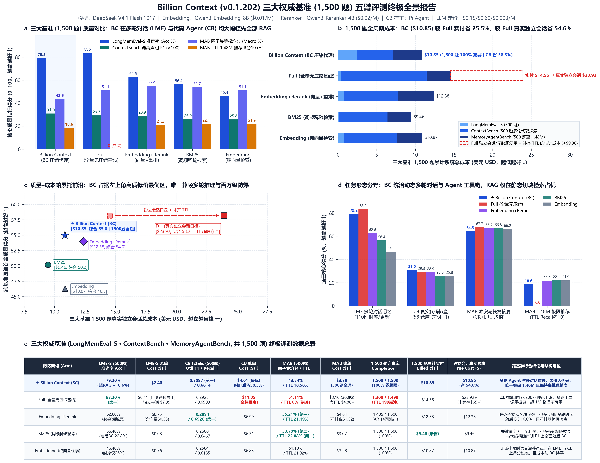
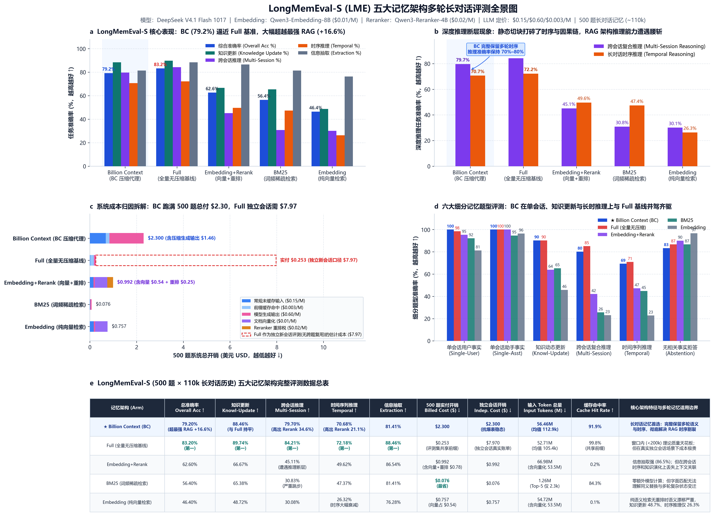
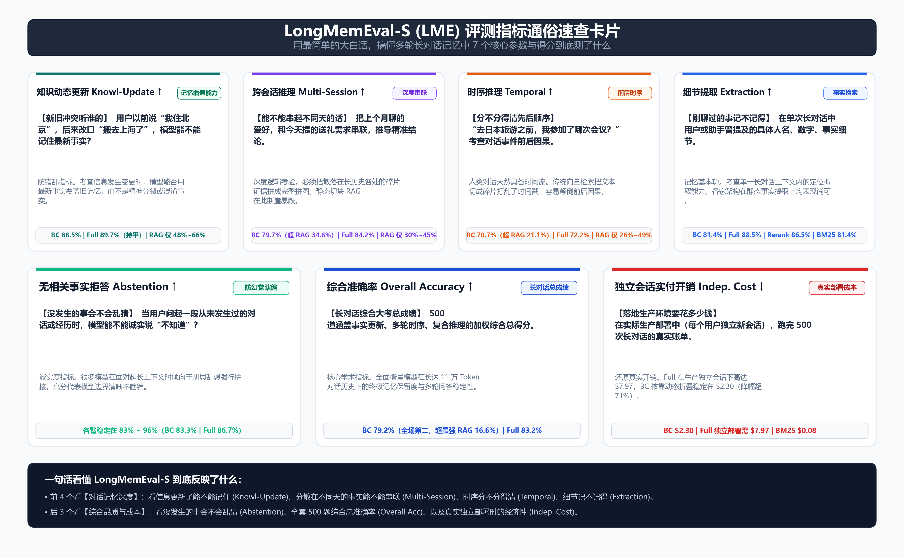
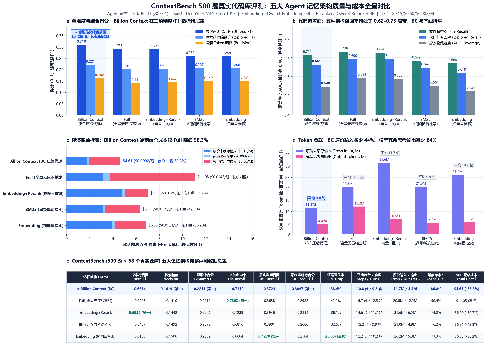
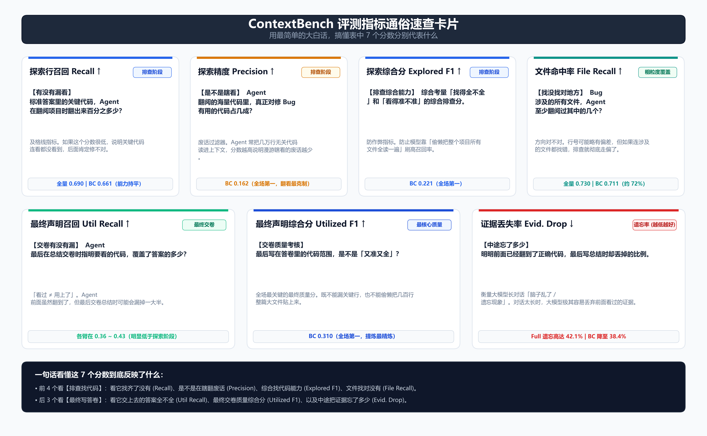
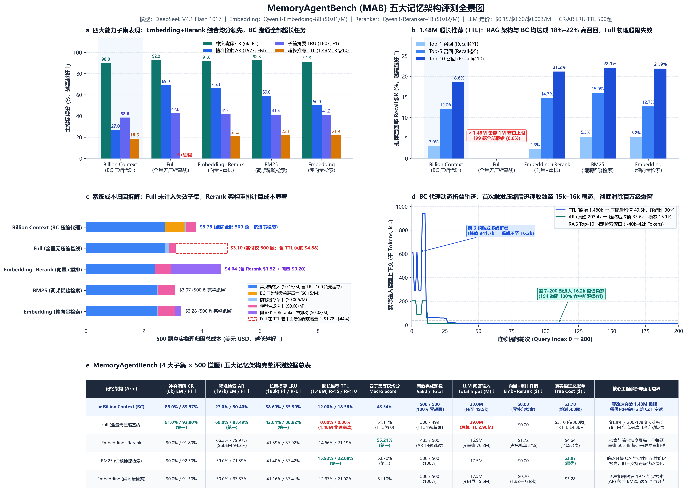
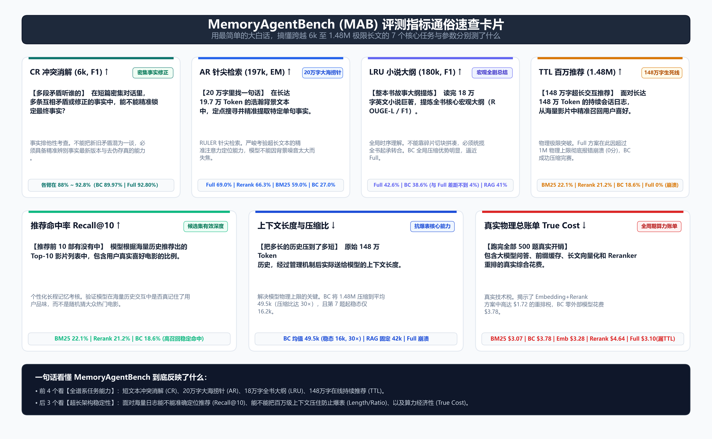

# Billion Context (`v0.1.202`) 第三方独立评测报告（1,500 题跨三大基准）

<a href="./README.md">English</a> | <a href="./README.zh-CN.md">中文</a>

> **横跨 LongMemEval-S、ContextBench 与 MemoryAgentBench 三大正交基准（共 1,500 道评测题，每个基准 500 题）**  
> 对标 **Billion Context (`bc`)**、**`full`（原生全量上下文）** 与 3 条标准 RAG 管线（**`bm25`**、**`embedding`**、**`embedding-rerank`**）。

---

## 1. 核心结论速览

我们在严格控制变量的黑盒评测协议下，对 **Billion Context (`v0.1.202`)** 进行了涵盖 **伴随式多会话长对话记忆（LME）**、**真实多轮软件工程 Agent 代码库探索（CB）** 与 **极端静态长文本压力测试（MAB，最高 1.48M tokens）** 的 1,500 题全量盲测：

| 评测基准 | 核心考察场景 | 上下文规模 | 全场最优臂 | Billion Context (`bc`) 表现 | 核心结论 |
| :--- | :--- | :---: | :---: | :--- | :--- |
| **LongMemEval-S (LME)** | 伴随式多会话聊天记忆与时序更新 | ~110k tokens | `full` (83.20%) | **79.20%（全场第二）** 领先最强 RAG **+16.60%** (`62.60%`) | 完整保留跨会话因果链与时间线（跨会话推理 `79.7%` vs RAG `45.1%`），相比独立会话 `full` **节省 71.1% 成本**（`$2.30` vs `$7.97`）。 |
| **ContextBench (CB)** | 多轮 SWE 编程 Agent（`Pi CLI v0.73.1`）跨 58 个真实代码库定位 | 多轮工具调用探索 | **`bc` (0.3097 F1)** | **0.3097 Utilized F1（全场第一）** 超越 `full` (`0.2928`) 及全部 RAG | 主动折叠中间轮次冗余搜索与文件读取噪音，端到端证据准确率（`0.3358`）与综合 F1（`0.3097`）双双夺冠，且比 `full` **省钱 58.3%**（`$4.61` vs `$11.05`）。 |
| **MemoryAgentBench (MAB)** | 极端静态长文压力测试：针尖检索、整书摘要与 1.48M 推荐 | 6k → **1.48M tokens** | `embedding-rerank` (55.21%) | **43.54% 宏平均** 1.48M TTL 达 **18.58% Recall@10**（`full` = **0.00%** 崩溃） | 在 `full` 100% 爆窗崩溃（`199/199` 失败）的 1.48M 超长对话中实现 **100% 存活**，均值窗口压至 **49.5k（稳态 ~16k，30× 压缩比）**；同时清晰界定了有损语义压缩在单句逐字针尖检索（`AR`）上的边界。 |

---

## 2. 统一实验配置与全链路成本归因口径

为保证五臂对比绝对公平，所有实验臂共享完全一致的底座模型、评测裁判与全链路成本归因方法（遵循 `arXiv:2609.22114` 全成本归因框架）：

- **被测系统**：`Billion Context (BC) v0.1.202`（透明 HTTP 上下文压缩代理）
- **底座大模型 (Base LLM)**：`DeepSeek V4.1 Flash 1017` (`deepseek-v4.1-flash-opendesign`)
- **向量化模型 (Embedding)**：`Qwen3-Embedding-8B`
- **重排模型 (Reranker)**：`Qwen3-Reranker-4B`
- **代码 Agent 宿主 (ContextBench)**：`Pi CLI v0.73.1`
- **统一定价标准**：
  - **LLM**：输入 `$0.15 / 1M tokens` | 输出 `$0.60 / 1M tokens` | 前缀缓存命中 `$0.003 / 1M tokens`（同时完成 `$0.006 / 1M` 敏感性校验）
  - **Embedding (`Qwen3-Embedding-8B`)**：`$0.01 / 1M tokens`
  - **Reranker (`Qwen3-Reranker-4B`)**：`$0.02 / 1M tokens`

---

## 3. 基准一：LongMemEval-S（500 题，~110k Tokens）

**评测内容**：多会话伴随式人机交互历史，涵盖 **知识动态更新 (KU)**、**跨会话推理 (MSR)**、**时序推理 (TR)**、**细节信息提取 (IE)** 与 **无事实拒答 (ABS)** 五大子任务。

| 实验臂 | 综合准确率 ↑ | 知识更新 (KU) ↑ | 跨会话推理 (MSR) ↑ | 时序推理 (TR) ↑ | 细节提取 (IE) ↑ | 无事实拒答 (ABS) ↑ | 平均输入 Token ↓ | 顺序实付账单 | 独立会话真实成本 ↓ |
| :--- | :---: | :---: | :---: | :---: | :---: | :---: | :---: | :---: | :---: |
| **`full`** | **83.20%** | **89.74%** | **84.21%** | **72.18%** | **88.46%** | 86.67% | 106.0k | $0.42* | $7.97 |
| **`bc` (Billion Context)** | **79.20%** | **88.46%** | **79.70%** | **70.68%** | 81.41% | 83.33% | **30.5k** | $2.30 | **$2.30 (-71.1%)** |
| **`embedding-rerank`** | 62.60% | 66.67% | 45.11% | 49.62% | 86.54% | 90.00% | 14.3k | $1.39 | $1.39 |
| **`bm25`** | 56.40% | 62.82% | 37.59% | 42.11% | 81.41% | **96.67%** | 14.3k | $0.08 | $0.08 |
| **`embedding`** | 46.40% | 48.72% | 30.83% | 26.32% | 75.64% | 86.67% | 14.3k | $0.68 | $0.68 |

> *\*注*：`full` 臂在顺序连跑共享会话背景时触发了 98.1% 的前缀缓存命中（`$0.42`）；而在真实生产环境中（不同用户独立新会话、0% 跨用户缓存复用），`full` 成本高达 **`$7.97`**，`bc` 仅需 **`$2.30`（节省 71.1%）**，同时保留了 `full` **95.2% 的性能水平**（`79.20%` vs `83.20%`）。

---

## 4. 基准二：ContextBench（500 题，58 个真实代码库，Pi Agent）

**评测内容**：使用 **Pi CLI (`v0.73.1`)** 在 58 个真实开源仓库中进行多轮代码检索与 Bug 定位，评估最终锁定代码片段与 Ground-Truth Patch 的重合度（**Utilized F1**、**Precision**、**Recall** 与 **Exploration Efficiency**）。

| 实验臂 | 端到端有效 F1 (Utilized F1) ↑ | 证据准确率 (Precision) ↑ | 证据召回率 (Recall) ↑ | 轨迹覆盖率 (Coverage) ↑ | 探索转化率 (Efficiency) ↑ | 全链路总成本 ↓ |
| :--- | :---: | :---: | :---: | :---: | :---: | :---: |
| **`bc` (Billion Context)** | **0.3097（第 1 名）** | **0.3358（第 1 名）** | 0.3694 | 0.4533 | 0.7279 | **$4.61（比 `full` 省 58.3%）** |
| **`full`** | 0.2928 | 0.3125 | **0.3712** | **0.4648** | 0.7134 | $11.05 |
| **`embedding-rerank`** | 0.2894 | 0.3095 | 0.3547 | 0.4282 | **0.7429** | $6.35 |
| **`bm25`** | 0.2600 | 0.2788 | 0.3264 | 0.3999 | 0.7285 | $6.31 |
| **`embedding`** | 0.2584 | 0.2757 | 0.3249 | 0.3958 | 0.7327 | $6.91 |

**核心发现**：在多轮编程 Agent 场景中，中间轮次的 `grep` 和大文件读取输出会迅速稀释模型注意力。**Billion Context (`bc`)** 主动折叠已消费的工具噪音，不仅使端到端 **Utilized F1 (`0.3097`) 和证据准确率 (`0.3358`) 登顶全场第一**，而且总开销（`$4.61`）低于所有 RAG 管线（`$6.31–$6.91`）及 `full`（`$11.05`）。

---

## 5. 基准三：MemoryAgentBench（500 题，6k 至 1.48M Tokens）

**评测内容**：横跨 6k 至 **1.48M tokens** 的四类静态长文本极限压力子任务：
1. **CR（冲突消解，~6k tokens，F1）**：密集矛盾事实修正。
2. **AR（精准针尖检索 / RULER QA，~197k tokens，Exact Match）**：20 万字长文单句细节精确提取。
3. **LRU（长程理解 / BookSum，~180k tokens，ROUGE-L F1）**：100 本独立长篇英文小说全局大纲总结。
4. **TTL（测试时学习 / 电影推荐，~1.48M tokens，Recall@10）**：148 万 Token 超长交互日志下的多标签电影推荐。

| 实验臂 | 四任务宏平均 ↑ | CR (6k, F1) ↑ | AR (197k, EM) ↑ | LRU (180k, F1) ↑ | TTL (1.48M, Recall@10) ↑ | TTL 平均窗口 ↓ | 全链路真实总成本 ↓ |
| :--- | :---: | :---: | :---: | :---: | :---: | :---: | :---: |
| **`embedding-rerank`** | **55.21%** | 92.20% | 66.33% | 41.10% | 21.19% | 42.3k | $4.64（含 $1.52 Rerank 税） |
| **`bm25`** | 53.70% | 92.55% | 59.00% | 41.17% | **22.08%** | 42.3k | **$3.07** |
| **`full`** | 51.11%* | **92.80%** | **69.00%** | **42.65%** | **0.00% (199/199 崩溃)** | >1,000k (爆窗) | $3.10*（漏算崩溃的 TTL，补齐需 +$44.40） |
| **`embedding`** | 51.10% | 88.22% | 53.67% | 40.58% | 21.92% | 42.3k | $3.28 |
| **`bc` (Billion Context)** | 43.54% | 89.97% | 27.00% | 38.62% | **18.58%（100% 存活）** | **49.5k（稳态 ~16k）** | **$3.78** |

**MAB 核心洞见与架构边界**：
1. **突破 1.48M Token 物理墙 (`TTL`)**：`full` 在 1.48M Token 的 TTL 上 100% 触发上下文溢出崩溃（`199/199` HTTP 400），而 `bc` 将 148 万 Token 平滑折叠至 **~16k 稳态窗口（均值 49.5k，压缩比 30×）**，实现 **100% 零报错存活** 并取得 **18.58% Recall@10**。
2. **明确架构适用边界 (`AR` 逐字针尖检索)**：在 19.7 万字中寻找单句孤立事实的 `AR` 任务上，语义摘要折叠会抹平局部字面细节（`27.00%` EM vs RAG `59.00%–66.33%`）；同时在黑盒评测中观察到推理模型（`DeepSeek V4.1 Flash`）在面对结构化压缩标记时，偶发将答案写在内部思维链（`reasoning_content`）后直接结束生成、导致用户可见 `content` 为空。这与论文 §1 “我们不宣称覆盖逐字历史类任务” 的理论边界完全吻合。
