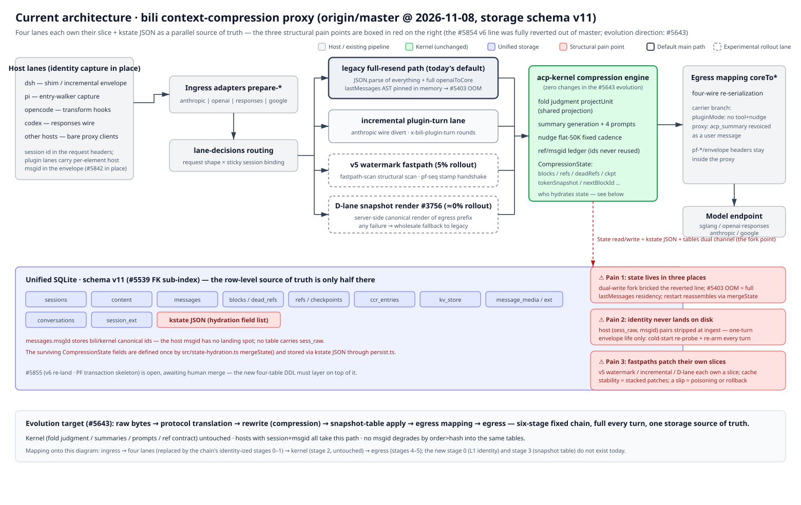

# アーキテクチャ

> システムのアーキテクチャに関するハブページです。このページには**全体図**と**モジュール台帳**を掲載しています。各モジュールは、このディレクトリ内に独自のページ（英語 + `.zh-CN`）を持ち、それぞれに独自の図が用意されています。
> 中国語版: [architecture.zh-CN.md](./architecture.zh-CN.md)
> English: [architecture.md](./architecture.md)
>
> **ライブドキュメント（オーナー裁定 2026-11-08）。** モジュール境界、図示されたデータフロー、テーブル、レーン、またはワイヤーパスを変更する PR は、同じ PR 内で影響を受けるページ、図、およびこのハブテーブルを更新する必要があります。CI は機械的な部分（`tools/check-architecture-docs.mjs`）を強制します。ルールの本文は [AGENTS.md](../AGENTS.md) の "Documentation Layout" セクションにあります。

## 全体アーキテクチャ（2026-11-08 時点、master、ストレージスキーマ v11）

（ビットマップフォールバック: [architecture-current.en.png](./architecture/assets/architecture-current.en.png)）

読み方:

- **左から右へは 1 つのモデルリクエストの流れです。** ホストレーン（dsh / pi / opencode / codex / ベアプロキシクライアント）はすでにアイデンティティ（ヘッダー内のセッション ID。プラグインレーンはエンベロープ内で要素ごとのホスト msgid を保持 — #5842 コレクター）を保持しています。イングレスアダプター（`prepare-*`）はワイヤーを正規化し、`lane-decisions` はリクエストの形状 × スティッキーセッションバインディングに基づいてリクエストを 4 つのレーンのいずれかにルーティングします。レーンは正規化されたコアを **acp-kernel** 圧縮エンジン（フォールド判定 / サマリー / リファレンス台帳 — コアはホスト作業によって書き換えられることはありません）に渡し、エグレスマッピング（`coreTo*`）は 4 つのワイヤー向けに再シリアライズし、モデルエンドポイントが応答します。
- **インディゴ色の帯は単一の SQLite ファイル**（スキーマ v11）です：行レベルのソースオブトゥルース。12 個のテーブルチップと赤い **kstate JSON** チップ。
- **右側の 3 つの赤いボックスは、#5643 の進化（スナップショットテーブル圧縮基盤）が対象とする構造的なペインポイント**です：3 か所に分散して存在する状態、ディスクに永続化されないホストアイデンティティ、そして統一されたスナップショットテーブルではなく各スライスを個別にパッチするファストパス。下部のストリップは進化の目標（6 段階の固定チェーン、単一のストレージソースオブトゥルース）を示しています — これは*提案*（#5643）であり、まだ構築されていません。

## モジュール台帳

| モジュール | 一行説明 | ページ | ステータス |
|---|---|---|---|
| `storage` | 統合 SQLite: テーブルファミリー、kstate、チェックポイント、GC | [storage.md](./architecture/storage.md) · [zh](./architecture/storage.zh-CN.md) · [ja](./architecture/storage.ja.md) | ✅ |
| `pipeline` | リクエストパイプライン（handle / prepare-* / relay / inject） | [pipeline.md](./architecture/pipeline.md) · [zh](./architecture/pipeline.zh-CN.md) · [ja](./architecture/pipeline.ja.md) | ✅ |
| `lanes` | ホストレーン（dsh / pi / opencode / codex / ベアプロキシ + lane-decisions） | [lanes.md](./architecture/lanes.md) · [zh](./architecture/lanes.zh-CN.md) · [ja](./architecture/lanes.ja.md) | ✅ |
| `kernel` | 圧縮エンジン（acp-kernel: フォールド、サマリー、リファレンス台帳） | [kernel.md](./architecture/kernel.md) · [zh](./architecture/kernel.zh-CN.md) · [ja](./architecture/kernel.ja.md) | ✅ |
| `identity` | セッションおよびメッセージのアイデンティティ（セッション ID、ペルソナフォーク、msgid チャネル） | [identity.md](./architecture/identity.md) · [zh](./architecture/identity.zh-CN.md) · [ja](./architecture/identity.ja.md) | ✅ |
| `fastpaths` | ファストパス（増分レーン、v5 ウォーターマーク、D レーンのスナップショットレンダリング） | [fastpaths.md](./architecture/fastpaths.md) · [zh](./architecture/fastpaths.zh-CN.md) · [ja](./architecture/fastpaths.ja.md) | ✅ |
| `webui` | Web パネルおよび管理画面 | [webui.md](./architecture/webui.md) · [zh](./architecture/webui.zh-CN.md) · [ja](./architecture/webui.ja.md) | ✅ |
| `update` | セルフアップデート、アドバイザリー、プラグインインストール | [update.md](./architecture/update.md) · [zh](./architecture/update.zh-CN.md) · [ja](./architecture/update.ja.md) | ✅ |

上記のハブテーブルは単一の台帳です — CI は `✅` の行にページペアが存在し、余分なページが存在しないことをチェックします。

## 他のドキュメントとの関係

- **ファイルレベルのマップ**（どのファイルが何をするか、各 1 行）: [reference/architecture.md](../reference/architecture.md) — CI は `src/` のすべてのファイルをカバーしていることを強制します。
- **構築手順**（ビルド / テスト / リリース / git の仕組み）: [reference/](../reference/README.md)。
- **アイデンティティ教義**（アイデンティティルールの背後にある「なぜ」）: [message-identity](./message-identity.md) · [session-identity](./session-identity.md) · [identity-channels](./identity-channels.md)。
- **リーダー向け概要**（README がリンクしているもの）: [how-it-works](../how-it-works.en.svg)。

## メンテナンスルール

- **同一 PR ルール**（オーナー裁定 2026-11-08）: 構造的変更 ⇒ ドキュメント + 図 + 台帳行を同じ PR で更新。「後でドキュメントを更新する」は禁止。
- **CI レーン `architecture-docs`**（`tools/check-architecture-docs.mjs`）は機械的な部分を強制します：
  1. `reference/architecture.md` がすべての追跡対象 `src/` ファイルを列挙していること（欠落なし、ゴーストなし）；
  2. すべての `✅` 台帳行に両方のページファイル（英語 + `.zh-CN`）が存在し、孤立したページが存在しないこと；
  3. すべてのページが `assets/<module>.{en,zh-CN}.svg` **および** `.png` フォールバックを参照し、それらがすべて存在すること；
  4. すべての SVG が基本的な well-formed であること（タグのバランス、エスケープされていない `&` なし — かつて壊れた英語図をレンダリングした失敗モード）。
- 図の**視覚的な鮮度**は機械的にチェックできません：同一 PR ルールおよびレビューに依存します。図はベクター優先（SVG）であり、PNG はフォールバックとして提供されます（AGENTS.md のドキュメントルールに従う）。
