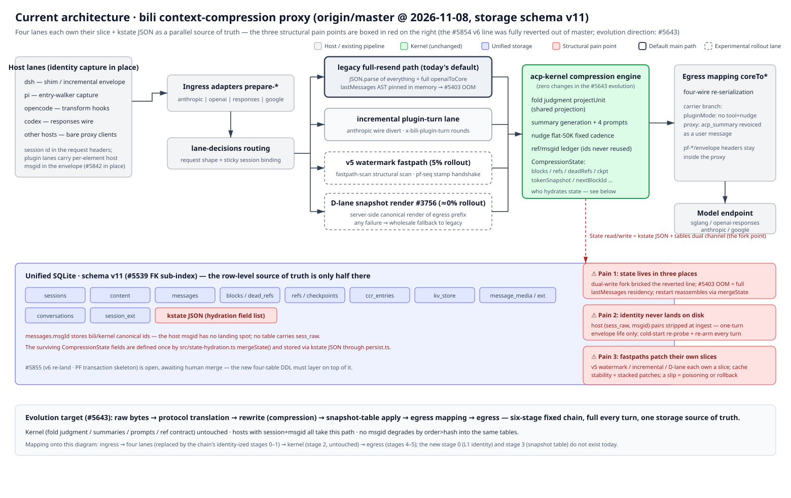

# Architecture

> One hub for the system's architecture. This page holds the **overall diagram** and the **module ledger**; each module gets its own page (en + `.zh-CN`) in this directory, each with its own diagram.
> 中文: [architecture.zh-CN.md](./architecture.zh-CN.md)
>
> **Live document (owner ruling 2026-11-08).** A PR that changes a module boundary, a depicted data flow, a table, a lane, or a wire path MUST update the affected page(s), diagram(s), and this hub table in the same PR. CI enforces the mechanical parts (`tools/check-architecture-docs.mjs`); the rule text lives in [AGENTS.md](../AGENTS.md) "Documentation Layout".

## Overall architecture (as of 2026-11-08, master, storage schema v11)

(bitmap fallback: [architecture-current.en.png](./architecture/assets/architecture-current.en.png))

How to read it:

- **Left → right is one model request.** Host lanes (dsh / pi / opencode / codex / bare proxy clients) carry identity already (session id in headers; plugin lanes carry per-element host msgid in the envelope — #5842 collectors). Ingress adapters (`prepare-*`) normalize the wire, `lane-decisions` routes the request to one of four lanes by request shape × sticky session binding, the lanes hand the canonical cores to the **acp-kernel** compression engine (fold judgment / summaries / ref ledger — the kernel is never rewritten by host work), egress mapping (`coreTo*`) re-serializes for the four wires, and the model endpoint answers.
- **The indigo band is the single SQLite file** (schema v11): the row-level source of truth. Twelve table chips + the red **kstate JSON** chip.
- **The three red boxes on the right are the structural pain points** that the #5643 evolution (snapshot-table compression foundation) targets: state living in three places, host identity never landing on disk, and fastpaths patching their own slices instead of one unified snapshot table. The bottom strip states the evolution target (six-stage fixed chain, one storage source of truth) — it is a *proposal* (#5643), not yet built.

## Module ledger

| Module | One line | Pages | Status |
|---|---|---|---|
| `storage` | Unified SQLite: table family, kstate, checkpoints, GC | [storage.md](./architecture/storage.md) · [zh](./architecture/storage.zh-CN.md) | ✅ |
| `pipeline` | Request pipeline (handle / prepare-* / relay / inject) | [pipeline.md](./architecture/pipeline.md) · [zh](./architecture/pipeline.zh-CN.md) | ✅ |
| `lanes` | Host lanes (dsh / pi / opencode / codex / bare proxy + lane-decisions) | [lanes.md](./architecture/lanes.md) · [zh](./architecture/lanes.zh-CN.md) | ✅ |
| `kernel` | Compression engine (acp-kernel: folds, summaries, ref ledger) | [kernel.md](./architecture/kernel.md) · [zh](./architecture/kernel.zh-CN.md) | ✅ |
| `identity` | Session & message identity (session id, persona fork, msgid channels) | [identity.md](./architecture/identity.md) · [zh](./architecture/identity.zh-CN.md) | ✅ |
| `fastpaths` | Fastpaths (incremental lane, v5 watermark, D-lane snapshot render) | [fastpaths.md](./architecture/fastpaths.md) · [zh](./architecture/fastpaths.zh-CN.md) | ✅ |
| `webui` | Web panel & admin surface | [webui.md](./architecture/webui.md) · [zh](./architecture/webui.zh-CN.md) | ✅ |
| `update` | Self-update, advisory, plugin install | [update.md](./architecture/update.md) · [zh](./architecture/update.zh-CN.md) | ✅ |

The hub table above is the single ledger — CI checks that `✅` rows have their page pairs and no extra pages exist.

## How this relates to the other docs

- **File-level map** (which file does what, one line each): [reference/architecture.md](../reference/architecture.md) — CI enforces it covers every `src/` file.
- **Construction procedures** (build / test / release / git mechanics): [reference/](../reference/README.md).
- **Identity doctrine** (the "why" behind identity rules): [message-identity](./message-identity.md) · [session-identity](./session-identity.md) · [identity-channels](./identity-channels.md).
- **Reader-facing overview** (what the README links): [how-it-works](../how-it-works.en.svg).

## Maintenance rules

- **Same-PR rule** (owner ruling 2026-11-08): structural change ⇒ doc + diagram + ledger row in the same PR. No "docs later".
- **CI lane `architecture-docs`** (`tools/check-architecture-docs.mjs`) enforces the mechanical parts:
  1. `reference/architecture.md` lists every tracked `src/` file (no missing, no ghosts);
  2. every `✅` ledger row has both page files (en + `.zh-CN`), and no orphan pages exist;
  3. every page references its `assets/<module>.{en,zh-CN}.svg` **and** a `.png` fallback, all present;
  4. every SVG is basic-well-formed (balanced tags, no unescaped `&` — the failure mode that once rendered a broken English diagram).
- **Visual freshness** of a diagram is not machine-checkable: it rides on the same-PR rule plus review. Diagrams are vector-first (SVG), PNG shipped as fallback, per the AGENTS.md docs rules.
