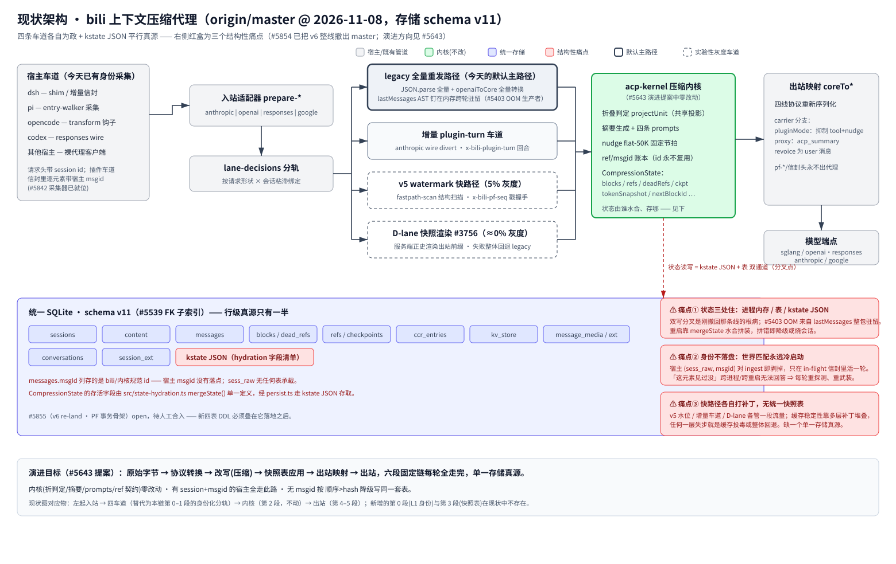

# 架构总览

> 系统架构的唯一枢纽。本页放**整体架构图**与**模块总表**；每个模块在本目录下有独立页面（中英各一份），每页配自己的图。
> English: [architecture.md](./architecture.md)
>
> **实时维护文档（owner 裁定 2026-11-08）**：任何改动模块边界 / 数据流 / 表 / 车道 / 线上路径的 PR，必须**同一 PR** 更新对应页面 + 图 + 本总表。机械部分由 CI 强制（`tools/check-architecture-docs.mjs`）；规则条文见 [AGENTS.md](../AGENTS.md)「Documentation Layout」。

## 整体架构（截至 2026-11-08，master，存储 schema v11）

（位图备选：[architecture-current.zh-CN.png](./architecture/assets/architecture-current.zh-CN.png)）

读图方式：

- **从左到右是一次模型请求的完整路径。** 宿主车道（dsh / pi / opencode / codex / 裸代理客户端）自带身份（session id 走请求头；插件车道逐元素宿主 msgid 走信封——#5842 采集）。入站适配器 `prepare-*` 归一化 wire，`lane-decisions` 按请求形状 × 会话粘滞绑定把请求分到四条车道之一，车道把 canonical cores 交给 **acp-kernel 压缩内核**（折叠判定 / 摘要 / ref 账本——宿主侧工作从不改写内核），出站映射 `coreTo*` 重序列化到四条 wire，模型端点应答。
- **靛色带是唯一的 SQLite 文件**（schema v11）：行级事实源。12 张表 chips + 红色 **kstate JSON** chip。
- **右侧三个红盒是结构性痛点**，#5643 演进提案（快照表压缩底座）针对的就是它们：状态三处住、宿主身份不落盘、快路径各自打补丁。底部一行是演进目标（六段固定链、单一存储真源）——那是**提案**（#5643），尚未实现。

## 模块总表

| 模块 | 一句话 | 页面 | 状态 |
|---|---|---|---|
| `storage` | 统一 SQLite 存储（表族 / kstate / ckpt / GC） | [storage.zh-CN.md](./architecture/storage.zh-CN.md) · [EN](./architecture/storage.md) | ✅ |
| `pipeline` | 请求管道（handle / prepare-* / relay / inject） | [pipeline.zh-CN.md](./architecture/pipeline.zh-CN.md) · [EN](./architecture/pipeline.md) | ✅ |
| `lanes` | 宿主车道（dsh / pi / opencode / codex / 裸代理 + lane-decisions） | [lanes.zh-CN.md](./architecture/lanes.zh-CN.md) · [EN](./architecture/lanes.md) | ✅ |
| `kernel` | 压缩内核（acp-kernel：折叠 / 摘要 / ref 账本） | [kernel.zh-CN.md](./architecture/kernel.zh-CN.md) · [EN](./architecture/kernel.md) | ✅ |
| `identity` | 会话与消息身份（session id / persona fork / msgid 通道） | [identity.zh-CN.md](./architecture/identity.zh-CN.md) · [EN](./architecture/identity.md) | ✅ |
| `fastpaths` | 快路径（增量车道 / v5 watermark / D-lane 快照渲染） | [fastpaths.zh-CN.md](./architecture/fastpaths.zh-CN.md) · [EN](./architecture/fastpaths.md) | ✅ |
| `webui` | Web 面板与 admin 面 | [webui.zh-CN.md](./architecture/webui.zh-CN.md) · [EN](./architecture/webui.md) | ✅ |
| `update` | 自更新、advisory、插件安装 | [update.zh-CN.md](./architecture/update.zh-CN.md) · [EN](./architecture/update.md) | ✅ |

上表是唯一账本——CI 校验 `✅` 行必有 en+zh-CN 页面成对、且不存在表外的孤儿页面。

## 与其他文档的关系

- **文件级地图**（哪个文件干什么，一行一个）：[reference/architecture.md](../reference/architecture.md)——CI 强制它覆盖全部 `src/` 文件。
- **施工流程**（构建 / 测试 / 发版 / git 机制）：[reference/](../reference/README.md)。
- **身份教义**（身份规则背后的 why）：[message-identity](./message-identity.zh-CN.md) · [session-identity](./session-identity.zh-CN.md) · [identity-channels](./identity-channels.zh-CN.md)。
- **面向读者的总览**（README 里那张）：[how-it-works](../how-it-works.zh-CN.svg)。

## 维护规则

- **同 PR 规则**（owner 裁定 2026-11-08）：结构变化 ⇒ 文档 + 图 + 总表行，同一 PR。不存在「文档回头补」。
- **CI 车道 `architecture-docs`**（`tools/check-architecture-docs.mjs`）强制机械部分：
  1. `reference/architecture.md` 列全全部 tracked `src/` 文件（无缺失、无幽灵条目）；
  2. 总表每个 `✅` 行都有 en + `.zh-CN` 两个页面文件，且不存在表外孤儿页面；
  3. 每个页面引用自己的 `assets/<模块>.{en,zh-CN}.svg` **和** `.png` 备选，文件必须存在；
  4. 每个 SVG 基础良构（标签配对、无未转义 `&`——曾有一次英文图因此渲染出破图）。
- 图的**视觉新鲜度**机器查不了：靠同 PR 规则 + review 兜底。图一律矢量优先（SVG），PNG 作备选随附（AGENTS.md 文档规则）。
