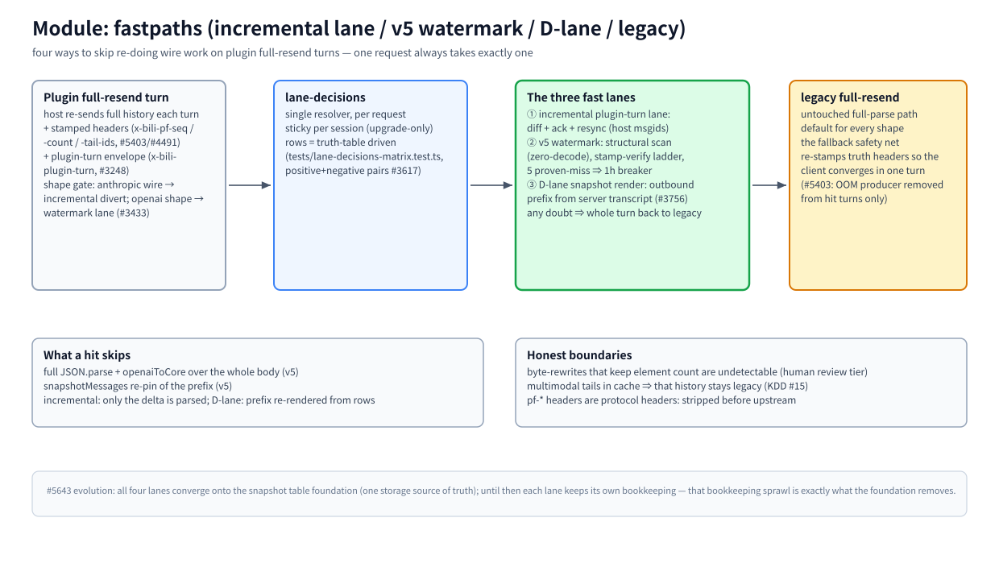

# モジュール: fastpaths (増分レーン / v5 ウォーターマーク / Dレーン / レガシー)

> [アーキテクチャハブ](../architecture.md) の一部 · 中国語版: [fastpaths.zh-CN.md](./fastpaths.zh-CN.md) · 2026-11-08 時点、master

(ビットマップフォールバック: [fastpaths.en.png](./assets/fastpaths.en.png))

## 責務

プラグインホスト (dsh スレッド、pi、opencode など) は、ターンごとに完全な履歴を再送信する。本モジュールは、これらのターンにおいてワイヤー上の作業（パース、正規化変換、スナップショット固定）を再実行することをスキップするメカニズムのファミリーであり、実際に実行した場合とバイト単位で同一の結果を保証する。1つのリクエストは常に正確に1つのパスのみを通過し、これらのパスは構造上（シェイプゲート + スティッキーバインディング）互いに排他的である。

## 原則

- **ヒットするか、完全なレガシーか — 中間は存在しない。** いかなる疑義（不正/古いスタンプ、シェイプ不一致、デシンク、ブレーカー）がある場合でも、ターン全体を未変更のレガシーパスに送る。これにより、クライアントは1ターンで真実値に収束するよう再スタンプが行われる。
- **劣化させ、推測しない。** 検証の失敗はコストであり、高速結果を信頼する許可ではない（可用性を性能より優先、#3128）。
- **高速レーンは1つのリクエストの最適化であり、新しいプロトコルではない。** pf-*/envelope ヘッダーはプロトコルヘッダーであり、アップストリーム (`UPSTREAM_HOP_HEADERS`) に送る前に除去され、モデルエンドポイントには決して表示されない。

## 動作原理

**ターンのシェイプ。** 各成功したレスポンスは、`x-bili-pf-seq` = メッセージ数（`fastpath-scan.ts` によって測定されるゼロアロケーションの構造的スキャン — JSON.parse なし）をスタンプする。クライアントはこれを `x-bili-pf-count` としてエコーバックし、さらに `x-bili-pf-tail-ids`（最後のアンカー以降のホスト msgid、#4491 の要素別スクリーニング）を付与する。プラグインターンのターンは、追加で `x-bili-plugin-turn` エンベロープ (#3248) を保持する。シェイプゲートがレーンを選択する: anthropic ワイヤー → 増分ダイバート; openai シェイプ → ウォーターマークレーン (#3433)。

**① 増分プラグインターンレーン** (`threads-lane.ts`, #3248): ホスト msgid に対する差分 + ACK + リシンク; デルタのみがパースされる。anthropic ワイヤーのダイバートターンを提供する。

**② v5 ウォーターマーク高速パス** (`fastpath.ts`, #5403/#5418, ロールアウト ~5% コホート): 検証済みのヒット時、パイプラインの入力は「前ターンの正規化コア（モジュールレベルの WeakMap）+ テールウィンドウ [K..T) のみに対する新規パース」になる — 完全なパース、完全な変換、および `lastMessages` の固定はスキップされる（#5403 の OOM 原因）。判定ラダー: 資格のある tail-ids リストが同行する場合（v4）、サーバー台帳からのカウントを使用し、それ以外の場合は従来のスタンプラダーを使用; 5回連続の PROVEN ミスで、1時間保持されるブレーカーが発動する（保持中もスキャン/スタンプは継続され、真実値を再教育する）。

**③ Dレーン スナップショットレンダリング** (`snapshot-render.ts`, #3756): 送信プレフィックスはサーバートランスクリプト行（行 seq = メッセージアイデンティティ）からレンダリングされる; テールはクライアントの原文のまま保持される。デシンクが発生した場合 → ターン全体をレガシーにする。

**レガシー完全再送信。** 未変更の完全パースパス — すべてのシェイプのデフォルトであり、3つの高速レーンすべてのフォールバックセーフティネットである。レスポンスに真実値ヘッダーを再スタンプするため、ミスしたターンは1ラウンドで自己修復される。

## ヒット時にスキップされるもの / 正直な境界

スキップ対象: 本体全体の `JSON.parse` + `openaiToCore` (v5); `snapshotMessages` プレフィックスの再固定 (v5); デルタのみパース (増分); 行からのプレフィックス再レンダリング (Dレーン)。正直な境界: 要素数を保持したままのバイト書き換えは検出不能である（その信頼モデルの変更は人間レビューの階層、KDD §7.4）; マルチモーダルテールがキャッシュに入った時点で、その履歴はレガシーターンに留まる（KDD #15 ②）; マーカー除去カウントはシード台帳から継承される（履歴の中間は再スキャンされない）。

## 主要エントリ

`src/server/fastpath.ts` · `src/server/fastpath-scan.ts` (構造的スキャナー) · `src/server/threads-lane.ts` (増分) · `src/server/snapshot-render.ts` (Dレーン) · `src/agent/pf-channel.ts` (クライアント状態機械) · `src/agent/incremental-client.ts` · `src/server/lane-decisions.ts` (ルーティング)

## 関連

[lanes](./lanes.md) · [pipeline](./pipeline.md) · [identity](./identity.md) · [#5643 進化: 4つすべてがスナップショットテーブル基盤に収束](https://github.com/ranxianglei/billion-context/issues/5643) · `tests/issue5403-watermark-fastpath.test.ts`
