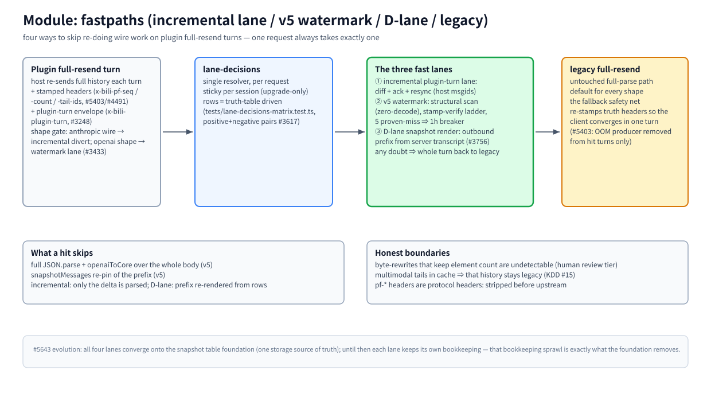

# Module: fastpaths (incremental lane / v5 watermark / D-lane / legacy)

> Part of the [architecture hub](../architecture.md) · 中文: [fastpaths.zh-CN.md](./fastpaths.zh-CN.md) · as of 2026-11-08, master

(bitmap fallback: [fastpaths.en.png](./assets/fastpaths.en.png))

## Responsibility

Plugin hosts (dsh threads, pi, opencode, …) re-send the FULL history every turn. This module is the family of mechanisms that skip re-doing the wire work on those turns — parsing, canonical conversion, snapshot pinning — while staying byte-identical to doing it for real. One request always takes exactly one path; the paths are mutually exclusive by construction (shape gate + sticky binding).

## Principles

- **Hit or full legacy — nothing in between.** Any doubt (bad/stale stamp, shape mismatch, desync, breaker) sends the WHOLE turn down the untouched legacy path, which re-stamps truth so the client converges in one turn.
- **Degrade, never guess.** A missed verification is a cost, not a license to trust the fast result (availability over performance, #3128).
- **The fast lane is an optimization of one request, not a new protocol.** pf-*/envelope headers are protocol headers: stripped before upstream (`UPSTREAM_HOP_HEADERS`), never visible to the model endpoint.

## How it works

**The turn shape.** Each successful response stamps `x-bili-pf-seq` = message count (measured by `fastpath-scan.ts`, a zero-allocation structural scan — no JSON.parse). The client echoes it back as `x-bili-pf-count`, plus `x-bili-pf-tail-ids` (host msgids since the last anchor, #4491's per-element screening). Plugin-turn turns additionally carry the `x-bili-plugin-turn` envelope (#3248). The shape gate picks the lane: anthropic wire → incremental divert; openai shapes → watermark lane (#3433).

**① Incremental plugin-turn lane** (`threads-lane.ts`, #3248): diff + ack + resync over the host msgids; only the delta is parsed. Serves the anthropic-wire divert turns.

**② v5 watermark fastpath** (`fastpath.ts`, #5403/#5418, rollout ~5% cohort): on a verified hit the pipeline input becomes "previous turn's canonical cores (module-level WeakMap) + fresh parse of the tail window [K..T) only" — the full parse, full conversion, and the `lastMessages` pin are skipped (the #5403 OOM producer). Verdict ladder: count from the server ledger when a qualified tail-ids list rides along (v4), otherwise the old stamp ladder; 5 consecutive PROVEN misses trip a breaker held for one hour (scanning/stamping continues during hold to teach truth back).

**③ D-lane snapshot render** (`snapshot-render.ts`, #3756): the outbound prefix is rendered from the server transcript rows (row seq = message identity); the tail stays client-verbatim. Any desync → whole turn legacy.

**Legacy full-resend.** The untouched full-parse path — default for every shape, the fallback safety net for all three fast lanes. It re-stamps truth headers on the response, so a missed turn self-heals in one round.

## What a hit skips / honest boundaries

Skips: whole-body `JSON.parse` + `openaiToCore` (v5); `snapshotMessages` prefix re-pin (v5); delta-only parsing (incremental); prefix re-render from rows (D-lane). Honest boundaries: byte-rewrites that KEEP the element count are undetectable (that trust-model change is human-review tier, KDD §7.4); once a multimodal tail enters the cache, that history stays on legacy turns (KDD #15 ②); marker-strip counts are inherited from the seed ledger (mid-history is never re-scanned).

## Key entries

`src/server/fastpath.ts` · `src/server/fastpath-scan.ts` (structural scanner) · `src/server/threads-lane.ts` (incremental) · `src/server/snapshot-render.ts` (D-lane) · `src/agent/pf-channel.ts` (client state machine) · `src/agent/incremental-client.ts` · `src/server/lane-decisions.ts` (routing)

## Related

[lanes](./lanes.md) · [pipeline](./pipeline.md) · [identity](./identity.md) · [#5643 evolution: all four converge onto the snapshot-table foundation](https://github.com/ranxianglei/billion-context/issues/5643) · `tests/issue5403-watermark-fastpath.test.ts`
