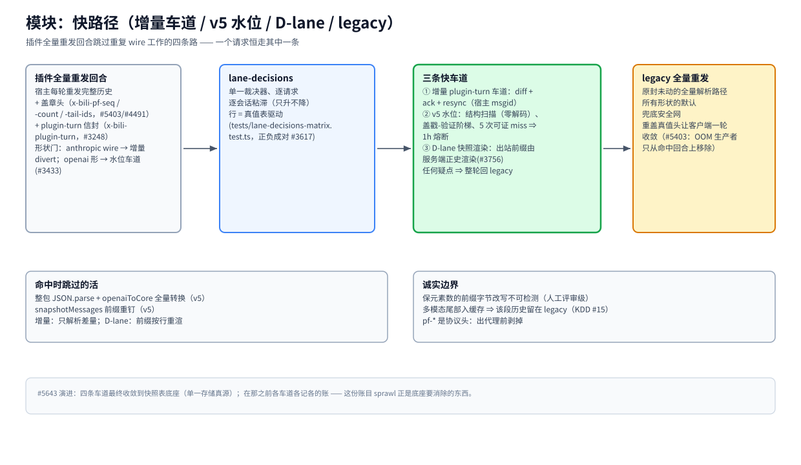

# 模块：快路径（增量车道 / v5 水位 / D-lane / legacy）

> [架构总览](../architecture.zh-CN.md) 的一个模块 · English: [fastpaths.md](./fastpaths.md) · 截至 2026-11-08，master

（位图备选：[fastpaths.zh-CN.png](./assets/fastpaths.zh-CN.png)）

## 职责

插件宿主（dsh threads、pi、opencode……）每轮把完整历史重发一次。这个模块是一族机制，专治这些回合上重复的 wire 工作——解析、规范转换、快照钉存——同时保证与真做一遍**逐字节一致**。一个请求恒走其中一条路；各路径按构造互斥（形状门 + 粘滞绑定）。

## 基本原理

- **要么命中、要么完整 legacy——没有中间态。** 任何疑点（坏戳/旧戳、形状不符、失步、熔断）整轮走原封未动的 legacy 路径；legacy 重新盖真值头，客户端一轮收敛。
- **降级不猜。** 一次验证未过是成本，不是信任快结果的许可证（可用性大于性能，#3128）。
- **快车道是一个请求的优化，不是新协议。** pf-*/信封头是协议头：出代理前剥掉（`UPSTREAM_HOP_HEADERS`），模型端点永远看不到。

## 工作机制

**回合形状。** 每个成功响应盖 `x-bili-pf-seq` = messages 元素数（由 `fastpath-scan.ts` 的零分配结构扫描测出——不 JSON.parse）。客户端下一轮回带 `x-bili-pf-count`，外加 `x-bili-pf-tail-ids`（上次锚点以来的宿主 msgid，#4491 同一套逐元素筛查）。plugin-turn 回合另带 `x-bili-plugin-turn` 信封（#3248）。形状门选车道：anthropic wire → 增量 divert；openai 形 → 水位车道（#3433）。

**① 增量 plugin-turn 车道**（`threads-lane.ts`，#3248）：基于宿主 msgid 的 diff + ack + resync；只解析差量。服务 anthropic-wire divert 回合。

**② v5 水位快路径**（`fastpath.ts`，#5403/#5418，rollout ~5% 灰度）：验证命中后，管道输入变成「上一轮 canonical cores（模块级 WeakMap）+ 仅尾窗 [K..T) 新解析」——整包解析、全量转换、`lastMessages` 钉存全跳过（#5403 的 OOM 生产者）。判决阶梯：带合格 tail-ids 列表时 K 取自服务端账本（v4），否则旧盖戳阶梯；连续 5 次**可证实** miss 触发熔断、持有一小时（持有期间继续扫描盖戳，把真值教回客户端）。

**③ D-lane 快照渲染**（`snapshot-render.ts`，#3756）：出站前缀由服务端正史行渲染（行 seq = 消息身份）；尾巴保持客户端逐字。任何失步 → 整轮 legacy。

**legacy 全量重发。** 原封未动的全量解析路径——所有形状的默认、三条快车道的兜底安全网。它在响应上重盖真值头，miss 的回合一轮自愈。

## 命中时跳过的活 / 诚实边界

跳过：整包 `JSON.parse` + `openaiToCore`（v5）；`snapshotMessages` 前缀重钉（v5）；只解析差量（增量）；前缀按行重渲（D-lane）。诚实边界：保元素数的前缀字节改写**不可检测**（这个信任模型变化在人工评审档，KDD §7.4）；多模态尾部一旦进缓存，该段历史留在 legacy 轮（KDD #15 ②）；marker-strip 计数随种子账本继承（中部区从不重扫）。

## 关键入口

`src/server/fastpath.ts` · `src/server/fastpath-scan.ts`（结构扫描器） · `src/server/threads-lane.ts`（增量） · `src/server/snapshot-render.ts`（D-lane） · `src/agent/pf-channel.ts`（客户端状态机） · `src/agent/incremental-client.ts` · `src/server/lane-decisions.ts`（路由）

## 相关

[lanes](./lanes.zh-CN.md) · [pipeline](./pipeline.zh-CN.md) · [identity](./identity.zh-CN.md) · [#5643 演进：四条收敛到快照表底座](https://github.com/ranxianglei/billion-context/issues/5643) · `tests/issue5403-watermark-fastpath.test.ts`
