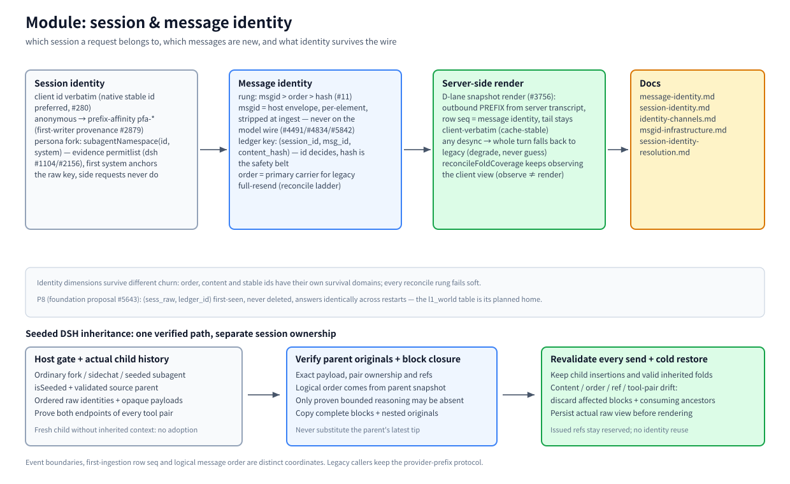

# モジュール: セッションとメッセージのアイデンティティ

> [アーキテクチャハブ](../architecture.md) の一部 · 中国語版: [identity.zh-CN.md](./identity.zh-CN.md) · 2026-11-08 時点、master

(ビットマップフォールバック: [identity.en.png](./assets/identity.en.png))

## 責務

リクエストがどのセッションに属するか、そのセッションのメッセージのうち新規と既に保存済みのものを区別し、生存しているアイデンティティから送信履歴をレンダリングする。これにより、再送信、ID の再発行、モデルの切り替えが、サマリーが参照している内容を破損させることがない。

## 原則

- **階層: msgid > order > hash (オーナールール #11)。** 有効なホスト msgid がアイデンティティを決定する（モデル間での再エンコード後も生存する）。msgid が存在しない場合、順序が一次の担い手となり、コンテンツハッシュはセルごとのハードゲートとして機能するが、グローバルな拒否権は持たない。
- **あいまいな類似性の使用は禁止。** 誤った帰属は最もコストの高い失敗である（MESSAGE-IDENTITY.md）：誤った結合は、古い参照のすべての後続の `decompress` を静かに誤った経路へルーティングさせる。
- **推測ではなく、劣化（デグラデーション）。** 同期のずれ（チェーンの破断、ストレージの読み取り不能、ターン中の切り替えなど）が発生した場合、そのターン全体でレガシーパスにフォールバックし、真実を再スタンプして、1 ラウンドで収束させる。

## 動作原理

**セッションアイデンティティ。** クライアントのセッション ID はそのまま使用される（ネイティブの安定 ID が優先される、#280 — 漂移する派生ハッシュからアイデンティティを構築しないこと）。匿名トラフィックは `pfa-*` プレフィックスアフィニティ ID に解決される（simhash チェーン、初回書き込み者の出所 #2879/#2265）。ペルソナのフォーク: `subagentNamespace(id, systemText)` はホスト由来のペルソナを `|sub:<fp>` にフォークする — 証拠パーミットリスト（現在は dsh、#1104/#2156）、ID 下で最初に確認されたシステムが生キーをアンカーし、サイドリクエストはそれを主張できない。

**メッセージアイデンティティ。** プラグインレーンは、bili のエンベロープ内で要素ごとのホスト msgid を保持する（`POST /__bili/plugin/turn` の `msgIds`）— インジェスト時に除去され、モデルワイヤー上には決して載らない（#4491/#4834/#5842）。台帳キーは `(session_id, msg_id, content_hash)` のトリプルである: msgid が決定し、ハッシュは誤った結合に対する安全帯として機能する。レガシーの全量再送信セッションは、順序中心の調整ラダーを実行する: セルごとのフィンガープリントゲートを伴う位置ベースの主張、ID/コンテンツは補助証拠として使用され、各階層はソフトに失敗し、同一インデックスの合意の連続（MIN_RESYNC_RUN）で再同期する。「基盤の破壊」へのエスカレーションは、すべてのパスが失敗した後、または完全展開のドゥームループ（#2821）の場合のみ行われる。

**サーバーサイドレンダリング（D レーン、#3756）。** 読み取り可能な統合ストレージにバインドされたセッションでは、送信 PREFIX はサーバートランスクリプトからレンダリングされる — 行の `seq` がメッセージアイデンティティであり、署名/ハッシュはチェーンのバックトレースのみである。末尾はプレフィックスキャッシュの安定性のためにクライアント由来のまま保持される。観察（`reconcileFoldCoverage`）とレンダリングは意図的に分離されている。

## 主要エントリ

`src/session-id.ts`（セッションキー + ペルソナフォーク） · `src/prefix-affinity.ts`（匿名解決） · `src/server/snapshot-render.ts`（D レーン） · `src/fold-reconcile.ts`（調整ラダー） · `src/agent/incremental-client.ts`（msgid エンベロープ）

## 関連

[MESSAGE-IDENTITY](../message-identity.md) · [SESSION-IDENTITY](../session-identity.md) · [identity-channels](../identity-channels.md) · [msgid-infrastructure](../msgid-infrastructure.md) · [session-identity-resolution](../session-identity-resolution.md) · [storage](./storage.md)
