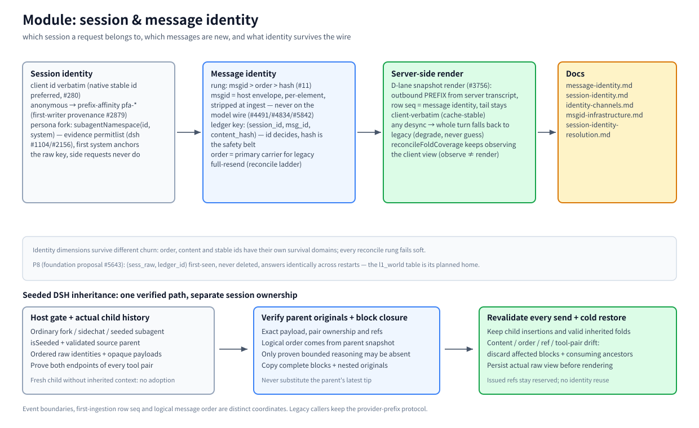

# Module: session & message identity

> Part of the [architecture hub](../architecture.md) · 中文: [identity.zh-CN.md](./identity.zh-CN.md) · as of 2026-11-08, master

(bitmap fallback: [identity.en.png](./assets/identity.en.png))

## Responsibility

Decide which session a request belongs to, which of its messages are new versus already stored, and render the outbound history from the surviving identity — so that re-sends, id re-mints, and model switches never corrupt what a summary refers to.

## Principles

- **Rung: msgid > order > hash (owner rule #11).** A valid host msgid decides identity (survives cross-model re-encoding); without it, order is the primary carrier and the content hash is a hard per-cell gate with NO global veto.
- **Never fuzzy similarity.** Mis-attribution is the most expensive failure (MESSAGE-IDENTITY.md): a wrong join silently misroutes every later `decompress` of a stale ref.
- **Degradation, not guessing.** Any desync — chain broken, storage unreadable, switch mid-turn — falls back to the legacy path for the whole turn, re-stamps truth, and converges in one round.

## How it works

**Session identity.** The client's session id is used verbatim (native stable ids preferred, #280 — never build identity from derived hashes that drift). Anonymous traffic resolves to `pfa-*` prefix-affinity ids (simhash chain, first-writer provenance #2879/#2265). Persona forking: `subagentNamespace(id, systemText)` forks a host-proven persona onto `|sub:<fp>` — an evidence permitlist (dsh today, #1104/#2156), the first system seen under an id anchors the raw key, side requests never claim it.

**Message identity.** Plugin lanes carry per-element host msgids in bili's envelope (`msgIds` on `POST /__bili/plugin/turn`) — stripped at ingest, never on the model wire (#4491/#4834/#5842). The ledger key is the triple `(session_id, msg_id, content_hash)`: msgid decides, hash is the safety belt against mis-binding. Legacy full-resend sessions run the order-centric reconcile ladder: positional claims with per-cell fingerprint gates, id/content as auxiliary evidence, each rung failing soft, resync at runs of same-index agreements (MIN_RESYNC_RUN); escalation to "substrate destroyed" only after every pass, or the total-unfold doom loop (#2821).

**Seeded DSH inheritance.** Ordinary forks, sidechats and context-inheriting subagents use the same gate: `isSeeded` plus a validated adoption parent (`forkSource`, or the legacy `parentSession`). Fresh subagents do not inherit merely because they have a parent. When the parent snapshot advertises durable-fork support with an available unified ledger, the host sends the child's actual ordered message identities with opaque payload and complete tool-pair proofs. The proxy compares them to archived parent cores and the parent snapshot's logical order, copies complete verified block closures and originals, and keeps inserted child messages. Only explicitly classified, bounded assistant reasoning may be omitted; missing or changed text/tools cannot qualify a block. Every later request, including cold recovery, revalidates that proof and removes affected blocks and their consumers before rendering changed content. DSH event boundaries and storage row sequences are separate coordinates; neither the parent's latest tip nor the provider-prefix length substitutes for the child's evidence. The wire contract is owned by [plugin-protocol §8](../plugin-protocol.md#8-public-snapshot-and-fork-fork-protocol-2-v1-clients-still-accepted).

**Server-side render (D-lane, #3756).** For sessions bound to a readable unified store, the outbound PREFIX is rendered from the server transcript — row `seq` IS the message identity, signatures/hash are chain back-trace only; the tail stays client-verbatim for prefix-cache stability. Observing (`reconcileFoldCoverage`) and rendering are deliberately separate.

## Key entries

`src/session-id.ts` (session key + persona fork) · `src/prefix-affinity.ts` (anonymous resolution) · `src/server/snapshot-render.ts` (D-lane) · `src/fold-reconcile.ts` (reconcile ladder) · `src/agent/incremental-client.ts` (msgid envelope)

## Related

[MESSAGE-IDENTITY](../message-identity.md) · [SESSION-IDENTITY](../session-identity.md) · [identity-channels](../identity-channels.md) · [msgid-infrastructure](../msgid-infrastructure.md) · [session-identity-resolution](../session-identity-resolution.md) · [storage](./storage.md)
