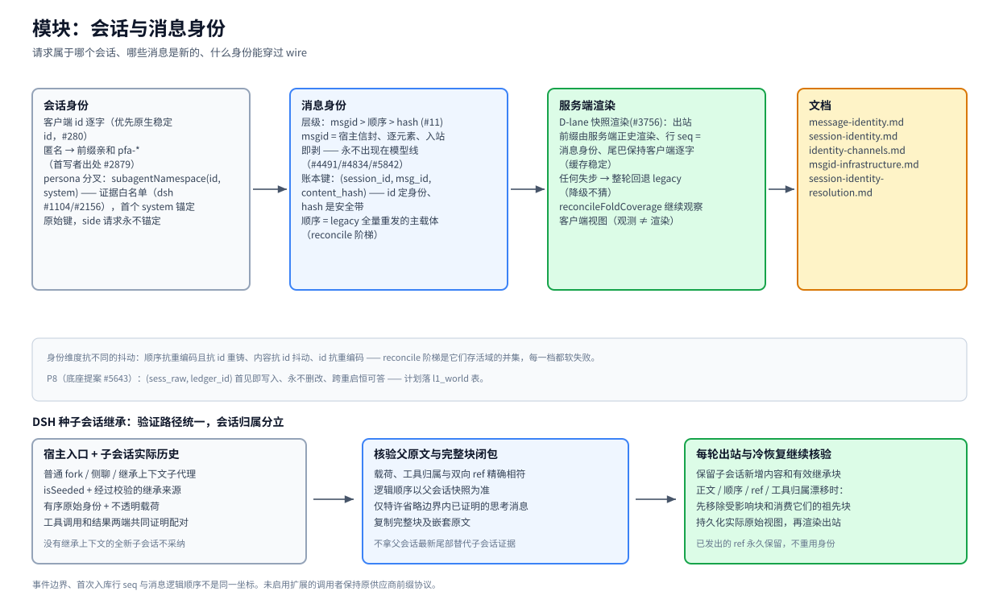

# 模块：会话与消息身份

> [架构总览](../architecture.zh-CN.md) 的一个模块 · English: [identity.md](./identity.md) · 截至 2026-11-08，master

（位图备选：[identity.zh-CN.png](./assets/identity.zh-CN.png)）

## 职责

判定一个请求属于哪个会话、它的哪些消息是新的哪些已落账、并按存活身份渲染出站历史——让重发、id 重铸、换模型都不会弄坏摘要引用的东西。

## 基本原理

- **层级：msgid > 顺序 > hash（owner 规则 #11）。** 有效的宿主 msgid 定身份（抗跨模型重编码）；没有它，顺序是主载体、内容哈希是逐格硬门但**没有全局否决权**。
- **永不模糊相似。** 错绑是最贵的失败（MESSAGE-IDENTITY.md）：join 错一次，之后对该 ref 的每次 `decompress` 都悄悄取错内容。
- **降级不猜。** 任何失步——链断、存储不可读、中途切换——整轮回退 legacy 路径、重盖真值、一轮收敛。

## 工作机制

**会话身份。** 客户端 session id 逐字使用（优先原生稳定 id，#280——永不从会漂移的派生哈希构造身份）。匿名流量解析为 `pfa-*` 前缀亲和 id（simhash 链、首写者出处 #2879/#2265）。persona 分叉：`subagentNamespace(id, systemText)` 把宿主被证明的 persona 分叉到 `|sub:<fp>`——证据白名单（今天是 dsh，#1104/#2156）；某 id 下首个 system 锚定原始键，side 请求永不锚定。

**消息身份。** 插件车道把逐元素宿主 msgid 装在 bili 信封里上行（`POST /__bili/plugin/turn` 的 `msgIds`）——入站即剥、永不出现在模型线上（#4491/#4834/#5842）。账本键是三元组 `(session_id, msg_id, content_hash)`：msgid 定身份，hash 是防错绑的安全带。legacy 全量重发会话跑顺序为中心的 reconcile 阶梯：位置认领带逐格指纹门，id/内容为辅助证据，每一档软失败，在同索引连续命中（MIN_RESYNC_RUN）处重新同步；只有所有通道都空了才升级「substrate destroyed」，否则就是 total-unfold 死循环（#2821）。

**服务端渲染（D-lane，#3756）。** 对绑定了可读统一存储的会话，出站**前缀**由服务端正史行渲染——行 `seq` 就是消息身份，签名/hash 只做链回溯兜底；尾巴保持客户端逐字以稳住前缀缓存。观察（`reconcileFoldCoverage`）与渲染刻意分离。

## 关键入口

`src/session-id.ts`（会话键 + persona 分叉） · `src/prefix-affinity.ts`（匿名解析） · `src/server/snapshot-render.ts`（D-lane） · `src/fold-reconcile.ts`（reconcile 阶梯） · `src/agent/incremental-client.ts`（msgid 信封）

## 相关

[MESSAGE-IDENTITY](../message-identity.zh-CN.md) · [SESSION-IDENTITY](../session-identity.zh-CN.md) · [identity-channels](../identity-channels.zh-CN.md) · [msgid-infrastructure](../msgid-infrastructure.zh-CN.md) · [session-identity-resolution](../session-identity-resolution.zh-CN.md) · [storage](./storage.zh-CN.md)
