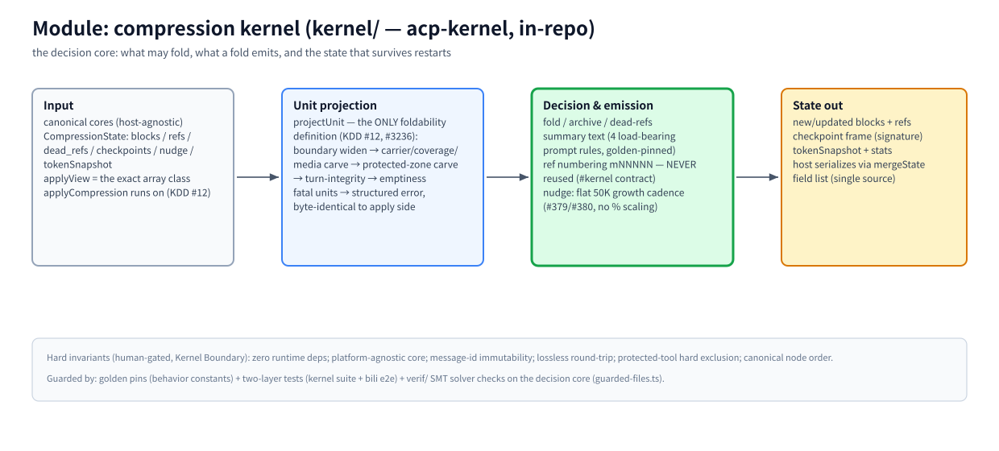

# モジュール: 圧縮カーネル (`kernel/` — acp-kernel, リポジトリ内)

> [アーキテクチャハブ](../architecture.md) の一部 · 中国語版: [kernel.zh-CN.md](./kernel.zh-CN.md) · 2026-11-08 時点、master、カーネル v0.0.184

(ビットマップフォールバック: [kernel.en.png](./assets/kernel.en.png))

## 責務

プロダクト全体の意思決定コアである。正規化されたコアとセッションの圧縮状態を受け取り、折りたたみ可能な対象を判定し、成果物（ブロック、参照、サマリー、チェックポイント）を出力し、状態の差分を返す。リポジトリ内の `kernel/` (#2092) に配置され、独自の npm アイデンティティ (`acp-kernel`) とバージョンを保持している。ビルド時に `dist/` にインラインでバンドルされ、`dist/index.js` は自己完結した状態を維持する。

## 原則 (カーネル境界 — `kernel/` 配下の何かを変更する前に AGENTS.md を読むこと)

- **ランタイム依存ゼロ。** オーナーの承認なしに新しい依存関係を追加しない。コアはプラットフォーム非依存を維持する（ホスト API / ファイル I/O / ネットワークなし）。
- **メッセージ ID は決して再利用されない。** コンテンツハッシュ ID と参照番号 (`mNNNNN`) は、メッセージが死んでも永遠にちょうど 1 つのメッセージのみを指す — モデルは過去に見た任意の番号を引用できる。
- **ロスカレスラウンドトリップ; 保護ツールのハード除外; 正規ノード順序。** 構造不変条件であり、人間によるゲート管理を行う。
- **常に人間によるみでのレビュー。** `kernel/**` の変更は `src/update.ts` と同じ階層に位置する: 自動マージは絶対に禁止; PR 本文には `kernel-change: <reason>` を宣言しなければならない (CI `kernel-guard`)。

## 動作原理

**入力。** 正規化されたコア（ホスト非依存のメッセージ形式）と `CompressionState` — ブロック / 参照 / dead_refs / チェックポイント / nudge / tokenSnapshot。判定は、`applyCompression` が実行される正確な配列クラス (`applyView`, KDD #12) に対して行われる。

**ユニット射影。** `projectUnit` (`kernel/src/unit-projection.ts`) は唯一の折りたたみ可能性の定義である (#3236): 境界の拡大 → キャリア/カバレッジ/メディアの切り出し → 保護ゾーンからの切り出し → ターン完全性 → 空判定、そして構造化された射影または、適用側とバイト単位で同一の致命的エラーを返す。推奨側は最終ユニットをこれを通じて再スクリーニングし、致命的なユニットをギャップに降格する — 広告→拒否の振動は起きない。

**意思決定と出力。** fold / archive / dead-refs; サマリーテキストは 4 つの荷重プロンプトルールに従う（`tests/golden/wire-contract/kernel.json` にゴールデンピンされている）; 参照番号 `mNNNNN` は一度だけ発行される; nudge の頻度は平坦な 50K 成長ステップである — 意図的にコンテキストウィンドウにスケーリングされない (#379/#380; ユーザーのエスケープハッチ `compress.nudgeGrowthTokens`)。

**状態出力。** 新規/更新されたブロック + 参照、署名付きチェックポイントフレーム、tokenSnapshot + 統計情報。ホストは `mergeState()` を通じて生存するフィールドをシリアライズする — フィールドリストの唯一の真実の源 (`src/state-hydration.ts`); カーネルはホストのストレージレイアウトについて決して知らない。

**ガード。** ホストが黙って依存している動作表面のためのゴールデンピン; 2 つのテスト層（カーネル自身のスイート + bili e2e を統合として）; `verif/` はガードされた意思決定コアファイルを SMT に変換し、反例を実際の TypeScript に対してリプレイする (AGENTS.md KDD #14)。

## 主要エントリ

`kernel/src/` (エンジン) · `kernel/src/state.ts` (`CompressionState`) · `kernel/src/unit-projection.ts` (`projectUnit`) · `verif/guarded-files.ts` (SMT ガード範囲) · `tests/golden/wire-contract/kernel.json` (動作ピン)

## 関連

[pipeline](./pipeline.md) · [storage](./storage.md) (状態永続化) · [fastpaths](./fastpaths.md) · [AGENTS.md — カーネル境界](../../AGENTS.md) · [#5643 進化提案](https://github.com/ranxianglei/billion-context/issues/5643) (カーネルは変更されない)
