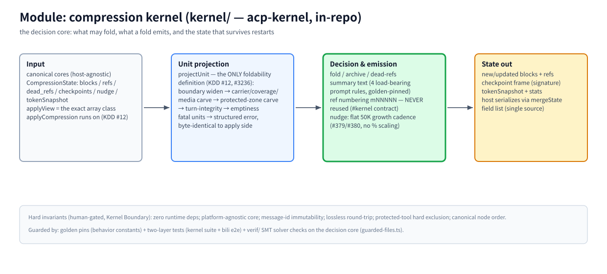

# Module: compression kernel (`kernel/` — acp-kernel, in-repo)

> Part of the [architecture hub](../architecture.md) · 中文: [kernel.zh-CN.md](./kernel.zh-CN.md) · as of 2026-11-08, master, kernel v0.0.184

(bitmap fallback: [kernel.en.png](./assets/kernel.en.png))

## Responsibility

The decision core of the whole product: given canonical cores plus the session's compression state, decide what may fold, emit the artifacts (blocks, refs, summaries, checkpoints), and hand back the state delta. It lives in-repo under `kernel/` (#2092), keeps its own npm identity (`acp-kernel`) and version, and is bundled inline into `dist/` at build time — `dist/index.js` stays self-contained.

## Principles (Kernel Boundary — read AGENTS.md before touching anything under `kernel/`)

- **Zero runtime deps.** No new dependency without owner sign-off; the core stays platform-agnostic (no host API / file I/O / network).
- **Message ids are never reused.** A content-hash id and a ref number (`mNNNNN`) denote exactly one message forever, even after it dies — the model can cite any number it has ever seen.
- **Lossless round-trip; protected-tool hard exclusion; canonical node order.** Structural invariants, human-gated.
- **Human-only review, always.** Any `kernel/**` change sits at the same tier as `src/update.ts`: no auto-merge, ever; PR body must declare `kernel-change: <reason>` (CI `kernel-guard`).

## How it works

**Input.** Canonical cores (host-agnostic message form) plus `CompressionState` — blocks / refs / dead_refs / checkpoints / nudge / tokenSnapshot. The judgment runs on the EXACT array class `applyCompression` executes on (`applyView`, KDD #12).

**Unit projection.** `projectUnit` (`kernel/src/unit-projection.ts`) is the ONLY foldability definition (#3236): boundary widen → carrier/coverage/media carve → protected-zone carve → turn-integrity → emptiness, returning either a structured projection or the ready-to-throw fatal error byte-identical to the apply side. The recommend side re-screens final units through it and demotes fatal units to gaps — no advertise→reject oscillation.

**Decision & emission.** fold / archive / dead-refs; summary text follows the four load-bearing prompt rules (golden-pinned in `tests/golden/wire-contract/kernel.json`); ref numbering `mNNNNN` is mint-once; nudge cadence is the flat 50K growth step — deliberately NOT scaled with the context window (#379/#380; user escape hatch `compress.nudgeGrowthTokens`).

**State out.** New/updated blocks + refs, the signed checkpoint frame, tokenSnapshot + stats. The host serializes the surviving fields through `mergeState()` — the field list's single source of truth (`src/state-hydration.ts`); the kernel never knows about the host's storage layout.

**Guards.** Golden pins for the behavior surface hosts silently depend on; two test layers (kernel's own suite + bili e2e as integration); `verif/` translates the guarded decision-core files into SMT and replays any counterexample against the real TypeScript (AGENTS.md KDD #14).

## Key entries

`kernel/src/` (engine) · `kernel/src/state.ts` (`CompressionState`) · `kernel/src/unit-projection.ts` (`projectUnit`) · `verif/guarded-files.ts` (SMT guard scope) · `tests/golden/wire-contract/kernel.json` (behavior pins)

## Related

[pipeline](./pipeline.md) · [storage](./storage.md) (state persistence) · [fastpaths](./fastpaths.md) · [AGENTS.md — Kernel Boundary](../../AGENTS.md) · [#5643 evolution proposal](https://github.com/ranxianglei/billion-context/issues/5643) (kernel stays untouched)
