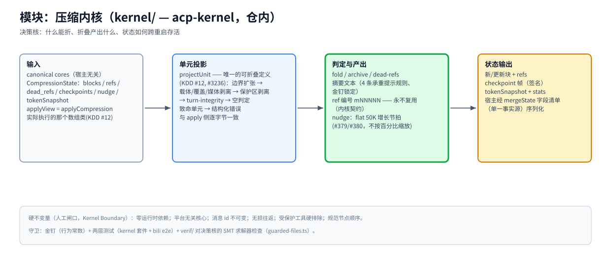

# 模块：压缩内核（`kernel/` — acp-kernel，仓内）

> [架构总览](../architecture.zh-CN.md) 的一个模块 · English: [kernel.md](./kernel.md) · 截至 2026-11-08，master，kernel v0.0.184

（位图备选：[kernel.zh-CN.png](./assets/kernel.zh-CN.png)）

## 职责

整个产品的决策核：给定 canonical cores 与会话压缩状态，判定什么能折、产出折叠产物（块、refs、摘要、检查点）、交回状态增量。它住在仓内 `kernel/`（#2092），保留自己的 npm 身份（`acp-kernel`）与版本号，构建时内联进 `dist/`——`dist/index.js` 保持自包含。

## 基本原理（Kernel Boundary——动 `kernel/` 前先读 AGENTS.md）

- **零运行时依赖。** 新依赖必须 owner 签核；核心保持平台无关（不碰宿主 API / 文件 I/O / 网络）。
- **消息 id 永不复用。** 内容哈希 id 与 ref 编号（`mNNNNN`）永远只指一条消息——即使它已死（被编辑/截断/折叠）；模型可以引用它见过的任何编号。
- **无损往返；受保护工具硬排除；规范节点顺序。** 结构性不变量，人工闸口。
- **人工评审，永远。** 任何 `kernel/**` 改动与 `src/update.ts` 同档：永不自动合并；PR 正文必须写 `kernel-change: <reason>`（CI `kernel-guard`）。

## 工作机制

**输入。** canonical cores（宿主无关消息形态）+ `CompressionState`——blocks / refs / dead_refs / checkpoints / nudge / tokenSnapshot。判定运行在 `applyCompression` 实际执行的那个数组类上（`applyView`，KDD #12）。

**单元投影。** `projectUnit`（`kernel/src/unit-projection.ts`）是**唯一**的可折叠定义（#3236）：边界扩张 → 载体/覆盖/媒体剥离 → 保护区剥离 → turn-integrity → 空判定；返回结构化投影，或返回与 apply 侧逐字节一致的待抛致命错误。推荐侧对最终单元再过一遍、把致命单元降级为 gap——没有 advertise→reject 振荡。

**判定与产出。** fold / archive / dead-refs；摘要文本遵循 4 条承重提示规则（金钉锁在 `tests/golden/wire-contract/kernel.json`）；ref 编号 `mNNNNN` 一次铸造；nudge 节拍是 flat 50K 增长步——**刻意不**随上下文窗口缩放（#379/#380；用户逃生阀 `compress.nudgeGrowthTokens`）。

**状态输出。** 新/更新块 + refs、带签名的 checkpoint 帧、tokenSnapshot + stats。宿主经 `mergeState()` 序列化存活字段——字段清单的单一事实源在 `src/state-hydration.ts`；内核从不知道宿主的存储布局。

**守卫。** 行为面金钉（宿主悄悄依赖的常量）；两层测试（kernel 自己的套件 + bili e2e 集成层）；`verif/` 把受守护的决策核文件翻译成 SMT，反例回放真 TypeScript（AGENTS.md KDD #14）。

## 关键入口

`kernel/src/`（引擎） · `kernel/src/state.ts`（`CompressionState`） · `kernel/src/unit-projection.ts`（`projectUnit`） · `verif/guarded-files.ts`（SMT 守护范围） · `tests/golden/wire-contract/kernel.json`（行为金钉）

## 相关

[pipeline](./pipeline.zh-CN.md) · [storage](./storage.zh-CN.md)（状态持久化） · [fastpaths](./fastpaths.zh-CN.md) · [AGENTS.md — Kernel Boundary](../../AGENTS.md) · [#5643 演进提案](https://github.com/ranxianglei/billion-context/issues/5643)（内核保持不动）
