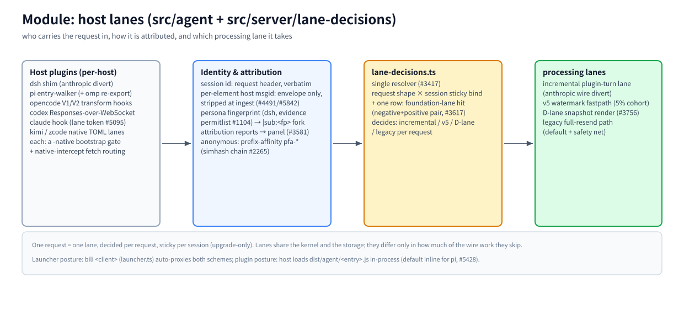

# モジュール: ホストレーン (`src/agent` + `src/server/lane-decisions.ts`)

> [アーキテクチャハブ](../architecture.ja.md) の一部 · 中国語: [lanes.zh-CN.md](./lanes.zh-CN.md) · 2026-11-08 時点、master

(ビットマップフォールバック: [lanes.en.png](./assets/lanes.en.png))

## 責務

このモジュールは、リクエストごとに3つの質問に答える。誰がそれを運んできたか（どのホスト、どのプラグイン）、どのアイデンティティに属するか（セッション、ペルソナ、メッセージ）、そしてどの処理レーンを通るかである。`src/agent/` はホストプロセス内で実行されるホストごとのプラグインコードを保持し、サーバー側の `lane-decisions.ts` は単一の解決器（resolver）である。

## 原則

- **1リクエスト = 1レーン。** `lane-decisions.ts` (#3417) によってリクエストごとに決定され、セッションごとにスティッキー（粘着性）であり、アップグレードのみ許可される（セッションがサイレントにダウングレードされることはない）。
- **ゲートの規律。** すべての抑制/劣化ゲートは、両方向のアサーションを伴ってリリースされる — `tests/lane-decisions-matrix.test.ts` (#3617) 内の正の行と負の行の両方である。負の行を伴わないゲートは、定義上不完全である。
- **エンベロープのみアイデンティティ。** ホストの msgid とスタンプされたヘッダーは bili のプライベートエンベロープ内で移動し、取り込み時に除去される。それらはモデルワイヤー上には決して現れない（msgid > order > hash, AGENTS.md #11）。

## 動作原理

**ホストプラグイン（ホストごと）。** dsh シム（anthropic-wire ターンを迂回し、openai 形状は完全な再送を維持 — #3433） · pi エントリーウォーカー（omp は同じエントリを再エクスポート） · opencode V1/V2 トランスフォームフック · codex Responses-over-WebSocket · claude フック（レーントークン、#5095） · kimi / zcode ネイティブ TOML レーン。各ホストレーンには `-native` ブートストラップゲートがあり、`native-intercept.ts` はホストの fetch トラフィックを帰属ヘッダー付きでプロキシにルーティングする。

**アイデンティティと帰属。** セッション ID はリクエストヘッダーからそのまま取得される（ネイティブ安定 ID が優先、#280）。匿名トラフィックはプレフィックスアフィニティ（`pfa-*`、ファーストライター由来 #2879、simhash チェーン #2265）によって解決される。dsh のペルソナフィンガープリントは証拠パーミットリスト（#1104/#2156）である：1つの ID を複数のペルソナ間で再利用することが証明されたホストのみが `|sub:<fp>` セッションにフォークする。ID 下で最初に見られたシステムが生のキーをアンカーし、サイドリクエストはそれを主張できない（#2156/#2160）。注入破損状態は `/__bili/status` の `attribution` 経由で可視化される（#3581）。

**解決器。** `lane-decisions.ts` はリクエスト形状 × セッションスティッキーバインディング（#5643 基盤レーン用の計画行1つ、負+正のペア）をマッチングし、以下を選択する：増分プラグインターンレーン / v5 ウォーターマーク / Dレーンスナップショットレンダリング / レガシー完全再送。

**処理レーン。** 3つのファストレーンについては [fastpaths モジュール](./fastpaths.md) を参照。レガシー完全再送はすべての形状のデフォルトであり、それらすべてのフォールバックセーフティネットである。

## 主要エントリ

`src/agent/plugin.ts` (x-bili-plugin レーン) · `src/agent/dsh-*` · `src/agent/pi*.ts` · `src/agent/opencode*.ts` · `src/agent/native-intercept.ts` · `src/server/lane-decisions.ts` · `src/launcher.ts` (`bili <client>` ポスチャー) · `tests/lane-decisions-matrix.test.ts`

## 関連

[fastpaths](./fastpaths.md) · [identity](./identity.md) · [pipeline](./pipeline.md) · [identity-channels](../identity-channels.md) · [msgid-infrastructure](../msgid-infrastructure.md)
