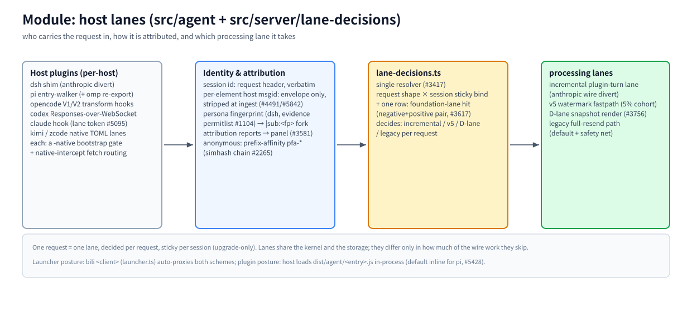

# Module: host lanes (`src/agent` + `src/server/lane-decisions.ts`)

> Part of the [architecture hub](../architecture.md) · 中文: [lanes.zh-CN.md](./lanes.zh-CN.md) · as of 2026-11-08, master

(bitmap fallback: [lanes.en.png](./assets/lanes.en.png))

## Responsibility

This module answers three questions per request: who carried it in (which host, which plugin), which identity it belongs to (session, persona, messages), and which processing lane it takes. `src/agent/` holds the per-host plugin code that runs INSIDE the host process; `lane-decisions.ts` on the server side is the single resolver.

## Principles

- **One request = one lane.** Decided per request by `lane-decisions.ts` (#3417), sticky per session, upgrade-only (a session never silently demotes).
- **Gate discipline.** Every suppression/degradation gate ships with both directions asserted — positive AND negative rows in `tests/lane-decisions-matrix.test.ts` (#3617). A gate without its negative row is incomplete by definition.
- **Envelope-only identity.** Host msgids and stamped headers travel in bili's private envelope and are stripped at ingest; they never appear on the model wire (msgid > order > hash, AGENTS.md #11).

## How it works

**Host plugins (per host).** dsh shim (diverts anthropic-wire turns, openai shapes keep full resend — #3433) · pi entry-walker (omp re-exports the same entries) · opencode V1/V2 transform hooks · codex Responses-over-WebSocket · claude hook (lane token, #5095) · kimi / zcode native TOML lanes. Each host lane has a `-native` bootstrap gate, and `native-intercept.ts` routes the host's fetch traffic to the proxy with attribution headers.

**Identity & attribution.** The session id comes from the request header verbatim (native stable ids preferred, #280). Anonymous traffic resolves via prefix affinity (`pfa-*`, first-writer provenance #2879, simhash chain #2265). The dsh persona fingerprint is an EVIDENCE PERMITLIST (#1104/#2156): only hosts proven to reuse one id across personas fork onto `|sub:<fp>` sessions; the first system seen under an id anchors the raw key, side requests never claim it (#2156/#2160). Broken-injection state is visible via `/__bili/status` `attribution` (#3581).

**The resolver.** `lane-decisions.ts` matches request shape × session sticky binding (+ one planned row for the #5643 foundation lane, negative+positive pair) and picks: incremental plugin-turn lane / v5 watermark / D-lane snapshot render / legacy full-resend.

**Processing lanes.** See the [fastpaths module](./fastpaths.md) for the three fast lanes; legacy full-resend is the default for every shape and the fallback safety net for all of them.

## Key entries

`src/agent/plugin.ts` (x-bili-plugin lane) · `src/agent/dsh-*` · `src/agent/pi*.ts` · `src/agent/opencode*.ts` · `src/agent/native-intercept.ts` · `src/server/lane-decisions.ts` · `src/launcher.ts` (`bili <client>` posture) · `tests/lane-decisions-matrix.test.ts`

## Related

[fastpaths](./fastpaths.md) · [identity](./identity.md) · [pipeline](./pipeline.md) · [identity-channels](../identity-channels.md) · [msgid-infrastructure](../msgid-infrastructure.md)
