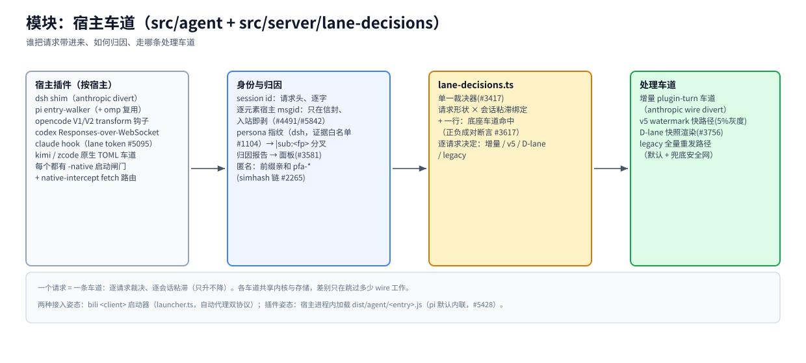

# 模块：宿主车道（`src/agent` + `src/server/lane-decisions.ts`）

> [架构总览](../architecture.zh-CN.md) 的一个模块 · English: [lanes.md](./lanes.md) · 截至 2026-11-08，master

（位图备选：[lanes.zh-CN.png](./assets/lanes.zh-CN.png)）

## 职责

对每个请求回答三个问题：谁把它带进来（哪个宿主、哪个插件）、它属于什么身份（会话、persona、消息）、它走哪条处理车道。`src/agent/` 是跑在**宿主进程内**的按宿主插件代码；服务端的 `lane-decisions.ts` 是单一裁决器。

## 基本原理

- **一个请求 = 一条车道。** `lane-decisions.ts`（#3417）逐请求裁决、逐会话粘滞、只升不降（会话不会悄悄降级）。
- **闸门纪律。** 每个抑制/降级闸门必须正负双向断言——`tests/lane-decisions-matrix.test.ts` 里成对的行（#3617）。没有负向行的闸门按定义就是缺件。
- **身份只在信封。** 宿主 msgid 与盖章头走 bili 私有信封、入站即剥；永不出现在模型线上（msgid > 顺序 > hash，AGENTS.md #11）。

## 工作机制

**宿主插件（按宿主）。** dsh shim（divert anthropic-wire 回合；openai 形保持全量重发——#3433） · pi entry-walker（omp 复用同一批 entry） · opencode V1/V2 transform 钩子 · codex Responses-over-WebSocket · claude hook（lane token，#5095） · kimi / zcode 原生 TOML 车道。每个宿主车道都有 `-native` 启动闸门；`native-intercept.ts` 把宿主 fetch 流量带归因头路由到代理。

**身份与归因。** session id 逐字取自请求头（优先原生稳定 id，#280）。匿名流量走前缀亲和（`pfa-*`，首写者出处 #2879、simhash 链 #2265）。dsh persona 指纹是**证据白名单**（#1104/#2156）：只有被证明「一个 id 复用给多个 persona」的宿主才分叉到 `|sub:<fp>` 会话；某 id 下首个 system 锚定原始键，side 请求永不锚定（#2156/#2160）。注入坏状态经 `/__bili/status` 的 `attribution` 字段可见（#3581）。

**裁决器。** `lane-decisions.ts` 匹配请求形状 × 会话粘滞绑定（外加 #5643 底座车道的一行，正负成对），逐请求选出：增量 plugin-turn / v5 水位 / D-lane 快照渲染 / legacy 全量重发。

**处理车道。** 三条快车道见 [fastpaths 模块](./fastpaths.zh-CN.md)；legacy 全量重发是所有形状的默认、也是所有快车道的兜底安全网。

## 关键入口

`src/agent/plugin.ts`（x-bili-plugin 车道） · `src/agent/dsh-*` · `src/agent/pi*.ts` · `src/agent/opencode*.ts` · `src/agent/native-intercept.ts` · `src/server/lane-decisions.ts` · `src/launcher.ts`（`bili <client>` 姿态） · `tests/lane-decisions-matrix.test.ts`

## 相关

[fastpaths](./fastpaths.zh-CN.md) · [identity](./identity.zh-CN.md) · [pipeline](./pipeline.zh-CN.md) · [identity-channels](../identity-channels.zh-CN.md) · [msgid-infrastructure](../msgid-infrastructure.zh-CN.md)
