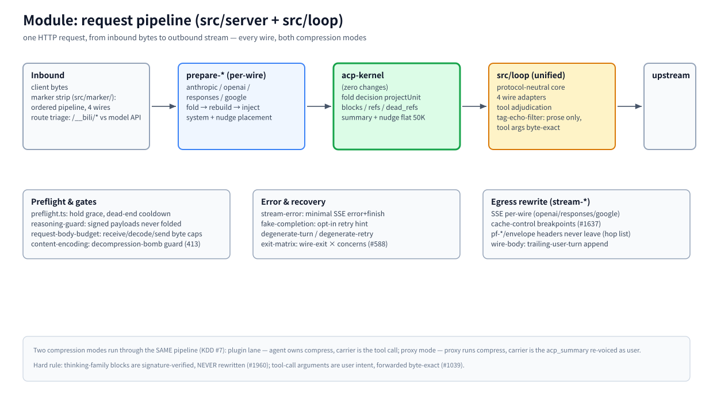

# モジュール: リクエストパイプライン (`src/server` + `src/loop`)

> [アーキテクチャハブ](../architecture.md) の一部 · 中国語版: [pipeline.zh-CN.md](./pipeline.zh-CN.md) · 2026-11-10 時点, master

(ビットマップフォールバック: [pipeline.en.png](./assets/pipeline.en.png))

## 責務

プロキシに到達するすべてのモデルトラフィックのリクエストは、このモジュールを通過します。受信バイト列はストリップおよびトリアージ（分類）され、ホスト非依存のコア形式に変換され、カーネルのフォールド判定を通過し、クライアントのワイヤー形式に再シリアライズされ、レスポンス側の書き換えを伴ってストリームとして返されます。管理トラフィック (`/__bili/*`, `/__acp/*`) は事前にトリアージで除外され、[webui モジュール](./webui.md) に送られます。

## 原則

- **1つのパイプライン、4つのワイヤー。** Anthropic、OpenAI chat-completions、Responses、Google それぞれに `prepare-*` と `stream-*` アダプタが用意され、中間部分は共有されます。変更は両方の圧縮モード（AGENTS.md §6）で論理的に検討する必要があります — 1つのモードで正しくても、もう1つのモードを壊す可能性があります (#377)。
- **1つのフォールダビリティ定義。** レンジがフォールダブル（折りたたみ可能）かどうかは、カーネルの `projectUnit` によって決定され、バイト単位で同一に適用されます (KDD #12, #3236) — 推奨と適用は決して不一致になりません。
- **重要な箇所ではバイト単位で正確に。** ツールコールの引数はユーザーの意図であり、バイト単位で正確に転送され、決してフィルタリングされません (#1039)。思考系ブロックは署名検証され、決して書き換えられません (#1960) — 散文フィルタはテキストチャネル専用です。

## 動作原理

**受信 (Inbound)。** マーカーストリップ (`src/marker/`) は、ワイヤーごとに ACP レンダリングタグを認識・除去する順序付きパイプラインです。`handle.ts` はルートをトリアージし、ワイヤーを検出してから、対応する `prepare-*` に引き継ぎます。

**準備 (Prepare) (ワイヤーごと)。** `prepare-anthropic` / `prepare-openai` / `prepare-responses` / `prepare-google` は、リクエストを正規コアに変換します（ホスト msgid などのインフライトエンベロープフィールドはここでストリップされます — [identity](./identity.md) を参照）、フォールド→再構築→注入のシーケンスを実行し、そのワイヤーが要求する場所にシステムメッセージとナッジを配置します。

**カーネル。** 正規コアとセッションの `CompressionState` が acp-kernel に渡され、判定とその成果物が返されます — [カーネルモジュール](./kernel.md) を参照してください。

**統一ループ (`src/loop`)。** 4つのワイヤーアダプタを持つプロトコル非依存のコアが、ツール裁定と散文タグエコーフィルタ (`tag-echo-filter.ts` — 散文のみ、引数は変更なし) を実行します。ここが2つの圧縮モードが同じコードパスを維持する場所です (KDD #7): プラグインモードではエージェントが圧縮を所有するためツール+ナッジ注入が抑制され、プロキシモードでは `acp_summary` キャリアを出力し、厳格なバックエンドが安定したプレフィックスを維持できるようユーザーメッセージとして再表現されます。

**送信 (Egress)。** `stream-*` はワイヤーごとにアップストリームの SSE を書き換えます（チャンクフレーミング、キャッシュコントロールブレークポイント #1637、`wire-body` トレーリングユーザーターン追加）。リクエスト側では、ユーザー登録可能な `egressTransforms[]` パイプライン (`src/egress-transforms.ts`, #6003) が、セッション処理の後で再署名/v1Wrap の前に、すべての送信モデルリクエストボディに対して ESM プラグインを実行します — プラグインごとにフェイルオープン、`/__bili/config/reload` によるホットリロード可能、未設定時は完全な何もしません (no-op)。プロトコルヘッダー (pf-*/envelope) はプロキシから決して外に出ません — アップストリームのホップヘッダーリストがそれらを除去します。

**ゲートとリカバリ。** `preflight.ts` (ホールドグレース、デッドエンドクールダウン)、`reasoning-guard` (署名済みペイロードは決してフォールド入力にならない)、`request-body-budget` (受信/デコード/送信バイト上限、パフォーマンスより可用性 #3128)、`content-encoding` (デコンプレッションボムガード、413)。エラー形状: `stream-error` (最小限の SSE エラー + 終了)、`fake-completion` (オプトインのリトライヒント)、`degenerate-turn` / `degenerate-retry`、および `exit-matrix` (ワイヤー終了 × 懸念事項、#588)。

## 主要エントリ

`src/server/handle.ts` (トリアージ) · `src/server/prepare-*.ts` (ワイヤーごとのリクエスト準備) · `src/marker/` (受信タグストリップ) · `src/loop/` (統一コア + アダプタ) · `src/server/stream-*.ts` (ワイヤーごとの送信) · `src/egress-transforms.ts` (ユーザー送信ボディ書き換えプラグイン、#6003) · `src/server/preflight.ts` · `src/server/exit-matrix.ts`

## 関連

[lanes](./lanes.md) · [kernel](./kernel.md) · [fastpaths](./fastpaths.md) · [storage](./storage.md) · [MESSAGE-IDENTITY](../message-identity.md)
