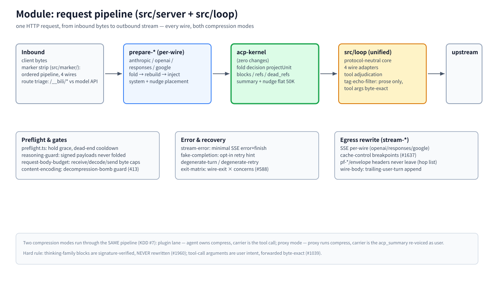

# Module: request pipeline (`src/server` + `src/loop`)

> Part of the [architecture hub](../architecture.md) · 中文: [pipeline.zh-CN.md](./pipeline.zh-CN.md) · as of 2026-11-08, master

(bitmap fallback: [pipeline.en.png](./assets/pipeline.en.png))

## Responsibility

Every model-traffic request that reaches the proxy passes through this module: inbound bytes are stripped and triaged, converted to the host-agnostic core form, sent through the kernel's fold decision, re-serialized to the client's wire, and streamed back with response-side rewrites. Admin traffic (`/__bili/*`, `/__acp/*`) is triaged out up front and goes to the [webui module](./webui.md).

## Principles

- **One pipeline, four wires.** Anthropic, OpenAI chat-completions, Responses, and Google each get a `prepare-*` and a `stream-*` adapter; the middle is shared. A change must be reasoned in both compression modes (AGENTS.md §6) — correct-in-one-mode can break the other (#377).
- **One foldability definition.** Whether a range is foldable is decided by the kernel's `projectUnit` and applied byte-identically (KDD #12, #3236) — recommend and apply never disagree.
- **Byte-exact where it counts.** Tool-call arguments are user intent and are forwarded byte-exact, never filtered (#1039); thinking-family blocks are signature-verified and NEVER rewritten (#1960) — the prose filters are text-channel only.

## How it works

**Inbound.** The marker strip (`src/marker/`) is an ordered pipeline that recognizes and removes ACP render tags, per wire. `handle.ts` triages the route, detects the wire, and hands off to the matching `prepare-*`.

**Prepare (per-wire).** `prepare-anthropic` / `prepare-openai` / `prepare-responses` / `prepare-google` convert the request to canonical cores (in-flight envelope fields such as host msgids are stripped here — see [identity](./identity.md)), run the fold→rebuild→injection sequence, and place the system message and the nudge where that wire requires it.

**Kernel.** The canonical cores plus the session's `CompressionState` go to acp-kernel; the decision and its artifacts come back — see the [kernel module](./kernel.md).

**Unified loop (`src/loop`).** A protocol-neutral core with four wire adapters performs tool adjudication and the prose tag-echo filter (`tag-echo-filter.ts` — prose only, arguments untouched). This is where the two compression modes keep the same code path (KDD #7): plugin mode suppresses tool + nudge injection because the agent owns compression; proxy mode emits the `acp_summary` carrier, re-voiced as a user message so strict backends keep a stable prefix.

**Egress.** `stream-*` rewrites the upstream SSE per wire (chunk framing, cache-control breakpoints #1637, `wire-body` trailing-user-turn append). Protocol headers (pf-*/envelope) never leave the proxy — the upstream hop-header list strips them.

**Gates & recovery.** `preflight.ts` (hold grace, dead-end cooldown), `reasoning-guard` (signed payloads are never fold inputs), `request-body-budget` (receive/decode/send byte caps, availability over performance #3128), `content-encoding` (decompression-bomb guard, 413). Error shapes: `stream-error` (minimal SSE error + finish), `fake-completion` (opt-in retry hint), `degenerate-turn` / `degenerate-retry`, and `exit-matrix` (wire-exit × concerns, #588).

## Key entries

`src/server/handle.ts` (triage) · `src/server/prepare-*.ts` (per-wire request prep) · `src/marker/` (inbound tag strip) · `src/loop/` (unified core + adapters) · `src/server/stream-*.ts` (per-wire egress) · `src/server/preflight.ts` · `src/server/exit-matrix.ts`

## Related

[lanes](./lanes.md) · [kernel](./kernel.md) · [fastpaths](./fastpaths.md) · [storage](./storage.md) · [MESSAGE-IDENTITY](../message-identity.md)
