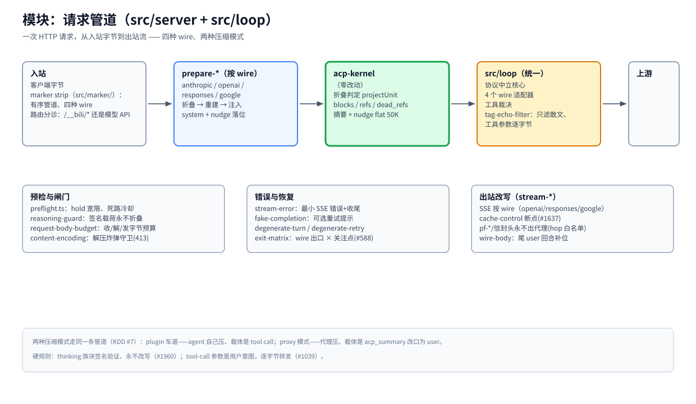

# 模块：请求管道（`src/server` + `src/loop`）

> [架构总览](../architecture.zh-CN.md) 的一个模块 · English: [pipeline.md](./pipeline.md) · 截至 2026-11-08，master

（位图备选：[pipeline.zh-CN.png](./assets/pipeline.zh-CN.png)）

## 职责

到达代理的每个模型流量请求都走这个模块：入站字节被剥标签、分诊，转成宿主无关的核形态，过内核的折叠判定，重序列化回客户端的 wire，再做响应侧改写后流式返回。管理流量（`/__bili/*`、`/__acp/*`）在最前面被分走，进 [webui 模块](./webui.zh-CN.md)。

## 基本原理

- **一条管道、四种 wire。** Anthropic、OpenAI chat-completions、Responses、Google 各有 `prepare-*` 与 `stream-*` 适配器，中段共享。任何改动必须同时推理两种压缩模式（AGENTS.md §6）——单模式正确可能弄坏另一个（#377）。
- **唯一的可折叠定义。** 一个区间能否折叠由内核 `projectUnit` 判定、apply 侧逐字节一致地执行（KDD #12，#3236）——推荐与执行永不分歧。
- **该精确处逐字节。** tool-call 参数是用户意图，只转发不过滤（#1039）；thinking 族块签名验证、永不改写（#1960）——散文过滤器只作用于文本通道。

## 工作机制

**入站。** marker strip（`src/marker/`）是有序管道，按 wire 识别并剥掉 ACP 渲染标签。`handle.ts` 分诊路由、检测 wire、交给对应的 `prepare-*`。

**准备（按 wire）。** `prepare-anthropic` / `prepare-openai` / `prepare-responses` / `prepare-google` 把请求转成 canonical cores（宿主 msgid 等 in-flight 信封字段在此剥掉——见 [identity](./identity.zh-CN.md)），跑折叠→重建→注入，把 system 与 nudge 落到该 wire 要求的位置。

**内核。** canonical cores 加会话的 `CompressionState` 进 acp-kernel，判定与产物回来——见 [kernel 模块](./kernel.zh-CN.md)。

**统一 loop（`src/loop`）。** 协议中立核心 + 4 个 wire 适配器，做工具裁决与散文 tag-echo 过滤（`tag-echo-filter.ts`——只滤散文、参数不动）。两种压缩模式在这里共用同一条代码路径（KDD #7）：plugin 模式抑制 tool + nudge 注入（agent 自己压）；proxy 模式发 `acp_summary` 载体、改口为 user 消息，让严格后端保持前缀稳定。

**出站。** `stream-*` 按 wire 改写上游 SSE（块框架、cache-control 断点 #1637、`wire-body` 尾 user 回合补位）。协议头（pf-*/信封）永不出代理——上游 hop 头白名单剥掉它们。

**闸门与恢复。** `preflight.ts`（hold 宽限、死路冷却）、`reasoning-guard`（签名载荷永不进折叠输入）、`request-body-budget`（收/解/发字节预算，可用性大于性能 #3128）、`content-encoding`（解压炸弹守卫，413）。错误形态：`stream-error`（最小 SSE 错误+收尾）、`fake-completion`（可选重试提示）、`degenerate-turn` / `degenerate-retry`、`exit-matrix`（wire 出口 × 关注点，#588）。

## 关键入口

`src/server/handle.ts`（分诊） · `src/server/prepare-*.ts`（按 wire 请求准备） · `src/marker/`（入站剥标签） · `src/loop/`（统一核心+适配器） · `src/server/stream-*.ts`（按 wire 出站） · `src/server/preflight.ts` · `src/server/exit-matrix.ts`

## 相关

[lanes](./lanes.zh-CN.md) · [kernel](./kernel.zh-CN.md) · [fastpaths](./fastpaths.zh-CN.md) · [storage](./storage.zh-CN.md) · [MESSAGE-IDENTITY](../message-identity.zh-CN.md)
