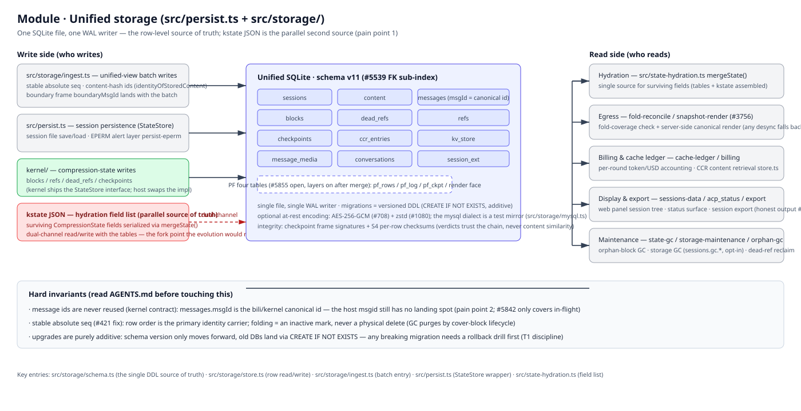

# モジュール: 統合ストレージ (`src/persist.ts` + `src/storage/`)

> [アーキテクチャハブ](../architecture.ja.md) の一部 · 中国語版: [storage.zh-CN.md](./storage.zh-CN.md) · 2026-11-08 時点、master、スキーマ v11

(ビットマップフォールバック: [storage.en.png](./assets/storage.en.png))

## 責務

プロセス再起動後も保持されなければならないすべてのデータは、単一の SQLite ファイルに格納される: セッション、メッセージ行、コンテンツ、圧縮ブロックとその参照台帳、チェックポイント、通知ストアとセッション拡張で使用される `kv_store`、およびメディアである。`src/persist.ts` はレガシーなセッションファイルのファサード（StateStore ラッパー、EPERM アラート層）であり、`src/storage/` は統合された行レベルのストアである。

## 原則

- **単一の WAL ライター。** 単一の SQLite ファイル、単一の書き込みパス（バッチ処理された `ingest.ts`）により、リーダーがライターと競合することがない。
- **正規 ID、ホスト ID ではない。** `messages.msgId` には bili/kernel の正規 ID（`identityOfStoredContent`）が保存される。ホストの要素ごとの msgid は進行中のエンベロープフィールドであり、まだストレージには格納されない（ペインポイント 2 — #5643 提案の `l1_world` テーブルが予定された格納先である）。
- **安定した絶対 seq (#421 修正)。** 行の順序はメッセージアイデンティティの主要な担い手である。フォールディングは行を非アクティブにマークするだけで、物理的に削除することはない（GC はカバーブロックのライフサイクルに基づいてパージする）。
- **追加的なマイグレーションのみ。** スキーマバージョンは前方に進む。古い DB は `CREATE IF NOT EXISTS` 経由で移行される — 破壊的なマイグレーションには、まずロールバックドリルが必要である（T1 規律、#5643 テストマトリクス）。

## 動作原理

**書き込み側。** インジェストパスは統合ビューをバッチ書き込みする（安定した絶対 seq; `identityOfStoredContent` によるコンテンツハッシュ ID; バウンダリフレーム `boundaryMsgId` はバッチとともに格納される）。`persist.ts` はセッションファイルの保存/読み込みと EPERM アラート層を処理する。カーネルは、カーネルが提供する StateStore インターフェースを通じて圧縮状態（ブロック / 参照 / dead_refs / チェックポイント）を書き込む — ホストは実装を差し替える。

**kstate JSON は並列の第二の真実の源である（ペインポイント 1）。** 残存する `CompressionState` フィールドリストは `mergeState()` によってシリアライズされる（フィールドリストの単一の源 — `src/state-hydration.ts`）であり、テーブルとともに読み書きされる — 二重チャネルである。#5643 の進化により、カーネル状態のシリアライズは `snap_ckpt.meta_json` 内に移動され、テーブルが唯一の源となる。

**読み込み側。** ハイドレーションは、残存フィールドの単一の源として `mergeState()` を使用する（テーブル + kstate が組み立てられる）。エグレスはフォールディングカバレッジチェックとサーバーサイドの正規レンダリングを実行する（D レーン、#3756 — どのデシンクもレガシーパスにフォールバックし、デグレードしても推測しない）。課金とキャッシュ台帳（`cache-ledger`、`store.ts` 内の CCR 取得）および表示/エクスポートサーフェス（`sessions-data`、`acp_status`、`export` — 誠実な出力、#155）はすべて同じ行を読み取る。メンテナンスは `state-gc` / `storage-maintenance` / オルファン GC（`sessions.gc_*` でのストレージ GC、オプトイン、dead-ref の回収）である。

**整合性。** チェックポイントフレーム署名 + S4 行ごとのチェックサム; 判定はチェーンを信頼し、コンテンツの類似性を決して信頼しない。任意の静止時エンコーディング: AES-256-GCM (#708) + zstd (#1080)。`src/storage/mysql.ts` 配下の mysql ダイアレクトはテストミラーのみである（mysql-contract CI レーン） — SQLite が本番ストレージであり続ける。

## 厳格な不変条件（これに触れる前に AGENTS.md を参照すること）

- メッセージ ID は決して再利用されない（カーネル契約）; `messages.msgId` は正規 ID である。
- 行の順序 = アイデンティティの担い手; フォールディング = 非アクティブマーク、物理削除ではない。
- アップグレードは純粋に追加的である; 破壊的な変更の前にロールバックドリルを行う。

## 主要なエントリ

`src/storage/schema.ts`（単一の DDL 真実の源） · `src/storage/store.ts`（行の読み書き） · `src/storage/ingest.ts`（バッチエントリ） · `src/persist.ts`（StateStore ラッパー） · `src/state-hydration.ts`（残存フィールドリスト）

## 関連

[message-identity](../message-identity.md) · [session-identity](../session-identity.md) · [#5643 進化提案 (PR #5873)](https://github.com/ranxianglei/billion-context/issues/5643)
