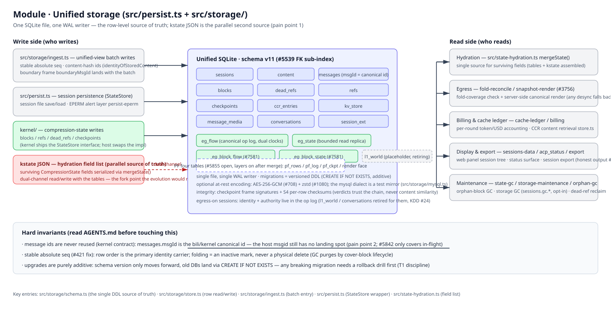

# モジュール: 統合ストレージ (`src/persist.ts` + `src/storage/`)

> [アーキテクチャハブ](../architecture.ja.md) の一部 · 中国語版: [storage.zh-CN.md](./storage.zh-CN.md) · 2026-11-08 時点、master、スキーマ v11

(ビットマップフォールバック: [storage.en.png](./assets/storage.en.png))

## 責務

プロセス再起動後も保持されなければならないすべてのデータは、単一の SQLite ファイルに格納される: セッション、メッセージ行、コンテンツ、圧縮ブロックとその参照台帳、チェックポイント、通知ストアとセッション拡張で使用される `kv_store`、およびメディアである。`src/persist.ts` はレガシーなセッションファイルのファサード（StateStore ラッパー、EPERM アラート層）であり、`src/storage/` は統合された行レベルのストアである。

## 原則

- **単一の WAL ライター。** 単一の SQLite ファイル、単一の書き込みパス（バッチ処理された `ingest.ts`）により、リーダーがライターと競合することがない。
- **正規 ID、ホスト ID ではない。** `messages.msgId` には bili/kernel の正規 ID（`identityOfStoredContent`）が保存される。ホストの要素ごとの msgid は進行中のエンベロープフィールド。`l1_world` はその予定先だったが決済済みとして**劣化プレースホルダ**になった（#7617）：egress-on セッションは ID を op log に置き l1 行を要さない。テーブルの退役ゲートは [deprecations.md](../deprecations.md) 参照。
- **安定した絶対 seq (#421 修正)。** 行の順序はメッセージアイデンティティの主要な担い手である。フォールディングは行を非アクティブにマークするだけで、物理的に削除することはない（GC はカバーブロックのライフサイクルに基づいてパージする）。
- **追加的なマイグレーションのみ。** スキーマバージョンは前方に進む。古い DB は `CREATE IF NOT EXISTS` 経由で移行される — 破壊的なマイグレーションには、まずロールバックドリルが必要である（T1 規律、#5643 テストマトリクス）。

## 動作原理

**書き込み側。** インジェストパスは統合ビューをバッチ書き込みする（安定した絶対 seq; `identityOfStoredContent` によるコンテンツハッシュ ID; バウンダリフレーム `boundaryMsgId` はバッチとともに格納される）。`persist.ts` はセッションファイルの保存/読み込みと EPERM アラート層を処理する。カーネルは、カーネルが提供する StateStore インターフェースを通じて圧縮状態（ブロック / 参照 / dead_refs / チェックポイント）を書き込む — ホストは実装を差し替える。

**kstate JSON は並列の第二の真実の源である（ペインポイント 1）。** 残存する `CompressionState` フィールドリストは `mergeState()` によってシリアライズされる（フィールドリストの単一の源 — `src/state-hydration.ts`）であり、テーブルとともに読み書きされる — 二重チャネルである。**egress-on の carve-out（#7581）：**導出可能な 3 フィールド（`tsStamps`、`tokenSnapshot`、`lastPassIds`）は保存時に `kstate_json` からトリムされる — kstate 残差は明示的な残留フィールドリスト。legacy セッションはバイト等価のまま。カーネル状態のテーブル統合はフォローアップ作業（#6858 が #6785 のスコープ外と明記）；#5874 v2 の基盤（content CAS、messages × blocks × refs、l1_world プレースホルダ — 劣化済み、上参照 — と egress_state/egress_flow op log — fold_journal/egress_snapshot はマージ前に退役済み、7439 裁定）がその収束の着地点である。

**読み込み側。** ハイドレーションは、残存フィールドの単一の源として `mergeState()` を使用する（テーブル + kstate が組み立てられる）。エグレスはフォールディングカバレッジチェックとサーバーサイドの正規レンダリングを実行する（D レーン、#3756 — どのデシンクもレガシーパスにフォールバックし、デグレードしても推測しない）。課金とキャッシュ台帳（`cache-ledger`、`store.ts` 内の CCR 取得）および表示/エクスポートサーフェス（`sessions-data`、`acp_status`、`export` — 誠実な出力、#155）はすべて同じ行を読み取る。メンテナンスは `state-gc` / `storage-maintenance` / オルファン GC（`sessions.gc_*` でのストレージ GC、オプトイン、dead-ref の回収）である。

**整合性。** チェックポイントフレーム署名 + S4 行ごとのチェックサム; 判定はチェーンを信頼し、コンテンツの類似性を決して信頼しない。任意の静止時エンコーディング: AES-256-GCM (#708) + zstd (#1080)。`src/storage/mysql.ts` 配下の mysql ダイアレクトはテストミラーのみである（mysql-contract CI レーン） — SQLite が本番ストレージであり続ける。

**egress プレーン（KDD #23/#24、#7439/#7577/#7591 — 出向会話 op log）。** `egress_state`/`egress_flow`（SQLite レーンのみ、ゲート `rollout.features.egressPlane`）は各セッションの出向ビューのスパース I/D/U op log を保持し、行は自己完結（バイトは行に乗る、content CAS 不要）。両テーブルのキーは `(session_id, op_seq)`（追加型行カーソル、復旧/切り詰め鍵）、I 行はさらに `log_seq`（正規メッセージ番号、再発行なし）を持つ。egress-on セッションでは op log が**唯一の**正規メッセージ権威：出向バイトはそこから配信、pin チャネルは messages レジャーではなくその I 行を解決、ターンごとの統一 ingest は停止（messages は**遅延射影**に格下げ、ロールバック/web 読み取り/復元時に一括再構築）、セッション JSON エンベロープは bootstrap で凍結。復旧 = `recoverEgressBase`（有界 state リプレイ、トランザクション内の seq 読み取り、#7574）；健全な点がない ⇒ ターンはハード失敗（裁定 7439-5）で、クライアントバイトに劣化することはない。裁定 7439-2 は読み書き側を blocks テーブル本体に置く：`summary_bytes` がブロック要約をインライン化（読取り側はこれを優先、content CAS は legacy フォールバックのみ）、`start_msgid`/`end_msgid` は折りたたみ時にフローの msgid 座標へ一度だけ整列 — フロー記録セッションのみ、他は NULL。**#7581 がブロックライフサイクルログ**（`egress_block_flow`/`egress_block_state`）**を二重クロックで追加** — ブロックテーブルは自分自身を番号付けし、各行は `flow_op_seq` でフロークロックを指す（フロー水位 W の定点 fork：フロー行 `op_seq <= W`、ブロック行 `flow_op_seq <= W`）；egress-on の checkpoint はこの定点 fork に退役。**#7617 は ID を統合**：egress-on の stage-0 は状態なし（`MAX(op_seq)`/最新 base の high water からの境界、l1 カーソルも resync もない）、R3 故障 latch は `sessions.r3_latched_at`（legacy l1 列との二重キャリアで読替/クリア）、egress-on セッションは年齢 GC から除外され手動 archive は拒否（アーカイブ形式が op log を載せるまで）。全体：[PR #6785 ドキュメント §6](../pr-6785-unified-storage-and-flows.md#6-round-2) ・ブロック：[egress-block-flow.md](../egress-block-flow.md) ・一箇所：[egress-plane.md](../egress-plane.md)。

## 厳格な不変条件（これに触れる前に AGENTS.md を参照すること）

- メッセージ ID は決して再利用されない（カーネル契約）; `messages.msgId` は正規 ID である。
- 行の順序 = アイデンティティの担い手; フォールディング = 非アクティブマーク、物理削除ではない。
- アップグレードは純粋に追加的である; 破壊的な変更の前にロールバックドリルを行う。

## 主要なエントリ

`src/storage/schema.ts`（単一の DDL 真実の源） · `src/storage/store.ts`（行の読み書き） · `src/storage/ingest.ts`（バッチエントリ） · `src/persist.ts`（StateStore ラッパー） · `src/state-hydration.ts`（残存フィールドリスト）

## 関連

[message-identity](../message-identity.md) · [session-identity](../session-identity.md) · [egress-plane.md](../egress-plane.md) · [deprecations.md](../deprecations.md) · [#5643 進化提案 (PR #5873)](https://github.com/ranxianglei/billion-context/issues/5643)
