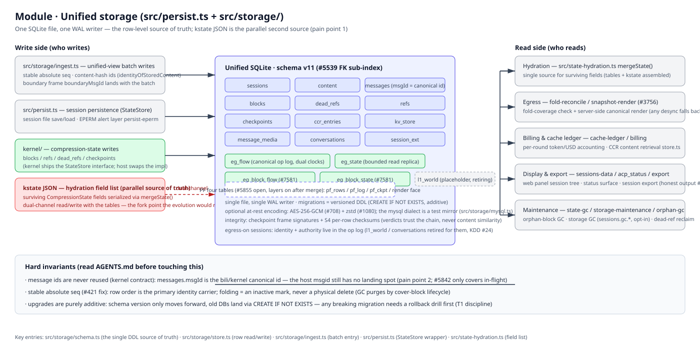

# Module: Unified storage (`src/persist.ts` + `src/storage/`)

> Part of the [architecture hub](../architecture.md) · 中文: [storage.zh-CN.md](./storage.zh-CN.md) · as of 2026-11-24, master, schema v11 (probe-first additions, no version bump)

(bitmap fallback: [storage.en.png](./assets/storage.en.png))

## Responsibility

Everything that must survive a process restart lands in ONE SQLite file: sessions, message rows, content, compression blocks and their ref ledger, checkpoints, the kv_store used by the notice store and session ext, and media. `src/persist.ts` is the legacy session-file façade (StateStore wrapper, EPERM alert layer); `src/storage/` is the unified row-level store.

## Principles

- **One WAL writer.** A single SQLite file, one write path (batched `ingest.ts`), so readers never race writers.
- **Canonical ids, not host ids.** `messages.msgId` stores the bili/kernel canonical id (`identityOfStoredContent`); the host's per-element msgid is an in-flight envelope field. `l1_world` started as its planned home and is now a **degraded placeholder** (#7617): egress-on sessions keep identity in the op log and need no l1 row; the table's retirement gate is in [deprecations.md](../deprecations.md).
- **Stable absolute seq (#421 fix).** Row order is the primary carrier of message identity; folding marks rows inactive, it never physically deletes them (GC purges by cover-block lifecycle).
- **Additive migrations only.** Schema version moves forward; old DBs land via `CREATE IF NOT EXISTS` — any breaking migration needs a rollback drill first (T1 discipline, #5643 test matrix).

## How it works

**Write side.** The ingest path batch-writes the unified view (stable absolute seq; content-hash ids via `identityOfStoredContent`; boundary frame `boundaryMsgId` lands with the batch). `persist.ts` handles session file save/load and the EPERM alert layer. The kernel writes compression state (blocks / refs / dead_refs / checkpoints) through the StateStore interface the kernel ships — the host swaps the implementation.

**The kstate JSON is the parallel second source of truth (pain point 1).** The surviving `CompressionState` field list is serialized via `mergeState()` (single source of the field list — `src/state-hydration.ts`) and read/written alongside the tables — a dual channel. **Egress-on carve-out (#7581):** three derivable fields (`tsStamps`, `tokenSnapshot`, `lastPassIds`) are trimmed from `kstate_json` at save — the kstate residue is the explicit residual-field list; legacy sessions stay byte-identical. Consolidating the kernel state into the tables is tracked as follow-up work (#6858 lists it as out of scope for #6785); the #5874 v2 substrate (content CAS, messages × blocks × refs, the l1_world placeholder — degraded, see above — and the egress_state/egress_flow op log — fold_journal/egress_snapshot were retired before merge, ruling 7439) is what that consolidation lands on.

**Read side.** Hydration uses `mergeState()` as the single source for surviving fields (tables + kstate assembled). Egress runs the fold-coverage check and the server-side canonical render (D-lane, #3756 — any desync falls back to the legacy path, degrade never guess). Billing & the cache ledger (`cache-ledger`, CCR retrieval in `store.ts`) and the display/export surfaces (`sessions-data`, `acp_status`, `export` — honest output, #155) all read the same rows. Maintenance is `state-gc` / `storage-maintenance` / orphan GC (storage GC on `sessions.gc_*`, opt-in, dead-ref reclaim).

**Consistency.** Checkpoint frame signatures + S4 per-row checksums; verdicts trust the chain, never content similarity. Optional at-rest encoding: AES-256-GCM (#708) + zstd (#1080). The mysql dialect under `src/storage/mysql.ts` is a TEST MIRROR only (the mysql-contract CI lane) — SQLite remains the production store.

**Egress plane (KDD #23/#24, discussions #7439/#7577/#7591 — the outbound conversation op log).** `egress_state`/`egress_flow` (SQLite lane only, gate `rollout.features.egressPlane`) hold the sparse I/D/U op log of each session's outbound view; rows are self-contained (bytes ride the row, no content CAS). Both tables key on `(session_id, op_seq)` (append-only row cursor, recovery/truncation key) and I rows additionally carry `log_seq` — the canonical, never-reissued message number. For egress-on sessions the op log is the SOLE canonical message authority: outbound bytes are served from it, the pin channel resolves its I rows instead of the messages ledger, the per-turn unified ingest stops (messages demoted to a LAZY projection, rebuilt one-time on rollback/web-read/restore) and the session JSON envelope freezes at bootstrap. Recovery = `recoverEgressBase` (bounded state replay; in-transaction seq reads, #7574); no healthy point ⇒ the turn hard-fails (ruling 7439-5), never degrades to client bytes. Ruling 7439-2 lands the read/write side on the blocks table itself: `summary_bytes` inlines the block summary (readers prefer it, the content CAS keeps its role only as the legacy fallback), and `start_msgid`/`end_msgid` align the block to the flow's msgid coordinates once at fold time — for flow-recorded sessions, NULL otherwise. **#7581 added the block lifecycle log** (`egress_block_flow`/`egress_block_state`) on **dual clocks** — the block tables number themselves, each row pointing at the flow clock via `flow_op_seq` (a point fork at flow watermark W copies flow rows `op_seq <= W` and block rows `flow_op_seq <= W`); checkpoints for egress-on retired in favor of this point-fork. **#7617 consolidated identity**: egress-on stage-0 is stateless (frontiers from `MAX(op_seq)` / the newest-base high water, no l1 cursor, no resync), the R3 fault latch lives in `sessions.r3_latched_at` (dual-carrier read/clear with the legacy l1 column), and egress-on sessions are excluded from age GC and refused on manual archive until the archive format carries the op log. Full walkthrough: [PR #6785 doc §6](../pr-6785-unified-storage-and-flows.md#6-round-2) · blocks: [egress-block-flow.md](../egress-block-flow.md) · one-stop: [egress-plane.md](../egress-plane.md).

## Hard invariants (see AGENTS.md before touching this)

- Message ids are never reused (kernel contract); `messages.msgId` is the canonical id — with the KDD #23 carve-out: for egress-on sessions the op log's I rows (`egress_flow.msgid` + `log_seq`) are the canonical message authority and the messages rows are a lazy projection.
- Row order = identity carrier; fold = inactive mark, never physical delete.
- Upgrades are purely additive; rollback drill before any breaking change.

## Key entries

`src/storage/schema.ts` (the single DDL source of truth) · `src/storage/store.ts` (row read/write) · `src/storage/ingest.ts` (batch entry) · `src/persist.ts` (StateStore wrapper) · `src/state-hydration.ts` (surviving field list)

## Related

[message-identity](../message-identity.md) · [session-identity](../session-identity.md) · [egress-plane.md](../egress-plane.md) · [deprecations.md](../deprecations.md) · [#5643 evolution proposal (PR #5873)](https://github.com/ranxianglei/billion-context/issues/5643)
