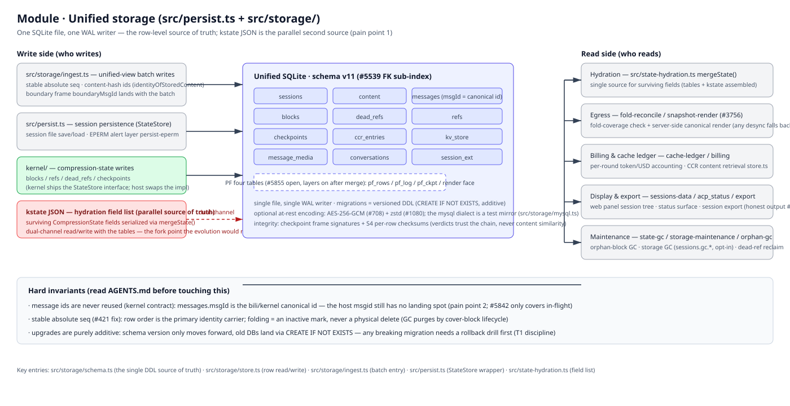

# Module: Unified storage (`src/persist.ts` + `src/storage/`)

> Part of the [architecture hub](../architecture.md) · 中文: [storage.zh-CN.md](./storage.zh-CN.md) · as of 2026-11-08, master, schema v11

(bitmap fallback: [storage.en.png](./assets/storage.en.png))

## Responsibility

Everything that must survive a process restart lands in ONE SQLite file: sessions, message rows, content, compression blocks and their ref ledger, checkpoints, the kv_store used by the notice store and session ext, and media. `src/persist.ts` is the legacy session-file façade (StateStore wrapper, EPERM alert layer); `src/storage/` is the unified row-level store.

## Principles

- **One WAL writer.** A single SQLite file, one write path (batched `ingest.ts`), so readers never race writers.
- **Canonical ids, not host ids.** `messages.msgId` stores the bili/kernel canonical id (`identityOfStoredContent`); the host's per-element msgid is an in-flight envelope field and does not land in storage yet (pain point 2 — the #5643 proposal's `l1_world` table is the planned home).
- **Stable absolute seq (#421 fix).** Row order is the primary carrier of message identity; folding marks rows inactive, it never physically deletes them (GC purges by cover-block lifecycle).
- **Additive migrations only.** Schema version moves forward; old DBs land via `CREATE IF NOT EXISTS` — any breaking migration needs a rollback drill first (T1 discipline, #5643 test matrix).

## How it works

**Write side.** The ingest path batch-writes the unified view (stable absolute seq; content-hash ids via `identityOfStoredContent`; boundary frame `boundaryMsgId` lands with the batch). `persist.ts` handles session file save/load and the EPERM alert layer. The kernel writes compression state (blocks / refs / dead_refs / checkpoints) through the StateStore interface the kernel ships — the host swaps the implementation.

**The kstate JSON is the parallel second source of truth (pain point 1).** The surviving `CompressionState` field list is serialized via `mergeState()` (single source of the field list — `src/state-hydration.ts`) and read/written alongside the tables — a dual channel. The #5643 evolution would move kernel state serialization into `snap_ckpt.meta_json` so the tables become the only source.

**Read side.** Hydration uses `mergeState()` as the single source for surviving fields (tables + kstate assembled). Egress runs the fold-coverage check and the server-side canonical render (D-lane, #3756 — any desync falls back to the legacy path, degrade never guess). Billing & the cache ledger (`cache-ledger`, CCR retrieval in `store.ts`) and the display/export surfaces (`sessions-data`, `acp_status`, `export` — honest output, #155) all read the same rows. Maintenance is `state-gc` / `storage-maintenance` / orphan GC (storage GC on `sessions.gc_*`, opt-in, dead-ref reclaim).

**Consistency.** Checkpoint frame signatures + S4 per-row checksums; verdicts trust the chain, never content similarity. Optional at-rest encoding: AES-256-GCM (#708) + zstd (#1080). The mysql dialect under `src/storage/mysql.ts` is a TEST MIRROR only (the mysql-contract CI lane) — SQLite remains the production store.

## Hard invariants (see AGENTS.md before touching this)

- Message ids are never reused (kernel contract); `messages.msgId` is the canonical id.
- Row order = identity carrier; fold = inactive mark, never physical delete.
- Upgrades are purely additive; rollback drill before any breaking change.

## Key entries

`src/storage/schema.ts` (the single DDL source of truth) · `src/storage/store.ts` (row read/write) · `src/storage/ingest.ts` (batch entry) · `src/persist.ts` (StateStore wrapper) · `src/state-hydration.ts` (surviving field list)

## Related

[message-identity](../message-identity.md) · [session-identity](../session-identity.md) · [#5643 evolution proposal (PR #5873)](https://github.com/ranxianglei/billion-context/issues/5643)
