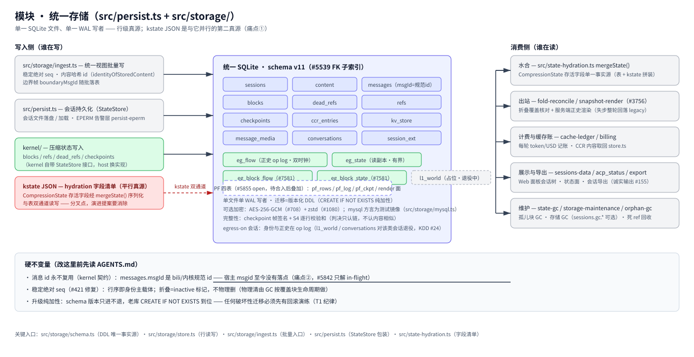

# 模块：统一存储（`src/persist.ts` + `src/storage/`）

> [架构总览](../architecture.zh-CN.md) 的一个模块 · English: [storage.md](./storage.md) · 截至 2026-11-08，master，schema v11

（位图备选：[storage.zh-CN.png](./assets/storage.zh-CN.png)）

## 职责

进程重启后必须存活的东西，全部进**一个** SQLite 文件：会话、消息行、内容、压缩块与 ref 账本、检查点、notice store 与会话扩展用的 kv_store、媒体。`src/persist.ts` 是旧会话文件门面（StateStore 封装、EPERM 告警层）；`src/storage/` 是统一的行级存储。

## 基本原理

- **单一 WAL 写者。** 一个 SQLite 文件、一条写入路径（`ingest.ts` 批量），读者永远不和写者抢。
- **canonical id，不是宿主 id。** `messages.msgId` 存 bili/内核规范 id（`identityOfStoredContent`）；宿主逐元素 msgid 目前只是 in-flight 信封字段。`l1_world` 曾是它的计划去处，如今已降级为**占位行**（#7617）：egress-on 会话的身份在 op log 里、不再需要 l1 行；该表的退役闸门见 [deprecations.md](../deprecations.zh-CN.md)。
- **稳定绝对 seq（#421 修复）。** 行序是消息身份的主载体；折叠只打 inactive 标记，从不物理删除（GC 按覆盖块生命周期清）。
- **只加性迁移。** schema 版本只前进；老库靠 `CREATE IF NOT EXISTS` 落地——任何破坏性迁移必须先过回滚演练（T1 纪律，#5643 测试矩阵）。

## 工作机制

**写入侧。** ingest 路径批量写统一视图（稳定绝对 seq；内容哈希 id 走 `identityOfStoredContent`；边界帧 `boundaryMsgId` 随批落地）。`persist.ts` 管会话文件存盘/装载与 EPERM 告警层。内核经 StateStore 接口写压缩状态（blocks / refs / dead_refs / checkpoints）——接口由内核自带，宿主换实现。

**kstate JSON 是平行的第二个真源（痛点 1）。** 存活 `CompressionState` 字段清单经 `mergeState()` 序列化（字段清单的单一事实源在 `src/state-hydration.ts`），与表并行读写——双通道。**egress-on 例外（#7581）：**三个可推导字段（`tsStamps`、`tokenSnapshot`、`lastPassIds`）在保存时从 `kstate_json` 裁剪——kstate 残差即显式残差字段清单；legacy 会话字节不变。把内核态收敛进表是后续工作（#6858 将其列为 #6785 范围外）；#5874 v2 基座（内容 CAS、messages × blocks × refs、l1_world 占位（已降级，见上）、egress_state/egress_flow op log——fold_journal/egress_snapshot 已在合入前退役，7439 裁定）就是那次收敛落地的目标。

**读取侧。** 水合用 `mergeState()` 作为存活字段的单一事实源（表 + kstate 拼装）。出站跑折叠覆盖检查与服务端正史渲染（D-lane，#3756——任何失步回退 legacy 路径，**降级不猜**）。计费与缓存账本（`cache-ledger`、CCR 取回在 `store.ts`）、展示/导出面（`sessions-data`、`acp_status`、`export`——诚实输出 #155）读的都是同一批行。维护面是 `state-gc` / `storage-maintenance` / 孤儿 GC（`sessions.gc_*` 上的 storage GC，opt-in，dead-ref 回收）。

**一致性。** 检查点帧签名 + S4 逐行校验和；判决只信链、不信内容相似。可选静态加密：AES-256-GCM（#708）+ zstd（#1080）。`src/storage/mysql.ts` 的 mysql 方言只是**测试镜像**（mysql-contract CI 车道）——生产存储永远是 SQLite。

**egress 平面（KDD #23/#24，#7439/#7577/#7591/#7773——出站会话 op log）。** `egress_flow`（仅 SQLite 车道，gate `rollout.features.egressPlane`）存每个会话出站视图的**append-only** I/D/U op log；行自包含（字节随行走，不经内容 CAS）。flow 以 `(session_id, op_seq)` 为主键（稠密行游标，恢复/截断键），I 行另带 `log_seq`——正史消息编号，永不重发；前沿 = flow 上的 `MAX(log_seq)`（退役 `B` base 行的 `highWater` payload 已不存在，#7773）。**`egress_state` 是物化 live 视图**（#7773）：PK `(session_id, msgid)`、按 `pos` 排序；每次 append 在同一事务内把 op 应用到行上（I 插入 + 后移、U 就地改、D 物理删 + 前移），服务副本构造上以 live 视图大小为界——没有 base 行、没有压实、没有 op 镜像。对 egress-on 会话，op log 是**唯一**正史消息权威：出站字节从它 serve，pin 通道读物化 state 而非 messages 账本，逐轮统一 ingest 停止（messages 降级为**惰性投影**，回滚/web 读/恢复时一次性重建），会话 JSON 信封在 bootstrap 冻结。恢复：state 副本损坏时**全史重放重建**后照常服务（flow 是正史）；flow 本身不可重放时，`recoverEgressBase` 走一趟全史 walk（`egressFlowWalkBack`）——最新健康前缀截掉尾部；无健康点 ⇒ 整轮硬失败（裁定 7439-5），绝不降级到客户端字节。裁定 7439-2 把读写侧落到 blocks 表自身：`summary_bytes` 内联压缩块摘要（读端优先用它，内容 CAS 只对遗留行保留回落），`start_msgid`/`end_msgid` 在折叠时一次性对齐到流水的 msgid 坐标——只有被流水记录的会话有值，其余保持 NULL。**#7581 增加块生命周期日志**（`egress_block_flow`/`egress_block_state`），**双时钟**——块表自己编号，每行经 `flow_op_seq` 指向流水时钟；reap = 一条 `D` 行带该块终态全量快照、state 行物理删除（#7773）；流水水位 W 的点位 fork：流水行拷 `op_seq <= W`、块行拷 `flow_op_seq <= W`，然后**重放到 W 物化两张 state 表**（任意点位均可——「低于最新 base」门已废除）；egress-on 的 checkpoint 退役，改用该点位 fork。**#7617 身份收拢**：egress-on 的 stage-0 无状态（前沿来自 `MAX(op_seq)`/flow 的 `MAX(log_seq)`，无 l1 游标、无 resync），R3 故障 latch 落 `sessions.r3_latched_at`（与 legacy l1 列双载体读/清），egress-on 会话整体排除出年龄 GC、手动 archive 被拒（直到归档格式携带 op log）。**重编号（2026-11-25，[egress-plane.zh-CN.md](../egress-plane.zh-CN.md) §10）：**`log_seq` 就是内核引用号（`mNNNNN` = m + log_seq，system 行 = 0）；arm 时一次性回填让 op log 成为完整历史，`refs` 写路径对 egress-on 退役，kstate overlay 的 refs 重建成为正当路径。**结构不变量（#7773 §6，每次写入后断言，两平面）：** flow 行数只增 · state 行数 == live 视图长度 · 最大 value == 历史最大单行 · 行字母表恰为 I/D/U（消息）/ I/U/D（块）——套件 `tests/egress-invariants-7773.test.ts`。完整梳理：[PR #6785 文档 §6](../pr-6785-unified-storage-and-flows.zh-CN.md) · 块：[egress-block-flow.md](../egress-block-flow.zh-CN.md) · 一站式：[egress-plane.md](../egress-plane.zh-CN.md)。

## 硬不变量（动手前先读 AGENTS.md）

- 消息 id 永不复用（内核契约）；`messages.msgId` 是规范 id——KDD #23 例外：egress-on 会话的正史消息权威是 op log 的 I 行（`egress_flow.msgid` + `log_seq`），messages 行是惰性投影。
- 行序 = 身份载体；折叠 = inactive 标记，不是物理删除。
- 升级纯加性；破坏性变化前先回滚演练。

## 关键入口

`src/storage/schema.ts`（DDL 唯一事实源） · `src/storage/store.ts`（行读写） · `src/storage/ingest.ts`（批量入口） · `src/persist.ts`（StateStore 封装） · `src/state-hydration.ts`（存活字段清单）

## 相关

[message-identity](../message-identity.zh-CN.md) · [session-identity](../session-identity.zh-CN.md) · [egress-plane.md](../egress-plane.zh-CN.md) · [deprecations.md](../deprecations.zh-CN.md) · [#5643 演进提案（PR #5873）](https://github.com/ranxianglei/billion-context/issues/5643)
