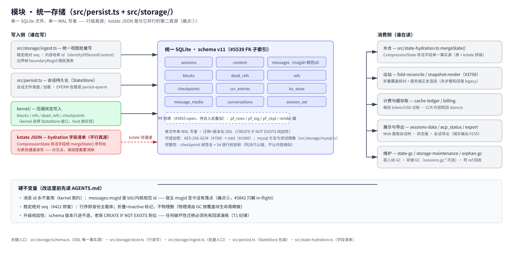

# 模块：统一存储（`src/persist.ts` + `src/storage/`）

> [架构总览](../architecture.zh-CN.md) 的一个模块 · English: [storage.md](./storage.md) · 截至 2026-11-08，master，schema v11

（位图备选：[storage.zh-CN.png](./assets/storage.zh-CN.png)）

## 职责

进程重启后必须存活的东西，全部进**一个** SQLite 文件：会话、消息行、内容、压缩块与 ref 账本、检查点、notice store 与会话扩展用的 kv_store、媒体。`src/persist.ts` 是旧会话文件门面（StateStore 封装、EPERM 告警层）；`src/storage/` 是统一的行级存储。

## 基本原理

- **单一 WAL 写者。** 一个 SQLite 文件、一条写入路径（`ingest.ts` 批量），读者永远不和写者抢。
- **canonical id，不是宿主 id。** `messages.msgId` 存 bili/内核规范 id（`identityOfStoredContent`）；宿主逐元素 msgid 目前只是 in-flight 信封字段，**不落盘**（痛点 2——#5643 提案的 `l1_world` 表是它的计划去处）。
- **稳定绝对 seq（#421 修复）。** 行序是消息身份的主载体；折叠只打 inactive 标记，从不物理删除（GC 按覆盖块生命周期清）。
- **只加性迁移。** schema 版本只前进；老库靠 `CREATE IF NOT EXISTS` 落地——任何破坏性迁移必须先过回滚演练（T1 纪律，#5643 测试矩阵）。

## 工作机制

**写入侧。** ingest 路径批量写统一视图（稳定绝对 seq；内容哈希 id 走 `identityOfStoredContent`；边界帧 `boundaryMsgId` 随批落地）。`persist.ts` 管会话文件存盘/装载与 EPERM 告警层。内核经 StateStore 接口写压缩状态（blocks / refs / dead_refs / checkpoints）——接口由内核自带，宿主换实现。

**kstate JSON 是平行的第二个真源（痛点 1）。** 存活 `CompressionState` 字段清单经 `mergeState()` 序列化（字段清单的单一事实源在 `src/state-hydration.ts`），与表并行读写——双通道。#5643 演进会把内核态序列化挪进 `snap_ckpt.meta_json`，让表成为唯一真源。

**读取侧。** 水合用 `mergeState()` 作为存活字段的单一事实源（表 + kstate 拼装）。出站跑折叠覆盖检查与服务端正史渲染（D-lane，#3756——任何失步回退 legacy 路径，**降级不猜**）。计费与缓存账本（`cache-ledger`、CCR 取回在 `store.ts`）、展示/导出面（`sessions-data`、`acp_status`、`export`——诚实输出 #155）读的都是同一批行。维护面是 `state-gc` / `storage-maintenance` / 孤儿 GC（`sessions.gc_*` 上的 storage GC，opt-in，dead-ref 回收）。

**一致性。** 检查点帧签名 + S4 逐行校验和；判决只信链、不信内容相似。可选静态加密：AES-256-GCM（#708）+ zstd（#1080）。`src/storage/mysql.ts` 的 mysql 方言只是**测试镜像**（mysql-contract CI 车道）——生产存储永远是 SQLite。

## 硬不变量（动手前先读 AGENTS.md）

- 消息 id 永不复用（内核契约）；`messages.msgId` 是规范 id。
- 行序 = 身份载体；折叠 = inactive 标记，不是物理删除。
- 升级纯加性；破坏性变化前先回滚演练。

## 关键入口

`src/storage/schema.ts`（DDL 唯一事实源） · `src/storage/store.ts`（行读写） · `src/storage/ingest.ts`（批量入口） · `src/persist.ts`（StateStore 封装） · `src/state-hydration.ts`（存活字段清单）

## 相关

[message-identity](../message-identity.zh-CN.md) · [session-identity](../session-identity.zh-CN.md) · [#5643 演进提案（PR #5873）](https://github.com/ranxianglei/billion-context/issues/5643)
