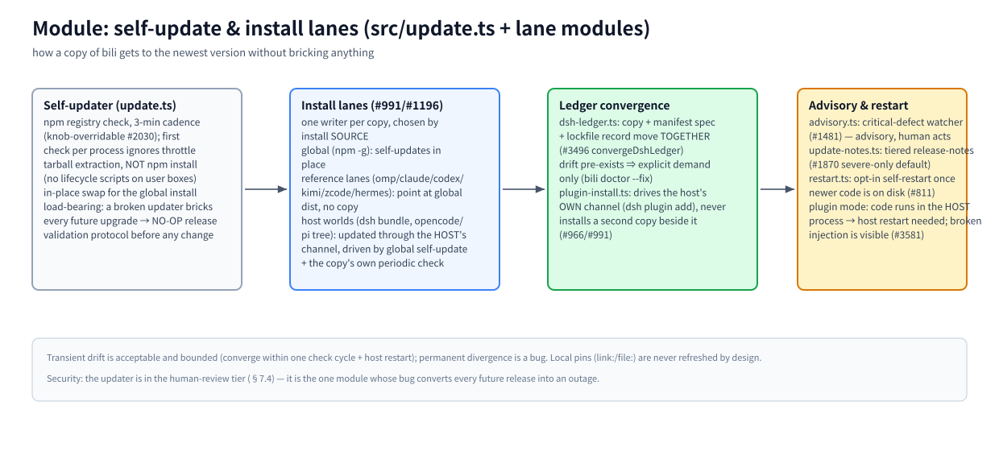

# モジュール: self-update & install lanes (`src/update.ts` + lane modules)

> [アーキテクチャハブ](../architecture.ja.md) の一部 · 中文: [update.zh-CN.md](./update.zh-CN.md) · 2026-11-08 時点, master

(ビットマップフォールバック: [update.en.png](./assets/update.en.png))

## 責務

マシン上のすべての bili コピーを、何も壊すことなく最新バージョンに更新すること。そして、コピー間の永続的な分岐を検出可能なバグとして扱うこと。これは、モジュール自身のバグが将来のすべてのリリースを障害に変えてしまう唯一のモジュールであり、そのため、変更をリリースする前に NO-OP 検証リリースプロトコルを適用し、人間レビュー層 (§7.4) に位置付けられている。

## 原則

- **コピーごとに 1 つのライターを、インストールソースで選択する (#991/#1196)。** ホスト自身のチャネル（dsh market、opencode/pi マネージャー、pnpm store）を通じてインストールされたコピーは、そのホストが所有するものとする: bili は決してそのコピーをインプレースで書き換えない。
- **すべてのコピーに LIVE な更新パスがある。** グローバルな自己更新、またはグローバル dist への参照、またはホストのチャネル——「永遠に凍結」は、この契約が存在する理由であるバグクラスである。
- **一時的なものは有界であり、永続的なものはバグである。** レーンは、1 つのチェックサイクル（約 3 分）とホストの再起動以内にレジストリバージョンへ収束する。

## 動作原理

**セルフアップデータ (`update.ts`)。** デフォルトでは 3 分ごとに npm レジストリをチェックする (`CHECK_INTERVAL_MS`、ノブで上書き可能 #2030; プロセスごとの最初のチェックはスロットリングを無視する)。更新は tarball の展開であり、`npm install` ではない——ユーザーの環境ではライフサイクルスクリプトは決して実行されない。グローバルインストールはインプレースで切り替わる。プラグインモードでは、注入されたコードは HOST プロセス内に存在する: 新しいコードはホストの再起動後にのみ有効になり、壊れた注入はモデルトラフィックを非圧縮の直接通信に劣化させる——パネルのバナーと `/__bili/status` の `attribution` で確認可能 (#3581)。

**インストールレーン。** グローバル (`npm i -g`、自己更新) · 参照レーン (omp/claude/codex/kimi/zcode/hermes — コピーなし、グローバル dist を指す) · ホストワールド (dsh プロファイルバンドル、opencode/pi ツリー — ホスト自身のチャネルを通じて更新され、グローバル自己更新と、グローバルが実行されない場合のコピー自身の定期的チェックによって駆動される、#1196) · ランチャー (`bili <client>` オーバーレイモード: 永続コピーゼロ)。

**台帳の収束。** デスクトップの dsh プロファイルは、bili が完全に所有する唯一のコピーである; その自己修復は `node_modules/billion-context` を直接切り替えるため、`convergeDshLedger` (`src/dsh-ledger.ts`) は、プロファイルマニフェストの宣言された spec と、ロックファイルに記録された解決結果を同じ操作で移動する (#3496) — コピーのみを移動するライターは、#3224 が検出するドリフトを生み出す。既存のドリフトは明示的な要求時のみ収束する: `bili doctor --fix`。`plugin-install.ts` はホスト自身のチャネル (`dsh plugin add`) のみ駆動し、その隣に第二のコピーをインストールすることは決してしない (#966)。

**助言と再起動。** `advisory.ts` は重大な欠陥を監視し、助言を提出する (#1481 — 人間が行動し、マシンは決して自動的にロールバックしない); `update-notes.ts` は階層化されたリリースノートを持つ（デフォルトでは重大なもののみ、#1870）; `restart.ts` は新しいコードがディスク上に存在した時点で、オプトインの自己再起動を提供する (#811)。

## 厳格なルール

人間レビュー層 (§7.4) — 自動マージなし; `update.ts` の変更にはまず NO-OP 検証リリースが必要; `link:`/`file:` 開発ピンは決して更新されない (`isRegistryDepSpec` ゲート); npm publish はリリース PR のマージ時の CI 経由でのみ発生する。

## 主要エントリ

`src/update.ts` (アップデータ — 重要) · `src/advisory.ts` · `src/restart.ts` · `src/plugin-install.ts` · `src/dsh-ledger.ts` · `src/dsh-channel.ts` · `src/pi-channel.ts` · `src/launcher.ts`

## 関連

[webui](./webui.md) (更新アクションのサーフェス) · [AGENTS.md — Install-Lane & Update-Ownership Contract](../../AGENTS.md) · [reference/release.md](../../reference/release.md)
