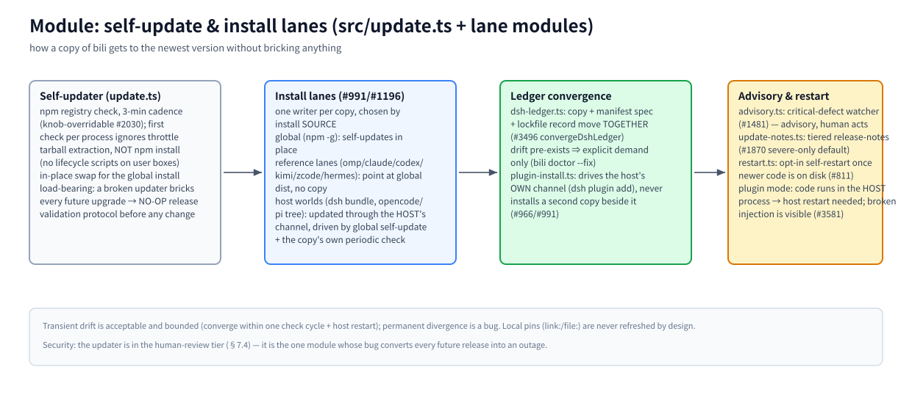

# Module: self-update & install lanes (`src/update.ts` + lane modules)

> Part of the [architecture hub](../architecture.md) · 中文: [update.zh-CN.md](./update.zh-CN.md) · as of 2026-11-08, master

(bitmap fallback: [update.en.png](./assets/update.en.png))

## Responsibility

Get every copy of bili on a machine to the newest version without bricking anything — and make permanent divergence between copies a detectable bug. This is the one module whose own bug converts every future release into an outage, so it sits in the human-review tier (§7.4) with a NO-OP validation-release protocol before any change ships.

## Principles

- **One writer per copy, chosen by install source (#991/#1196).** A copy installed through a host's own channel (dsh market, opencode/pi managers, pnpm store) is owned by that host: bili NEVER writes it in place.
- **Every copy has a LIVE update path.** Global self-update, or reference at the global dist, or the host's channel — "frozen forever" is the bug class this contract exists to kill.
- **Transients are bounded, permanents are bugs.** Lanes converge to the registry version within one check cycle (~3 min) plus a host restart.

## How it works

**Self-updater (`update.ts`).** Checks the npm registry every 3 min by default (`CHECK_INTERVAL_MS`, knob-overridable #2030; the first check per process ignores the throttle). Updates are tarball extraction, NOT `npm install` — no lifecycle scripts ever run on user boxes. The global install swaps in place. In plugin mode the injected code lives in the HOST process: new code only takes effect after a host restart, and a broken injection degrades model traffic to uncompressed direct — visible via the panel banner and `/__bili/status` `attribution` (#3581).

**Install lanes.** Global (`npm i -g`, self-updating) · reference lanes (omp/claude/codex/kimi/zcode/hermes — no copy, point at the global dist) · host worlds (dsh profile bundle, opencode/pi trees — updated through the host's own channel, driven by the global self-update AND by the copy's own periodic check when no global ever runs, #1196) · launchers (`bili <client>` overlay mode: zero persistent copy).

**Ledger convergence.** The desktop dsh profile is the one copy bili owns outright; its self-heal swaps `node_modules/billion-context` directly, so `convergeDshLedger` (`src/dsh-ledger.ts`) also moves the profile manifest's declared spec AND the lockfile's recorded resolution in the same operation (#3496) — a writer that moves only the copy manufactures the drift #3224 detects. Pre-existing drift converges on explicit demand only: `bili doctor --fix`. `plugin-install.ts` only drives the host's own channel (`dsh plugin add`), never installs a second copy beside it (#966).

**Advisory & restart.** `advisory.ts` watches for critical defects and files an advisory (#1481 — a human acts, the machine never rolls back on its own); `update-notes.ts` carries tiered release notes (severe-only by default, #1870); `restart.ts` offers opt-in self-restart once newer code is on disk (#811).

## Hard rules

Human-review tier (§7.4) — no auto-merge; changing `update.ts` requires a NO-OP validation release first; `link:`/`file:` dev pins are never refreshed (`isRegistryDepSpec` gate); npm publish only ever happens via CI on a release-PR merge.

## Key entries

`src/update.ts` (updater — load-bearing) · `src/advisory.ts` · `src/restart.ts` · `src/plugin-install.ts` · `src/dsh-ledger.ts` · `src/dsh-channel.ts` · `src/pi-channel.ts` · `src/launcher.ts`

## Related

[webui](./webui.md) (update actions surface) · [AGENTS.md — Install-Lane & Update-Ownership Contract](../../AGENTS.md) · [reference/release.md](../../reference/release.md)
