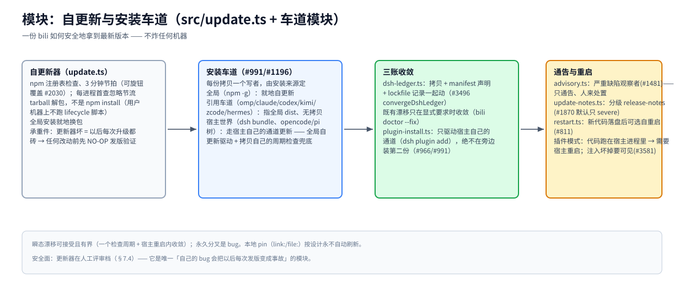

# 模块：自更新与安装车道（`src/update.ts` + 车道模块）

> [架构总览](../architecture.zh-CN.md) 的一个模块 · English: [update.md](./update.md) · 截至 2026-11-08，master

（位图备选：[update.zh-CN.png](./assets/update.zh-CN.png)）

## 职责

让机器上每一份 bili 拷贝安全地拿到最新版本——并且让拷贝间的永久分叉成为可发现的 bug。这是唯一「自己的 bug 会把以后每次发版变成事故」的模块，所以它在人工评审档（§7.4），且任何改动上线前先走 NO-OP 验证发版协议。

## 基本原理

- **每份拷贝一个写者，由安装来源定（#991/#1196）。** 走宿主自己通道装的拷贝（dsh market、opencode/pi manager、pnpm store）归宿主所有：bili **绝不**就地写它。
- **每份拷贝都有一条活的更新路径。** 全局自更新、或指全局 dist、或宿主通道——「永远冻结」是这个契约要消灭的 bug 类。
- **瞬态有界、永久即 bug。** 各车道在一个检查周期（~3 分钟）+ 一次宿主重启内收敛到注册表版本。

## 工作机制

**自更新器（`update.ts`）。** 默认每 3 分钟查一次 npm 注册表（`CHECK_INTERVAL_MS`，旋钮可覆盖 #2030；每进程首查忽略节流）。更新是 tarball 解包，**不是** `npm install`——用户机器上永不跑 lifecycle 脚本。全局安装就地换包。插件模式里注入的代码跑在**宿主进程**中：新代码要宿主重启才生效；注入坏掉则模型流量退化为不压缩直连——面板 banner 与 `/__bili/status` 的 `attribution` 可见（#3581）。

**安装车道。** 全局（`npm i -g`，就地自更新） · 引用车道（omp/claude/codex/kimi/zcode/hermes——无拷贝、指全局 dist） · 宿主世界（dsh profile bundle、opencode/pi 树——走宿主自己的通道更新，由全局自更新驱动 + 无全局时拷贝自己的周期检查兜底，#1196） · 启动器（`bili <client>` overlay 模式：零持久拷贝）。

**三账收敛。** 桌面 dsh profile 是 bili 唯一完全自有的拷贝；它的自愈直接换 `node_modules/billion-context`，所以 `convergeDshLedger`（`src/dsh-ledger.ts`）同一操作里还要挪 profile manifest 的声明 spec 与 lockfile 的记录（#3496）——只挪拷贝的写者会亲手造出 #3224 检测的那种漂移。既有漂移只在显式要求时收敛：`bili doctor --fix`。`plugin-install.ts` 只驱动宿主自己的通道（`dsh plugin add`），绝不在旁边装第二份（#966）。

**通告与重启。** `advisory.ts` 观察严重缺陷并开 advisory（#1481——人来处置，机器永不自行回滚）；`update-notes.ts` 承载分级 release notes（默认只 severe，#1870）；`restart.ts` 在新代码落盘后提供可选自重启（#811）。

## 硬规则

人工评审档（§7.4）——永不自动合并；改 `update.ts` 前先走 NO-OP 验证发版；`link:`/`file:` 本地 pin 永不刷新（`isRegistryDepSpec` 门）；npm 发布只经 CI 在 release-PR 合并时发生。

## 关键入口

`src/update.ts`（更新器——承重件） · `src/advisory.ts` · `src/restart.ts` · `src/plugin-install.ts` · `src/dsh-ledger.ts` · `src/dsh-channel.ts` · `src/pi-channel.ts` · `src/launcher.ts`

## 相关

[webui](./webui.zh-CN.md)（更新动作界面） · [AGENTS.md — Install-Lane & Update-Ownership Contract](../../AGENTS.md) · [reference/release.md](../../reference/release.md)
