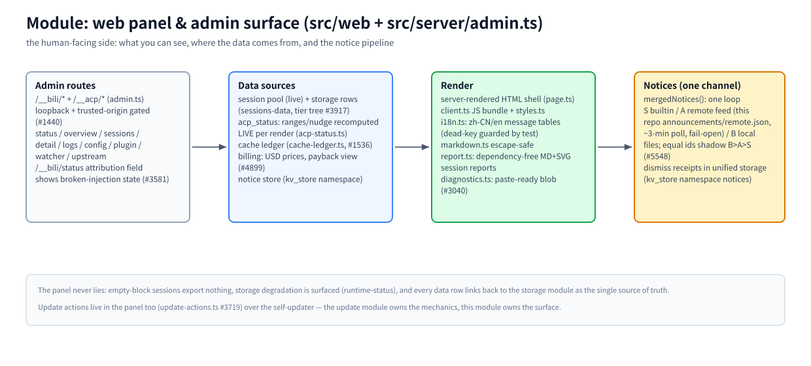

# モジュール: Web パネルと管理画面 (`src/web` + `src/server/admin.ts`)

> [アーキテクチャハブ](../architecture.md) の一部 · 中国語版: [webui.zh-CN.md](./webui.zh-CN.md) · 2026-11-08 時点、master

(ビットマップフォールバック: [webui.en.png](./assets/webui.en.png))

## 責務

プロキシに関する人間が見るすべてのもの: セッションブラウザ、ログ、設定、更新、通知、そして ACP ネイティブのエージェントも呼び出すマシン向けの管理ルート (`/__bili/*`、`/__acp/*`)。パネルは [ストレージモジュール](./storage.md) に対するビューであり、データを所有することはない。

## 原則

- **パネルは嘘をつかない。** 0 ブロックのセッションは「元の会話」として何もエクスポートしない (#155); ストレージの劣化は隠蔽せず表面化される (`runtime-status`); すべてのデータ行は、その出典となったストレージ行に追跡可能である。
- **通知チャネルは一つ。** すべてのバナーは `mergedNotices()` に対する一つのループを介して流れる — ビルトイン (S)、リモートフィード (A)、ローカルファイル (B); 同一 ID は B>A>S の順でシャドウイングされる (#5548)。個別のフィードフェッチャー、却下ストア、インラインバナーは存在しない。
- **管理画面はゲートされている。** ループバック + 信頼できるオリジンチェック (#1440) — この画面はパブリック API ではなく、コントロールプレーンである。

## 動作原理

**ルート。** `admin.ts` は `/__bili/*` と `/__acp/*` を所有する: ステータス (`attribution` フィールドにより壊れたプラグインの注入が可視化される、#3581)、概要、セッション + 詳細、ログ、設定、プラグイン、ウォッチャー、アップストリーム。ACP ネイティブのエージェントは、compress/decompress/acp_status に同じルートを使用する。

**データソース。** ライブセッションプールとストレージ行 (ティアツリー、#3917); `acp_status` の範囲/nudge はレンダリングごとに LIVE で再計算され、古いキャッシュは決して使われない (`acp-status.ts`); キャッシュ台帳の経済性 (`cache-ledger.ts`、#1536); 回収期間ビュー付きの USD 価格での請求 (#4899); 統合ストレージ (kv_store 名前空間 `notices`) 内の通知却下レシート。

**レンダリング。** サーバーレンダリングされた HTML シェル (`page.ts`) + 単一の JS バンドル (`client.ts`) + スタイル; `i18n.ts` は zh-CN/en のメッセージテーブルを保持する (デッドキーはテストでガードされる); `mdrender.ts` はエスケープ優先の Markdown + 構文ハイライトのコア単体である (json/diff/js/ts/py/sh 用の手書きレクサ、GitHub ライト+ダークパレット、ランタイム依存ゼロ — JSONC ヘルパーと同様に `.toString()` 経由でブラウザ IIFE にインライン化される)、そして `markdown.ts` はサーバーサイド (ブログ記事 + ハンドオフフォールバック) 用にこれをラップする; `report.ts` は依存関係のない MD+SVG セッションレポートを構築する; `diagnostics.ts` は issue レポート用の貼り付け可能なブロブを生成する (#3040)。

**通知。** `mergedNotices()` (`src/announcements.ts`) は 3 つのソースをマージする; リモートフィードはこのリポジトリの `announcements/remote.json` であり、約 3 分間のウォッチャー周期でポーリングされ、フェイルオープン (フェッチの問題は最後に既知の正常なスナップショットを保持する; モデルトラフィックには決して影響を与えない); ビルトイン通知は `tests/notice-registry.test.ts` によってデッドキーガードされる。

## 主要エントリ

`src/server/admin.ts` (ルート) · `src/web/` (シェル、バンドル、i18n、レポート、診断) · `src/announcements.ts` (通知レジストリ) · `src/notices.ts` (ビルトイン) · `src/remote-notices.ts` (フィードポーラー) · `src/notice-store.ts` (レシート)

## 関連

[ストレージ](./storage.md) · [更新](./update.md) (更新アクションはパネル内に存在する、#3719) · [設定](../configuration.md) · `announcements/remote.json`
