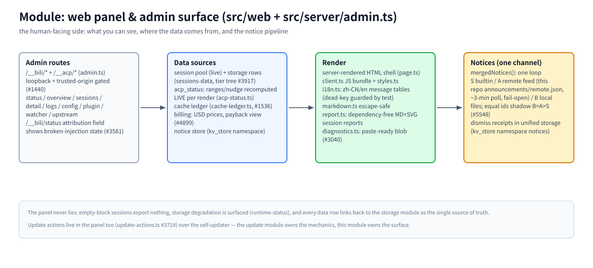

# Module: web panel & admin surface (`src/web` + `src/server/admin.ts`)

> Part of the [architecture hub](../architecture.md) · 中文: [webui.zh-CN.md](./webui.zh-CN.md) · as of 2026-11-08, master

(bitmap fallback: [webui.en.png](./assets/webui.en.png))

## Responsibility

Everything a human sees about the proxy: the session browser, logs, config, updates, notices, and the machine-facing admin routes (`/__bili/*`, `/__acp/*`) that ACP-native agents also call. The panel is a VIEW over the [storage module](./storage.md) — it never owns data.

## Principles

- **The panel never lies.** A 0-block session exports nothing as "original conversation" (#155); storage degradation is surfaced, not hidden (`runtime-status`); every data row can be traced to the storage rows it came from.
- **One notice channel.** Every banner flows through ONE loop over `mergedNotices()` — builtin (S), remote feed (A), local files (B); equal ids shadow B>A>S (#5548). No bespoke feed fetchers, dismissal stores, or inline banners.
- **Admin surface is gated.** Loopback + trusted-origin checks (#1440) — the surface is control-plane, not public API.

## How it works

**Routes.** `admin.ts` owns `/__bili/*` and `/__acp/*`: status (the `attribution` field makes broken plugin injection visible, #3581), overview, sessions + detail, logs, config, plugin, watcher, upstream. ACP-native agents use the same routes for compress/decompress/acp_status.

**Data sources.** The live session pool plus storage rows (tier tree, #3917); `acp_status` ranges/nudge are recomputed LIVE per render, never cached stale (`acp-status.ts`); the cache ledger economics (`cache-ledger.ts`, #1536); billing at USD prices with the payback view (#4899); notice dismissal receipts in unified storage (kv_store namespace `notices`).

**Render.** Server-rendered HTML shell (`page.ts`) + one JS bundle (`client.ts`) + styles; `i18n.ts` carries the zh-CN/en message tables (dead keys are test-guarded); `markdown.ts` is escape-safe; `report.ts` builds dependency-free MD+SVG session reports; `diagnostics.ts` produces the paste-ready blob for issue reports (#3040).

**Notices.** `mergedNotices()` (`src/announcements.ts`) merges the three sources; the remote feed is this repo's `announcements/remote.json`, polled on the ~3-minute watcher cadence, fail-open (fetch problems keep the last-known-good snapshot; model traffic is never affected); builtin notices are dead-key-guarded by `tests/notice-registry.test.ts`.

## Key entries

`src/server/admin.ts` (routes) · `src/web/` (shell, bundle, i18n, report, diagnostics) · `src/announcements.ts` (notice registry) · `src/notices.ts` (builtins) · `src/remote-notices.ts` (feed poller) · `src/notice-store.ts` (receipts)

## Related

[storage](./storage.md) · [update](./update.md) (update actions live in the panel, #3719) · [CONFIGURATION](../configuration.md) · `announcements/remote.json`
