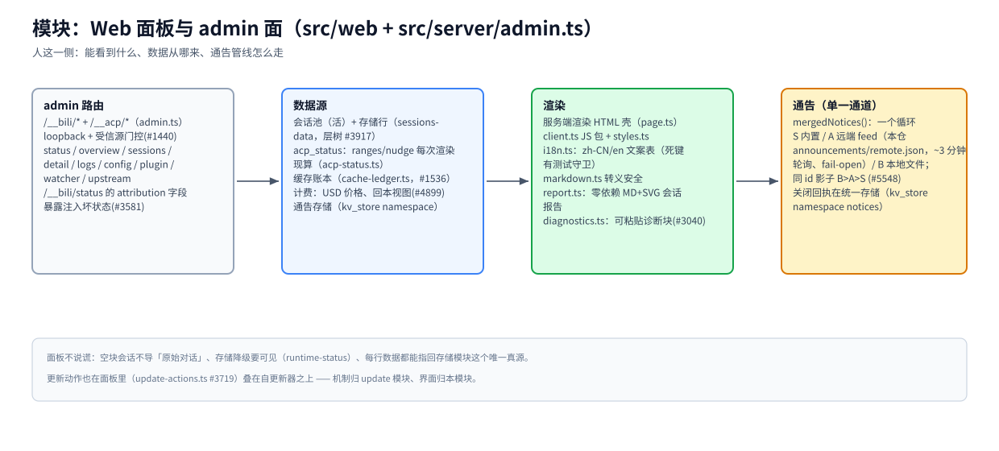

# 模块：Web 面板与 admin 面（`src/web` + `src/server/admin.ts`）

> [架构总览](../architecture.zh-CN.md) 的一个模块 · English: [webui.md](./webui.md) · 截至 2026-11-08，master

（位图备选：[webui.zh-CN.png](./assets/webui.zh-CN.png)）

## 职责

人看到的一切：会话浏览器、日志、配置、更新、通告，以及 ACP 原生 agent 也调的机器向管理路由（`/__bili/*`、`/__acp/*`）。面板是 [storage 模块](./storage.zh-CN.md) 之上的**视图**——它从不拥有数据。

## 基本原理

- **面板不说谎。** 空块会话不导「原始对话」（#155）；存储降级要可见不藏（`runtime-status`）；每行数据都能追到它来自的存储行。
- **通告只有一个通道。** 所有 banner 走一个循环消费 `mergedNotices()`——内置（S）、远端 feed（A）、本地文件（B）；同 id 影子 B>A>S（#5548）。禁止另起炉灶的 feed 抓取、关闭存储、内联 banner。
- **admin 面有门。** loopback + 受信源检查（#1440）——这是控制面，不是公开 API。

## 工作机制

**路由。** `admin.ts` 拥有 `/__bili/*` 与 `/__acp/*`：status（`attribution` 字段让插件注入坏掉可见，#3581）、overview、sessions + detail、logs、config、plugin、watcher、upstream。ACP 原生 agent 用同一批路由做 compress/decompress/acp_status。

**数据源。** 活会话池 + 存储行（层树，#3917）；`acp_status` 的 ranges/nudge 每次渲染**现算**、从不缓存陈旧（`acp-status.ts`）；缓存账本经济性（`cache-ledger.ts`，#1536）；USD 价格计费与回本视图（#4899）；通告关闭回执在统一存储（kv_store namespace `notices`）。

**渲染。** 服务端渲染 HTML 壳（`page.ts`）+ 一个 JS 包（`client.ts`）+ 样式；`i18n.ts` 承载 zh-CN/en 文案表（死键有测试守卫）；`markdown.ts` 转义安全；`report.ts` 生成零依赖 MD+SVG 会话报告；`diagnostics.ts` 产出可粘贴的诊断块供报 issue（#3040）。

**通告。** `mergedNotices()`（`src/announcements.ts`）合并三个源；远端 feed 是本仓 `announcements/remote.json`，按 ~3 分钟 watcher 节拍轮询、fail-open（取不到就留最后已知良好快照；模型流量永不受影响）；内置通告由 `tests/notice-registry.test.ts` 死键守卫。

## 关键入口

`src/server/admin.ts`（路由） · `src/web/`（壳、包、i18n、报告、诊断） · `src/announcements.ts`（通告注册表） · `src/notices.ts`（内置） · `src/remote-notices.ts`（feed 轮询） · `src/notice-store.ts`（回执）

## 相关

[storage](./storage.zh-CN.md) · [update](./update.zh-CN.md)（更新动作在面板里，#3719） · [CONFIGURATION](../configuration.zh-CN.md) · `announcements/remote.json`
