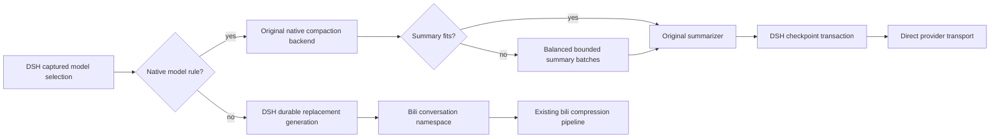

# DSH model-selective native compaction

Proposed in #6121. This opt-in feature targets DSH Web agent presets containing `@deepseek-ai/dsh-compaction-basic` (standard, ptc, cordis, and equivalent custom presets). Default configuration `[]` preserves bili's existing behavior. Restart the host after changing the list; existing preset instances retain their original composition.

```json
{
  "dsh": {
    "nativeCompactionModels": [
      { "model": "gpt-*" },
      { "model": "codex/gpt-*" }
    ]
  }
}
```

Rules match the actual DSH **model ID**, case-sensitively, not its display label. A trailing `*` means prefix matching; other wildcards and a standalone `*` are rejected. Optional `provider` is an exact DSH provider ID. Omit it to match the model across providers. All unmatched models keep bili. `codex/gpt-*` is needed when a gateway includes that namespace in the model ID. `passthrough` alone cannot enable the native backend.



Native thresholds, retention settings, summary prompts and summary-model resolution remain DSH-owned. On a model switch DSH can summarize using its previous routed model unless its own summary-model configuration overrides that choice. Those summary requests still bypass bili, independently of the summarization model's membership in the rules.

The summary input budget reserves output, summary instructions and a safety margin. Tool definitions are priced with the host's `tokenMeter.estimateMessage`, in the same units as messages; the temporary text message used for metering is never sent. UTF-8 schema bytes must not be subtracted directly as tokens, which can falsely exhaust the budget for a large MCP catalog. Every summary batch still carries the complete original schemas. A catalog whose token estimate truly exceeds the available budget fails while preserving history.

The adapter gates automatic/manual native compression for bili-owned models and hides bili tools on native-owned steps. Native HTTP requests retain the original body, headers and provider transport. WebSocket connections cannot carry a request under a different compression owner: the mismatched frame is withheld and the connection is closed so the host can reconnect, using its existing transport recovery.

When switching bili → native, all selected raw messages go through DSH's summarizer. Oversized input is reduced in balanced groups; a tool call and all its results are indivisible. System messages and tool schemas are retained in each batch. A failed/cancelled/no-progress summary, or one indivisible message/group larger than the summary window, fails visibly; no partial replacement checkpoint is committed. Normal LLM summarization is lossy; this feature cannot guarantee retention of every detail.

Intermediate summaries carry a chronological segment number, reduction round, input-message range within that round and the host's `compacted-summary` framing. Their text stays verbatim. Every subsequent merge also receives a separate assembly instruction: these segments are complementary history, not successive replacements of the entire checkpoint. Missing facts or `(none)` in one segment do not revoke earlier facts; only explicit corrections or revocations supersede them. Standing facts and constraints must survive even when the latest task is complete. The framing and assembly instruction both count against the input budget, including recursive reductions. Requests that fit without splitting retain the original native messages and instruction path.

A live Luna replay on 2026-11-11 held the three previously captured partial-summary texts, system prompt, tools, native summarization instruction and model parameters fixed. Five interleaved A/B pairs retained all five planted facts and constraints in 0/5 original merges versus 5/5 merges with framing plus assembly instructions. An earlier framing-only pilot retained all of them in 3/5 corrected merges and was rejected; those observations were retained. This is a small, single-fixture merge-stage acceptance test, not a guarantee of lossless summaries or accurate task-state reconciliation in arbitrary histories. It does not rerun the original long-history reduction or install the candidate into production.

When switching native → bili, the host's durable `surface.replaceGeneration` changes the bili conversation namespace. New folds cannot reuse an earlier substrate. The value survives replay/restart and does not change on ordinary appends or model switches without a host replacement. Original DSH session IDs and append-only history are unchanged. After a replacement, negotiated aliases, fork adoption and incremental conversion are disabled for that substrate; full sends plus a fresh watermark seed provide a conservative boundary. Other sessions retain their existing path. The Context tab and `/acp` follow the active namespace; native mode reports its ownership rather than showing stale bili data.

## Compatibility and validation

Validated with DSH `0.2.2-rc.1`. The integration script uses the real Cordis loader, isolated compaction realm, token meter, Session replay and native checkpoint engine, with a deterministic fake LLM (no account traffic). Run after building:

```sh
node scripts/test-dsh-native-compaction.mjs /absolute/path/to/isolated-dsh-runtime
```

The caller must supply a detached runtime directory, not a running profile. No credentials, live sessions or production files are used by this test. The actual upstream model's summary quality and provider billing are not validated by a fake LLM.

Native requests fail closed when their preset has not attached the adapter. The stock minimal preset has no compaction backend: native rules preserve that behavior and do not add compression. Root-plane CLI compositions and unknown future DSH APIs require compatibility work before enabling rules there. This feature does not silently promise native compression on those profiles.

## Extended live acceptance

The deterministic tests also fail the second summary batch after the first succeeds, assert that no replacement or raw-history mutation is committed, and retry the same session. Unit coverage cancels a later reduction and overlaps native summarization with bili-owned work to check asynchronous ownership isolation.

For live acceptance, use a separate DSH home, bili state and ports with real provider calls. Exercise compressed bili → native → bili twice, including raw history larger than the native model's window. Explicitly set DSH's summarization model when testing its smaller budget: selecting the main model alone can leave the previous model as the summarizer. Inject failure or hold the second summary request only after the first succeeds; check that no checkpoint is committed, then retry and recall planted facts without repeating their values. While a native summary is held, another bili session must finish under its own identity without the first session's facts. Finally restart the isolated host and proxy, verify the same conversation namespace and unchanged earlier event hashes, and recall the facts again. Require a new assistant answer in each turn; an older answer visible after a failed turn is not success. These checks demonstrate selected facts and lifecycle behavior, not lossless summarization.

## Carrying a patch across updates

Keep the source commit/patch and tests in version control. Build candidates from the desired upstream release, apply the patch with `git apply --check`, then run typecheck, focused tests, build, and the real-DSH integration script before packaging. Use a profile-owned local `file:` package pin so the registry updater cannot overwrite the patch. Updates become an explicit rebuild-and-install workflow, not automatic registry replacement. Preserve the original package, profile manifest/lockfile and config for rollback. Never apply an old compiled `dist` over a newer upstream tree.

Unknown future upstream versions can conflict or change behavior even when a patch applies. Stop on conflicts or failed compatibility checks, retain the installed version, and review/rebase the patch. No finite test suite guarantees compatibility with every future release.

To return every model to bili after using this feature, keep the key and set `nativeCompactionModels: []`. An explicitly present empty list retains generation isolation; deleting the key or removing the patch is a separate migration and can expose an earlier bili namespace.
