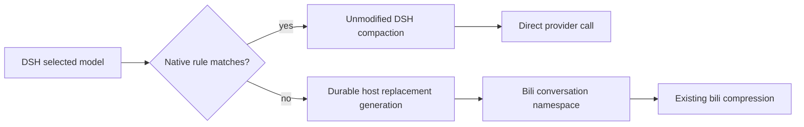

# DSH model-selective native compaction

Proposed in #6121. This opt-in feature targets DSH Web agent presets containing `@deepseek-ai/dsh-compaction-basic` (standard, ptc, cordis, and equivalent custom presets). Default configuration `[]` preserves bili's existing behavior. Restart the host after changing the list; existing preset instances retain their original composition.

```json
{
  "dsh": {
    "nativeCompactionModels": [
      { "model": "gpt-*" },
      { "model": "codex/gpt-*" }
    ]
  }
}
```

Rules match the actual DSH **model ID**, case-sensitively, not its display label. A trailing `*` means prefix matching; other wildcards and a standalone `*` are rejected. Optional `provider` is an exact DSH provider ID. Omit it to match the model across providers. All unmatched models keep bili. `codex/gpt-*` is needed when a gateway includes that namespace in the model ID. `passthrough` alone cannot enable the native backend.



Native thresholds, retention settings, summary prompts and summary-model resolution remain DSH-owned. On a model switch DSH can summarize using its previous routed model unless its own summary-model configuration overrides that choice. Those summary requests still bypass bili, independently of the summarization model's membership in the rules.

This adapter only selects the compaction owner. DSH retains control of summary input, tools, output budget, model selection, prompts, call count and failure handling. The patch performs no extra budget validation, history splitting, intermediate summarization or merge prompting. An asynchronous scope marks native summary requests for direct transport without changing their content or affecting concurrent bili sessions.

Native steps do not expose bili compression tools; bili steps do not trigger host compaction. Native HTTP requests preserve their bodies, headers and provider transport. A WebSocket reused across ownership modes rejects that frame and closes so the existing host transport recovery can reconnect.

When switching bili → native, DSH uses its own durable history and checkpoints with its existing compaction strategy. Bili fold summaries are not assembled into a replacement native summary. If the selected history exceeds the summary model window, the native request and native failure/recovery behavior are preserved, without secretly splitting history or switching models. A switch cannot guarantee successful compaction of arbitrarily long history. Consecutive native compactions remain controlled by the stock pressure strategy.

When switching native → bili, the host's durable `surface.replaceGeneration` changes the bili conversation namespace. New folds cannot reuse an earlier substrate. The value survives replay/restart and does not change on ordinary appends or model switches without a host replacement. Original DSH session IDs and append-only history are unchanged. After a replacement, negotiated aliases, fork adoption and incremental conversion are disabled for that substrate; full sends plus a fresh watermark seed provide a conservative boundary. Other sessions retain their existing path. The Context tab and `/acp` follow the active namespace; native mode reports its ownership rather than showing stale bili data.

## Compatibility and validation

Validated with DSH `0.2.2-rc.1`. The integration script uses the real Cordis loader, isolated compaction realm, token meter, Session replay and native checkpoint engine, with a deterministic fake LLM (no account traffic). Run after building:

```sh
node scripts/test-dsh-native-compaction.mjs /absolute/path/to/isolated-dsh-runtime
```

The caller must supply a detached runtime directory, not a running profile. No credentials, live sessions or production files are used by this test. The actual upstream model's summary quality and provider billing are not validated by a fake LLM.

Native requests fail closed when their preset has not attached the adapter. The stock minimal preset has no compaction backend: native rules preserve that behavior and do not add compression. Root-plane CLI compositions and unknown future DSH APIs require compatibility work before enabling rules there. This feature does not silently promise native compression on those profiles.

## Behavioral parity acceptance

The real DSH engine integration script replays identical events through the stock engine without the routing adapter and through the routed native engine. It compares actual summary requests, compaction events, generations and token results; only newly generated host identifiers are normalized, preserving original message and tool IDs. Cases cover below-threshold, automatic/manual/region compaction, model switches, configured summary models, provider failure, cancellation and oversized histories/tool catalogs. Overflow must fail the same way in both arms rather than succeed through a new adapter fallback.

The bili comparison uses real plugin request interception, proxy and compression tools to compare bili-only mode with an unmatched model under selective routing: tool lists, fold results and provider requests must match. Separate coverage checks round trips, checkpoint-generation replay and asynchronous isolation. A deterministic upstream removes random model-output differences; this verifies routing behavior, not summary quality or losslessness. Earlier batch-merge A/B results describe removed code and are not acceptance evidence for this revision.

## Carrying a patch across updates

Keep the source commit/patch and tests in version control. Build candidates from the desired upstream release, apply the patch with `git apply --check`, then run typecheck, focused tests, build, and the real-DSH integration script before packaging. Use a profile-owned local `file:` package pin so the registry updater cannot overwrite the patch. Updates become an explicit rebuild-and-install workflow, not automatic registry replacement. Preserve the original package, profile manifest/lockfile and config for rollback. Never apply an old compiled `dist` over a newer upstream tree.

Unknown future upstream versions can conflict or change behavior even when a patch applies. Stop on conflicts or failed compatibility checks, retain the installed version, and review/rebase the patch. No finite test suite guarantees compatibility with every future release.

To return every model to bili after using this feature, keep the key and set `nativeCompactionModels: []`. An explicitly present empty list retains generation isolation; deleting the key or removing the patch is a separate migration and can expose an earlier bili namespace.
