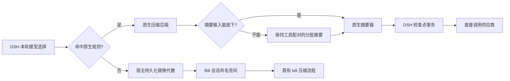

# DSH 按模型使用原生压缩

对应 #6121。此可选功能用于包含 `@deepseek-ai/dsh-compaction-basic` 的 DSH Web 预设：standard、ptc、cordis 及结构相同的自定义预设。默认空列表维持既有 bili 行为。修改后需重启宿主，因为运行中的 Agent 会保留原预设实例。

```json
{
  "dsh": {
    "nativeCompactionModels": [
      { "model": "gpt-*" },
      { "model": "codex/gpt-*" }
    ]
  }
}
```

匹配实际 DSH **模型 ID**，区分大小写，不匹配显示名。仅支持结尾 `*` 表示前缀；不接受其他通配符或单独 `*`。可选的 `provider` 精确匹配 DSH 供应商 ID；省略表示所有供应商。未匹配模型继续使用 bili。网关模型 ID 若包含 `codex/`，需配置 `codex/gpt-*`。单独设置 `passthrough` 无法恢复宿主压缩。



原生触发阈值、近期内容保留、摘要提示词和摘要模型选择由 DSH 决定。模型切换时，DSH 可能使用上一轮模型生成摘要，除非其原生配置另行指定；这些摘要请求仍绕过 bili，不受摘要模型是否命中规则影响。

原生步骤不提供 bili 压缩工具；bili 步骤不触发宿主原生压缩。原生 HTTP 请求保留原始请求体、请求头和供应商传输。WebSocket 若复用跨压缩模式的连接，会先阻止该帧并关闭连接，由宿主既有传输恢复机制重连。

**bili → 原生：** 选中的原始历史进入 DSH 摘要器。超长输入分批缩减，工具调用及其全部结果不可拆开，系统消息和工具定义随每批保留。失败、取消、无法缩短或单个消息/工具组超出摘要窗口时明确报错，不提交部分替换检查点。摘要仍然有损，无法保证每个细节都保留。

**原生 → bili：** 使用宿主持久化的 `surface.replaceGeneration` 区分 bili 命名空间，防止旧折叠套用到新摘要上。重启重放后保持一致；普通追加消息或未发生宿主替换的模型切换不会改名。DSH 会话 ID 与原始追加日志保持原样。发生替换后，该命名空间停用旧协商别名、分叉继承和增量发送，采用完整发送及新的水位种子；其他会话沿用原路径。上下文页和 `/acp` 跟随当前命名空间，原生模式显示归属，不展示过时 bili 数据。

## 验证与边界

针对 DSH `0.2.2-rc.1` 验证。集成脚本使用真实 Cordis Loader、独立压缩作用域、token meter、Session 重放和原生检查点引擎；模型为确定性假实现，不消耗账户额度：

```sh
node scripts/test-dsh-native-compaction.mjs /绝对路径/隔离的DSH运行时
```

运行时必须是独立副本，不是正在运行的 profile。测试不使用凭据、现有会话或线上文件；不代表已经验证真实模型的摘要质量或计费。

预设未挂载适配器时，原生请求明确失败。原厂 minimal 预设没有压缩后端，命中原生规则时维持其原样，不额外添加压缩。CLI 根作用域配置、未来 DSH API 版本需要额外适配，不能直接视为已支持。

## 后续更新保留补丁

保存源码提交、补丁和测试。对目标上游版本先执行 `git apply --check`，再执行类型检查、针对性测试、构建及真实 DSH 集成验证，全部通过才打包。profile 使用其管理渠道的本地 `file:` 包固定，避免注册表更新覆盖补丁；以后更新改为明确的“重建、验证、安装”流程。保留原包、profile 清单/锁文件及配置用于回滚。不要将旧 `dist` 覆盖到新版源码上。

未来上游可能产生冲突或改变语义，即使补丁文本能套用也不代表兼容。检查失败时应保留已安装版本并重新审查补丁，不能保证未知的所有未来版本均可自动应用。

使用后若要让全部模型回到 bili，请保留配置键并设为 `nativeCompactionModels: []`；显式空列表仍保留代数隔离。删除整个配置键或移除补丁属于另一次迁移，可能重新暴露旧 bili 命名空间，不能等同于清空规则。
