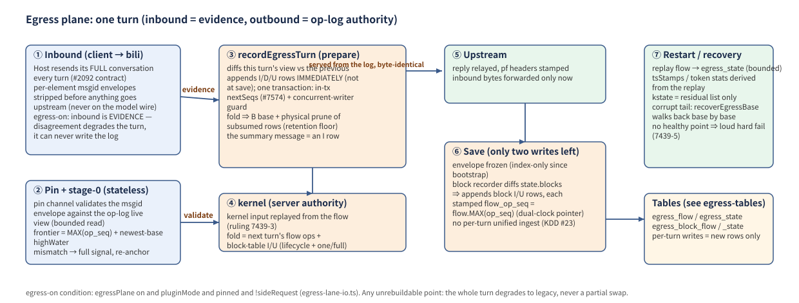

# The egress plane (egressPlane) — dedicated doc

> The #7439 series end-state: for **egress-on** sessions, the outbound conversation **op log is the single authority**. One-stop reference: what it does and why, the tables, the per-turn mechanism, the performance story, fork/rollback, the design decisions, the switch family, the operator runbook, and the PR/proposal timeline. 中文: [egress-plane.zh-CN.md](./egress-plane.zh-CN.md). Retiring surfaces: [deprecations.md](./deprecations.md) · storage module: [architecture/storage.md](./architecture/storage.md) · blocks detail: [egress-block-flow.md](./egress-block-flow.md).

## 1. Inbound vs outbound — the two directions of a turn

A plugin turn is two opposite byte flows over the same session:

- **Inbound** (client → bili): the plugin host **resends its full conversation** every turn (its own history is its source of truth; that's the #2092 contract). The host also stamps per-element **msgid** envelopes — host↔bili private, **stripped before anything is forwarded upstream** (never on the model wire). For egress-on sessions the inbound stream is now **evidence, not authority**: it feeds stage-0 (pin/identity) and the pin channel, and anything it disagrees with the op log about degrades that turn — it can never write the log.
- **Outbound** (bili → client): the core-message portion of the reply/next-request view is served **from the op log**, byte-identical by construction, not re-derived from the client's resent bytes. The kernel (compression engine) input is **replayed from the flow** (server authority, ruling 7439-3) — fold decisions are computed over the log's view, so the host can never steer compression by rewriting its resend.

So: **the client still sends everything (inbound), but bili no longer believes it for the outbound view (outbound).** The legacy re-derive-from-client-bytes chain stays alive as the degrade target — any unrebuildable point degrades the *whole turn* to legacy, never a partial swap.

## 2. Why an op log can be the authority (design decisions)

| # | Decision | Why it holds |
|---|---|---|
| 7439-1 | **Self-contained rows** — the message bytes ride the `I` row (no content-CAS join). | The log must be replayable alone (fork, restore, audit) without the rest of the DB. |
| 7439-2 | **Blocks read/write side on the blocks table** — `summary_bytes` inlines the block summary; `start_msgid`/`end_msgid` align a block to the flow's msgid coordinates once at fold time. | Fold output is written where the kernel reads it; no cross-table identity dance per turn. |
| 7439-3/5 | **Server authority + hard fail** — kernel input replays from flow; a log with **no healthy point at all** hard-fails loudly instead of silently serving client bytes. | A wrong-but-silent answer is the failure mode the plane exists to kill; a loud 500 with the recovery log is acceptable. |
| KDD #23 | **`messages` demoted to a lazy projection** — for egress-on sessions the per-turn unified ingest stops; the messages table is rebuilt one-time, O(n), only on plane rollback / web read / restore. | Storage cost was proportional to the messages ledger's **total** rows per turn (~20µs/row; 2× double-ledger at 100k). The op log's per-turn write is O(new messages) and the serving reads are bounded by compaction. |
| Dual clocks (#7581) | The **block** tables number themselves; each block row points at the flow clock via `flow_op_seq` (non-decreasing ⇒ `<= X` is a prefix). | One shared clock made the fold's block rows (written at **save**) land two op_seqs past the turn's last flow row (written at **prepare**) and broke the flow's density invariant on the next turn's first read. Two clocks + a one-way pointer keeps both tables dense and independent. |
| Stateless identity (#7617) | stage-0 for egress-on sessions computes from op-log frontiers (`MAX(op_seq)` + newest-base high water); no `l1_world` cursor, no resync. | The log already IS the identity ledger — a second cursor would be a third clock. The R3 fault latch moves to `sessions.r3_latched_at` (dual-carrier read/clear with the legacy column). |

**Why compression (fold) works on top of the flow.** A fold is just ops: `D` × covered originals + `I` (the summary message — it is context, so it lives in the flow) + a `B` base in the same transaction. The summary's **block object** (lifecycle: active/superseded/reaped, coverage, the covered originals' `one`/`full` text) lives in the **block tables** — the log records "what the context is", the block tables record "what the fold did to get there". On-demand full-text retrieval (`decompress`) reads the block row, not the flow. The fold's compaction **physically deletes** the subsumed flow rows below the base (retention floor: point forks below the newest base are refused until the point-reconstruction materializer lands).

## 3. Tables (SQLite, `src/storage/schema.ts`; probe-first DDL, dev-era tables)

| Table | PK | Role | Key columns |
|---|---|---|---|
| `egress_flow` | `(session_id, op_seq)` | **Message** op log. Dense within the table above the retention floor (#7574 invariant; recovery = walk back to the newest healthy base). Rows below the newest `B` base are physically pruned by compaction. | `row_type` I/D/U/B · I: `msgid`, `log_seq` (canonical, never-reissued message number), `ref`, `tokens`, `bytes`, `role`, `type_tag` · B: payload `{entries, highWater}` (the compaction base = the live view at that point + the message frontier) |
| `egress_state` | `(session_id, op_seq)` | **Read replica** of the live view (replayed from flow at every write, in the same tx; `log_seq` ordered, index on `msgid`). Bounded by compaction. | same I-row shape; this is what `snapPinLiveIds` / serving reads hit |
| `egress_block_flow` | `(session_id, op_seq)` | Append-only **block** history. **Own number pool** (dual clocks). | `row_type` I/U/B · snapshot payload `{tier, startMsgid, startSeq, endMsgid, endSeq, supersedesBlockId, active, reaped, one, full}` · **`flow_op_seq`** = the flow's `MAX(op_seq)` at write time (the cross-table pointer) · kstate sidecar (residual field list) |
| `egress_block_state` | `(session_id, block_id)` | Latest snapshot per block (same pointer). | snapshot payload + `flow_op_seq` |
| `sessions.r3_latched_at` | — | R3 identity-fault latch carrier (#7617). NULL/0 = not latched. | dual-carrier: read `?? l1_world.r3_latched_at`, clear touches **both** |
| `conversations` | — | Host-identity claim table. egress-on sessions no longer need a claim row (identity is stateless); physical DROP on the retirement register. | |

Retention rules: flow/state are pruned **down to the newest B base** (the retention floor); block_flow is append-only (its compaction path exists — `egressBlockCompact` — but has no production caller yet, see follow-ups).

## 4. One turn, step by step

1. **Prepare** — the plugin turn arrives; lane arbitration picks the egress path; **`recordEgressTurn`** diffs the turn's outbound view against the previous one and **appends I/D/U rows to the flow immediately (at prepare, not save)** — in one transaction: in-transaction `nextSeqs` (density-safe, #7574), a concurrent-writer guard, and — if the turn deleted rows (a fold) — a **B base + physical prune** in the same tx.
2. **Pin** — the pin channel validates the host's msgid envelope against the op-log live view (`snapPinLiveIds`, bounded serving read). Mismatch ⇒ degrade this turn (full signal, re-anchor next), never reject.
3. **Kernel** — the kernel input is **replayed from the flow** (server authority). Fold decisions land as flow ops (step 1 of the *next* turn) plus **block-table ops** (I/U for the summary block's lifecycle, with `one`/`full`).
4. **Upstream** — reply relayed; pf headers stamped.
5. **Save** — the session envelope save is **index-only** (frozen at bootstrap); the **block recorder** diffs `state.blocks` against `egress_block_state` and appends block I/U rows, each stamped with `flow_op_seq = flow.MAX(op_seq)`. No per-turn unified ingest (KDD #23).
6. **Restart** — load replays flow → `egress_state` (bounded); `tsStamps`/token stats are **derived from the replay**, not persisted; kstate is the residual list only. If the tail is corrupt, `recoverEgressBase` walks back one step at a time (truncating past each healthy base) until a healthy point; no healthy point ⇒ hard fail loudly (7439-5).

## 5. Why it is faster

| Before (per turn, 100k-row session) | After |
|---|---|
| Unified ingest O(**total** messages rows) ≈ 2s p50, 2× for the double ledger | Per-turn write = **new flow rows only** |
| Every watermark HIT: O(full table) re-ingest 0.5–0.8s | Sliding-tail **re-anchor delta**: per-row index identity probes **inside the write tx**; any doubt = the pre-change full path |
| Serving reads over the growing messages ledger | **Bounded serving reads** — the live view is kept compact by compaction bases |
| `tsStamps`/token stats persisted alongside the kernel state | **Derived from flow replay on load** (kstate residue trimmed to the residual field list) |
| `l1_world` cursor read/write + resync per identity decision | **Stateless stage-0** from op-log frontiers |

The invariant that pays for all of it: **every read the serving path needs is bounded by compaction**, and the only O(n) path left (projection rebuild) runs once per rollback/web-read/restore, not per turn.

## 6. Fork and rollback

- **Fork-to-now** (the default): all four tables copied verbatim + `sessions`; the child continues both clocks independently.
- **True point fork** (watermark `wm` = a flow `op_seq`): copy flow rows `op_seq <= wm`, copy **block rows `flow_op_seq <= wm`** (the pointer, not the block's own number — that's the whole reason dual clocks exist), then rebuild both state replicas by replay. Below the newest base ⇒ refused (400) until the point-reconstruction materializer lands — retention pruned those rows by design.
- **Rollback / downgrade** (opt the plane out, or run an old binary): the messages-table **lazy projection is rebuilt one-time, O(n), from the flow**; the legacy reader (messages + envelope) then sees a byte-complete session. Egress rows stay; re-enabling needs no migration (the log is still ahead).
- **Downgrade safety**: an egress-on session has **no envelope rows after bootstrap** — an old binary cannot read it; that's why the standard upgrade path is forward-only and the rollback path goes through the projection rebuild, never "just read the old file".

## 7. The switch family and how they depend on each other

| Flag | Default | Role in the egress family |
|---|---|---|
| `rollout.features.egressPlane` | **0 (off — opt-in per owner ruling 2026-11-24; a default-100 GA flip was proposed in this series and declined)** | THE switch. Arms the plane for eligible sessions. Force on: `true`/percent / `BILI_ROLLOUT_EGRESS_PLANE=1`. |
| `storage.unified` (full/shadow) | — | **Prerequisite.** SQLite lane only; the op log lives in the unified store. No unified store ⇒ the plane has nowhere to write and stays inert. |
| `pluginLaneServerHistory` | 100 | The **pin**: server history + msgid identity. Without a pin, `egressAuthority` never arms — the plane silently idles. |
| `pluginMsgIdIncremental` | 100 | Steady-state tail form of the pin channel (requires `pluginLaneServerHistory`). |
| `pluginFullResendWatermark` | 100 | Fastpath optimization of the same family (skip re-parsing the verified identical prefix). |
| `snapshotRender` (D-lane) | 0 | **NOT egress.** Server-render for *unarmed* plugin sessions; egress-on turns bypass it by construction (`src/server/snapshot-render.ts`: `if (deps.pluginMode) return clientMsgs`). Retirement trigger conditions: [deprecations.md](./deprecations.md). |
| `pluginIncrementalTurns` | 0 | Not egress at all — a client opt-in wire protocol (#3248). |

**Arm rule** (`src/server/egress-lane-io.ts`): `featureEnabled("egressPlane") && pluginMode && pinned && !sideRequest` — one rule for all four wire lanes; side requests (title-gen, compaction calls, tiny budgets) never touch the log.

**Silent half-states are documented, not hidden**: `egressPlane` on + `pluginLaneServerHistory` off ⇒ nothing arms, nothing happens. The three msgid-family flags default to 100 (their GA predates this doc), so this only happens via an explicit operator opt-out. Flag removal (hardcode-on) is on the retirement register, gated on fleet-wide egressPlane stability.

## 8. Operator runbook

- **Where on/off is read (resolution order):** env `BILI_ROLLOUT_EGRESS_PLANE` (`"0"`/`"false"` = off, anything else on) → config file `$XDG_CONFIG_HOME/billion-context/billion-context.json` (default `~/.config/billion-context/billion-context.json`), key `rollout.features.egressPlane` (`true`/`false`, or `{"percent": n}`) → code default (`src/rollout.ts`): **0 (off)**. Turning it on needs nothing else beyond the flag (`storage.unified` is set by the standard install).
- **Opt out (whole plane):** `BILI_ROLLOUT_EGRESS_PLANE=0` (env wins over config) or `"rollout": {"features": {"egressPlane": false}}`. New turns go legacy; existing rows stay (projection rebuild still reads them).
- **Degrade (no action needed):** any unrebuildable row / corrupt point / probe failure degrades **that turn** to legacy. No healthy point at all ⇒ loud hard fail.
- **Point fork:** `POST /__bili/replicas` — 201 point-fork / 503 non-resident / 400 below newest base. Fork-to-now copies all four tables verbatim.
- **R3 latch stuck:** `SELECT r3_latched_at FROM sessions WHERE session_id = ?` (old binaries: also check `l1_world`); clearing resets **both** carriers.
- **GC / archive:** egress-on sessions are **excluded from age GC entirely** and **refused** on manual archive (`bili sessions archive`) — the archive format doesn't carry the op log yet (follow-up).
- **Diagnosis:** `/__bili/status`; recovery events (walk-back truncations, degraded turns) are loud in the proxy log.

## 9. PR / proposal timeline

| When | What |
|---|---|
| Discussion [#7439](https://github.com/ranxianglei/billion-context/discussions/7439) | Series origin; the five owner rulings (self-contained rows; blocks read/write side; server authority + flow replay; blocks-table alignment; no-healthy-point hard fail). |
| KDD #23 (#7474/#7475, 2026-11-22) | op log = sole authority, `messages` lazy projection, re-anchor delta. |
| #7574 | op-log integrity: in-transaction seq reads, `recoverEgressBase` walk-back, concurrent-writer refusal, density invariant. |
| [#7577](https://github.com/ranxianglei/billion-context/discussions/7577) / **#7581** (merged) | `egress_block_flow`/`egress_block_state` (**dual clocks** — the shared-clock design was rejected in review because it broke flow density on the first fold), checkpoint retirement → point fork, kstate trim. |
| [#7591](https://github.com/ranxianglei/billion-context/discussions/7591) / **#7617** (merged) | Identity consolidation: stateless stage-0, R3 latch → `sessions`, conversations retirement for egress-on, GC/manual-archive guards. |
| **#7659 (this PR, 2026-11-24)** | Docs wrap-up: this doc; [deprecations.md](./deprecations.md); KDD #24; diagrams. The egressPlane default stays **0** per the owner ruling — a GA flip was proposed and declined. |

**Open follow-ups** (tracked): the egressPlane default-100 flip when the owner says so; the point-reconstruction materializer (fork below the newest base); the archive format gaining the op log; a production **compaction caller** for `egressBlockCompact` (replay is live in #7664); the physical DROP batch for the retired identity carriers; flag removal (hardcode-on) per the retirement register.

## 10. Renumber — log_seq IS the citation number (fixed design, 2026-11-25)

**Background — the split this closes.** The kernel gives every real message a citation ref (`m00001`, `m00002`, … — `assignRefs`, persisted in the `refs` table) and the op log keeps its own `log_seq` counter, with the two number spaces joined only through the raw message id. When the kstate retirement (#7658 PR-B) rebuilt `messageRefs` from the op-log view at cold load, that split bit: the op log numbers the constant **system row first**, so its view minted `m00001 → egress-system` and shifted every real message by one. The rebuilt refs map no longer matched the stored `tokenSnapshot` (keyed by kernel refs), and the wire tags carried the wrong token counts on every post-fold turn. Fixing "ignore the overlay" treats the symptom; the design ruling (owner, 2026-11-25) is that the **op log is the sole authority, so the kernel's citation number and `log_seq` are one and the same number** — no second number space to drift from it, and no external table the egress system must consult.

**The rules.**

1. **`log_seq` ≡ citation number.** For a real message, `log_seq` is the number the kernel assigned (`mNNNNN` = `m` + `log_seq`), written on the I row at append time. The old `MAX(log_seq)+1` counter survives only as the fallback for a row whose id has no ledger entry; it never overwrites a known number. Kernel numbers are dense, allocated once, never re-issued (retired slots are dead, #5196), so a freshly allocated number is exactly `MAX(log_seq)+1` — the counter and the ledger agree by construction once the log is complete. **Collision rules (refined 2026-11-25):** a cited number below the batch high water is LEGAL — it means the slot was retired (a fold re-homed its content) — and the append throws only when the number collides with a row still LIVE at the op position (the kernel can hand out a retired slot before the fold's D rows are booked); a row with no ledger entry takes the dense fallback ABOVE every number the same batch cites (the kernel's own fold-summary ids have no refs entry and render between cited numbers — a mid-sequence dense fill would steal the next cited number, e.g. `acp_summary_b2` in a fork-child fold).
2. **The system row is number 0.** Outside the citation space (which starts at 1). Nothing has to be filtered: "the system prompt does not take a message ref" is true by construction, and it stays true for every derived view (pin ledgers, kstate rebuild, replay) because the exclusion was a filter on a number that should not exist in the space at all.
3. **Backfill at arm, self-healing.** A session that arms mid-history (legacy saves before the plane) has pre-arm messages absent from the op log. No marker is needed: the first record pass after arm sees an empty log, so the diff emits I rows for the **whole** live conversation, each carrying its existing kernel number — that natural first pass IS the backfill. Idempotency is structural: rows enter per missing `msgid`, so a second pass adds nothing, and a truncated or damaged log heals the same way (missing rows re-enter on the next record). Forks copy the flow verbatim, so backfilled numbers travel with them. Fresh-from-birth sessions never need it: system is 0, the first real message is 1.
4. **`refs` table: write-retired for egress-on, read fallback kept.** After backfill, the op log covers the whole history, so egress-on sessions stop writing `refs` rows (registered in [deprecations.md](./deprecations.md)); the reader falls back to the table for pre-backfill/legacy sessions until the physical DROP batch.
5. **The kstate overlay becomes the legitimate path.** Cold load derives `messageRefs` as `{rawId → m + log_seq}` from the op-log view — the same map the kernel assigned in-process, by rule 1. The stopgap "never let the overlay clobber stored refs" is unnecessary once the numbers agree.
6. **System prompt: input form in `egress_state`, transcript form in the flow.** One text, two forms — no third copy: the flow's system row keeps the **assembled outbound** (client system `A` + the server standing blocks `B`, computed live every turn; the transcript needs exactly what went out). The **client raw** `A` gains a permanent home inside the egress tables — a row on the fixed `egress-system` msgid at number 0 in `egress_state`, updated with a U op when the client changes it (no DDL on `sessions`). Consequence: the sticky-copy carrier in `session_ext` (`inc:system`) is retired for egress-on sessions — registered in [deprecations.md](./deprecations.md) — and the incremental lane reads `A` from the egress state for egress-on sessions (legacy, plane-off, is untouched). Both forms are queryable from the egress tables; there is no more "the real system prompt lives in an extension column".

**Why this is safe for the rest of the plane.** Forks copy flow rows verbatim, so the backfilled numbers travel with them; compaction bases store `highWater` as the largest number subsumed (now a citation number, so the frontier `MAX(log_seq)` read by stage-0 and the next-number fallback are citation-aligned on both sides); CCR and the block tables key on `op_seq`/`msgid`, not citation numbers. Bonus: egress-on citation space becomes **identical to the legacy leg's** (`m00001` = first real message on both sides), which also removes the whole renumber-on-load machinery (#4316) from the egress-on path — the stale-snapshot-after-renumber bug class has no egress-on instance left.
