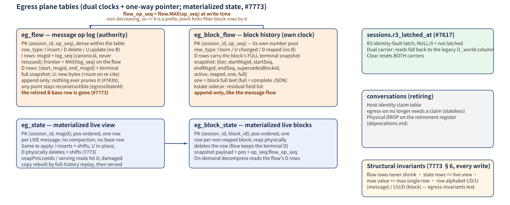
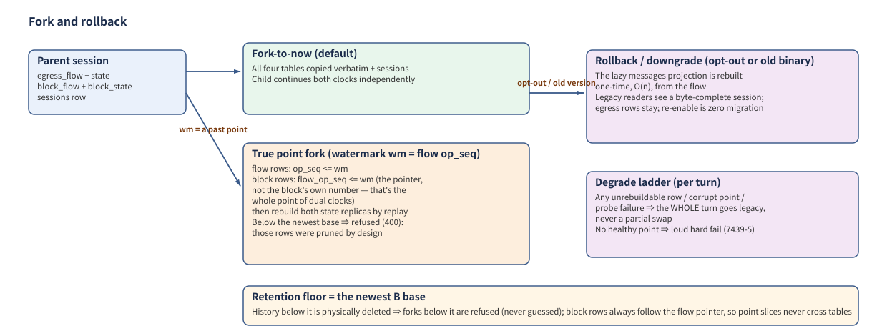

# The egress plane (egressPlane) — dedicated doc

> The #7439 series end-state: for **egress-on** sessions, the outbound conversation **op log is the single authority**. One-stop reference: what it does and why, the tables, the per-turn mechanism, the performance story, fork/rollback, the design decisions, the switch family, the operator runbook, and the PR/proposal timeline. 中文: [egress-plane.zh-CN.md](./egress-plane.zh-CN.md). Retiring surfaces: [deprecations.md](./deprecations.md) · storage module: [architecture/storage.md](./architecture/storage.md) · blocks detail: [egress-block-flow.md](./egress-block-flow.md).

## 1. Inbound vs outbound — the two directions of a turn

A plugin turn is two opposite byte flows over the same session:

- **Inbound** (client → bili): the plugin host **resends its full conversation** every turn (its own history is its source of truth; that's the #2092 contract). The host also stamps per-element **msgid** envelopes — host↔bili private, **stripped before anything is forwarded upstream** (never on the model wire). For egress-on sessions the inbound stream is now **evidence, not authority**: it feeds stage-0 (pin/identity) and the pin channel, and anything it disagrees with the op log about degrades that turn — it can never write the log.
- **Outbound** (bili → client): the core-message portion of the reply/next-request view is served **from the op log**, byte-identical by construction, not re-derived from the client's resent bytes. The kernel (compression engine) input is **replayed from the flow** (server authority, ruling 7439-3) — fold decisions are computed over the log's view, so the host can never steer compression by rewriting its resend.

So: **the client still sends everything (inbound), but bili no longer believes it for the outbound view (outbound).** The legacy re-derive-from-client-bytes chain stays alive as the degrade target — any unrebuildable point degrades the *whole turn* to legacy, never a partial swap.

## 2. Why an op log can be the authority (design decisions)

| # | Decision | Why it holds |
|---|---|---|
| 7439-1 | **Self-contained rows** — the message bytes ride the `I` row (no content-CAS join). | The log must be replayable alone (fork, restore, audit) without the rest of the DB. |
| 7439-2 | **Blocks read/write side on the blocks table** — `summary_bytes` inlines the block summary; `start_msgid`/`end_msgid` align a block to the flow's msgid coordinates once at fold time. | Fold output is written where the kernel reads it; no cross-table identity dance per turn. |
| 7439-3/5 | **Server authority + hard fail** — kernel input replays from flow; a log with **no healthy point at all** hard-fails loudly instead of silently serving client bytes. | A wrong-but-silent answer is the failure mode the plane exists to kill; a loud 500 with the recovery log is acceptable. |
| KDD #23 | **`messages` demoted to a lazy projection** — for egress-on sessions the per-turn unified ingest stops; the messages table is rebuilt one-time, O(n), only on plane rollback / web read / restore. | Storage cost was proportional to the messages ledger's **total** rows per turn (~20µs/row; 2× double-ledger at 100k). The op log's per-turn write is O(new messages) and the serving reads are as bounded as the live context itself (the state tables are the materialized live view, #7773). |
| Dual clocks (#7581) | The **block** tables number themselves; each block row points at the flow clock via `flow_op_seq` (non-decreasing ⇒ `<= X` is a prefix). | One shared clock made the fold's block rows (written at **save**) land two op_seqs past the turn's last flow row (written at **prepare**) and broke the flow's density invariant on the next turn's first read. Two clocks + a one-way pointer keeps both tables dense and independent. |
| Stateless identity (#7617) | stage-0 for egress-on sessions computes from op-log frontiers (`MAX(op_seq)` + newest-base high water); no `l1_world` cursor, no resync. | The log already IS the identity ledger — a second cursor would be a third clock. The R3 fault latch moves to `sessions.r3_latched_at` (dual-carrier read/clear with the legacy column). |

**Why compression (fold) works on top of the flow.** A fold is just ops: `D` × covered originals + `I` (the summary message — it is context, so it lives in the flow), in one transaction. The summary's **block object** (lifecycle: active/superseded/reaped, coverage, the covered originals' `one`/`full` text) lives in the **block tables** — the log records "what the context is", the block tables record "what the fold did to get there". On-demand full-text retrieval (`decompress`) reads the block row, not the flow. The fold **materializes**: the covered rows are physically deleted from the **state** tables (the serving view) while the **flow** keeps every row it ever wrote — append-only by the #7439 ruling, so any historical point stays reconstructible. (A 2026-11-23 implementation deviation pruned the flow below the newest base; it is restored by this PR — see the issue history. The base-row/compaction machinery that used to bound the state replica is retired entirely — discussion [#7773](https://github.com/ranxianglei/billion-context/discussions/7773).)

## 3. Tables (SQLite, `src/storage/schema.ts`; probe-first DDL, dev-era tables)

Creation note (KDD #25): on an **egressPlane-on** instance a **fresh** database is created with only the core trio (`sessions`/`session_ext`/`kv_store`) plus the four egress tables — the 12 legacy tables below are skipped at creation and probed back in when the flag is later turned off; existing databases are never stripped. See §11.

| Table | PK | Role | Key columns |
|---|---|---|---|
| `egress_flow` | `(session_id, op_seq)` | **Message** op log. Dense within the table (#7574 invariant). **Append-only: nothing ever prunes it** (#7439); recovery = walk back to the newest healthy point; every point stays reconstructible (`egressStateAt`). | `row_type` I/D/U (the retired `B` base row is gone, #7773) · I: `rid` (the row id, below), `msgid`, `log_seq` (canonical, never-reissued message number), `ref`, `tokens`, `bytes`, `role`, `type_tag` · D: range `(start, end)` (rid values) — addressed by row id, NEVER by msgid (2026-11-27 owner ruling) — + the terminal full snapshot · U: `rid` (the target row; the row's msgid is kept as a cross-check) + new bytes (+ `num` on re-citation) |
| `egress_state` | `(session_id, rid)` | **Materialized live view** (7773): one row per LIVE message, ordered by `pos`. Every append applies its ops to the rows in the same transaction — `I` inserts (shifting `pos`), `U` updates in place, `D` physically deletes + shifts. Bounded by the live view's size by construction; there is no compaction, no base row, no op mirror. A msgid MAY recur in the live view (a content-hash proxy can legitimately collide, or a re-homed slot can reappear); the `rid` cannot — that is why the key and every log anchor are `rid`, with `idx_egress_state_msgid` (session_id, msgid) as the serving lookup. | `rid` (dense, per-session, never re-issued — the flow keeps it forever, so `MAX(rid)+1` is always safe), `pos`, `log_seq` (the I-twin's flow number, immutable — the twin anchor), `num` (current kernel citation; 0 = uncited/retired), `msgid`, `ref`, `tokens`, `type`, `role`, `ts`, `sys_in`, `bytes`, `created_at`. This is what `snapPinLiveIds` / serving reads hit. |
| `egress_block_flow` | `(session_id, op_seq)` | Append-only **block** history. **Own number pool** (dual clocks). | `row_type` I/U/D (reap = a `D` row carrying the block's **full terminal snapshot**, #7773; the retired `B` row is gone) · snapshot payload `{tier, startMsgid, startSeq, endMsgid, endSeq, supersedesBlockId, active, reaped, one, full}` · **`flow_op_seq`** = the flow's `MAX(op_seq)` at write time (the cross-table pointer) · kstate sidecar (residual field list) |
| `egress_block_state` | `(session_id, block_id)` | **Materialized** live blocks: one row per non-reaped block, ordered by `pos`; reap physically deletes the row (the flow keeps the terminal `D` snapshot). | snapshot payload + `pos` + `op_seq`/`flow_op_seq` |
| `egress_usage` | `(session_id, op_seq)` | Append-only **cache/usage event stream** (owner ruling 2026-11-27): the ledger's mutations as an op log, so the in-memory cache ledger is restart-reconstructible (§12). Third egress clock; own number pool. | `row_type` M/S/F · `at` (epoch ms — point-fork watermark) · `payload` = bounded JSON (S: the EXACT `recordCacheSample` arguments + model · F: the pristine fold row) |
| `sessions.r3_latched_at` | — | R3 identity-fault latch carrier (#7617). NULL/0 = not latched. | dual-carrier: read `?? l1_world.r3_latched_at`, clear touches **both** |
| `conversations` | — | Host-identity claim table. egress-on sessions no longer need a claim row (identity is stateless); physical DROP on the retirement register. | |

Retention rules: **flow is append-only and never pruned** (#7439 — its growth is a deferred optimization, #7475, addressed elsewhere, never by retention); the **state** tables are the materialized live view — their size IS the live view's size, covered rows physically deleted at fold time (the base-row/compaction path, `egressStateCompact`/`egressBlockCompact`, is retired, #7773); block_flow is append-only like the message flow; **egress_usage** is append-only like its siblings (cleared only by session deletion / fork copy, §12).

**Structural invariants (7773 §6, asserted after EVERY write, both planes).** ① the flow's row count never shrinks (append-only); ② the state row count == the live view's row count (a materialization, never an aggregate and never an op mirror); ③ the largest value in flow/state equals the historical maximum SINGLE-row size — the regression defense against the retired `B` row's whole-view aggregate payload; ④ the row alphabet is exactly I/D/U (message plane) and I/U/D (block plane) — `B` never appears; ⑤ **log addressing is by `rid`** — the dense, never-reissued per-session row id: D endpoints, U targets and I anchors in `egress_flow` payloads are rids, never msgids (a msgid is a kernel identity that the proxy may map from a content hash and that can legitimately recur; a rid is ours and cannot — owner ruling 2026-11-27, the follow-up to #7773). Suite: `tests/egress-invariants-7773.test.ts`.

### The id map — which question each number answers

Five numbers appear across the five tables. They answer FIVE DIFFERENT questions; none of them is redundant:

| id | lives on | the question it answers | re-use |
|---|---|---|---|
| `op_seq` | flow / block_flow / usage PK | "the Nth **write to this table**" — the physical journal cursor; fork and point-in-time watermarks ride it (or the block plane's `flow_op_seq` pointer onto it) | monotonic, but names **events**, not rows: one row's life (I→U→U→D) consumes several op_seqs — the row is addressed by its I row's `rid`, not by where its writes happened |
| `log_seq` | flow I rows / state | "the number the **kernel cites** for this row" — `mNNNNN` = m + log_seq, one number not two (§10) | re-citable: a fold summary may legitimately take over a retired slot (demote → re-home, §10 rule 7) — this is exactly why it CANNOT be a row identity |
| `num` | state row + U payload | the row's **current** kernel citation; `0` = not cited / demoted | follows the kernel's fact, +U num |
| `pos` | state table | "where does it sit in the **current live view**" | transient; shifts on every insert/delete |
| `rid` | flow I/U rows + state PK | "**which row**" — the target of every op payload (D endpoints, U target, I anchor) | dense per session (`MAX(rid)+1`), never re-issued (the flow is never pruned) |

One-liner: **log_seq/num are citation numbers (re-issue allowed), rid is row identity (reuse forbidden), op_seq is a write counter, pos is a view offset.** The pre-#7849 shape had msgid carrying both citation-identity and row-identity duties at once; a content-hash-derived msgid can legitimately recur, which is what broke the D-row addressing (owner ruling 2026-11-27).

Fork needs NO id conversion: every key is `(session_id, rid)`, so a child's copied rows are namespaced by the session id and no op can ever reach across sessions — the child keeps its forked rids as lineage identity and continues numbering from its own `MAX(rid)+1`. The **usage** stream (§12) carries no rids at all (its events reference kernel block ids and timestamps), so its fork copy — whole (to-now) or `at <= W` prefix (point) — is a plain row copy with replay reconstructing the ledger; nothing is remapped.

## 4. One turn, step by step

1. **Prepare** — the plugin turn arrives; lane arbitration picks the egress path; **`recordEgressTurn`** diffs the turn's outbound view against the previous one and **appends I/D/U rows to the flow immediately (at prepare, not save)** — in one transaction: in-transaction `nextSeqs` (density-safe, #7574), a concurrent-writer guard, then the same ops applied to the **materialized state rows** (I inserts with `pos` shift, U in-place, D physically deletes + shifts), and finally the invariant checks (state row count == live view length, 7773 §6).
2. **Pin** — the pin channel validates the host's msgid envelope against the op-log live view (`snapPinLiveIds`, bounded serving read). Mismatch ⇒ degrade this turn (full signal, re-anchor next), never reject.
3. **Kernel** — the kernel input is **replayed from the flow** (server authority). Fold decisions land as flow ops (step 1 of the *next* turn) plus **block-table ops** (I/U for the summary block's lifecycle, with `one`/`full`).
4. **Upstream** — reply relayed; pf headers stamped.
5. **Save** — the session envelope save is **index-only** (frozen at bootstrap); the **block recorder** diffs `state.blocks` against `egress_block_state` and appends block I/U rows, each stamped with `flow_op_seq = flow.MAX(op_seq)`. No per-turn unified ingest (KDD #23).
6. **Restart** — load replays flow → `egress_state` (materialized); `tsStamps`/token stats are **derived from the replay**, not persisted; kstate is the residual list only. If the state copy is damaged, the serving read **rebuilds it by full-history replay** and serves from the rebuilt copy (the flow is the authority); if the FLOW itself does not replay, `recoverEgressBase` does ONE full-history walk (`egressFlowWalkBack`): the newest healthy prefix truncates the tail and the session continues from there; no healthy point ⇒ hard fail loudly (7439-5).

## 5. Why it is faster

| Before (per turn, 100k-row session) | After |
|---|---|
| Unified ingest O(**total** messages rows) ≈ 2s p50, 2× for the double ledger | Per-turn write = **new flow rows only** |
| Every watermark HIT: O(full table) re-ingest 0.5–0.8s | Sliding-tail **re-anchor delta**: per-row index identity probes **inside the write tx**; any doubt = the pre-change full path |
| Serving reads over the growing messages ledger | **Bounded serving reads** — the state tables *are* the live view (7773): covered rows physically deleted at fold time, so every serving read is as small as the live context itself |
| `tsStamps`/token stats persisted alongside the kernel state | **Derived from flow replay on load** (kstate residue trimmed to the residual field list) |
| `l1_world` cursor read/write + resync per identity decision | **Stateless stage-0** from op-log frontiers |

The invariant that pays for all of it: **every read the serving path needs is as bounded as the live context itself**; the only O(n)-over-history paths (full replays) run once each at rebuild/restore/walk-back, never per turn.

## 6. Fork and rollback

- **Fork-to-now** (the default): all four tables copied verbatim + `sessions`; the child continues both clocks independently.
- **True point fork** (watermark `wm` = a flow `op_seq`): copy flow rows `op_seq <= wm`, copy **block rows `flow_op_seq <= wm`** (the pointer, not the block's own number — that's the whole reason dual clocks exist), then **materialize both state tables by replaying to that point** (7773: `egressStateAt(wm)` + the block replay) — any point works, there is no "below the newest base" gate anymore.
- **Rollback / downgrade** (opt the plane out, or run an old binary): the messages-table **lazy projection is rebuilt one-time, O(n), from the flow**; the legacy reader (messages + envelope) then sees a byte-complete session. Egress rows stay; re-enabling needs no migration (the log is still ahead).
- **Downgrade safety**: an egress-on session has **no envelope rows after bootstrap** — an old binary cannot read it; that's why the standard upgrade path is forward-only and the rollback path goes through the projection rebuild, never "just read the old file".

## 7. The switch family and how they depend on each other

| Flag | Default | Role in the egress family |
|---|---|---|
| `rollout.features.egressPlane` | **0 (off — opt-in per owner ruling 2026-11-24; a default-100 GA flip was proposed in this series and declined)** | THE switch (single gate `egressPlaneGateOn`, `src/knobs.ts`). Force on: `true` / `BILI_ROLLOUT_EGRESS_PLANE=1`. The entry's `percent` is intentionally inert — bucketing is unusable on the store-open path and two disagreeing gates would mix states; staged GA goes through `enabled: true` / the env var. |
| `storage.unified` (full/shadow) | — | **Prerequisite.** SQLite lane only; the op log lives in the unified store. No unified store ⇒ the plane has nowhere to write and stays inert. |
| `pluginLaneServerHistory` | 100 | The **pin**: server history + msgid identity. Without a pin, `egressAuthority` never arms — the plane silently idles. |
| `pluginMsgIdIncremental` | 100 | Steady-state tail form of the pin channel (requires `pluginLaneServerHistory`). |
| `pluginFullResendWatermark` | 100 | Fastpath optimization of the same family (skip re-parsing the verified identical prefix). |
| `snapshotRender` (D-lane) | 0 | **NOT egress.** Server-render for *unarmed* plugin sessions; egress-on turns bypass it by construction (`src/server/snapshot-render.ts`: `if (deps.pluginMode) return clientMsgs`). Retirement trigger conditions: [deprecations.md](./deprecations.md). |
| `pluginIncrementalTurns` | 0 | Not egress at all — a client opt-in wire protocol (#3248). |

**Arm rule** (`src/server/egress-lane-io.ts`): `egressPlaneGateOn() && pluginMode && pinned && !sideRequest` — one rule for all four wire lanes; side requests (title-gen, compaction calls, tiny budgets) never touch the log. `egressPlaneGateOn()` is the plane's SINGLE gate — DDL, kv256, affinity retirement and every runtime behavior above read the same predicate (unified in PR #7738; a previous dual-gate setup let `{percent: 100}` configs arm routing while the storage side stayed legacy).

**Silent half-states are documented, not hidden**: `egressPlane` on + `pluginLaneServerHistory` off ⇒ nothing arms, nothing happens. The three msgid-family flags default to 100 (their GA predates this doc), so this only happens via an explicit operator opt-out. Flag removal (hardcode-on) is on the retirement register, gated on fleet-wide egressPlane stability.

## 8. Operator runbook

- **Where on/off is read (resolution order):** env `BILI_ROLLOUT_EGRESS_PLANE` (`"0"`/`"false"` = off, anything else on) → config file `$XDG_CONFIG_HOME/billion-context/billion-context.json` (default `~/.config/billion-context/billion-context.json`), key `rollout.features.egressPlane` (`true`/`false`, or `{"enabled": true}` — a bare `percent` does nothing and is warned about at startup) → code default: **0 (off)**. Turning it on needs nothing else beyond the flag (`storage.unified` is set by the standard install).
- **Opt out (whole plane):** `BILI_ROLLOUT_EGRESS_PLANE=0` (env wins over config) or `"rollout": {"features": {"egressPlane": false}}`. New turns go legacy; existing rows stay (projection rebuild still reads them).
- **Degrade (no action needed):** any unrebuildable row / corrupt point / probe failure degrades **that turn** to legacy. No healthy point at all ⇒ loud hard fail.
- **Point fork:** `POST /__bili/replicas` — 201 point-fork (any watermark; the state tables are rebuilt by replay to that point, 7773) / 503 non-resident. Fork-to-now copies all four tables verbatim.
- **R3 latch stuck:** `SELECT r3_latched_at FROM sessions WHERE session_id = ?` (old binaries: also check `l1_world`); clearing resets **both** carriers.
- **GC / archive:** egress-on sessions are **excluded from age GC entirely** and **refused** on manual archive (`bili sessions archive`) — the archive format doesn't carry the op log yet (follow-up).
- **Diagnosis:** `/__bili/status`; recovery events (walk-back truncations, degraded turns) are loud in the proxy log.
- **Handover — destroy & rebuild the dev database (7773 §7, owner executes):** the egress tables were never released with the old shape, so there is NO migration — a dev database holding the pre-#7773 egress tables is rebuilt by deleting the store files and restarting: stop bili, remove `<sessions dir>/index.db`, `index.db-wal`, `index.db-shm` (default sessions dir: `~/.local/share/billion-context/sessions/`, i.e. `$XDG_DATA_HOME/billion-context/sessions/`), start bili again — the probe in `migrateSchema` detects the old shape (`op_seq` column / missing `pos` column / `B` in the flow CHECK / missing `rid` column) and drop-rebuilds the five egress tables on first open anyway; the manual delete is the clean path. egress-on session history in the old DB is discarded by design (dev data only — the plane never shipped to users).

## 9. PR / proposal timeline

| When | What |
|---|---|
| Discussion [#7439](https://github.com/ranxianglei/billion-context/discussions/7439) | Series origin; the five owner rulings (self-contained rows; blocks read/write side; server authority + flow replay; blocks-table alignment; no-healthy-point hard fail). |
| KDD #23 (#7474/#7475, 2026-11-22) | op log = sole authority, `messages` lazy projection, re-anchor delta. |
| #7574 | op-log integrity: in-transaction seq reads, `recoverEgressBase` walk-back, concurrent-writer refusal, density invariant. |
| [#7577](https://github.com/ranxianglei/billion-context/discussions/7577) / **#7581** (merged) | `egress_block_flow`/`egress_block_state` (**dual clocks** — the shared-clock design was rejected in review because it broke flow density on the first fold), checkpoint retirement → point fork, kstate trim. |
| [#7591](https://github.com/ranxianglei/billion-context/discussions/7591) / **#7617** (merged) | Identity consolidation: stateless stage-0, R3 latch → `sessions`, conversations retirement for egress-on, GC/manual-archive guards. |
| **#7659 (this PR, 2026-11-24)** | Docs wrap-up: this doc; [deprecations.md](./deprecations.md); KDD #24; diagrams. The egressPlane default stays **0** per the owner ruling — a GA flip was proposed and declined. |
| Discussion [#7735](https://github.com/ranxianglei/billion-context/discussions/7735) (2026-11-25) | **Sweep**: the arm-time identity row (§11), the 7-table creation gate, kv_store 256-char policy + big-blob retirement, l1 dead-row cleanup, and the flag-default correction back to 0. |
| Discussion [#7773](https://github.com/ranxianglei/billion-context/discussions/7773) (2026-11-26) | **Shape re-ruling**: the `B` base row is retired on both planes; the state tables become the **materialized live view** (PK `(session_id, msgid)`, `pos`-ordered; D physically deletes, fold O(tail)); recovery becomes ONE full-history walk (`egressFlowWalkBack`); point forks materialize by replay to ANY point; structural invariants asserted after every write (§3). Legacy rows are NOT migrated — the tables were never released, so existing DBs drop and rebuild the four egress tables (owner runbook: delete `index.db*` + restart). |
| Owner ruling (2026-11-27, #7773 follow-up — the D-row audit in a field test) | **Row addressing moves to a self-issued row id (`rid`)**: msgids in log payloads are unreliable addresses — the proxy maps host ids to content hashes, a client id can collide, and after folds/re-homings a msgid no longer distinguishes which occurrence was meant. Every egress table addresses by the dense, append-only, never-reissued `rid` instead: `egress_state` PK `(session_id, rid)` (+ `idx_egress_state_msgid` for serving lookups), `egress_flow` I rows carry `rid` and D/U payloads reference rids. The kernel-identity seam (prev↔next diff matching) keeps msgids — only the PERSISTENT addressing changed. Never-shipped rule applies again: the old-shape probe (missing `rid`) drop-rebuilds on first open; dev DBs are destroyed & rebuilt by the §7 runbook. |

**Open follow-ups** (tracked): the egressPlane default-100 flip when the owner says so; the archive format gaining the op log; the physical DROP batch for the retired identity carriers; flag removal (hardcode-on) per the retirement register. (The point-reconstruction materializer and the `egressBlockCompact` production caller are retired by #7773 — point forks materialize by replay, and block compaction no longer exists.)

## 10. Renumber — log_seq IS the citation number (fixed design, 2026-11-25)

**Background — the split this closes.** The kernel gives every real message a citation ref (`m00001`, `m00002`, … — `assignRefs`, persisted in the `refs` table) and the op log keeps its own `log_seq` counter, with the two number spaces joined only through the raw message id. When the kstate retirement (#7658 PR-B) rebuilt `messageRefs` from the op-log view at cold load, that split bit: the op log numbers the constant **system row first**, so its view minted `m00001 → egress-system` and shifted every real message by one. The rebuilt refs map no longer matched the stored `tokenSnapshot` (keyed by kernel refs), and the wire tags carried the wrong token counts on every post-fold turn. Fixing "ignore the overlay" treats the symptom; the design ruling (owner, 2026-11-25) is that the **op log is the sole authority, so the kernel's citation number and `log_seq` are one and the same number** — no second number space to drift from it, and no external table the egress system must consult.

**The rules.**

1. **`log_seq` ≡ citation number.** For a real message, `log_seq` is the number the kernel assigned (`mNNNNN` = `m` + `log_seq`), written on the I row at append time. The old `MAX(log_seq)+1` counter survives only as the fallback for a row whose id has no ledger entry; it never overwrites a known number. Kernel numbers are dense, allocated once, never re-issued (retired slots are dead, #5196), so a freshly allocated number is exactly `MAX(log_seq)+1` — the counter and the ledger agree by construction once the log is complete. **Collision rules (refined 2026-11-25):** a cited number below the batch high water is LEGAL — it means the slot was retired (a fold re-homed its content) — and the append throws only when the number collides with a row still LIVE at the op position (the kernel can hand out a retired slot before the fold's D rows are booked); a row with no ledger entry takes the dense fallback ABOVE every number the same batch cites (the kernel's own fold-summary ids have no refs entry and render between cited numbers — a mid-sequence dense fill would steal the next cited number, e.g. `acp_summary_b2` in a fork-child fold).
2. **The system row is number 0.** Outside the citation space (which starts at 1). Nothing has to be filtered: "the system prompt does not take a message ref" is true by construction, and it stays true for every derived view (pin ledgers, kstate rebuild, replay) because the exclusion was a filter on a number that should not exist in the space at all.
3. **Backfill at arm, self-healing.** A session that arms mid-history (legacy saves before the plane) has pre-arm messages absent from the op log. No marker is needed: the first record pass after arm sees an empty log, so the diff emits I rows for the **whole** live conversation, each carrying its existing kernel number — that natural first pass IS the backfill. Idempotency is structural: rows enter per missing `msgid`, so a second pass adds nothing, and a truncated or damaged log heals the same way (missing rows re-enter on the next record). Forks copy the flow verbatim, so backfilled numbers travel with them. Fresh-from-birth sessions never need it: system is 0, the first real message is 1.
4. **`refs` table: write-retired for egress-on, read fallback kept.** After backfill, the op log covers the whole history, so egress-on sessions stop writing `refs` rows (registered in [deprecations.md](./deprecations.md)); the reader falls back to the table for pre-backfill/legacy sessions until the physical DROP batch.
5. **The kstate overlay becomes the legitimate path.** Cold load derives `messageRefs` as `{rawId → m + log_seq}` from the op-log view — the same map the kernel assigned in-process, by rule 1. The stopgap "never let the overlay clobber stored refs" is unnecessary once the numbers agree.
6. **System prompt: input form in `egress_state`, transcript form in the flow.** One text, two forms — no third copy: the flow's system row keeps the **assembled outbound** (client system `A` + the server standing blocks `B`, computed live every turn; the transcript needs exactly what went out). The **client raw** `A` gains a permanent home inside the egress tables — a row on the fixed `egress-system` msgid at number 0 in `egress_state`, updated with a U op when the client changes it (no DDL on `sessions`). Consequence: the sticky-copy carrier in `session_ext` (`inc:system`) is retired for egress-on sessions — registered in [deprecations.md](./deprecations.md) — and the incremental lane reads `A` from the egress state for egress-on sessions (legacy, plane-off, is untouched). Both forms are queryable from the egress tables; there is no more "the real system prompt lives in an extension column".
7. **Num lifecycle — the stored row follows the kernel citation fact (fixed 2026-11-26).** A row's `num` is its CURRENT kernel citation, or **0 when uncited**. The dense fallback (rule 1) allocates a placeholder to rows without a ledger entry (protected/BLOCKED rows, kernel summaries) — a placeholder the kernel counter NEVER sees. The kernel counter may therefore later cite a slot a placeholder still holds; the divergence is structural, not a corruption. The log reconciles it in ONE turn, at the diff: a spine row whose effective num changed against the refs ledger emits a **+U carrying `num`** (additive payload field; the op's own `log_seq` stays NULL) — 9→0 demotes (the number is RETIRED, never re-issued), 0→N re-homes onto the kernel citation, N→M follows a restamp. Replay applies U's `num` before any later I in the same batch (D, U, I op order), so a re-citation of a just-freed slot is legal while a collision with a row STILL cited at that number still throws (true kernel corruption). The dense cursor keeps starting past the flow high-water, so retired slots are never re-issued by the cursor. Without this reconciliation the append refused every subsequent turn (`cited number N is already live`), freezing the op log while serving degraded on client bytes — the failure mode the fix removes.

**Why this is safe for the rest of the plane.** Forks copy flow rows verbatim, so the backfilled numbers travel with them; the frontier is `MAX(log_seq)` on the flow (the retired base payload's `highWater` is gone, 7773) — citation-aligned on both sides stage-0 reads and the next-number fallback use it; CCR and the block tables key on `op_seq`/`msgid`, not citation numbers. Bonus: egress-on citation space becomes **identical to the legacy leg's** (`m00001` = first real message on both sides), which also removes the whole renumber-on-load machinery (#4316) from the egress-on path — the stale-snapshot-after-renumber bug class has no egress-on instance left.

## 11. Sweep (2026-11-25, discussion [#7735](https://github.com/ranxianglei/billion-context/discussions/7735)) — identity row, table creation gate, kv policy

**The identity row.** `#7591` assumed the sessions row for an egress-on session lands at the arm turn via the first ingest — false: the `egressAuthority` latch is set *before* that save (`src/server/egress-lane-io.ts`), so the very first ingest is already frozen by `egressProjectionFrozen` and the row **never landed**. Consequences on the field: restart lost the session (no row ⇒ not loadable, not listable, not GC-visible), metadata (pluginAgent/lastModel/title) lived only in memory, lineage columns never persisted. Fix: at arm (the latch line) the seam calls `UnifiedStore.ensureEgressIdentity()` — a one-shot, idempotent upsert of the **13 identity columns only** (session_id, parent_session_id, protocol, label, title, host_title, namespace, origin, status, created_at, updated_at, meta_json, metadata_json; parent via `COALESCE(kept, new)` so the first parent wins exactly like ingest; fork_point_seq and every payload column untouched). It runs on EVERY armed turn, so a deleted row self-heals on the next turn. The same transaction also deletes the session's **dead arm-turn `l1_world` placeholder rows** (`armed_at IS NULL AND r3_latched_at IS NULL AND witness_probe <> ''`) — the arm turn's stage-0 still runs legacy (deliberately no pre-latch) and used to leave one dead row per session forever. **The row's metadata_json is sanitized to identity keys only** (`EGRESS_IDENTITY_METADATA_KEYS`: egressAuthority, pluginAgent, derivedFromSessionId, egressFlowUnreadable, lastModel) — never the full runtime bag: the #6947 turn-final reply stashes (`handoffReply`/`handoffResponse`, up to 1.5 MB of chat content each) and the per-request state (effectiveConfig/cacheLedger/publicSnapshot*) stay in memory/op log only (owner ruling 2026-11-26: the sessions table holds identity, not chat content).

**Table creation gate.** An eg-mode **fresh** database gets only: `sessions` + `session_ext` + `kv_store` (the core trio) + the egress tables = **7 tables as swept here — superseded 2026-11-27 by the 5th egress table `egress_usage` (§12): a fresh eg db now has 8, and full convergence 20**; the 12 legacy tables are **not created** (probe-first convergence still brings them back on any later open once `egressPlane` is off). Existing databases keep every table they have — the gate only skips creation, never drops. `session_ext` is exempt by owner ruling (the fastpath `pf:state` breaker memory rides there). Direct `UnifiedStore.open` callers default to the full set; the decision lives in `UnifiedShadow.maybeOpen` (`egressPlaneGateOn()` in `src/knobs.ts` — a side-effect-free read that is now the plane's single gate for DDL, kv256, affinity retirement and all runtime behavior; `featureEnabled()` is unusable anywhere on this plane because its install-id bootstrap performs a wx file race in the middle of a store open). Load/fork paths guard the missing legacy tables as "no data" (seven read getters short-circuit when `messages` is absent) so an eg-mode instance stays fully usable. `BILI_TEST_FORCE_FULL_DDL=1` is the TEST-ONLY escape for suites that assert the legacy table shape while the flag is on (they simulate a pre-gate DB).

**kv_store policy.** `kv_store` is the small-config surface (install id, notices, host flags), not a blob store: with `egressPlane` **on**, every value must stay at **256 characters** after JSON serialization (`KV_VALUE_MAX_CHARS`, enforced in `setKv` on both sqlite and mysql backends, evaluated at call time). **Legacy mode keeps the historical 4 MB byte budget** — pre-existing keys may already hold very large values, and the cap must not break non-eg deployments (owner ruling 2026-11-26). A frozen whitelist (`KV_VALUE_WHITELIST`, adding an entry is a review event registered in [deprecations.md](./deprecations.md)) keeps the two known-growing keys on the 4 MB ceiling: `prefix-affinity|v1` and `plugin-conversations|table`. In eg mode the big blobs are retired at the write side: `session-order` already retired (its writer module was removed upstream — orphan rows are never touched again, fresh DBs stay clean), `plugin-conversations` is not written (routing table stays in memory; a restart miss repopulates on the next model request — the pre-existing miss semantics), and `prefix-affinity` persistence is retired in full under eg (owner ruling 2026-11-26): the explicit-ID branch, the one-time file→kv migration, and the kv/file persist paths are all gated — the chain table is still computed per turn but never lands on disk in eg mode (anonymous clients lose cross-restart chain continuity there; accepted), the legacy JSON file stays a read-only hydration source, and legacy mode is byte-identical.

**Flag defaults corrected.** The `ci:full` verification merge (#7691) accidentally shipped `egressPlane` / `egressKstateRetireWrites` / `egressKstateRebuild` at **default 100** against this doc's owner ruling (default 0, opt-in). This sweep reverts all three to **0** in `src/rollout.ts` and the configuration docs. **Switch consolidation (owner ruling 2026-11-26):** the two kstate flags (`egressKstateRetireWrites` / `egressKstateRebuild`) were then REMOVED entirely — the write-side residual trim and the load-side op-log rebuild are part of `egressPlane` itself. `egressPlane` is the ONE switch: on = the full plane including kstate retirement, off = byte-identical legacy. The two env vars no longer exist (registered in [deprecations.md](./deprecations.md)); pre-existing config keys are ignored.

## 12. Usage stream — `egress_usage` (owner ruling 2026-11-27)

**What it is.** The in-memory **cache ledger** (`src/cache-ledger.ts`, stored on the session envelope as `cacheLedger`) is today LOST on restart — the panel, the seam-suspect logic and the fold-coverage accrual all start from zero after a process restart. The ruling: an egress-on session already pays for per-turn op-log writes, so the ledger's mutations become an op log too — the same philosophy as the message plane (flow = truth, state = materialization, load = replay). The stream lives in the 5th egress table `egress_usage` (probe-first DDL, never-shipped rule — a fresh db gets it, no version bump).

**Row alphabet (M/S/F), one pool per session (`op_seq` = MAX+1):**

| Row | Meaning | Payload |
|---|---|---|
| `M` | boot-epoch marker — the ledger's restart sentinel fired (a sample settled as "first known after a boot", `rs=1`) | none |
| `S` | usage sample — the EXACT `recordCacheSample` arguments (`at`, `input`, `cached`, `output`, `protocol`, `upstream`, `keyFp`, `sysFp`, `canonFp`, `effFp`, `mode`) + the model baseline (`lastModel`) at settle time | `{s: UsageSample, model?}` |
| `F` | fold registration — the PRISTINE fold row as pushed (`at`, `S`, `sigma`, `X`, `V`, `Vp`, `bid`) | the fold row |

**Write path.** Best-effort only, never fatal to the request: the server registers a sink at startup (`setEgressUsageSink` / `setEgressUsageStatsSink`, `src/server.ts`) whose store resolution is lazy (`getStore().egressOpLogStore()` — null on the legacy backend ⇒ silent skip). `settleUsageReport` emits `[M?] + S` — the M precedes S exactly when the settled sample carries the restart flag; `recordCacheFoldsFromBlocks` emits one F per newly registered fold (eager stream site and lazy detect share the path, so a fold is emitted exactly once). A corrupt append (e.g. a stats JSON over the 1024-char cap) throws at the writer but is swallowed by the best-effort wrapper — the request proceeds, the stream row degrades.

**Stats materialization.** Each S also writes the bounded aggregate (`usageStatsJson`: requests/input/cached/output/nc/cr/tr/folds + lastAt/hitPct/finalContext) to `session_ext` key `usage:stats` in its OWN small transaction, capped at 1024 characters (throw + best-effort, like the stream). The row is a read shortcut; the stream is the truth.

**Replay (restart rebuild).** Cold load of a session with `metadata.egressAuthority === true` and an EMPTY envelope ledger (`persist.ts` → `withEgressUsageReplay` → `rebuildCacheLedgerFromUsageEvents`) re-runs the stream on a fresh ledger: F rows through `pushFold`, S rows through `recordCacheSample` (the model pin is transient), M rows re-arm the `lastBoot` sentinel so the NEXT sample restart-flags exactly like live. Two structural rules: (1) the high-water `lastBlockId` is pre-seeded from the stream's F rows — the loaded `state.blocks` is already fully materialized, and letting `detectNewFolds` re-derive blocks from state would double-push every fold the stream is about to deliver (a truncated stream self-heals the documented way: a missing block is re-derived at the next S without geo fields); (2) the rebuild degrades, never fails — an unparseable payload skips its row, an all-corrupt stream leaves the empty ledger with a warn.

**Non-replayed boundaries (documented, accepted):** the seam-suspect counters (recomputed from the first live settle — a live/replay parity by construction, `detectOrphanSweeps` baselines on the first sample on both sides), the line evidence fields filled AFTER settle (`bd`/`be`/`bs`/`bl`/`captureId`/`captureRound`), and `xMeasured` seam adjustments (transient settle context, absent at replay — the sample re-runs on the ledger surface without them). These fields may differ between live and replayed ledgers; the aggregates, lines, folds and the restart sentinel do not.

**Fork.** Fork-to-now copies the WHOLE stream (the child inherits the parent's ledger history — "a usage copy per session", owner ruling); a point fork at flow watermark W copies the `at <= W` prefix (W derived from the parent flow's `MAX(created_at)` at `op_seq <= W`). Re-fork is idempotent (the child's rows are deleted before the copy). Session deletion clears the stream + the stats row (`deleteEgressOps`).

**Tests.** `tests/egress-usage.test.ts` — A: storage (DDL/table set, append ordering, fork whole/prefix/idempotency, delete); B: emission (exact-sample S, M-before-S on rs=1 only, zero-total quarantine S, bounded stats JSON); C: replay (byte-equal ledger, M re-arm, corrupt-stream degradation); D: load wiring (egressAuthority gate, non-egress skip, corrupt-degrade warn).
