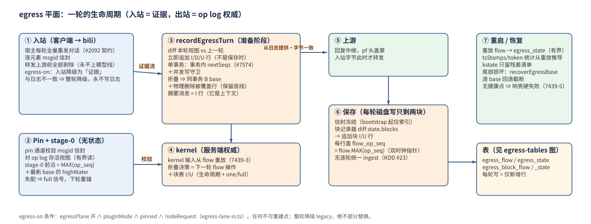
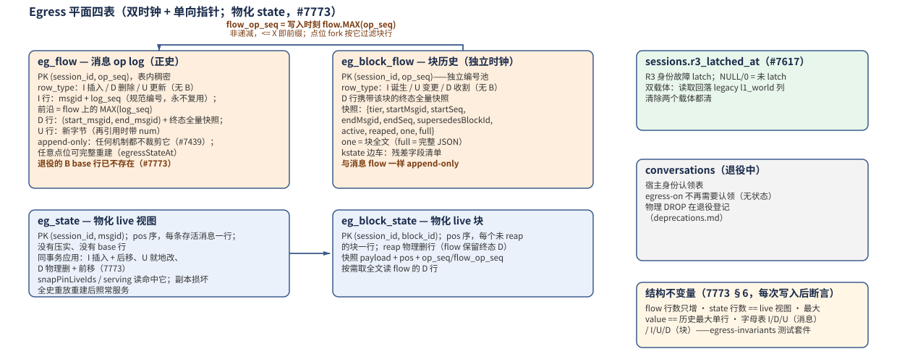
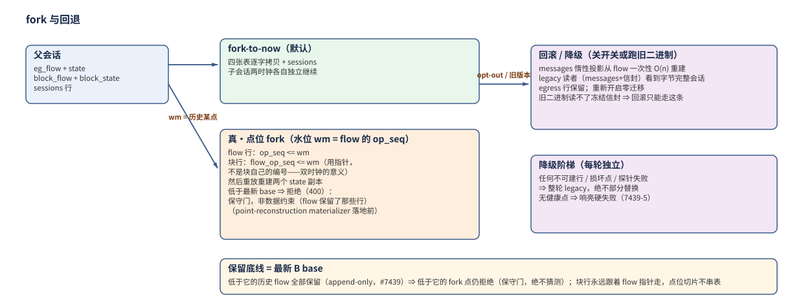

# egress 平面（egressPlane）——专项文档

> #7439 系列的终态：对 **egress-on** 会话，出站对话的**操作日志（op log）是唯一权威**。一站式参考：做什么、为什么、表结构、每轮机制、性能账、fork/回退、设计决策、开关家族、操作手册、PR 时间线。EN: [egress-plane.md](./egress-plane.md)。退役面登记：[deprecations.zh-CN.md](./deprecations.zh-CN.md) · 存储模块：[architecture/storage.zh-CN.md](./architecture/storage.zh-CN.md) · 块表细节：[egress-block-flow.zh-CN.md](./egress-block-flow.zh-CN.md)。

## 1. 入站 vs 出站 —— 一轮的两个方向

插件车道的一轮是两个相反的字节流：

- **入站**（客户端 → bili）：插件宿主**每轮重发整段对话**（宿主的历史是它自己的真源，#2092 契约），并给每个元素盖 **msgid** 信封——宿主↔bili 私有，**转发上游前全部剥除**（永不出现在模型线上）。对 egress-on 会话，入站流从「权威」降级为**证据**：喂给 stage-0/pin 通道做校验；它与 op log 不一致 ⇒ 该轮降级，**入站永远不能写日志**。
- **出站**（bili → 客户端）：回复/下一轮视图的核心消息部分**从 op log 直接提供**，按构造字节一致，不再从客户端重发字节重新推导。kernel（压缩引擎）的输入是**从 flow 重放的**（服务端权威，裁定 7439-3）——折叠决策在日志的视图上计算，宿主无法靠改写重发内容操纵压缩。

一句话：**客户端照旧全量发送（入站），但 bili 不再信它来产出出站视图（出站）**。旧的「从客户端字节重新推导」链路保留为降级目标——任何不可重建点把**整轮**降级为 legacy，绝不部分替换。

## 2. 为什么 op log 能当正史（设计决策）

| # | 决策 | 为什么成立 |
|---|---|---|
| 7439-1 | **自包含行**——消息字节直接挂在 `I` 行上（不 join 内容 CAS）。 | 日志必须能脱离整库单独重放（fork、恢复、审计）。 |
| 7439-2 | **块的读/写侧落 blocks 表**——`summary_bytes` 内联块摘要；`start_msgid`/`end_msgid` 在折叠时一次性对齐到 flow 的 msgid 坐标。 | 折叠产物写在 kernel 读取的地方；每轮不做跨表身份对账。 |
| 7439-3/5 | **服务端权威 + 硬失败**——kernel 输入从 flow 重放；日志**没有任何健康点**时响亮地硬失败，而不是静默地拿客户端字节应答。 | 「答错但没声音」正是本平面要消灭的失败模式；响亮的 500 + 恢复日志可接受。 |
| KDD #23 | **`messages` 降级为惰性投影**——egress-on 会话停止逐轮统一 ingest；messages 表只在平面回滚 / web 读 / 恢复时一次性 O(n) 重建。 | 存储开销曾正比于 messages 账本**总行数**（~20µs/行，10w 行 2× 双账本放大）。op log 每轮写入 = O(新增消息)，serving 读被压实有界。 |
| 双时钟（#7581） | **块表自己编号**；每个块行用 `flow_op_seq` 指向 flow 时钟（单调不减 ⇒ `<= X` 是前缀）。 | 共用一个时钟时，折叠的块行（**保存时**写）落在该轮最后一条 flow 行（**准备时**写）之后两个 op_seq 处，下一轮第一次读就击穿 flow 的密度不变量。两时钟 + 单向指针让两张表各自稠密、互不阻塞。 |
| 无状态身份（#7617） | egress-on 的 stage-0 直接从 op log 前沿计算（`MAX(op_seq)` + 最新 base 的 high water），无 `l1_world` 游标、无 resync。 | 日志本身已经是身份账本——第二个游标就是第三个时钟。R3 故障 latch 迁到 `sessions.r3_latched_at`（与旧列双载体读/清）。 |

**为什么压缩（折叠）能在 flow 上做。** 折叠就是一组操作：`D` × 被覆盖原文 + `I`（摘要消息——它是上下文，所以进 flow）+ 同一事务里一条 `B` base。摘要的**块对象**（生命周期 active/superseded/reaped、覆盖区间、被覆盖原文的 `one`/`full` 全文）住在**块表**里——flow 记「上下文现在是什么」，块表记「折叠做了什么得到它」。按需取全文（`decompress`）读块行，不读 flow。折叠的压实**物理删除** base 以下的 flow 行（保留底线：低于最新 base 的点位 fork 在 point-reconstruction materializer 落地前被拒绝）。

## 3. 表结构（SQLite，`src/storage/schema.ts`；probe-first DDL，开发期表）

创建说明（KDD #25）：**egressPlane 开**的实例上，**新建**数据库只建核心三件套（`sessions`/`session_ext`/`kv_store`）+ 四张 egress 表——下方 12 张 legacy 表跳过创建，flag 日后关闭时由 probe-first 收敛补建；已有数据库绝不删表。见 §11。

| 表 | 主键 | 作用 | 关键列 |
|---|---|---|---|
| `egress_flow` | `(session_id, op_seq)` | **消息**操作日志。保留底线之上表内稠密（#7574 不变量；恢复 = 一步步回退到最新健康 base）。最新 `B` base 以下的行由压实物理删除。 | `row_type` I/D/U/B · I 行：`msgid`、`log_seq`（规范消息号，永不复用）、`ref`、`tokens`、`bytes`、`role`、`type_tag` · B 行：payload `{entries, highWater}`（压实 base = 该点存活视图 + 消息前沿） |
| `egress_state` | `(session_id, op_seq)` | 存活视图的**读副本**（每次写入同事务内从 flow 重放；按 `log_seq` 排序、`msgid` 上有索引）。被压实有界。 | 同 I 行形状；`snapPinLiveIds`/serving 读命中它 |
| `egress_block_flow` | `(session_id, op_seq)` | 追加式**块**历史。**独立编号池**（双时钟）。 | `row_type` I/U/B · 快照 payload `{tier, startMsgid, startSeq, endMsgid, endSeq, supersedesBlockId, active, reaped, one, full}` · **`flow_op_seq`** = 写入时刻 flow 的 `MAX(op_seq)`（跨表指针）· kstate 边车（残差字段清单） |
| `egress_block_state` | `(session_id, block_id)` | 每块最新快照（同一指针）。 | 快照 payload + `flow_op_seq` |
| `sessions.r3_latched_at` | — | R3 身份故障 latch 载体（#7617）。NULL/0 = 未 latch。 | 双载体：读 `?? l1_world.r3_latched_at`，清**两个都清** |
| `conversations` | — | 宿主身份认领表。egress-on 会话不再需要认领行（身份无状态）；物理 DROP 在退役登记。 | |

保留规则：flow/state 被压实**剪到最新 B base 为止**（保留底线）；block_flow 追加式（压实路径 `egressBlockCompact` 存在但尚无生产调用方，见遗留）。

## 4. 一轮的生命周期

1. **准备**——插件轮到达，车道仲裁选中 egress 路径；**`recordEgressTurn`** 把本轮出站视图与上一轮 diff，**立即（准备阶段，不是保存）追加 I/D/U 行到 flow**——单事务：事务内 `nextSeqs`（密度安全，#7574）、并发写守卫、若本轮有删除（折叠）则**同事务写 B base + 物理剪枝**。
2. **Pin**——pin 通道用 op log 存活视图校验宿主的 msgid 信封（`snapPinLiveIds`，有界 serving 读）。失配 ⇒ 该轮降级（发 full 信号，下轮重锚），永不拒绝。
3. **Kernel**——kernel 输入**从 flow 重放**（服务端权威）。折叠决策 = 下一轮的 flow 操作 + **块表操作**（摘要块生命周期的 I/U，带 `one`/`full`）。
4. **上游**——回复中继；pf 头盖章。
5. **保存**——会话信封保存为**仅索引**（bootstrap 起冻结）；**块记录器**把 `state.blocks` 与 `egress_block_state` diff，追加块 I/U 行，每行盖 `flow_op_seq = flow.MAX(op_seq)`。无逐轮统一 ingest（KDD #23）。
6. **重启**——加载时重放 flow → `egress_state`（有界）；`tsStamps`/token 统计**从重放推导**，不再持久化；kstate 只留残差清单。尾部损坏时 `recoverEgressBase` 逐步回退（跨过每个健康 base 截断）直到健康点；无任何健康点 ⇒ 响亮硬失败（7439-5）。

## 5. 为什么更快

| 之前（每轮，10w 行会话） | 之后 |
|---|---|
| 统一 ingest O(**总** messages 行数) ≈ p50 2s，双账本 2× | 每轮写入 = **仅新增 flow 行** |
| 每个水位 HIT 轮 O(全表) re-ingest 0.5–0.8s | 滑动尾窗 **re-anchor delta**：逐行索引 identity 探针，**在写事务内**裁决；任何疑点 = 改前的全量路径 |
| serving 读打在不断增长的 messages 账本上 | **有界 serving 读**——存活视图被压实 base 保持紧凑 |
| `tsStamps`/token 统计随 kernel 状态一起持久化 | **加载时从 flow 重放推导**（kstate 残差裁剪到残差字段清单） |
| 每次身份判定读写 `l1_world` 游标 + resync | **无状态 stage-0** 从 op log 前沿计算 |

让这一切成立的不变量：**serving 路径需要的每个读都被压实有界**；剩下的唯一 O(n) 路径（投影重建）只在回滚/web 读/恢复时各跑一次，不再逐轮。

## 6. Fork 与回退

- **Fork-to-now**（默认）：四张表逐字拷贝 + `sessions`；子会话两时钟各自独立继续。
- **真·点位 fork**（水位 `wm` = flow 的 `op_seq`）：拷 flow 行 `op_seq <= wm`，拷**块行 `flow_op_seq <= wm`**（用指针而不是块自己的编号——这正是双时钟存在的意义），然后重放重建两个 state 副本。低于最新 base ⇒ 拒绝（400），直到 point-reconstruction materializer 落地——那些行是被压实按设计删掉的。
- **回滚/降级**（关掉平面开关，或跑旧二进制）：messages 表的**惰性投影从 flow 一次性 O(n) 重建**；legacy 读者（messages + 信封）看到的会话字节完整。egress 行保留；重新开启零迁移（日志仍在最前）。
- **降级安全性**：egress-on 会话 bootstrap 后**没有信封行**——旧二进制读不了它；所以升级只能向前，回滚走投影重建这条路，而不是「读旧文件」。

## 7. 开关家族与依赖

| 旗标 | 默认 | 在 egress 家族里的角色 |
|---|---|---|
| `rollout.features.egressPlane` | **0（关——2026-11-24 owner 裁定保持 opt-in；本系列曾提议默认 100，被否）** | 总开关。对合格会话 arm 平面。强制开：`true`/百分比 / `BILI_ROLLOUT_EGRESS_PLANE=1`。 |
| `storage.unified`（full/shadow） | — | **前置**。仅 SQLite 车道；op log 住在统一存储里。无统一存储 ⇒ 平面无处可写，静默空转。 |
| `pluginLaneServerHistory` | 100 | **Pin**：服务端历史 + msgid 身份。没有 pin，`egressAuthority` 永不 arm——平面静默空转。 |
| `pluginMsgIdIncremental` | 100 | pin 通道的稳态尾部形态（依赖 `pluginLaneServerHistory`）。 |
| `pluginFullResendWatermark` | 100 | 同家族的快路径优化（跳过对已验证相同前缀的重解析）。 |
| `snapshotRender`（D-lane） | 0 | **不是 egress**。服务未 arm 的插件会话；egress-on 轮按构造绕过它（`src/server/snapshot-render.ts`：`if (deps.pluginMode) return clientMsgs`）。退役触发条件见 [deprecations.zh-CN.md](./deprecations.zh-CN.md)。 |
| `pluginIncrementalTurns` | 0 | 与 egress 无关——客户端 opt-in 的 wire 协议（#3248）。 |

**Arm 规则**（`src/server/egress-lane-io.ts`）：`featureEnabled("egressPlane") && pluginMode && pinned && !sideRequest`——四条 wire 车道同一条规则；side 请求（标题生成、压缩调用、小预算）永不碰日志。

**静默半状态是被写出来的，不是藏起来的**：`egressPlane` 开 + `pluginLaneServerHistory` 关 ⇒ 什么都不 arm，什么都不发生。三个 msgid 家族旗标默认都是 100（其 GA 早于本文档），所以这种情况只能由运维显式关掉造成。删开关（硬编码开）在退役登记里，以 egressPlane 全量稳定为前提。

## 8. 操作手册

- **on/off 在哪读（解析序）**：env `BILI_ROLLOUT_EGRESS_PLANE`（`"0"`/`"false"` = 关，其他值 = 开）→ 配置文件 `$XDG_CONFIG_HOME/billion-context/billion-context.json`（默认 `~/.config/billion-context/billion-context.json`）键 `rollout.features.egressPlane`（`true`/`false` 或 `{"percent": n}`）→ 代码默认（`src/rollout.ts`）：**0（关）**。开启除旗标外不需要别的（`storage.unified` 标准安装已设）。
- **整体退出**：`BILI_ROLLOUT_EGRESS_PLANE=0`（env 优先于 config）或 `"rollout": {"features": {"egressPlane": false}}`。新轮走 legacy；已有行保留（投影重建仍读它们）。
- **降级（无需动作）**：任何不可建行 / 损坏点 / 探针失败 ⇒ **该轮**降级 legacy。完全没有健康点 ⇒ 响亮硬失败。
- **点位 fork**：`POST /__bili/replicas`——201 点位 fork / 503 非驻留 / 400 低于最新 base。Fork-to-now 四表逐字拷贝。
- **R3 latch 卡住**：`SELECT r3_latched_at FROM sessions WHERE session_id = ?`（旧二进制另查 `l1_world`）；清除**两个载体都清**。
- **GC / 归档**：egress-on 会话**完全排除在按龄 GC 之外**，手动归档（`bili sessions archive`）**被拒绝**——归档格式尚未承载 op log（遗留项）。
- **诊断**：`/__bili/status`；恢复事件（回退截断、降级轮）在代理日志里响。

## 9. PR / 提案时间线

| 时间 | 内容 |
|---|---|
| 讨论 [#7439](https://github.com/ranxianglei/billion-context/discussions/7439) | 系列起源；五条 owner 裁定（自包含行；块读写侧；服务端权威 + flow 重放；块表对齐；无健康点硬失败）。 |
| KDD #23（#7474/#7475，2026-11-22） | op log = 唯一正史、`messages` 惰性投影、re-anchor delta。 |
| #7574 | op log 完整性：事务内 seq 读、`recoverEgressBase` 回退、并发写拒绝、密度不变量。 |
| [#7577](https://github.com/ranxianglei/billion-context/discussions/7577) / **#7581**（已合并） | `egress_block_flow`/`egress_block_state`（**双时钟**——共用时钟方案在 review 中被否：它会在第一次折叠时击穿 flow 密度）、checkpoint 退役 → 点位 fork、kstate 裁剪。 |
| [#7591](https://github.com/ranxianglei/billion-context/discussions/7591) / **#7617**（已合并） | 身份收拢：无状态 stage-0、R3 latch → `sessions`、conversations 对 egress-on 退役、GC/手动归档守卫。 |
| **#7659（本 PR，2026-11-24）** | 文档收尾：本文档；[deprecations.zh-CN.md](./deprecations.zh-CN.md)；KDD #24；图。egressPlane 默认按 owner 裁定保持 **0**——GA 翻转被提议后否决。 |
| 讨论 [#7735](https://github.com/ranxianglei/billion-context/discussions/7735)（2026-11-25） | **扫尾**：arm 时身份行（§11）、7 表创建门、kv_store 256 字符策略 + 大 blob 退役、l1 死行清理、三个 flag 默认值修正回 0。 |

**遗留**（已跟踪）：egressPlane 默认翻 100（等 owner 点头）；point-reconstruction materializer（低于最新 base 的 fork 点）；归档格式承载 op log；`egressBlockCompact` 的生产**压缩**调用方（replay 已在 #7664 落地）；退役身份载体的物理 DROP 批次；按退役登记表删开关（硬编码开）。

## 10. 重编号——log_seq 就是引用号（定稿设计，2026-11-25）

**背景——本次收掉的分裂。** 内核给每条真消息发一个引用号（`m00001`、`m00002`…——`assignRefs`，落在 `refs` 表），op log 另有一套 `log_seq` 计数，两套编号空间只靠消息 raw id 关联。kstate 退役（#758 PR-B）在冷加载时从 op log 视图重建 `messageRefs` 时，这个分裂咬了人：op log 给**恒定 system 行**排了第一号，视图于是铸出 `m00001 → egress-system`，把所有真消息整体 +1；重建出的 refs 与按内核引用号落盘的 `tokenSnapshot` 对不上，折叠后每一轮的线上 tag 都带错了 token 数。"加载时忽略 overlay"只治标；设计裁定（owner，2026-11-25）是**op log 是唯一正史，那么内核引用号与 `log_seq` 就是同一个号**——不再存在第二套编号可以跟它漂移，egress 体系也不再需要引用外部表。

**规则。**

1. **`log_seq` ≡ 引用号。** 真实消息的 `log_seq` 就是内核分给它的那个号（`mNNNNN` = `m` + `log_seq`），写 I 行时落盘。旧的 `MAX(log_seq)+1` 计数器只作为"该 id 没有账本条目"时的兜底，绝不覆盖已知编号。内核编号稠密、一次性分配、永不复用（退役槽位是死的，#5196），所以新分配的号恰为 `MAX(log_seq)+1`——日志完备后计数器与账本天然一致。**冲突规则（2026-11-25 细化）：** 低于本批高水的引用号是合法的——它表示该槽位已退役（压缩把内容搬了家）——只有当该号与 op 位置上仍然**存活**的行相撞时才拒绝写入（内核可能在折叠的 D 行入账前就把退役槽位分了出去）；没有账本条目的行取稠密兜底，且必须高于**本批所有引用号**（内核自己的折叠摘要 id 没有 refs 条目、渲染在引用号之间——序列中间插一个稠密号会抢走下一个引用号，如 fork 子会话折叠里的 `acp_summary_b2`）。
2. **system 行编号 0。** 落在引用空间（从 1 开始）之外。什么都不用过滤："系统提示词不占消息引用号"变成构造上为真，对一切派生视图（pin 账本、kstate 重建、replay）都为真——因为被过滤的那个号根本不该存在于这个空间里。
3. **arm 时自愈回填。** 中途 arm 的会话（开平面前有 legacy 落盘）在 op log 里缺 arm 前的消息。不需要标记行：arm 后的第一次记账看到的是空日志，diff 于是为**全部**存活消息发 I 行、各带其现有内核号——这一次自然的首趟就是回填。幂等是结构性的：按缺失的 `msgid` 补行，第二趟无新行可补；日志被截断/损坏也用同一路径自愈（缺的行在下一次记账时回来）。fork 逐行拷贝 flow，回填的号随迁移走。生而 egress-on 的会话永远不需要：system 是 0，第一条真消息就是 1。
4. **`refs` 表：egress-on 停写，读兑底保留。** 回填后 op log 覆盖全部历史，egress-on 会话停止写 `refs` 行（已登记 [deprecations.zh-CN.md](./deprecations.zh-CN.md)）；读方对回填前/legacy 会话继续回退到该表，直到物理 DROP 批次。
5. **kstate overlay 成为正当路径。** 冷加载按 `{rawId → m + log_seq}` 从 op log 视图推导 `messageRefs`——由规则 1，这正是内核在进程内分配的同一个映射。"别让 overlay 覆盖已存 refs"的权宜补丁不再需要：编号一致后它本来就是对的。
6. **系统提示词：输入形态在 `egress_state`，账本形态在 flow。** 一个文本、两种形态、不再第三份：flow 的 system 行保留**拼装成品**（客户端 system `A` + 服务端常驻块 `B`，每轮实时计算；transcript 要的就是真正发出去的东西）。**客户端原文 `A`** 在 egress 表内拿到永久住所——`egress_state` 上固定 `egress-system` msgid、编号 0 的一行，客户端改了就发 U 更新（`sessions` 不动 DDL）。结果：`session_ext` 里的粘性副本（`inc:system`）对 egress-on 会话退役——已登记 [deprecations.zh-CN.md](./deprecations.zh-CN.md)；增量车道对 egress-on 会话从 egress state 读 `A`（legacy/关平面不动）。两种形态都从 egress 表可查，不再"真正的系统提示词在扩展列里"。

**为什么对平面其余部分是安全的。** fork 原样拷贝 flow 行，回填的编号随会话走；压缩 base 存的 `highWater` 是被压掉的最大编号（现在是引用号，stage-0 读的 `MAX(log_seq)` 前沿与下一号兑底两边都对齐）；CCR 与块表以 `op_seq`/`msg_id` 为键，与引用号无关。附带收益：egress-on 的引用空间与 legacy 边**逐字相同**（两边 `m00001` 都是第一条真消息），加载重编号机制（#4316）整体退出 egress-on 路径——"重编号后快照过期"这一 bug 类在 egress-on 上不再存在。

## 11. 扫尾（2026-11-25，讨论 [#7735](https://github.com/ranxianglei/billion-context/discussions/7735)）——身份行、表创建门、kv 策略

**身份行。** #7591 假设 egress-on 会话的 sessions 行在 arm turn 由首次 ingest 落地——不成立：`egressAuthority` latch 在该次保存**之前**就已打入（`src/server/egress-lane-io.ts`），第一次 ingest 就被 `egressProjectionFrozen` 冻结，行**永远落不了**。线上后果：重启后会话丢失（无行⇒不可 load、不可见、不进 GC 视野），metadata（pluginAgent/lastModel/title）只活在内存，血缘列永未持久化。修复：arm（latch 行）时 seam 调 `UnifiedStore.ensureEgressIdentity()`——一次性、幂等的 **13 列身份 upsert**（session_id、parent_session_id、protocol、label、title、host_title、namespace、origin、status、created_at、updated_at、meta_json、metadata_json；parent 用 `COALESCE(存量,新)` 与 ingest 同语义，第一个父赢；fork_point_seq 与全部 payload 列不碰）。每个 armed turn 都执行，删行下一轮自愈。同一事务里还删掉该会话的 **arm-turn 死 l1_world 占位行**（`armed_at IS NULL AND r3_latched_at IS NULL AND witness_probe <> ''`）——arm turn 的 stage-0 仍走 legacy（故意不预 latch），以前每个会话永久留一行死行。**该行的 metadata_json 只写身份键白名单**（`EGRESS_IDENTITY_METADATA_KEYS`：egressAuthority、pluginAgent、derivedFromSessionId、egressFlowUnreadable、lastModel），绝不写整个运行时袋：#6947 的 turn-final 回复暂存（handoffReply/handoffResponse，各最多 1.5MB 聊天内容）与每请求状态（effectiveConfig/cacheLedger/publicSnapshot*）只活在内存/op log（owner 2026-11-26：sessions 表放身份，不放聊天内容）。

**表创建门。** eg 模式**新建**库只建：`sessions` + `session_ext` + `kv_store`（核心三件套）+ 四张 egress 表 = **7 张表**；12 张 legacy 表**不创建**（probe-first 收敛保证 flag 日后关闭时任何一次打开都会补建）。已有库保留全部现有表——门只管不建、从不删。`session_ext` 按 owner 裁定豁免（fastpath `pf:state` 熔断记忆住在里面）。直接调 `UnifiedStore.open` 的调用方默认建全表；开关判定在 `UnifiedShadow.maybeOpen`（`src/knobs.ts` 的 `egressPlaneGateOn()`——无副作用读法，因为 `featureEnabled()` 会在 store open 中途触发 install-id 引导的 wx 文件竞态写）。load/fork 路径对缺失的 legacy 表按"无数据"处理（7 个读 getter 短路），eg 模式实例完整可用。`BILI_TEST_FORCE_FULL_DDL=1` 是**测试专用**逃生口：断言 legacy 表形状而 flag 又开的套件（模拟门禁前的库）用它，生产永不设。

**kv_store 策略。** `kv_store` 是小配置面（install id、notices、host flags），不是 blob 库：开启 `egressPlane` 时每个值 JSON 序列化后不得超过 **256 字符**（`KV_VALUE_MAX_CHARS`，sqlite/mysql 两后端 `setKv` 入口按调用时刻判定）。**legacy 模式保持原有 4MB 字节预算**——存量键可能已经存着非常大的值，上限不能把非 eg 部署炸掉（owner 裁定 2026-11-26）。冻结白名单（`KV_VALUE_WHITELIST`，加条目 = review 事件，须登记 [deprecations.zh-CN.md](./deprecations.zh-CN.md)）给两个已知会长大的键保留 4MB 上限：`prefix-affinity|v1`、`plugin-conversations|table`。eg 模式下大 blob 在写入侧退役：`session-order` 早已退役（写入模块已被上游移除——孤儿行不再触碰，新库干净）；`plugin-conversations` 不写（路由表纯内存；重启 miss 等下一个模型请求重建——既有 miss 语义）；`prefix-affinity` 持久化在 eg 下整体退役（owner 裁定 2026-11-26）：显式 ID 分支、file→kv 一次性迁移、kv/文件持久化路径全部加门——链表仍每轮计算、但 eg 模式下永不落盘（匿名客户端在 eg 下丢失跨重启链连续性，已接受），legacy JSON 文件降为只读 hydration 源，legacy 模式字节级不变。

**flag 默认值修正。** `ci:full` 验证合并（#7691）误把 `egressPlane` / `egressKstateRetireWrites` / `egressKstateRebuild` 的默认发到 **100**，违反本文档的 owner 裁定（默认 0、opt-in）。本次扫尾把三个默认在 `src/rollout.ts` 与配置文档中全部改回 **0**。**开关合并（owner 裁定 2026-11-26）：**两个 kstate 开关（`egressKstateRetireWrites` / `egressKstateRebuild`）随后被**整个移除**——写侧裁剪与读侧 op log 重建就是 `egressPlane` 本身的一部分。`egressPlane` 是唯一的开关：开 = 含 kstate 退役在内的全套平面，关 = 字节级 legacy。两个环境变量不复存在（已登记 [deprecations.zh-CN.md](./deprecations.zh-CN.md)）；旧配置里残留的键被无害忽略。
