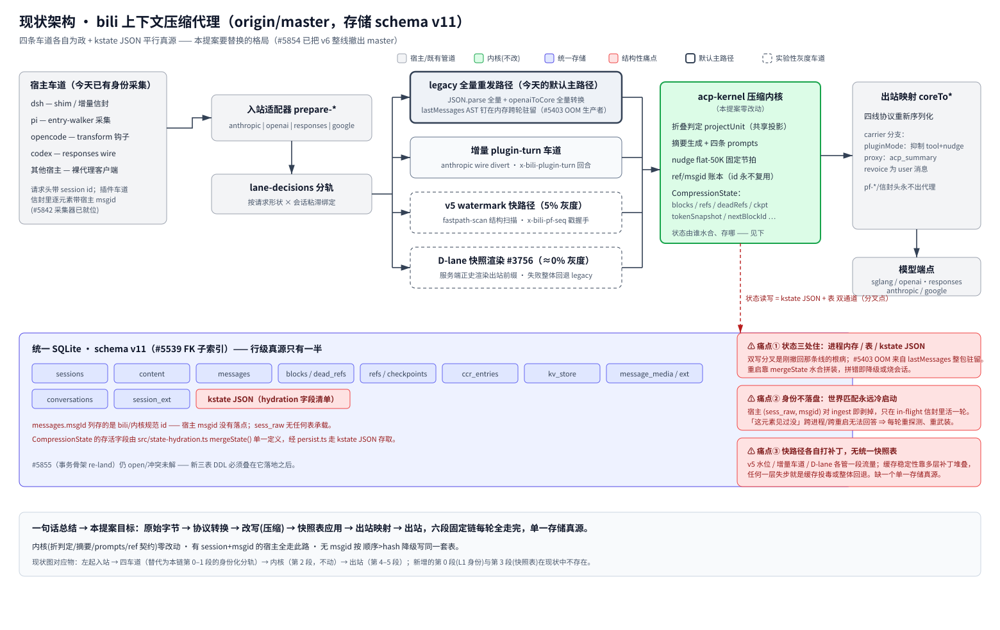
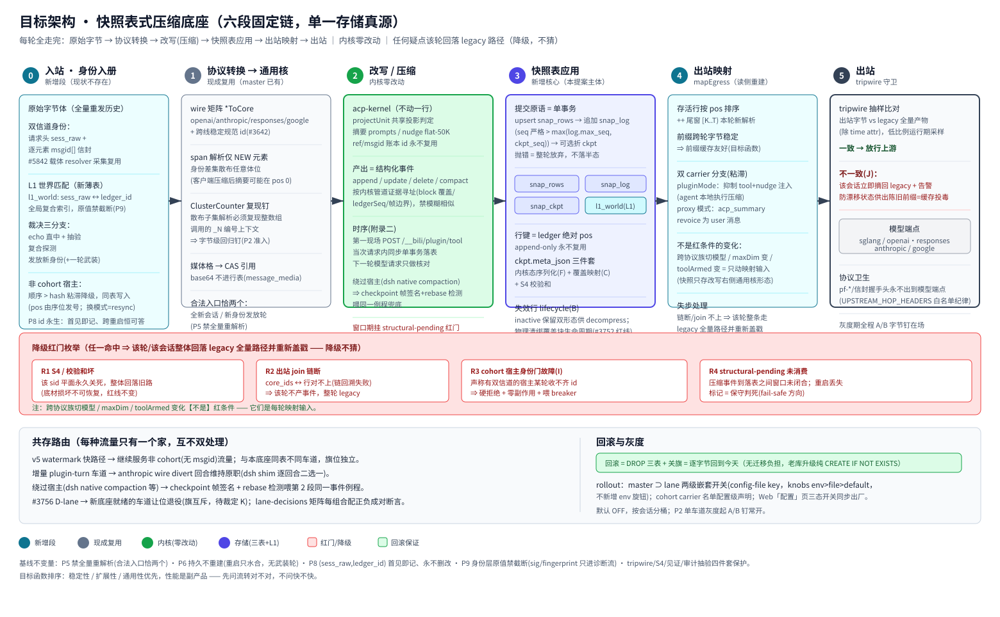
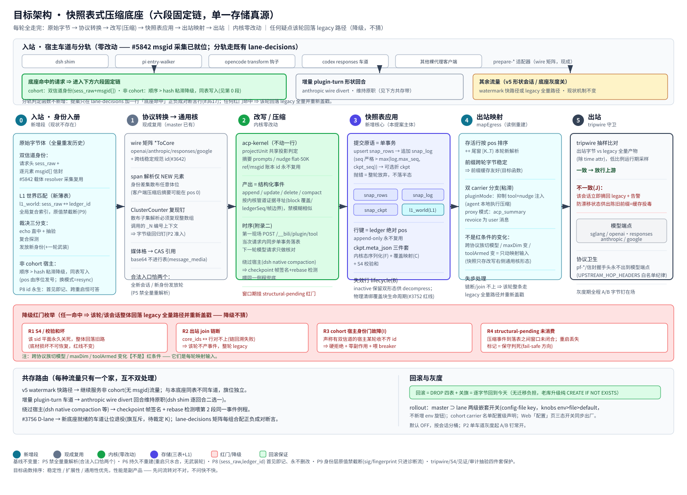
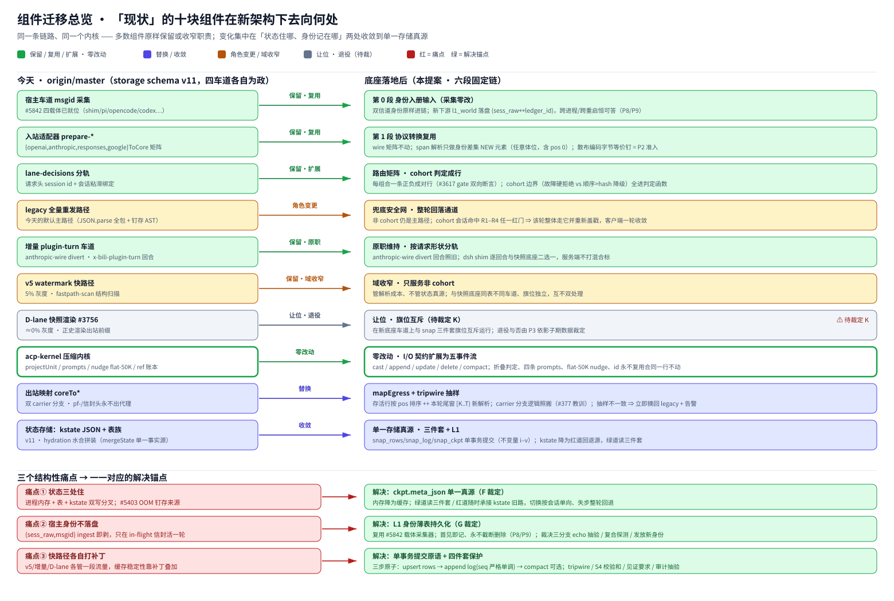

# Proposal: Snapshot-Table Compression Foundation (six-stage fixed chain, single storage truth)

> **Status: P0 + P1 + P2 implemented in [#5901](https://github.com/ranxianglei/billion-context/pull/5901)** (schema v12; shadow-write soak; P2 = mapEgress tripwire-guarded egress cutover, soak at 100% for the `ci:full` + local-gate run, release flips it back to OFF-before-ship like every soak flag). P2-final lands the six-stage chain in the proposal's own order: the snapshot write (events → tables) runs **in-request**, after the kernel rewrite and before the egress stage — the plane is readable before the response is sent, and this round's own resend carries an empty tail.
> Written 2026-11-07 as a design proposal; this doc is the design record of the landed implementation.
> **Baseline:** origin/master (written 2026-11-07; storage schema v11; #5854 has fully reverted the v6 line from master).
> **Origin thread:** [#5643](https://github.com/ranxianglei/billion-context/issues/5643) (incl. the re-positioning comment).
> **Companion doc:** [中文版](./README.zh-CN.md) (fuller wording where the two diverge).

---

## 0. TL;DR

Replace today's parallel state sources (process memory + kstate JSON + table spread) with **one snapshot table set as the single storage truth**. Every model request walks the same fixed chain end to end:

**raw bytes → protocol conversion (canonical cores) → rewrite/compression → apply to snapshot tables → egress mapping → outbound**

The compression kernel (fold judgment, summaries, prompts, ref/msgid contracts) stays **byte-for-byte untouched**. Sessions whose host supplies both a session id and per-element msgids run entirely on the new chain; hosts without msgids degrade to order-then-hash identity and write into the same tables. Any mismatch anywhere sends that turn back to today's legacy full-resend path (degrade, never guess). Rollback = DROP the four new tables + flip the flag off — byte-identical return to today.

Objective ordering is unchanged: **stability / extensibility / generality first, performance is a byproduct** — ask "is the flow correct", not "is it fast".

---

## 1. Background & positioning

### 1.1 History

- **#5643** started as the implementation contract for "fast-forward watermark v6": a `(sess_raw, msgid)` composite-identity incremental fast lane for plugin hosts.
- The entire v6 line (fastpath + render-snapshot plane) was reverted out of master via **[#5854](https://github.com/ranxianglei/billion-context/pull/5854)** (clean revert, merged).
- The owner's re-positioning comment on #5643 (2026-11-07) fixed the new direction: this line is **not an incremental lane**, and not a sequel of v5 watermark — it is a **snapshot-table-based compression foundation**: storage-centric, kernel unchanged, with one fixed chain deciding what gets rewritten, stored, and rendered.
- [#5855](https://github.com/ranxianglei/billion-context/pull/5855) (transaction-skeleton re-land) is the **engineering substrate** of this line, not its end state. It was still open (conflicts unresolved) when this proposal was written — the first timing dependency.

### 1.2 What this line is NOT (drift guard)

| Easily conflated direction | Why it's not that |
|---|---|
| The incremental plugin-turn lane | That lane optimizes REQUEST SHAPE (delta-only transfer); here the server still receives full history each turn — it just stops doing indiscriminate parse/store over all of it |
| A sequel of the v5 watermark fastpath | v5 attacks PARSE COST (stamp handshake + tail-window parsing); this proposal fixes the STATE TRUTH problem; v5 keeps serving non-cohort traffic |
| Kernel swap / fold-algorithm change | Kernel zero-change is a hard constraint: fold judgment, summaries, cadence, id contracts stay as-is |
| A "faster" perf feature | Perf wins (stable prefix cache, lower memory) are byproducts of a correct flow, never the design criterion |

### 1.3 Carried baseline rulings

All standing rulings from the #5643 body remain in force without restatement here: objective ordering, the fixed chain, the two verification points (kernel-internal state + post-rewrite canonical form), append-only row keys, evidence-addressed diffing only (no fuzzy similarity), the four-piece protection (tripwire / S4 per-row checksums / witness requirement / audit sampling), pure-ignore of client-side compaction, invariants P5–P9. Conflicts, if any, must be registered explicitly in the ruling table (§14).

---

## 2. Current architecture & three structural problems

 (bitmap fallback: [arch-current.png](./assets/arch-current.png))

Today a model request passes through `prepare-*` adapters → `lane-decisions` branching (legacy full resend / incremental plugin-turn / v5 watermark 5% rollout / D-lane snapshot render ≈0% rollout) → kernel → `coreTo*` egress mapping. State lives in three places: process memory (lastMessages ASTs, resident core arrays), the unified SQLite v11 table family, and kstate JSON (hydrated through `mergeState()`). Three structural problems:

1. **State lives in three places.** kstate JSON and the tables form a dual-write fork point; the direct producer of the #5403 OOM class is lastMessages pinned whole; restart depends on hydration assembly — assemble wrong and you either degrade or brick the session. The line we just reverted had exactly this parallel-truth disease at its root.
2. **Identity never lands on disk.** Host `(sess_raw, msgid)` pairs are stripped at ingest and live exactly one round in-flight. The `messages.msgId` column stores bili/kernel canonical ids; no table carries the host's raw identity. "Have I seen this element before?" cannot be answered across processes or restarts (P8 requires it always answerable), so every round cold-starts re-probing.
3. **Fastpaths patch independently.** v5 / incremental lane / D-lane each own a slice of traffic; cache stability is layered patches stacked on top of each other. One layer out of step = cache poisoning or full fallback. There is no single storage truth underneath them.

---

## 3. Target architecture overview

The full view is **pixel-aligned one-to-one with the §2 current-architecture diagram** — compare side by side to see exactly which part of the global picture changed and how big the blast radius is (grey = untouched · cyan = new stage/table · amber = role change · red dashed = fallback safety net):

 (bitmap fallback: [arch-target.png](./assets/arch-target.png))

How the six-stage chain flows on the inside — **stage-by-stage expansion** (commit primitive / DDL chips / red-gate band R1–R4 / coexistence routing & rollout rollback):

 (bitmap fallback: [arch-stages.png](./assets/arch-stages.png))

Where each piece of today's architecture lands under the new design — **component migration map** (bottom band maps the three structural pain points one-to-one to their fixes):

 (bitmap fallback: [arch-migration.png](./assets/arch-migration.png))

One-line duties per stage:

| # | Stage | One line | Status |
|---|------|----------|--------|
| 0 | Ingress · identity registration | Dual-channel identity + L1 world match decides each row's provenance this turn | **NEW** |
| 1 | Protocol conversion → canonical cores | Reuse existing wire matrix; span-parse only the identity-diff NEW elements | Existing + one new regression pin |
| 2 | Rewrite / compression | Kernel untouched; emits structured events; landing timing per appendix-two | Kernel zero-change |
| 3 | Apply to snapshot tables | Single-transaction commit primitive writes the snap trio (rows/log/ckpt); ckpt meta carries kernel state + coverage map + S4 | **NEW CORE** |
| 4 | Egress mapping | Live rows ordered by pos ++ fresh-parse of tail window; dual-carrier branch | Read-side rebuild |
| 5 | Outbound | Tripwire sampling comparison before release upstream | Guard strengthened |

Two cross-cutting bands: the **red-gate degradation band** (§7 — any doubt falls back to legacy) and **coexistence routing** (§8 — every traffic class has exactly one home).

---

## 4. Stage-by-stage design

### 4.0 Stage 0 — Ingress · identity registration (does not exist today)

**Inputs:** the raw body plus dual-channel identity — `sess_raw` (host session id, original value) in the request header, per-element `msgids[]` in envelopes. **Collection reuses the carrier resolvers already merged in [#5842](https://github.com/ranxianglei/billion-context/pull/5842)** (shim / pi entry-walker / opencode transform hook / codex / cc / gemini candidate carriers) — no second collection system.

**World-match decision** (sequential, first hit wins):

1. **Echo direct-hit + spot check:** the id list the host echoes matches the server transcript positionally; adopt after sampled witness verification;
2. **Composite probe:** `(sess_raw, msgid)` hits the L1 table ⇒ continue the existing ledger identity;
3. **Mint new identity:** neither hits ⇒ mint a new ledger id, record it in L1, pay one arming round (that element enters storage but not cache decisions).

**Cohort vs degradation boundary** (ruling I, §14): a cohort host (one that DECLARES dual-channel capability) missing ids in some round = failure → hard reject + zero side effects + feed the breaker (baseline §3.2 verbatim). Non-cohort hosts without msgids take the sticky order-then-hash degraded channel writing into the same tables (pos issued by ordinal). The mode is sticky per session; switching mid-session is one explicit resync — silent mixing forbidden.

**L1 table** (the vehicle of ruling G): `l1_world(sess_raw PK, ledger_id, …)`, queryable globally and across restarts; original values never truncated (P9); sig/fingerprint go to warn diagnostics only, never into judgment (P8/P9).

### 4.1 Stage 1 — Protocol conversion → canonical cores (reuse)

- The wire matrix `{openai,anthropic,responses,google}ToCore ↔ coreToX` and cross-wire stable canonical ids (#3642) are already on master — zero rebuild.
- **Span parsing** covers only the NEW element set decided in stage 0 — these can sit at ANY body position (a client-compaction summary may appear at pos 0). Dirty implementation detail: the codec's ClusterCounter numbers `_N` per call, so parsing a scattered subset must reproduce the numbering context of a WHOLE-ARRAY call, or egress bytes drift = prefix cache breaks. **A byte-level regression pin for scattered-subset encoding is a P2 entry condition** (contiguous tail slices were proven feasible under v5; scattered subsets are the new case).
- Media cells (images etc.) reference the existing content CAS + `message_media`; base64 never enters rows.
- P5: exactly two legal entry points (fresh session / new-identity arming round); full re-parsing forbidden elsewhere.

### 4.2 Stage 2 — Rewrite / compression (kernel zero-change)

acp-kernel stays one line untouched: fold judgment (projectUnit shared projection), the four prompts, nudge flat-50K cadence, the id-never-reused contract. Its external output is defined here as a **structured event stream**:

```
cast     first-time row minting (fresh session load)
append   new rows (turn tail additions)
update   in-row shape change (e.g. tool result backfill)
delete   coverage/inactivation (active=0, never physically removed)
compact  fold compaction (block absorbs covered span, meta updates coverage map)
```

Addressing rule follows baseline: events locate affected rows ONLY by kernel pipeline evidence (block coverage spans / ledgerSeq / frame boundaries) — no fuzzy similarity matching of any kind; if nothing lines up, the turn produces no events and runs legacy wholesale (§7 R2).

**Landing timing (per #5643 appendix two):** first scene = the plugin endpoint `POST /__bili/plugin/tool` (src/server/admin.ts:797) completes events→table mutation **synchronously, in a single transaction, inside that request**; the next model turn only reconciles. Hosts bypassing the endpoint (dsh native compaction and kin) feed the SAME table-mutation routine via checkpoint-frame signature + rebase detection. Between endpoint and landed write the plane carries a `structural-pending` mark; losing the mark across a process restart = conservatively dead (fail-safe direction, §7 R4).

### 4.3 Stage 3 — Apply to snapshot tables (the body of this proposal)

**Commit primitive = one transaction** with three steps:

```
upsert snap_rows (rows addressed by evidence)
  → append snap_log (seq strictly > max(log.max_seq, ckpt.seq))
    → (optional) compact snap_ckpt (absorb log payloads, update meta)
any step throws ⇒ abandon the whole turn, no half-state (invariant i)
```

**Invariant table** (draft v0.1 + review hardening, carried forward):

| # | Invariant |
|---|-----------|
| i | Single writer per session: ALL table mutations go through this one primitive |
| ii | log.seq strictly monotonic: > max(log.max_seq, ckpt.seq); no numbering break across compactions |
| iii | S4: per-row checksum mismatch ⇒ that sid's plane is CLOSED FOREVER, whole thing falls back to the old path (red line unchanged) |
| iv | Rows are never physically deleted: folds flip active; pre/post forms preserved for decompress |
| v | post_json is always the "right-of-rewrite canonical form" — wire bytes may never be cached |

**ckpt.meta_json triple** (where rulings F+C converge): (1) serialized kernel conversation state (CompressionState: blocks/refs/deadRefs/nudge/tokenSnapshot/…) + its own checksum — the kernel has NO deterministic "event stream → state" rebuild entry, so serialization-with-checkpoint is the only option that both keeps the kernel untouched and satisfies P7 (memory is just a cache); (2) the **coverage map** (summary pos → covered pos ranges) — delete/compact payloads get absorbed into the checkpoint, and after compaction this explicit map is decompress/GC's sole basis; (3) the S4 aggregate checksum.

**Inactive-row lifecycle** (ruling B recommendation): inactive rows persist until their covering block itself is archived/deleted, then physical cleanup rides along; against both "never clean" (#3752 unbounded growth is a p1 red line) and global TTL (avoids extra alignment proofs between GC windows and dereference windows).

### 4.4 Stage 4 — Egress mapping

`mapEgress` = live rows ordered by pos, their cores, ++ freshly parsed cores of the tail window `[K..T)` this turn, then `coreToX` into the target protocol family. Prefix bytes stable across turns ⇒ prefix-cache friendly — this IS the objective function, structurally guaranteed rather than coincidental.

- **Dual-carrier branch** (sticky per session; BOTH modes must be reasoned together — classic #377-class bug in this repo): pluginMode suppresses tool+nudge injection (the agent executes compression locally); proxy mode revoices acp_summary as a user message (systemToUser, keeping the head system message byte-stable).
- **Transparent changes** (NOT red conditions): switching model across protocol families, maxDim change, toolArmed change — they only vary mapping inputs, since snapshots store only the right-of-rewrite canonical form.
- Desync handling: join-chain broken / fails to align ⇒ the whole turn runs the legacy full path and re-stamps (client converges within one round).

### 4.5 Stage 5 — Outbound

**Tripwire runtime form** (ruling J recommendation): low-ratio sampling compares egress bytes word-for-word against the legacy full-path artifact (modulo time attributes). Match ⇒ release; mismatch ⇒ that session is immediately dropped back to legacy + alert. This final guard protects against "feeding stale prefixes out of a drifted state" — cache poisoning.

**Protocol hygiene:** pf-* / envelope-style handshake headers are protocol headers, not hop headers — strip before forwarding upstream (UPSTREAM_HOP_HEADERS whitelist discipline); any NEW handshake header introduced by this proposal joins the same whitelist management. A/B byte pins stay in place throughout rollout.

---

## 5. Storage schema (final DDL landed as schema v12 in #5901)

Version-stacking rule: #5901 landed this DDL as schema **v12** (`SNAPBASE_DDL_V12` in `src/storage/schema.ts`) directly on the v11 master, because #5855 was still open at the time; if #5855 lands first, the later-landing side renumbers mechanically (same DDL, one version bump). Old-library upgrade is purely additive (`CREATE ... IF NOT EXISTS`), no data migration. Per-table read/write map (zh/en): [storage-relations.en.svg](../../storage-relations.en.svg) / [storage-relations.zh.svg](../../storage-relations.zh.svg). DDL (final types as landed in P0):

```sql
-- L1 identity thin table (vehicle of ruling G; restores baseline §4.1.1's two columns as a dedicated table)
CREATE TABLE IF NOT EXISTS l1_world(
  sess_raw      TEXT    NOT NULL,         -- host session id, ORIGINAL value, never truncated (P9)
  ledger_id     TEXT    NOT NULL,         -- bili canonical sid (existing key space, ruling D)
  witness_probe TEXT,                     -- echo spot-check witness sample (diagnostics stream only)
  issued_at     INTEGER NOT NULL,
  armed_at      INTEGER,                  -- arming-round mark for freshly minted identities
  PRIMARY KEY (sess_raw)
);
CREATE INDEX IF NOT EXISTS idx_l1_ledger ON l1_world(ledger_id);

-- Row table: the transcript proper
CREATE TABLE IF NOT EXISTS snap_rows(
  sid         TEXT    NOT NULL,
  pos         INTEGER NOT NULL,           -- ledger absolute position, append-only, never reused
  core_ids    TEXT    NOT NULL,           -- canonical-core element id list (json text)
  pre_json    TEXT,                       -- pre-rewrite form reference (CAS digest); ruling A② defaults to reference, not inline
  post_json   TEXT    NOT NULL,           -- post-rewrite canonical form (the ONLY form allowed to be cached)
  tokens_est  INTEGER,                    -- estimated tokens (ruling L: growth data source for judgment + billing share)
  active      INTEGER NOT NULL DEFAULT 1, -- 0 = covered/inactive (kept for decompress; lifecycle per §4.3)
  cover_ref   TEXT,                       -- id of the summary block covering it (lifecycle anchor for physical cleanup)
  updated_at  INTEGER NOT NULL,
  PRIMARY KEY (sid, pos)
);

-- Event log (LSM log layer)
CREATE TABLE IF NOT EXISTS snap_log(
  sid        TEXT    NOT NULL,
  seq        INTEGER NOT NULL,            -- strictly > max(log.max_seq, ckpt.seq)
  kind       TEXT    NOT NULL,            -- cast|append|update|delete|compact
  payload    TEXT    NOT NULL,
  created_at INTEGER NOT NULL,
  PRIMARY KEY (sid, seq)
);

-- Checkpoint (LSM meta layer; absorbs log payloads AND explicitly retains the coverage map)
CREATE TABLE IF NOT EXISTS snap_ckpt(
  sid        TEXT    NOT NULL PRIMARY KEY,
  ckpt_seq   INTEGER NOT NULL,
  meta_json  TEXT    NOT NULL,            -- serialized kernel state + coverage map + own checksum
  checksum   TEXT    NOT NULL,            -- S4 aggregate checksum
  updated_at INTEGER NOT NULL
);
```

**Write-model assumption** (ruling H item): default is the single-process assumption (WAL serializes cross-process writes naturally). If multi-instance concurrent writes are wanted, an in-memory-view invalidation protocol must ship with it (who invalidates resident core arrays / metadata caches on commit) — P0 contract picks one, definitively.

---

## 6. Read paths & consumer-switching ledger

**Hydration dual path:** green path (new tables readable AND S4 passes) rebuilds the read view from snap_rows + meta; red path (flag off / no active block / tables unreadable / checksum fail) falls back to the kstate-old path verbatim. Switching is per-session and one-directional; any step out of alignment sends the whole turn back to legacy — same discipline as D-lane #3756.

Consumers annotated individually (P0 lists the complete inventory; this is the mainline):

| Consumer | Disposition |
|----------|-------------|
| decompress (restore/decompress tool path) | P3 switch to new-table pre/post dual forms + coverage map; missing pre bytes MUST surface through an explicit audit diagnostics exit — never silent empty references |
| export | P3 switch; honest-output discipline unchanged (#155: a 0-block session may never claim "original conversation") |
| billing | shares the tokens_est column; switching read source does not change billing semantics |
| Web UI (sessions panel / acp_status uncompressed view) | acp_status judgment face (KDD#12 shared projection) input source points at new-table rows; panel gains table-health metrics (§10) |
| kv_store namespaces / notice store / persona fork (`\|sub:<fp>`) | Untouched (independent mechanisms; the fork records its suffixed id into the same lane) |
| CCR (ccr_entries) | Not touched during P0–P2; P3 evaluates merge vs long-term coexistence separately |

---

## 7. Red-gate enumeration (hit ANY ⇒ the turn/session falls back wholesale to the legacy full path and re-stamps)

| # | Red condition | Consequence |
|---|---------------|-------------|
| R1 | S4 / checksum corrupted | that sid's plane CLOSED FOREVER, whole fallback to the old path (substrate corruption unrecoverable; red line unchanged) |
| R2 | Egress join chain broken (core_ids ↔ rows fail to align; chain walk-back fails) | no events produced this turn; legacy wholesale |
| R3 | Cohost identity gate fault (cohort host fails to deliver dual-channel ids) | hard reject + zero side effects + feed breaker (baseline §3.2 verbatim) |
| R4 | structural-pending unconsumed (incl. restart-lost mark) | conservatively dead (fail-safe direction) |

**NOT red conditions:** model switch across protocol families, maxDim change, toolArmed change, client-side compaction traces (purely ignored — increments only). These boundaries become decision functions in the lane-decisions matrix, one positive+negative row pair per combination (#3617 discipline).

---

## 8. Coexistence routing with existing lanes (every traffic class has exactly one home)

| Traffic | Home | Notes |
|---------|------|-------|
| Cohort hosts (dual channel) full-resend sessions | **New foundation** | the primary served population |
| Non-cohort (no msgid) traffic | v5 watermark keeps serving | same tables, different lane; independent flag bits; the order-then-hash degraded writes use the same tables |
| Anthropic-wire divert turns | incremental plugin-turn lane keeps its job | dsh shim picks one per turn; no double processing |
| Endpoint-bypassing hosts (dsh native compaction et al.) | stage-2's SAME event routine (checkpoint-frame signature + rebase detection feed-in) | see §4.2 timing |
| #3756 D-lane | **Yields/retires** on lanes where the new foundation is live (flag mutual exclusion) | pending ruling K; retirement decision lands in P3 |

lane-decisions matrix: one row per combination, positive+negative pairs ("triggers when it should; does NOT trigger when it should not"); added rows discoverable.

---

## 9. Rollout & config surface (owner-gated; keys finalized in #5901)

- **Two-level nested flags:** master flag ⊃ lane flags (a lane flag means anything only when master is on), config-file keys resolved through `src/knobs.ts` (env > file > default); **no new env knobs** (scarce-surface discipline #2030). Keys as landed: config-file `storage.snapBase.enabled` (master flag) / `storage.snapBase.shadowWrite` (lane flag, master ⊃ lane), see [configuration](../../configuration.md).
- **Cohort roster:** config-level declaration (which carriers/hosts claim dual-channel capability); initial value TBD (open item D4: verify the six candidate carriers one by one).
- **Web config page** tri-state quick switches shipped in lockstep; i18n en/zh pairs; registry-test dead-key guard rows; website/config-reference yaml seeds where a knob ships.
- Default OFF, bucketed per session (an independent salted bucket), P2 starts as single-lane gray rollout. (#5901 soak reality: shadow-write runs at 100% by default for the `ci:full` + local-gate traffic run; the release build flips it back to OFF before shipping.)

---

## 10. Observability surface

- **Decision log:** unified vocabulary (hit / miss / red:<R-n> / degrade / resync / arm …), every line grep-able and aggregatable; during rollout it IS the confidence evidence.
- **`/__bili/status`:** attribution field extended with foundation dimensions (which chain serves this session, plane health).
- **Panel health metrics:** snap table row counts / log depth / ckpt lag (seq distance) / GC waterline / tripwire sampling agreement rate — sessions panel or a dedicated card.
- **acp_status uncompressed view:** judgment input source repointed to new-table rows (KDD#12 shared-projection apply/recommend/status consistency re-pinned on the new tables).

---

## 11. Test matrix

Phase test skeleton (positive+negative pairing applies throughout):

| # | Test | Phase |
|---|------|-------|
| T1 | Upgrade additivity pin: pre/post-upgrade existing query behavior byte-identical; DROP-four-new-tables rollback drill = byte-identical return to today | P0 |
| T2 | Event transaction unit: commit primitive atomicity; seq monotonic across compaction; throw leaves no half-state | P0 |
| T3 | B1 trap pin × 3 consecutive restarts oracle comparison (hydrated snapshot must carry the active world origin o; frontier movable only by arm/reset) | P1 |
| T4 | A/B byte-level: on N-turn real corpora, new-chain egress bytes == legacy full-path artifact (modulo time attr) | P1–P3, always on |
| T5 | Scattered-NEW encoding byte-equivalence pin (ClusterCounter reproduction) | P2 entry |
| T6 | deleteSession cascade incl. l1_world — no orphans | P0/P1 |
| T7 | Coverage map survives compaction: decompress/GC basis still queryable after compact | P1 |
| T8 | Post-GC decompress honest-failure exit (missing pre ≠ silent empty reference) | P3 |
| T9 | Long-session volume growth curve model (row count / log depth / ckpt size vs the #3752 red line), long-run acceptance | P1 |
| T10 | Red-gate matrix: R1–R4 each with a "triggers-and-falls-back" + "must-NOT-trigger" pair row | per phase, alongside modules |
| T11 | Real-client e2e (pi / dsh × sglang) full chain | P2 entry |
| T12 | Dual-mode (pluginMode/proxyMode) carrier branch double verification (§4.4) | P2 |

CI: docker gate + solver-free; hermetic; ports via listen(0) (#360 discipline).

---

## 12. Phased delivery (each phase = its own PR; human gates marked)

| Phase | Scope | Behavior surface | Acceptance |
|-------|-------|------------------|------------|
| **P0** | DDL four-piece + commit primitive + upgrade pin + rollback drill + event transaction unit tests | **ZERO behavior change** (foundation laying only) | T1/T2/T6; write-model assumption (H) and key naming (config-surface section) finalized here — human gate ① |
| **P1** | Shadow write: new tables populated in parallel with the old path; read side completely untouched | Zero behavior surface | T3/T4(shadow compare)/T7/T9 long-run curves; volume model passes red-line check — human gate ② (critical trust-rebuild period) |
| **P2** | Single-lane hydrate-egress cutover gray rollout (first cohort member; suggest pi or dsh) | Gray sessions read egress from new tables | T5/T10/T11/T12 + A/B pins always on + tripwire sampling present; one-click exit switch |
| **P3** | decompress/export/UI/billing switched one consumer at a time; CCR/persona disposition; #3756 retirement decision; cohort roster expansion | Per-consumer switches | T8 + full matrix rerun; each phase its own PR |

**Ruling E recommendation stood down for P2:** the owner directed single-PR completion (#5901 now carries P0+P1+P2). P2 landed as `mapEgress` ([src/server/snap-egress.ts](../../../src/server/snap-egress.ts)): every outbound turn assembles the plane view FIRST (anchors + surviving rows + client tail, the #3756 seam walk), reapplies the lane's exact post-processing, and switches the outbound bytes only on a normalized exact match (tripwire on every turn — stricter than the proposal's sampling); any mismatch keeps the legacy bytes and after 3 mismatches the session is sticky-excluded. Cohorts = protocol lanes (`storage.snapBase.egressCohorts`, default all four), see [configuration](../../configuration.md).

---

## 13. Prerequisites & sequencing

1. **#5855 merges FIRST** (human merge): it is the engineering substrate of the transaction skeleton AND the schema-version layer beneath ours. While it sits open/dirty, P0 DDL cannot stack versions cleanly. (2026-11-08 reality: #5901 did not wait for it — the P0 DDL landed as v12 directly on the v11 master; if #5855 merges afterward, the later-landing side renumbers mechanically, DDL unchanged.)
2. #5842 (identity collection) ✓ already on master — stage 0 reuses it directly; nothing to wait for.
3. #5854 (revert) ✓ merged — confirms zero v6 symbol residue on master.
4. Rulings closed (§14): F/G/B decide the table-shape skeleton — decide those first; the rest ride with the P0 PR.

---

## 14. Pending owner rulings

Already discussed online (A–E, draft-v0.1 numbering) + gap-analysis additions (F–L) + carryovers (D3–D5):

| # | Item | Recommendation | Blocks |
|---|------|----------------|--------|
| A | In-row form | ② store post only, pre references existing CAS; addendum: pre bytes referenced by a LIVE row must outlive that row | P0 DDL |
| **B** | Inactive-row retention | compaction cleanup bound to covering-block lifecycle; against both never-clean (#3752 red line) and global TTL | P0 DDL / GC design |
| C | Summary placement | ① occupy covered-span head pos in place + ckpt meta explicitly retains the coverage map | P0 DDL |
| D | Session key space | reuse existing sid | P0 DDL |
| E | Scope this cycle | hand off at P0+P1 for acceptance; P2 separate PR with rollout | Scheduling |
| **F** | Kernel state residence | ckpt.meta_json carries serialized CompressionState + checksum (kernel untouched, O(1) hydration) | P0/P1 core |
| **G** | L1 identity thin table | restore persistent (sess_raw, ledger_id) per baseline §4.1.1 (dedicated thin table + index), reusing #5842 collection | P0 DDL |
| **H** | Write model | single-process assumption (WAL serializes) OR multi-process + in-memory-view invalidation protocol — pick one, definitive, in P0 | P0 |
| **I** | Hard gate vs degradation boundary | cohort-claimed host: fault reject + zero side effects + breaker; non-cohort: order-then-hash same-table degraded writes, sticky per session, mode switch = resync | P0/P2 routing |
| **J** | Tripwire | runtime low-ratio sampling + immediate legacy drop + alert on mismatch | P2 |
| **K** | Coexistence with #3756 / v5 | #3756 yields/retires (flag mutual exclusion) on new-foundation lanes; v5 continues serving non-cohort | P2/P3 |
| **L** | In-row token accounting column | tokens_est in-table: growth data source for judgment + billing share | P0 DDL |
| D3 | Fault-response shape | HTTP code / error body / client retry contract (peer-side view of R3 hard reject) | P2 |
| D4 | Initial cohort roster | verify the six candidate carriers (shim/pi/opencode/codex/cc/gemini) one by one for carrier stability | P0 config initial value |
| D5 | Re-numbering semantics | same content, different id: count as new duplicate pair or pair-level dedup? | P0 semantics |

---

## 15. Risks & honest boundaries

- **"Element-count-preserving prefix byte rewrites are undetectable"** (carried cost clause from baseline): the price is a trust-model change that skips per-item re-verification — human review required, auto-merge forbidden (same gate tier as KDD §7.4 items).
- **Once a multimodal tail enters the cache, that history segment permanently degrades to legacy full turns** (carried KDD#15 honest boundary ②): degrade rather than deviate.
- **Marker-strip counts inherit with the seed ledger**; mid-history regions are never rescanned (boundary ③ above).
- The final arbiter of every "invariant" in this document is the runtime tripwire + S4 sampling, not paper argument — which is precisely why the P1 shadow phase exists: to accumulate that empirical evidence before any read-side cutover.

---

## 16. Reference numbers

#5643 (origin + re-positioning) · #5854 (full revert, merged) · #5855 (substrate re-land, open) · #5842 (identity wiring, merged) · #3756 (D-lane snapshot render; disposition pending ruling K) · #3752 (unbounded storage growth p1 red line) · #5403 (OOM: lastMessages pinning) · #2432 (client-compaction death spiral; source of the pure-ignore policy) · #3236 (shared projection judgment) · #3642 (cross-wire stable canonical ids) · #3617 (gate bidirectional assertions) · #1104/#1106/#1107 (fingerprint permitlist discipline) · #4491/#4834 (msgid identity hierarchy) · #5539 (schema v11 FK subindex) · #155 (honest output) · #360 (listen(0) port discipline) · MESSAGE-IDENTITY.md (identity doctrine) · #5643 re-positioning comment: <https://github.com/ranxianglei/billion-context/issues/5643#issuecomment-6703186445>
