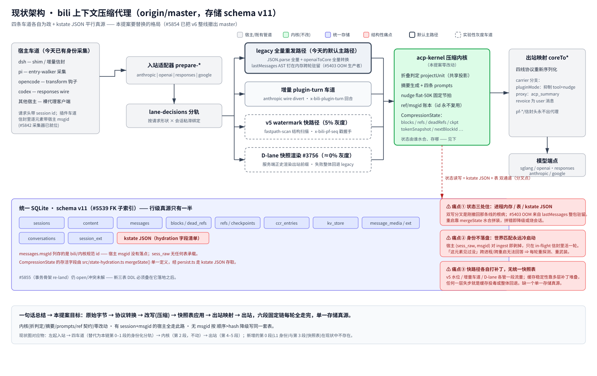
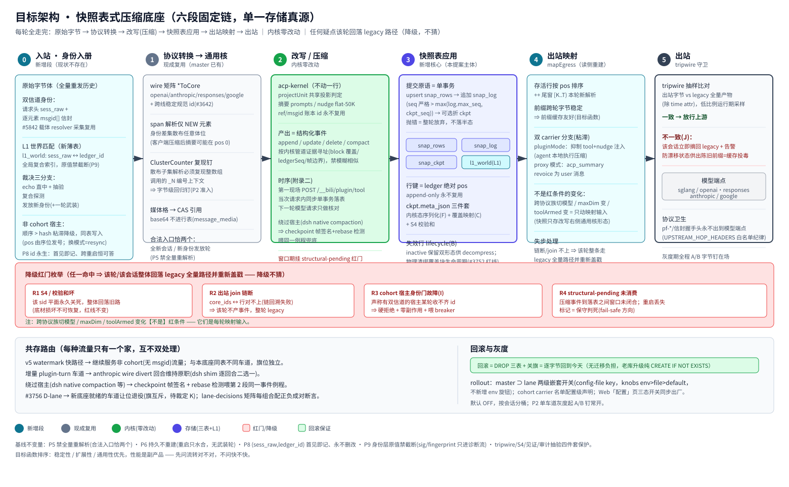
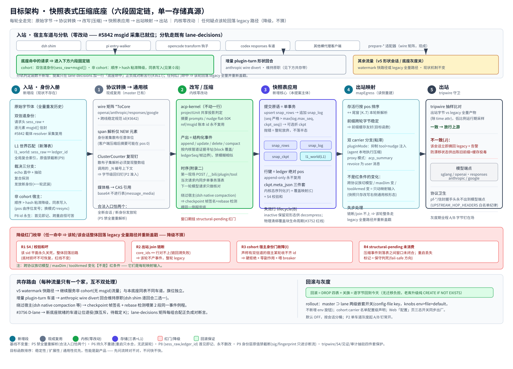
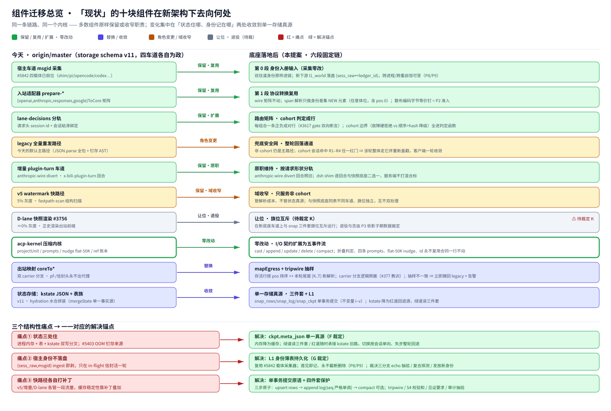

# 提案：快照表式压缩底座（六段固定链，单一存储真源）

> **状态：P0 + P1 + P2 已在 [#5901](https://github.com/ranxianglei/billion-context/pull/5901) 实现**（schema v12；影子写 soak；P2 = mapEgress 带 tripwire 保护的出站切换，soak 期间随 `ci:full` + 本地 gate 以 100% 运行，发版前与其他 soak 旗一样改回先关后发）。P2-final 按提案原序落地六段链：快照写入（事件→表）在**请求内**完成 —— 内核改写之后、出站改写之前，平面在响应发出前即可读，本轮自身重发的尾窗为空。
> 2026-11-07 作为设计提案撰写；本文件是已落地实现的设计记录。
> **基线：** origin/master（写于 2026-11-07；存储 schema v11，#5854 已把 v6 整线撤出 master）。
> **来源讨论：** [#5643](https://github.com/ranxianglei/billion-context/issues/5643)（含定位纠正评论）。
> **姊妹文档：** [English version](./README.md)。

---

## 0. 摘要（TL;DR）

本提案把上下文压缩的状态底座从「进程内存 + kstate JSON + 多张表」的平行真源格局，换成**一套快照表作为唯一存储真源**。每轮请求固定走完同一条链：

**原始字节 → 协议转换(通用核) → 改写(压缩) → 快照表应用 → 出站映射 → 出站**

压缩内核（折判定、摘要、prompts、ref/msgid 契约）**零改动**。有宿主 session+msgid 双信道的会话全部走新链路；没有 msgid 的宿主按「顺序 > hash」降级身份写同一套表。任何环节失步，该轮整体回落今天的 legacy 全量路径（降级，不猜）。回滚 = DROP 四张新表 + 关旗，逐字节回到今天。

目标函数排序不变：**稳定性 / 扩展性 / 通用性优先，性能是副产品**——先问流转对不对，不问快不快。

---

## 1. 背景与定位

### 1.1 来龙去脉

- **#5643** 最初是「快进水位 v6」实现契约：用 `(sess_raw, msgid)` 复合身份给插件车道做增量快路。
- 整条 v6 线（快路径 + render snapshot 平面）经 **[#5854](https://github.com/ranxianglei/billion-context/pull/5854)** 完整撤出 master（干净 revert）。
- 撤回后的定位纠正（#5643 评论区，2026-11-07）把方向定死了：这条线**不是增量车道，也不是 v5 watermark 的续作**，而是**基于快照表的压缩底座**——以新存储为主，内核不动，让「改什么、存什么、渲染什么」全部由一条固定链决定。
- [#5855](https://github.com/ranxianglei/billion-context/pull/5855)（事务骨架 re-land）是本线的**工程基底**，不是终态。截至本提案写作时它仍 open（冲突未解）——这是本提案的第一时序依赖。

### 1.2 这条线不是什么（防止再次漂移）

| 容易误认的方向 | 为什么不是 |
|---|---|
| 增量车道（plugin-turn divert） | 那条是「只传新增 delta」的请求形状优化；本提案每轮仍收全量重发，只是服务端不再对全量做无差别解析/存储 |
| v5 watermark 快路径的续作 | v5 解决的是「解析成本」（戳握手 + 尾窗解析）；本提案解决的是「状态真源」，v5 继续服务非 cohort 流量 |
| 换内核/改折叠算法 | 内核零改动是硬约束；折叠判定、摘要、节拍、id 契约原样保留 |
| 「快一点」的性能特性 | 性能收益（前缀缓存稳定、内存下降）是流转正确的副产品，不作为设计判据 |

### 1.3 保留的基准裁定（继承自 #5643 正文，全文有效）

目标函数排序、固定链、两处校验点（内核内部状态 + 改写后核形态）、行键 append-only、diff 只按内核管道证据寻址（禁模糊相似）、四件套保护（tripwire / S4 逐行校验和 / 见证要求 / 审计抽验）、客户端压缩纯忽略、P5–P9 五组不变量，全部沿用，不在本文重复展开；与本文冲突处以本节为准并在裁定表（§14）显式登记。

---

## 2. 现状架构与三个结构性问题

（位图备选：[arch-current.png](./assets/arch-current.png)）

今天的一条模型请求从入站到出站要经过：`prepare-*` 适配器 → `lane-decisions` 分轨（legacy 全量 / 增量 plugin-turn / v5 watermark 5%灰度 / D-lane 快照渲染 ≈0%灰度）→ 内核 → `coreTo*` 出站映射。状态住在三个地方：进程内存（lastMessages AST、常驻核数组）、统一 SQLite v11 表族、kstate JSON（经 `mergeState()` 水合）。三个结构性问题：

1. **状态三处住（痛点①）**——kstate JSON 与表是双通道分叉点；#5403 OOM 的直接生产者就是 lastMessages 整包驻留；重启靠水合拼装，拼错即降级或烧会话。刚被撤回的那条线的根病正是这种平行真源。
2. **身份不落盘（痛点②）**——宿主的 `(sess_raw, msgid)` 对在 ingest 时剥掉，只活在 in-flight 信封里一轮。`messages.msgId` 列存的是 bili/内核自己的规范 id，宿主的原始身份没有任何表承载。「这个元素见过没？」跨进程、跨重启无法回答（P8 要求恒可答），于是每轮都冷启动重新探测。
3. **快路径各自打补丁（痛点③）**——v5 / 增量车道 / D-lane 各管一段流量，缓存稳定性靠多层补丁堆叠；任何一层失步就是缓存投毒或整体回退。没有一个单一存储真源兜底。

---

## 3. 目标架构总览

全貌与 §2 现状架构图**逐位对齐**，直接对照即可看出改的是全局哪一块、影响范围多大（灰 = 零改动 · 青 = 新增段/表 · 琥珀 = 角色变更 · 红虚线 = 兜底安全网）：

（位图备选：[arch-target.png](./assets/arch-target.png)）

六段固定链自身的内部流转 —— **分阶段展开**（提交原语 / DDL chip / 降级红门 R1–R4 / 共存路由与回滚灰度）：

（位图备选：[arch-stages.png](./assets/arch-stages.png)）

现状图里的每一块在新架构下变成什么样子 —— **组件迁移总览**（底部为三个结构性痛点的一一对应解决锚点）：

（位图备选：[arch-migration.png](./assets/arch-migration.png)）

六个阶段的职责一句话版：

| # | 阶段 | 一句话 | 状态 |
|---|------|--------|------|
| 0 | 入站·身份入册 | 双信道身份 + L1 世界匹配，决定这轮每行的出身 | **新增** |
| 1 | 协议转换→通用核 | wire 矩阵现成复用；只对身份差集 NEW 元素做 span 解析 | 现成 + 一个新回归钉 |
| 2 | 改写/压缩 | 内核一行不改，产出结构化事件；落表时序按附录二 | 内核零改动 |
| 3 | 快照表应用 | 单事务提交原语写入 snap 三件套(rows/log/ckpt)；ckpt meta 携带内核态+覆盖映射+S4 | **新增核心** |
| 4 | 出站映射 | 存活行按 pos 排序 ++ 尾窗新解析；双 carrier 分支 | 读侧重建 |
| 5 | 出站 | tripwire 抽样比对后放行上游 | 守卫强化 |

横切两条：**红门降级带**（§7，任何疑点回落 legacy）与**共存路由**（§8，每种流量只有一个家）。

---

## 4. 六段固定链逐段设计

### 4.0 第 0 段：入站 · 身份入册（现状中不存在的一段）

**输入**：原始字节体 + 双信道身份——请求头里的 `sess_raw`（宿主会话 id 原值）+ 逐元素 `msgid[]` 信封。**采集直接消费 [#5842](https://github.com/ranxianglei/billion-context/pull/5842) 已合入的载体 resolver 输出**（shim / pi entry-walker / opencode transform 钩子 / codex / cc / gemini 六候选载体），不建第二套采集系统。

**世界匹配裁决**（顺序执行，第一个命中即止）：

1. **echo 直中 + 抽验**：宿主回带的 id 列表与服务端正史逐位吻合，抽样见证核对通过后直接采用；
2. **复合探测**：`(sess_raw, msgid)` 在 L1 表中探测命中 ⇒ 沿用既有账本身份；
3. **发放新身份**：都没命中 ⇒ 发放新账本 id 并记入 L1，付一轮武装（本轮该元素只进不入缓存决策）。

**cohort vs 降级的边界**（裁定 I，见 §14）：声称具备双信道的 cohort 宿主某轮收不齐 id = 故障，硬拒绝 + 零副作用 + 喂 breaker（baseline §3.2 原样）；天生没有 msgid 的非 cohort 宿主走「顺序 > hash」粘滞降级通道，写同一套表（pos 由序位发号）；模式每会话粘滞，中途换模式 = 一次显式 resync，禁止静默混用。

**L1 表**（G 裁定的承载体）：`l1_world(sess_raw PK, ledger_id, …)`，全局可跨重启查询；原值禁截断（P9），sig/fingerprint 只进 warn 诊断流永不入判决（P8/P9）。

### 4.1 第 1 段：协议转换 → 通用核（现成复用）

- wire 矩阵 `{openai,anthropic,responses,google}ToCore ↔ coreToX` 与跨线稳定规范 id（#3642）均在 master，零重建。
- **span 解析**：只对第 0 段判定的 NEW 元素集合做解析——它们可以散布在 body 任意体位（客户端压缩后摘要可能出现在 pos 0）。这是一个脏实现点：codec 的 ClusterCounter 按单次调用内次序编号 `_N`，解析散布子集必须复现「整数组调用」的编号上下文，否则出站字节漂移 = 前缀缓存碎掉。**散布子集编码的字节级回归钉是 P2 准入条件**（连续尾切片情形 v5 已证可行，散布子集是新情形）。
- 媒体格（图片等）走既有 content CAS + `message_media` 引用，base64 不进行表。
- P5：合法入口恰两个（全新会话 / 新身份发放轮），其余轮次禁止全量重解析。

### 4.2 第 2 段：改写 / 压缩（内核零改动）

acp-kernel 保持一行不改：折叠判定（projectUnit 共享投影）、四条 prompts、nudge flat-50K 节拍、ref/msgid 永不复用契约。它对外的输出在本设计中定义为**结构化事件流**：

```
cast     首次铸入行（新会话首载）
append   新增行（新回合尾部）
update   行内形态变更（如 tool result 回填）
delete   覆盖/失效（active=0，不物理删）
compact  折叠压实（块吸收覆盖段，meta 更新覆盖映射）
```

事件寻址规则沿用 baseline：**只按内核管道证据**（block 覆盖区间 / ledgerSeq / 帧边界）定位受影响行，禁止任何模糊相似匹配；对不上 ⇒ 该轮不产事件、整轮走 legacy（§8 R2）。

**落表时序（以 #5643 附录二为准）**：第一现场 = 插件端点 `POST /__bili/plugin/tool`（src/server/admin.ts:797）在**当次请求内同步单事务**完成事件→表修改；下一轮模型请求只做核对。绕过端点的宿主（dsh native compaction 一类）由 checkpoint 帧签名 + rebase 检测喂**同一个**表修改例程兜底。端点到落表之间平面挂 `structural-pending` 标记；进程重启丢失标记 = 保守判死（fail-safe 方向，§8 R4）。

### 4.3 第 3 段：快照表应用（本提案主体）

**提交原语 = 单事务**，内含三步：

```
upsert snap_rows（按证据寻址的行）
  → 追加 snap_log（seq 严格 > max(log.max_seq, ckpt_seq)）
    → （可选）折 snap_ckpt（吸收 log 载荷，更新 meta）
任一步抛错 ⇒ 整轮放弃，不留半态（不变量 i）
```

**不变量表**（草案 v0.1 起、review 补强后沿用）：

| # | 不变量 |
|---|--------|
| i | 单会话单写者：所有表修改只经这一个提交原语 |
| ii | log.seq 严格单调：> max(log.max_seq, ckpt_seq)，跨压实不断号 |
| iii | S4：逐行校验和不符 ⇒ 该 sid 平面永久关死，整体回落旧路（红线不变） |
| iv | 行不物理删除：折叠只翻 active，pre/post 双形态保留供 decompress |
| v | post_json 恒为「改写层右侧的通用核形态」——缓存永远不允许 wire 字节 |

**ckpt.meta_json 三件套**（F+C 裁定的合流）：① 内核会话态（CompressionState：blocks/refs/deadRefs/nudge/tokenSnapshot/…）序列化 + 自身校验和——内核没有确定性「事件流→状态」重建入口，序列化随 checkpoint 走是唯一既零改内核又满足 P7（内存只是缓存）的方案；② **覆盖映射**（摘要 pos → 被覆盖 pos 区间）——delete/compact 载荷会被 ckpt 吸收，压实之后 decompress/GC 的唯一依据就是这份显式映射；③ S4 聚合校验和。

**失效行生命周期**（B 裁定建议）：inactive 行保留至其覆盖块本身被归档/删除时一并物理清理；反对永不物理清（#3752 单调无界增长是 p1 红线）也反对全局 TTL（GC 窗口和解引用窗口不用额外对齐证明）。

### 4.4 第 4 段：出站映射

`mapEgress` = 存活行按 pos 排序取核 ++ 尾窗 `[K..T)` 本轮新解析的核，再过 `coreToX` 到目标协议族。前缀跨轮字节稳定 ⇒ 前缀缓存友好（这就是目标函数，不是巧合而是结构保证）。

- **双 carrier 分支**（会话粘滞绑定，两模式必须同时想清——本仓库惯犯病类 #377）：pluginMode 抑制 tool+nudge 注入（agent 本地执行压缩）；proxy 模式 acp_summary revoice 为 user 消息（systemToUser，保护头部 system 逐字稳定）。
- **透明变化**（不是红条件）：跨协议族切模型、maxDim 变、toolArmed 变——都只动映射输入。因为快照只存改写右侧的通用核形态，族切换天然透明。
- 失步处理：join 链断 / 对不上 ⇒ 该轮整条 legacy 全量路径并重新盖戳（客户端一轮收敛）。

### 4.5 第 5 段：出站

**tripwire 运行期形态**（J 裁定建议）：低比例抽样把出站字节与 legacy 全量路径产物逐字比对（除 time attr）。一致放行；不一致 ⇒ 该会话立即摘回 legacy + 告警。最终护栏防的是「漂移状态下供出陈旧前缀 = 缓存投毒」。

**协议卫生**：pf-* / 信封类握手头是协议头不是 hop 头，转发上游前剥掉（UPSTREAM_HOP_HEADERS 白名单纪律）；本提案引入的任何新握手头同样进白名单管理。灰度期全程 A/B 字节钉在场。

---

## 5. 存储 schema（最终 DDL 已在 #5901 落地为 schema v12）

版本叠加规则：因 #5855 当时仍 open，#5901 在 v11 master 上直接把本 DDL 落为 schema **v12**（`src/storage/schema.ts` 的 `SNAPBASE_DDL_V12`）；若 #5855 先落地，则由后落地者机械重编号（同一份 DDL，版本号 +1）。老库升级纯 `CREATE ... IF NOT EXISTS` 加性变更，无数据迁移。逐表读写地图（中/英）：[storage-relations.zh.svg](../../storage-relations.zh.svg) / [storage-relations.en.svg](../../storage-relations.en.svg)。DDL（P0 落地的最终列型）：

```sql
-- L1 身份薄表（裁定 G 的承载体；baseline §4.1.1 的两列恢复为独立表）
CREATE TABLE IF NOT EXISTS l1_world(
  sess_raw      TEXT    NOT NULL,         -- 宿主会话 id 原值，禁截断(P9)
  ledger_id     TEXT    NOT NULL,         -- bili 规范 sid（沿用现有键空间，裁定 D）
  witness_probe TEXT,                     -- echo 抽验见证样本（仅诊断流）
  issued_at     INTEGER NOT NULL,
  armed_at      INTEGER,                  -- 新身份发放的武装轮标记
  PRIMARY KEY (sess_raw)
);
CREATE INDEX IF NOT EXISTS idx_l1_ledger ON l1_world(ledger_id);

-- 行表：正史本体
CREATE TABLE IF NOT EXISTS snap_rows(
  sid         TEXT    NOT NULL,
  pos         INTEGER NOT NULL,           -- ledger 绝对位置，append-only 永不复用
  core_ids    TEXT    NOT NULL,           -- 通用核元素 id 序列(json text)
  pre_json    TEXT,                       -- 改写前形态引用(CAS digest)，裁定 A② 默认引用不内嵌
  post_json   TEXT    NOT NULL,           -- 改写后通用核形态（唯一允许被缓存的形态）
  tokens_est  INTEGER,                    -- 估算 token（裁定 L：判决面增长数据源 + 计费共用）
  active      INTEGER NOT NULL DEFAULT 1, -- 0=被覆盖/失效（保留供 decompress，生命周期见 §4.3）
  cover_ref   TEXT,                       -- 覆盖它的摘要块 id（物理清理的生命周期锚）
  updated_at  INTEGER NOT NULL,
  PRIMARY KEY (sid, pos)
);

-- 事件日志（LSM log 层）
CREATE TABLE IF NOT EXISTS snap_log(
  sid        TEXT    NOT NULL,
  seq        INTEGER NOT NULL,            -- 严格 > max(log.max_seq, ckpt_seq)
  kind       TEXT    NOT NULL,            -- cast|append|update|delete|compact
  payload    TEXT    NOT NULL,
  created_at INTEGER NOT NULL,
  PRIMARY KEY (sid, seq)
);

-- 检查点（LSM meta 层；吸收 log 载荷并显式保留覆盖映射）
CREATE TABLE IF NOT EXISTS snap_ckpt(
  sid        TEXT    NOT NULL PRIMARY KEY,
  ckpt_seq   INTEGER NOT NULL,
  meta_json  TEXT    NOT NULL,            -- 内核态序列化 + 覆盖映射 + 自身校验和
  checksum   TEXT    NOT NULL,            -- S4 聚合校验和
  updated_at INTEGER NOT NULL
);
```

**写模型假设**（H 裁定项）：默认单进程假设（WAL 天然串行化跨进程写）；若要多实例并发写，需附内存视图失效协议（常驻核数组/元数据缓存谁作废谁通知）——P0 契约里二选一钉死。

---

## 6. 读路径与消费方切换台账

**hydrate 双道**：绿道（新表可读且 S4 通过）从 snap_rows+meta 重建读视图；红道（开关关 / 无活跃块 / 表不可读 / 校验失败）原样走 kstate 旧路承接。切换按会话粒度、单向渐进，任何一道失步整轮回退 legacy——与 D-lane #3756 同纪律。

消费方逐个标注（P0 列全清单，此处为主干）：

| 消费方 | 处置 |
|--------|------|
| decompress（restore/decompress 工具路径） | P3 切到新表 pre/post 双形态 + 覆盖映射；pre 字节缺失时必须走审计显式诊断出口，不得静默空引用 |
| export | P3 切换；诚实输出纪律不变（#155：0-block 会话不许谎称「原始对话」） |
| 计费 | tokens_est 列共用；切读源不改变计费口径 |
| Web UI（sessions 面板 / acp_status uncompressed view） | acp_status 判决面（KDD#12 共享投影）输入源指到新表；面板新增表健康度指标（§11） |
| kv_store namespaces / notice store / persona fork（`\|sub:<fp>`） | 不触碰（独立机制，fork 记录自己后缀 id 进同一车道即可） |
| CCR（ccr_entries） | P0–P2 不碰；P3 单独评估是否并入或长期并存 |

---

## 7. 降级红门枚举（命中任一 ⇒ 该轮/该会话整体回落 legacy 全量路径并重新盖戳）

| # | 红条件 | 后果 |
|---|--------|------|
| R1 | S4 / 校验和坏 | 该 sid 平面**永久关死**，整体回落旧路（底材损坏不可恢复，红线不变） |
| R2 | 出站 join 链断（core_ids ↔ 行对不上，链回溯失败） | 该轮不产事件，整轮 legacy |
| R3 | cohort 宿主身份门故障（收不齐双信道 id） | 硬拒绝 + 零副作用 + 喂 breaker（baseline §3.2 原样） |
| R4 | structural-pending 未消费（含重启丢失标记） | 保守判死（fail-safe 方向） |

**不是红条件的**：跨协议族切模型、maxDim 变化、toolArmed 变化、客户端压缩痕迹（纯忽略，只看增量）。把这组边界写成判定函数放进 lane-decisions 矩阵，每种组合正负成对断言（#3617 纪律）。

---

## 8. 与既有车道的共存路由（每种流量只有一个家）

| 流量 | 归属 | 说明 |
|------|------|------|
| cohort 宿主（有双信道）全量重发会话 | **新底座** | 本提案服务的主对象 |
| 非 cohort（无 msgid）流量 | v5 watermark 快路径继续服务 | 与本底座同表不同车道，旗位独立；「顺序>hash」降级写入走同一套表 |
| anthropic wire divert 回合 | 增量 plugin-turn 车道维持原职 | dsh shim 逐回合二选一，互不双处理 |
| dsh native compaction 等绕过端点的宿主 | 第 2 段同一事件例程（checkpoint 帧签名 + rebase 检测喂入） | 见 §4.2 时序 |
| #3756 D-lane | 新底座就绪的车道**让位退役**（旗互斥） | 待裁定 K；退役判断放在 P3 |

lane-decisions 矩阵：每个组合一行，正负成对（触发时触发、不该触发时不触发），新增行可追溯。

---

## 9. Rollout 与配置面（owner-gated，key 已在 #5901 定稿）

- **两级嵌套开关**：master 旗 ⊃ lane 旗（lane 旗只在 master 开时有意义），config-file key 经 `src/knobs.ts`（env > file > default）解析；**不新增 env 旋钮**（env 稀缺面纪律 #2030）。落地 key：config-file `storage.snapBase.enabled`（master 旗）/ `storage.snapBase.shadowWrite`（lane 旗，master ⊃ lane），见[配置文档](../../configuration.zh-CN.md)。
- **cohort 名单**：配置级声明（哪些 carrier/宿主声称具备双信道），初值待定（遗留 D4：shim/pi/opencode/codex/cc/gemini 六候选逐个核实）。
- **Web「配置」页**三态快速开关同步出厂；i18n en/zh 对；registry-test 死键守护行；website/config-reference yaml 种子（若 ship 旋钮）。
- 默认 OFF，按会话分桶（announcement-id 盐值桶之外的独立桶），P2 单车道灰度起步。（#5901 soak 现状：影子写默认 100% 打开，跑 `ci:full` + 本地 gate 真实流量；发布版出厂前翻回 OFF。）

---

## 10. 观测面

- **决策日志**：统一词汇表（hit / miss / red:<R编号> / degrade / resync / arm …），每行可 grep 可聚合；rollout 期间就是信心证据。
- **`/__bili/status`**：attribution 字段扩展新底座维度（哪条链路在服务本会话、平面健康）。
- **面板健康度**：snap 表行数 / log 深度 / ckpt lag（seq 落后量）/ GC 水位 / tripwire 抽验命中率，进 sessions 面板或独立小卡。
- **acp_status uncompressed view**：判决输入源指到新表行（KDD#12 共享投影的 apply/recommend/status 三方一致性在新表上重新钉测试）。

---

## 11. 测试矩阵

分期测试骨架（正负成对原则全程适用）：

| # | 测试 | 期 |
|---|------|----|
| T1 | 升级纯加性钉：老库升级前后既有查询行为逐字节不变；DROP 四张新表回滚演练 = 逐字节回到今天 | P0 |
| T2 | 事件事务单元：提交原语单事务原子性；seq 单调跨压实不断号；抛错无半态 | P0 |
| T3 | B1 陷阱钉 ×3 连续重启 oracle 比对（水合快照必须携带活跃世界原点 o；frontier 只能由 arm/reset 移动） | P1 |
| T4 | A/B 字节级：N 回合真实语料下新链路出站字节 == legacy 全量产物（除 time attr） | P1–P3 常开 |
| T5 | 散布 NEW 编码字节一致钉（ClusterCounter 复现） | P2 准入 |
| T6 | deleteSession 级联连删（含 l1_world）无孤儿 | P0/P1 |
| T7 | 覆盖映射压实时存活：compact 后 decompress/GC 依据仍可查 | P1 |
| T8 | GC 后 decompress 的诚实失败出口（pre 缺失 ≠ 静默空引用） | P3 |
| T9 | 长会话体量增长曲线模型（行数/log 深度/ckpt 尺寸，对照 #3752 红线）长跑验收 | P1 |
| T10 | 红门矩阵：R1–R4 各配「触发时回落」+「不该触发时不回落」成对行 | 各期随对应模块 |
| T11 | 真实客户端 e2e（pi / dsh × sglang）全链路 | P2 准入 |
| T12 | 双模式（pluginMode/proxyMode）carrier 分支双验证（§4.4） | P2 |

CI：docker gate + 求解器无关；hermetic，端口 listen(0)（#360 纪律）。

---

## 12. 分期交付（每期为独立 PR，人审关卡标出）

| 期 | 范围 | 行为面 | 验收 |
|----|------|--------|------|
| **P0** | DDL 四件套 + 提交原语 + 升级钉 + 回滚演练 + 事件事务单元测试 | **零行为变化**（纯铺底） | T1/T2/T6；写模型假设(H)与 key 命名(config-surface 章)在此期定稿——人审点① |
| **P1** | 影子写：新表与旧路并行落数据，读侧完全不切 | 零行为面 | T3/T4(影子比对)/T7/T9 长跑曲线；体量模型过红线检查——人审点②（信任重建关键期） |
| **P2** | 单车道 hydrate-egress 切源灰度（cohort 首个成员，建议 pi 或 dsh 之一） | 灰度会话读出站来自新表 | T5/T10/T11/T12 + A/B 钉常开 + tripwire 抽样在场；exit switch 一键回退 |
| **P3** | decompress/export/UI/计费逐一切换；CCR/persona 处置；#3756 退役判断；cohort 名单扩员 | 消费方逐个切换 | T8 + 全矩阵复跑；每期独立 PR |

**E 裁定的 P2 部分被 owner 推翻**：owner 要求单 PR 完成（#5901 现承载 P0+P1+P2）。P2 落地为 `mapEgress`（[src/server/snap-egress.ts](../../../src/server/snap-egress.ts)）：每个出站轮先拼平面视图（锚点 + 存活行 + 客户端尾窗，缝合与 #3756 同法），重放本车道后处理链，归一化完全一致才切出站字节（tripwire 逐轮全量比对 —— 比提案的抽样更严）；任何不一致保留旧字节，同会话累计 3 次不一致粘性排除。cohort = 协议车道（`storage.snapBase.egressCohorts`，默认四条全开），见[配置文档](../../configuration.zh-CN.md)。

---

## 13. 前置依赖与时序

1. **#5855 先合并**（人合）：它是事务骨架的工程基底，也是 schema 版本的垫层。它 open/dirty 一天，P0 的 DDL 就没法干净地叠版本。（2026-11-08 现实：#5901 未等它——P0 DDL 在 v11 master 上直接落 v12；若 #5855 之后合并，由后落地者机械重编号，DDL 不动。）
2. #5842（身份采集）✓ 已在 master —— 第 0 段直接复用，无需等待。
3. #5854（撤回）✓ 已 merged —— 确认 v6 符号零残留于 master。
4. 裁定闭环（§14）：F/G/B 三项决定表结构骨架，先行拍板；其余随 P0 PR 一并裁。

---

## 14. 待 owner 裁定汇总

已在线讨过的（A–E，沿用草案 v0.1 编号）+ 缺口分析新增（F–L）+ 遗留（D3–D5）：

| # | 事项 | 倾向 | 阻塞什么 |
|---|------|------|----------|
| A | 行内形态 | ② 只存 post，pre 引用既有 CAS；附加：被存活行引用的 pre 字节活得比该行久 | P0 DDL |
| **B** | 失效行保留策略 | 绑定覆盖块生命周期的压实清理；反对永不清（#3752 红线）与全局 TTL | P0 DDL/GC 设计 |
| C | 摘要落位 | ① 就地占覆盖段首 pos + ckpt meta 显式保留覆盖映射 | P0 DDL |
| D | 会话键空间 | 沿用现有 sid | P0 DDL |
| E | 本期范围 | P0+P1 收手交验收，P2 另开 PR 灰度 | 排期 |
| **F** | 内核状态居所 | ckpt.meta_json 携带 CompressionState 序列化 + 校验和（内核零改动、水合 O(1)） | P0/P1 核心 |
| **G** | L1 身份薄表 | 恢复 baseline §4.1.1 的 (sess_raw, ledger_id) 持久化（独立薄表 + 索引），复用 #5842 采集 | P0 DDL |
| **H** | 写模型 | 单进程假设（WAL 串行化）or 多进程 + 内存视图失效协议，P0 二选一定稿 | P0 |
| **I** | 硬门 vs 降级边界 | cohort 声称宿主故障拒绝 + 零副作用 + breaker；非 cohort 走顺序>hash 同表降级、会话粘滞、换模式=resync | P0/P2 路由 |
| **J** | tripwire | 运行期低比例抽样 + 不匹配即摘回 legacy + 告警 | P2 |
| **K** | 与 #3756 / v5 共存 | 新底座车道上 #3756 让位退役（旗互斥）；v5 继续服务非 cohort | P2/P3 |
| **L** | 行内 token 计账列 | tokens_est 入表：判决面增长数据源 + 计费共用 | P0 DDL |
| D3 | 故障响应形态 | HTTP 码 / 错误体 / 客户端重试约定（R3 硬拒绝的对端视角） | P2 |
| D4 | cohort 初始名单 | shim/pi/opencode/codex/cc/gemini 六候选逐个核实载体稳定性 | P0 配置初值 |
| D5 | 重编号语义 | 内容同 id 异：判新增双份 or 对级去重 | P0 语义 |

---

## 15. 风险与诚实边界

- **「保元素数的前缀字节改写不可检测」**（继承 baseline 代价条款）：代价就是跳过逐条复核的信任模型变化——需人工评审把关，不得自动合并（KDD §7.4 同类门槛）。
- **多模态尾部进入缓存后该段历史永久降级 legacy 全量轮**（继承 KDD#15 诚实边界②）：宁降级不偏离。
- **marker-strip 计数随种子账本继承**，中部区从不重扫（同上③）。
- 本提案所有「不变量」的最终裁判是运行期 tripwire + S4 抽验，不是纸面论证——所以 P1 影子期存在意义就是攒这份实证。

---

## 16. 参考号速查

#5643（本线起源+定位纠正）· #5854（整线撤回，merged）· #5855（工程基底 re-land，open）· #5842（身份采集 wiring，merged）· #3756（D-lane 快照渲染，将被 K 裁定处置）· #3752（存储无界增长 p1 红线）· #5403（OOM：lastMessages 驻留）· #2432（客户端压缩死螺旋，纯忽略策略的来源）· #3236（共享投影判据）· #3642（跨线稳定规范 id）· #3617（gate 双向断言）· #1104/#1106/#1107（fingerprint 白名单纪律）· #4491/#4834（msgid 身份层级）· #5539（schema v11 FK 子索引）· #155（诚实输出）· #360（listen(0) 端口纪律）· MESSAGE-IDENTITY.md（身份教义）· #5643 定位纠正评论：<https://github.com/ranxianglei/billion-context/issues/5643#issuecomment-6703186445>
